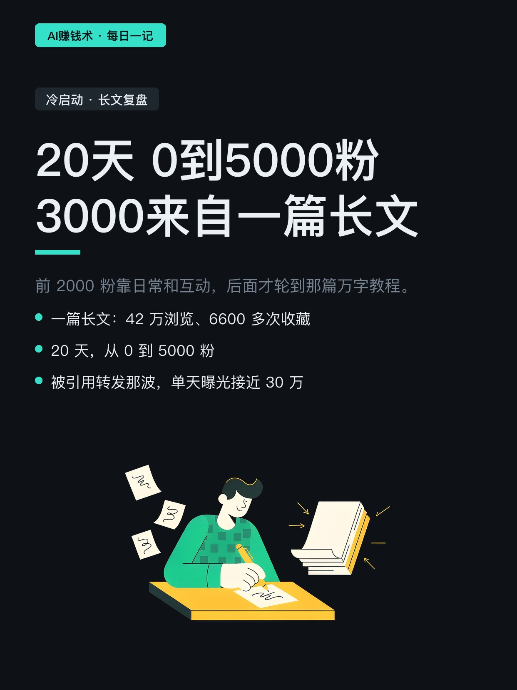
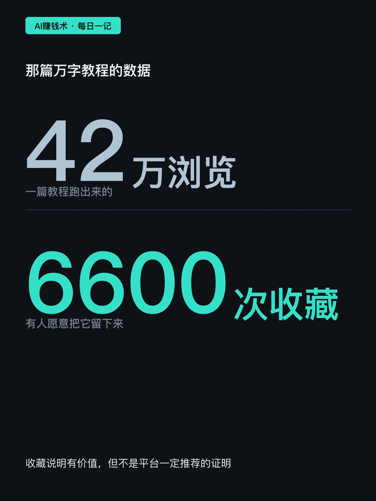
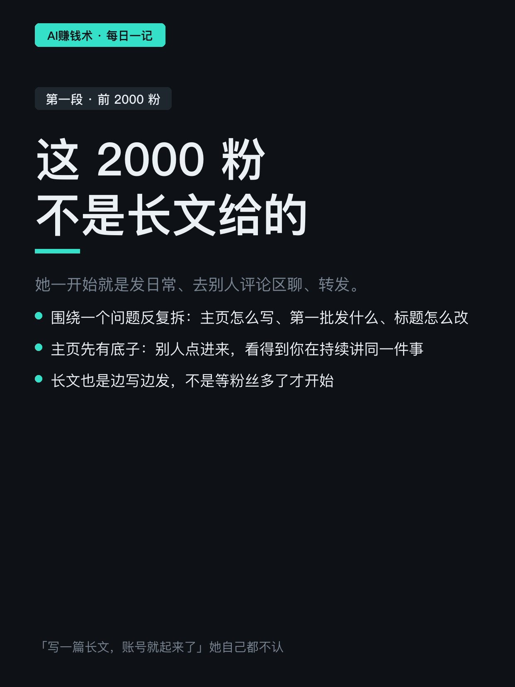
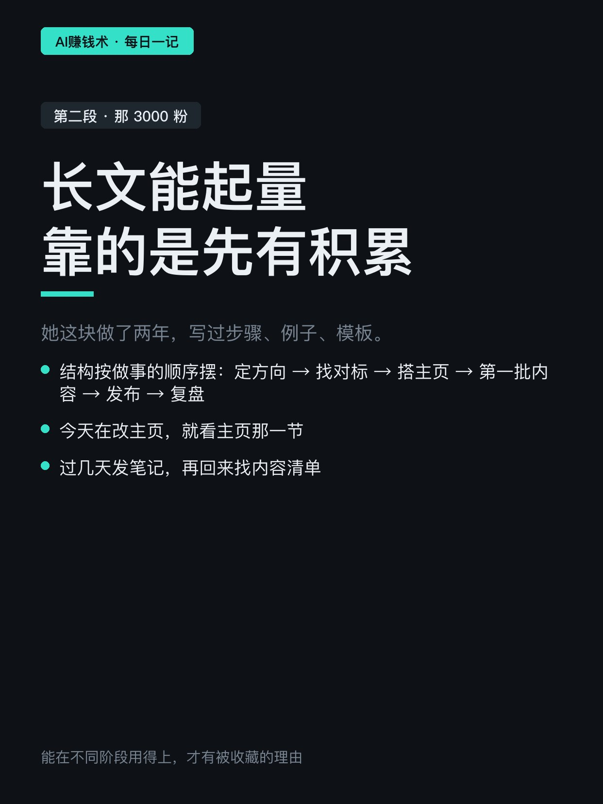
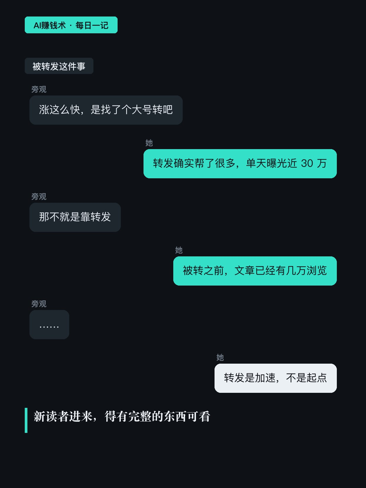
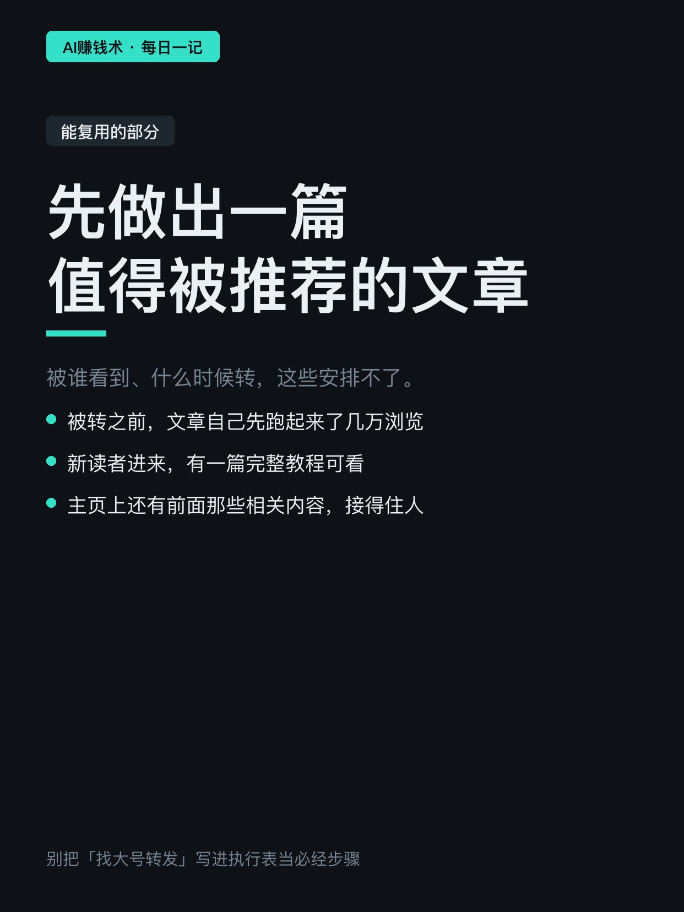
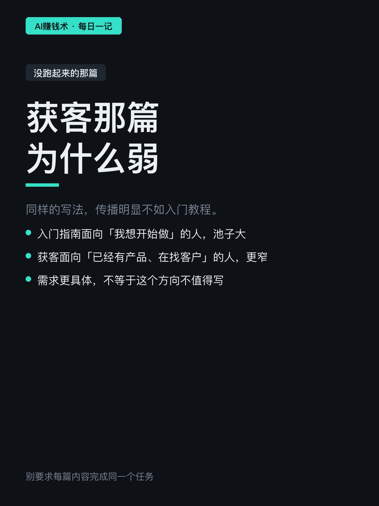
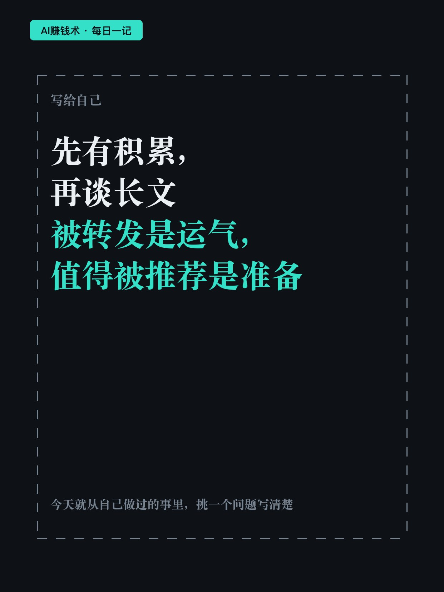

# 20天0到5000粉，一篇长文涨3000

> — · 2026-10-31 19:14 发布 · AI 赚钱内容

## 标题（可直接复制）

```
20天0到5000粉，一篇长文涨3000
```

## 正文（可直接复制发布）

20 天，从 0 到 5000 粉。其中 3000 粉，来自一篇长文。😮

这是她 10 月初开始的复盘。她把过程拆成两段讲：前面 2000 粉，和后面那 3000 粉。我觉得这个拆法比结果本身更值得看。

① 前 2000 粉，不是长文给的

一开始她做的就是发日常、去别人评论区聊、转发。围绕一件事一个个拆具体问题：主页怎么写、第一批笔记发什么、标题怎么改。

这些先让主页攒下了底子。别人点进来，至少能看到你在持续讲同一件事，也能找到不止一篇相关内容，不是只有一条孤零零的爆款。

长文也是边写边发，不是等粉丝多了才开始。所以「写一篇长文，账号就起来了」这个说法，她自己都不认。

② 长文能起量，靠的是先有积累

那篇万字教程：42 万浏览、6600 多次收藏，一篇涨了 3000 粉。

两个原因。一是她这块做了两年，写过步骤、例子、模板，不是通用话；二是结构按做事的顺序摆——先定方向，再找对标、搭主页、安排第一批内容，然后才是发布和复盘。

连标题都在做同一件事。「分享一点运营经验」和「从 0 到 1，入门运营详细指南」，后者把对象和范围说清楚了，准备开始做的人一眼知道跟自己有关。

读者今天在改主页，就先看主页那一节；过几天开始发笔记，再回来找内容清单。一篇文章能在不同阶段用得上，才有被收藏的理由。

她也提醒了一句：收藏说明有人想留下，但不能反推「收藏到某个比例，平台就一定推」。

③ 被大号转发之前，文章已经有几万浏览

这段她写得很实在：被引用转发那一下，单天曝光接近 30 万，确实帮了很多。

但转发不是起点。被转之前，文章已经有几万浏览；新读者进来，有一篇完整教程可看，个人页上还有前面那些相关内容，接得住人。

能复用的是「先做出一篇别人看完有理由推荐给朋友的文章」。被谁看到、什么时候转，这些安排不了，也别写进执行表当成必经步骤。

她还提了没跑起来的那篇：获客。面对的是已经有产品、正在找客户的人，需求更具体，愿意点进来的人也更少。这不说明方向不值得写，只是覆盖的人群不一样。

如果要我带走一句：不要要求每篇内容都完成同一个任务。

你现在缺的是哪一步——没积累（不知道该写什么）、写不深（只有方向没有步骤）、还是写完没人看（缺一个被推荐的入口）？评论区说一句，我按顺序回。

## 话题标签

#自媒体 #内容创作 #冷启动 #个人IP #AI赚钱术日记

## 配图（8 张）










## 发布信息

| 项 | 值 |
|---|---|
| 平台 | 小红书 |
| 期数 | — |
| 发布时间 | 2026-10-31 19:14 |
| 正文长度 | 959 字 |
| 图片数量 | 8 张 |
| 状态 | 已发布 |
