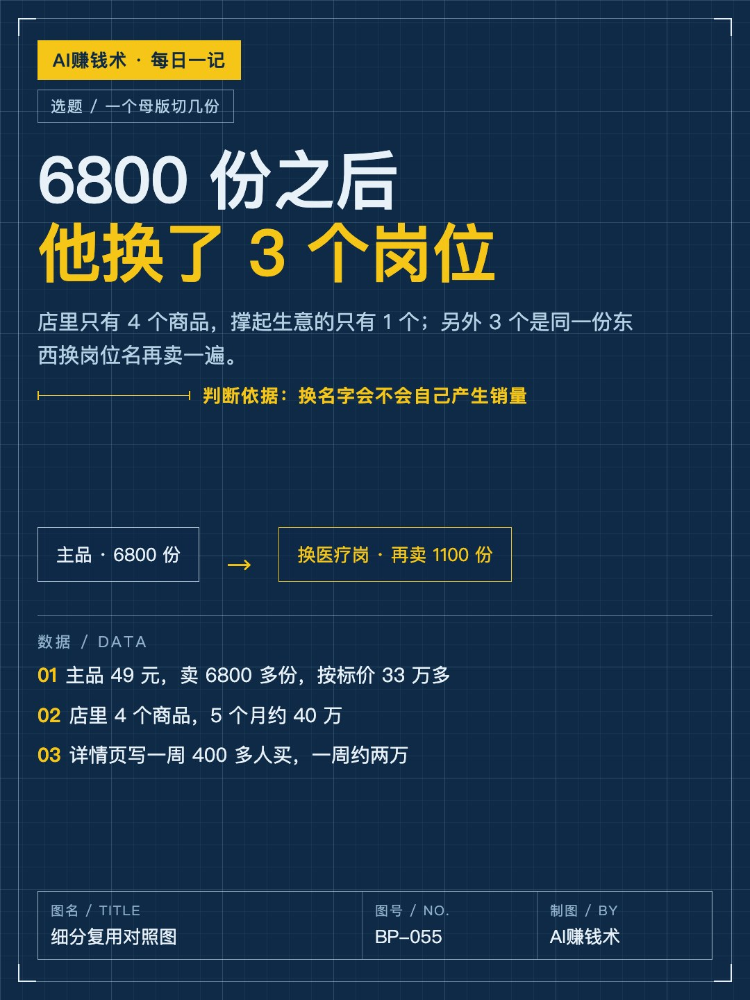
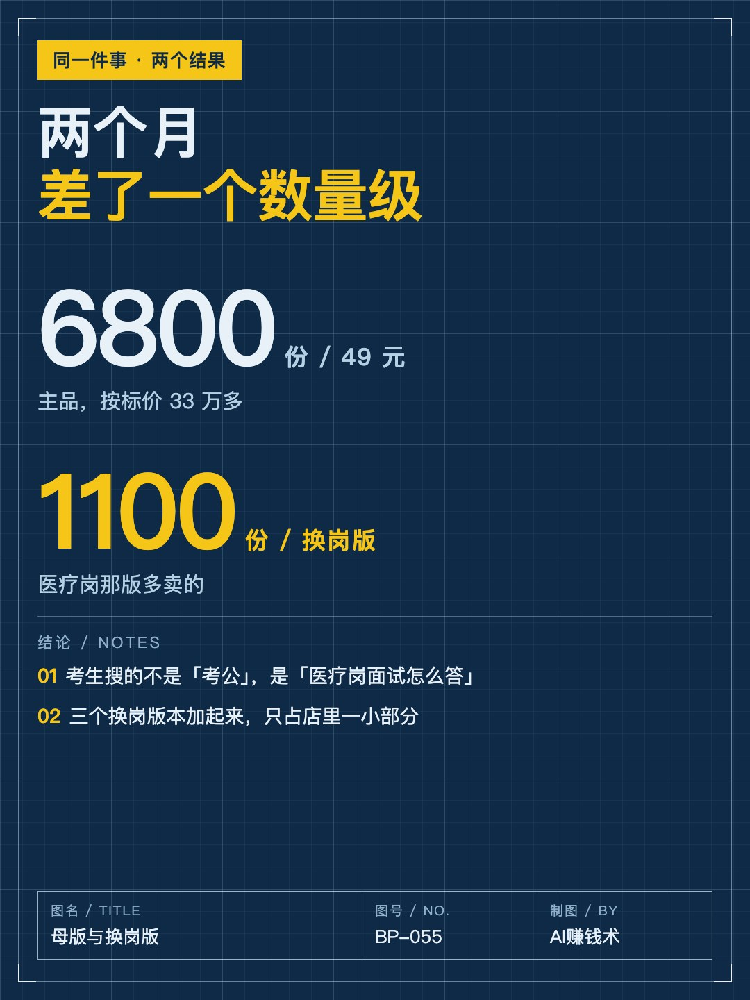
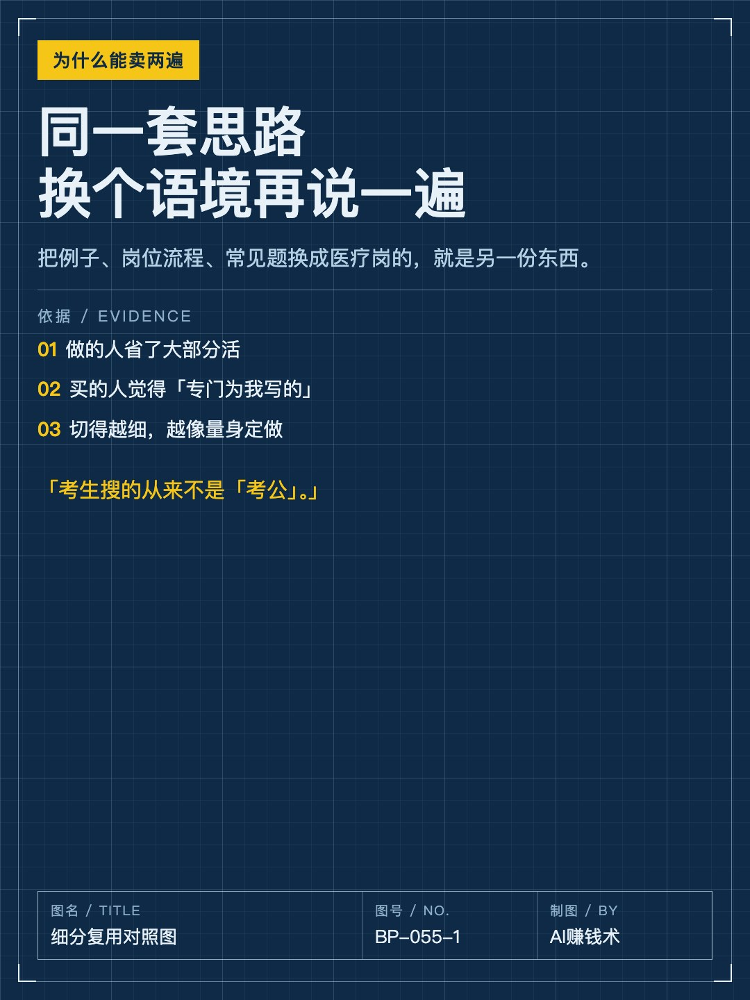
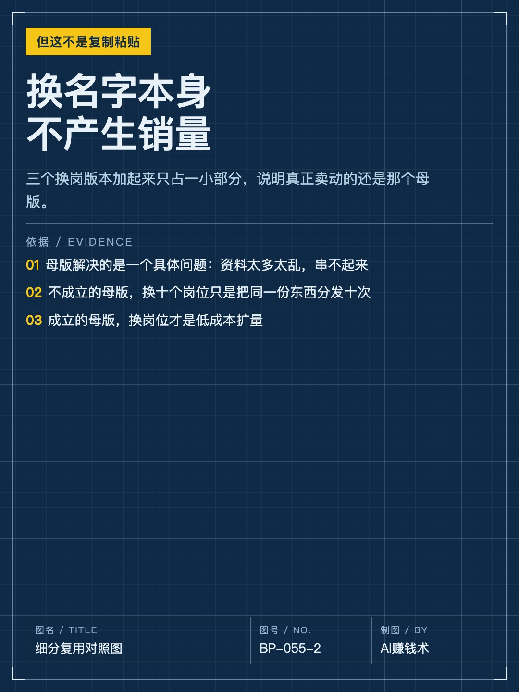
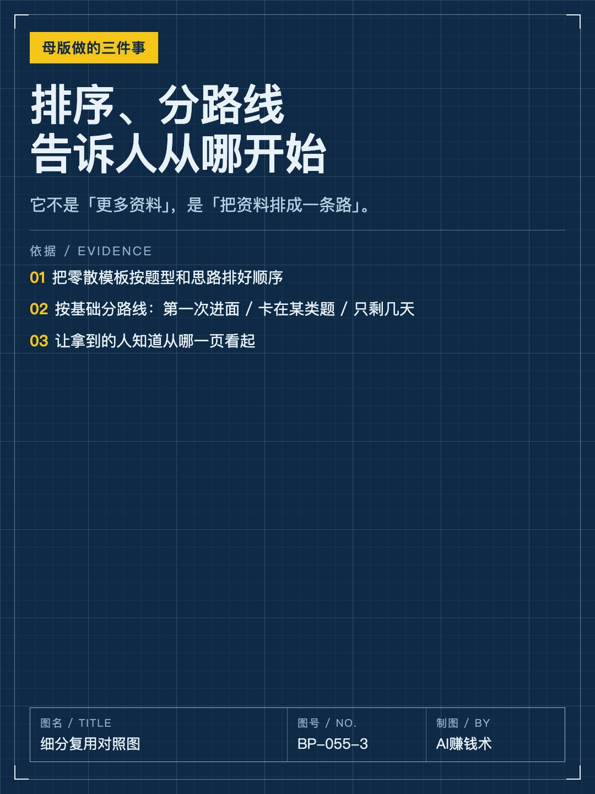
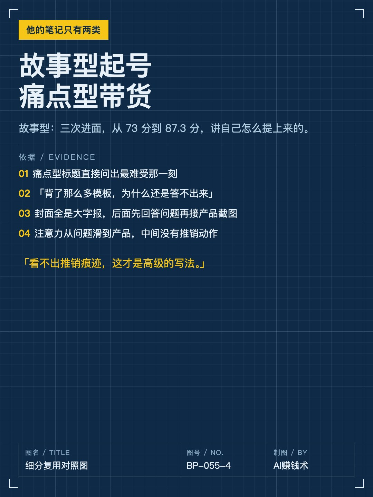
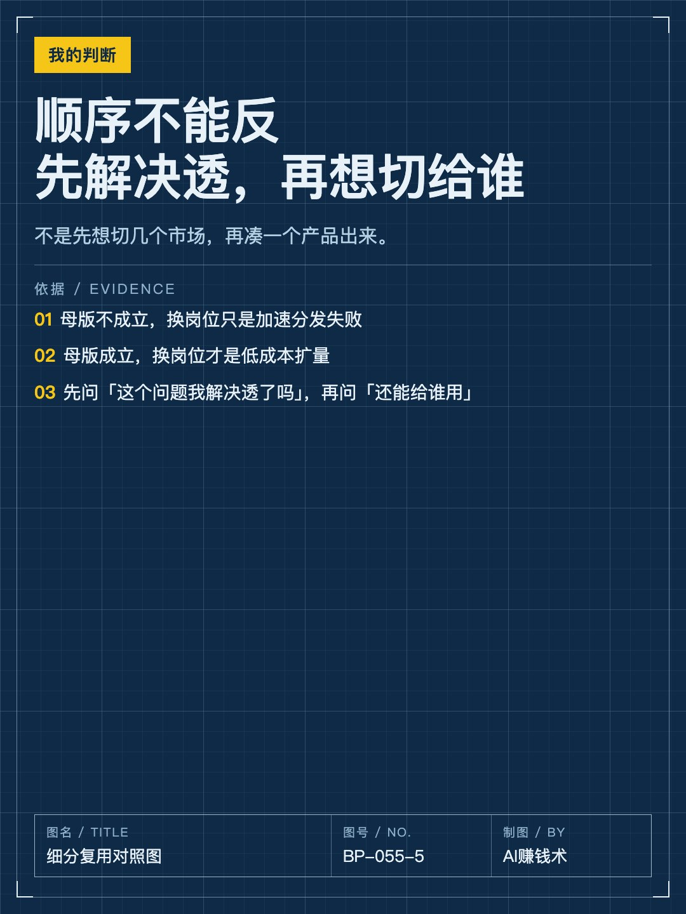
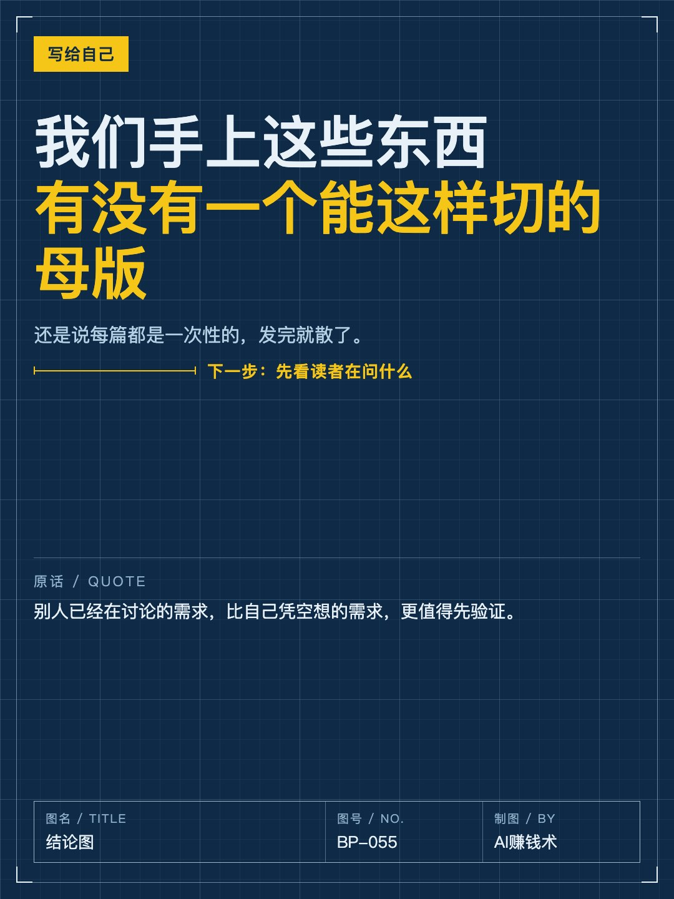

# 6800份之后，他换了3个岗位

> — · 2026-10-31 10:39 发布 · AI 赚钱内容

## 标题（可直接复制）

```
6800份之后，他换了3个岗位
```

## 正文（可直接复制发布）

一份 49 块的面试笔记，卖了 6800 多份。😮

这家店里一共只有 4 个商品，5 个月做了 40 万左右。

真正撑起这家店的，其实只有一个品。剩下三个，是同一份东西换了个岗位名，又卖了一遍。

📌 先看数字

主品：49 块，6800 多份，按标价算 33 万多。

详情页写着「一周内 400 多人购买」，按 49 算，一周两万左右。现在十月下旬，面试还在笔试后面，真正的旺季没到。

另外三个品：医疗岗、教师岗、申论。医疗岗那版又卖了 1100 多份。三个加起来，只占一小部分。

📌 为什么同一份东西能卖两遍

因为考生搜的从来不是「考公」。

他们搜的是「医疗岗面试怎么答」「教资结构化怎么准备」。切得越细，越像「这就是为我写的」。

同一套答题思路，把例子、岗位流程、常见题换成医疗岗的，就是另一份东西。做的人省了 80% 的活，买的人觉得专门给自己写的。💡

📌 但这不是复制粘贴

他把三个品加起来才占一小部分，说明什么？

说明换名字本身不产生销量。真正卖动的还是那一个母版，因为它解决了一个具体问题：资料太多太乱，串不起来。

它做了三件事：把零散模板按题型和思路排好顺序；按不同基础给不同路线（第一次进面 / 卡在某类题 / 只剩几天）；让拿到的人知道从哪一页看起。

换岗位只是把这三件事，换个语境再说一遍。⏱️

📌 他的笔记只有两类

一类是故事型：三次进面，面试从 73 分提到 87.3 分，图片放产品截图，正文讲自己怎么一步步提上来的。这类拿来起号。

一类是痛点型，标题直接问出最难受那一刻：「为什么你背了那么多模板，面试还是答不出来」「网课看明白了，为什么一答题脑子还是空的」。

封面全是大字报，后面几张要么是产品截图，要么先回答封面那个问题，再接产品截图。读者的注意力从问题滑到产品，中间没有推销动作。

📌 我的判断

这套东西真正的门槛不在「换个岗位再卖一遍」，在于那个母版是不是真的解决问题。

母版不成立，换十个岗位也只是把同一份垃圾分发十次。母版成立，换岗位才是低成本扩量。

所以顺序不能反：先把一个问题解决透，再想它能切给谁；不是先想切几个市场，再凑一个产品出来。

我现在的疑问是：我们手上这些东西，有没有一个能这样切的母版。还是说每篇都是一次性的，发完就散了。🤔

## 话题标签

#副业 #自媒体 #内容创作 #AI赚钱术日记

## 配图（8 张）










## 发布信息

| 项 | 值 |
|---|---|
| 平台 | 小红书 |
| 期数 | — |
| 发布时间 | 2026-10-31 10:39 |
| 正文长度 | 964 字 |
| 图片数量 | 8 张 |
| 状态 | 已发布 |
