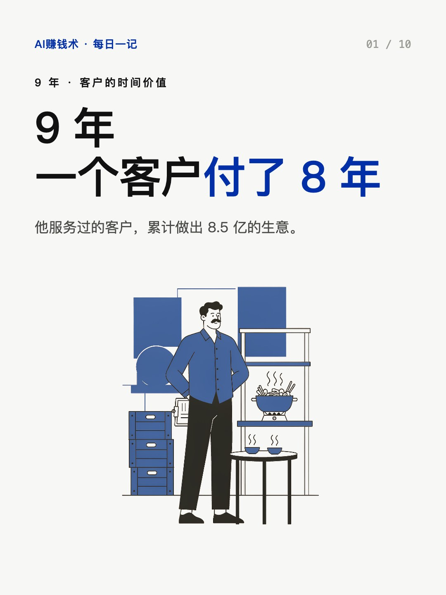
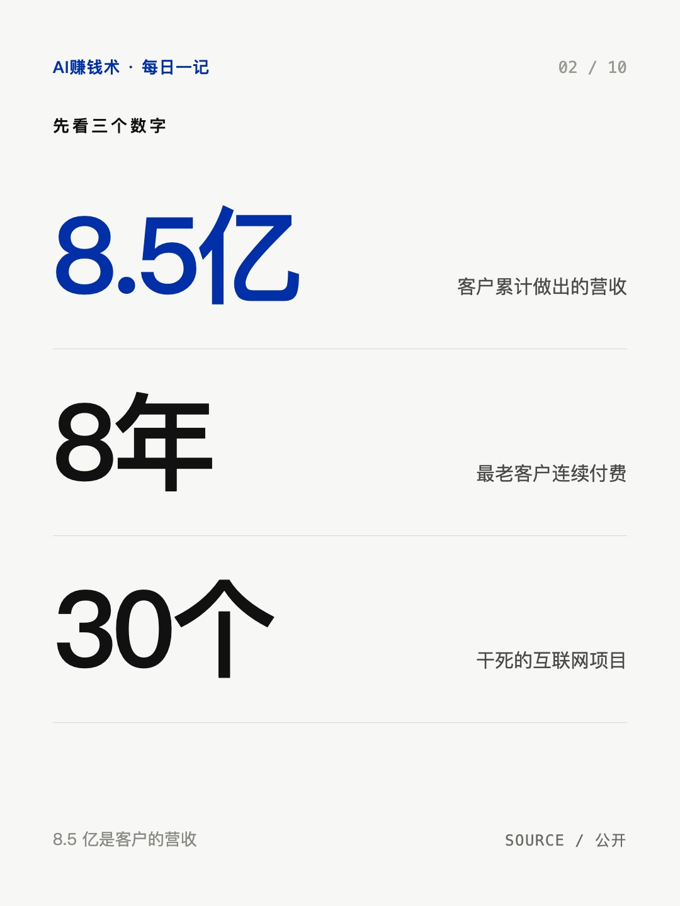
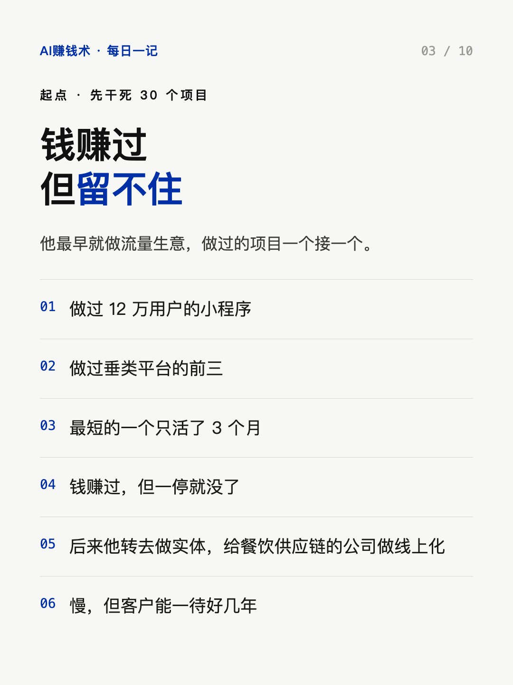
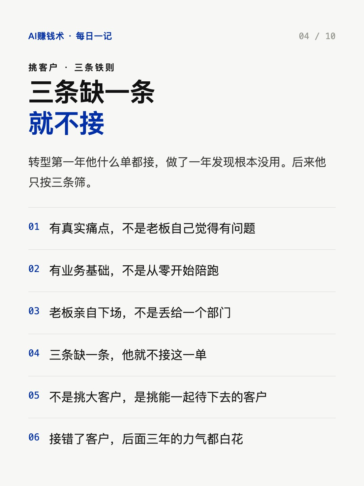
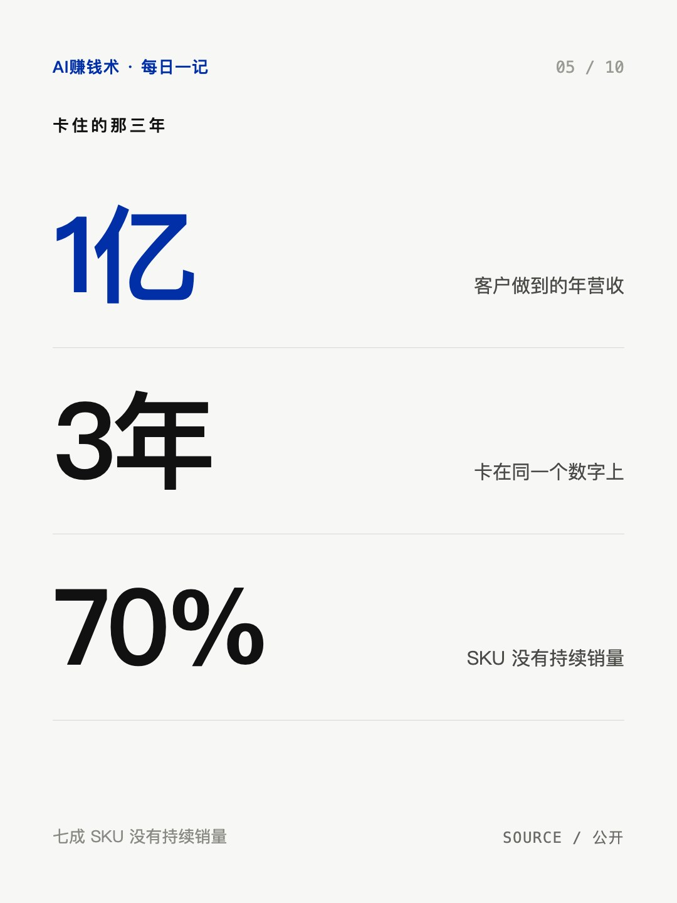
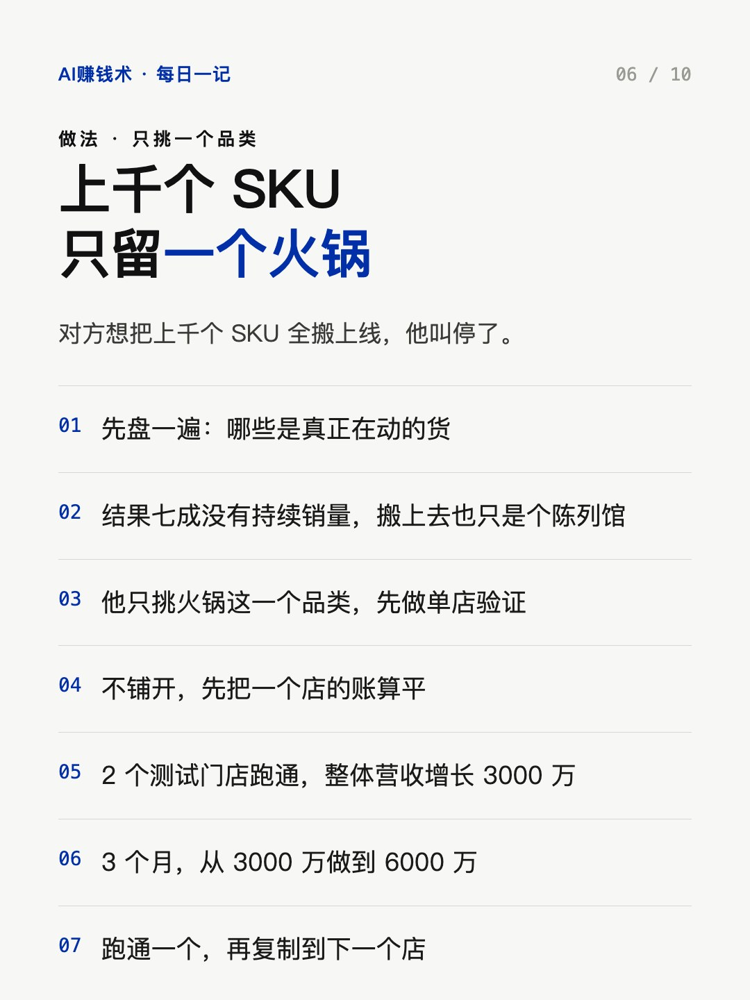
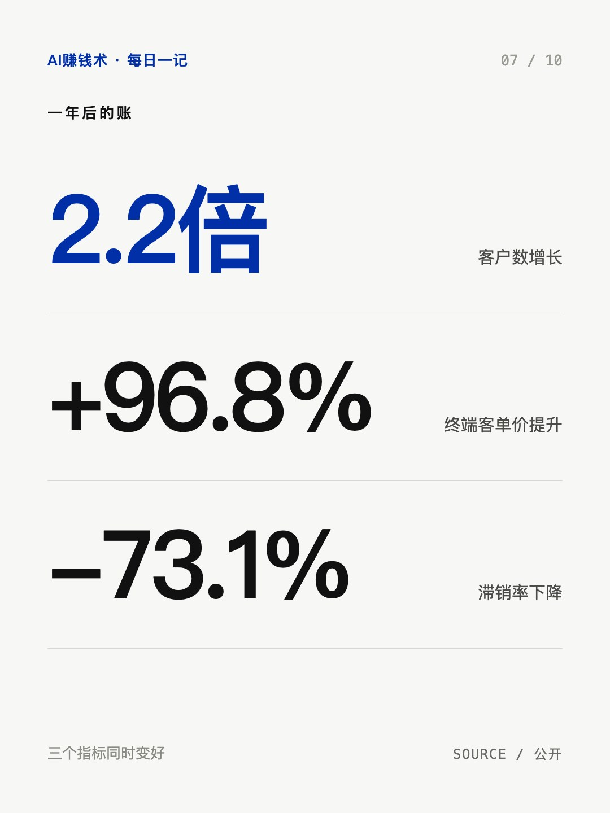
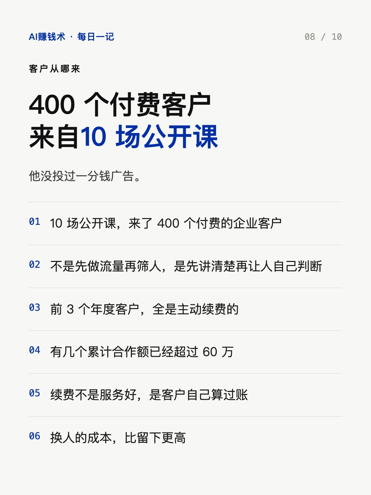
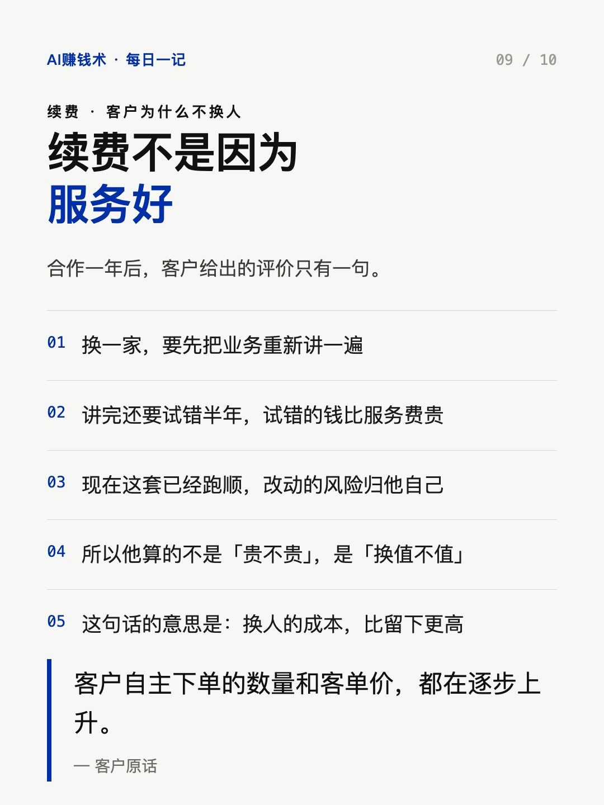
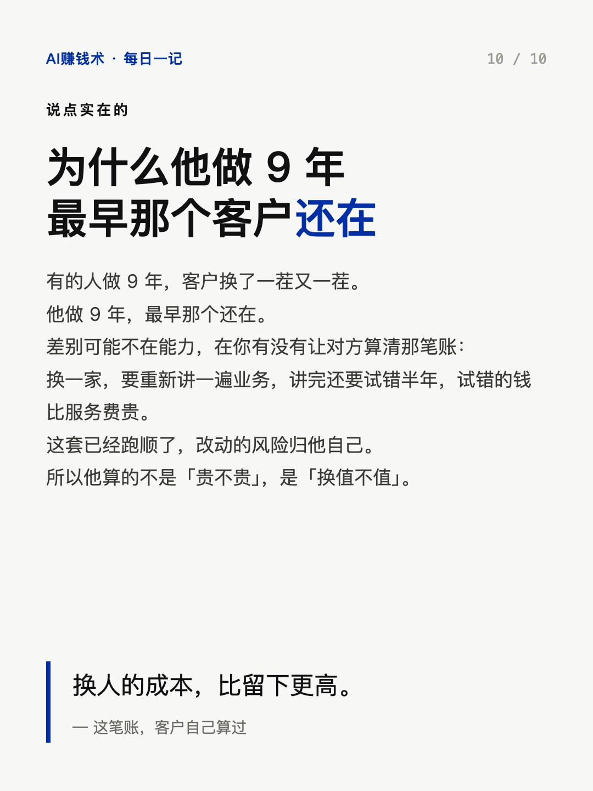

# 9年，一个客户付了8年

> — · 2026-10-31 13:57 发布 · AI 赚钱内容

## 标题（可直接复制）

```
9年，一个客户付了8年
```

## 正文（可直接复制发布）

做了 9 年，他服务过的客户，累计做出 8.5 亿的生意。
最老的一个客户，连续付费 8 年。

先说清楚：8.5 亿是客户自己做出来的营收，不是他的。
真正值钱的是后面那句，8 年。

他先干死过 30 个互联网项目。
做过 12 万用户的小程序，做过垂类平台的前三，最短的一个只活了 3 个月。
钱赚过，但留不住。

后来他转去做实体，给餐饮供应链的公司做线上化。
慢，但客户能一待好几年。

挑客户他有三条铁则：有真实痛点，有业务基础，老板亲自下场。
三条缺一条就不接。

他遇到过一个做火锅食材的老板，10 年做到年营收 1 亿，
然后卡在 1 亿整 3 年，怎么都上不去。

对方想把上千个 SKU 全搬上线。
他叫停了。盘下来发现其中 70% 没有持续销量，搬上去也只是个陈列馆。

他只挑火锅这一个品类，先做单店验证。
2 个测试门店，整体营收增长 3000 万。
3 个月，从 3000 万做到 6000 万。

合作一年后，客户数翻了 2.2 倍，终端客单价提升 96.8%，滞销率降了 73.1%。

他没投过一分钱广告。
400 个付费客户，来自 10 场公开课。

前 3 个年度客户，全是主动续费的。
有几个累计合作额已经超过 60 万。

客户的原话是：自主下单的数量和客单价，都在逐步上升。

这句话比 8.5 亿有用。
它说明客户不是在给他面子，是在给自己算账：换人的成本，比留下更高。

我一直在想，为什么有的人做 9 年，客户换了一茬又一茬。
他做 9 年，最早那个还在。

差别可能不在能力，在你有没有让对方算清那笔账。

## 话题标签

#副业 #AI #商业思维 #自媒体 #AI赚钱术日记

## 配图（10 张）












## 发布信息

| 项 | 值 |
|---|---|
| 平台 | 小红书 |
| 期数 | — |
| 发布时间 | 2026-10-31 13:57 |
| 正文长度 | 679 字 |
| 图片数量 | 10 张 |
| 状态 | 已发布 |
