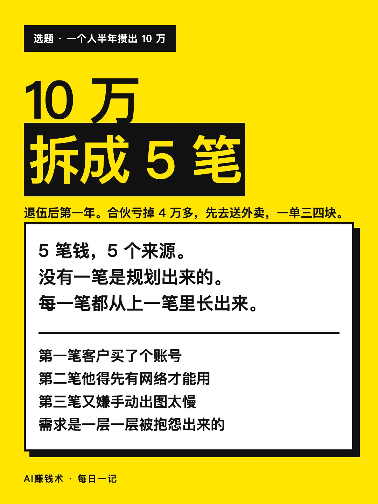
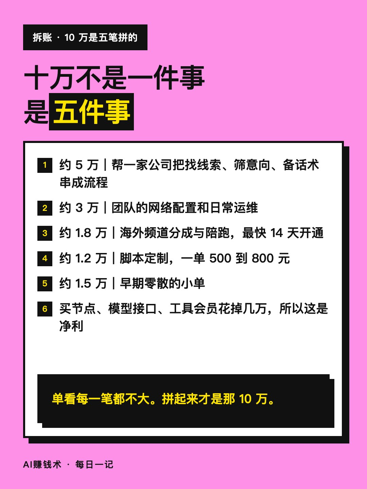
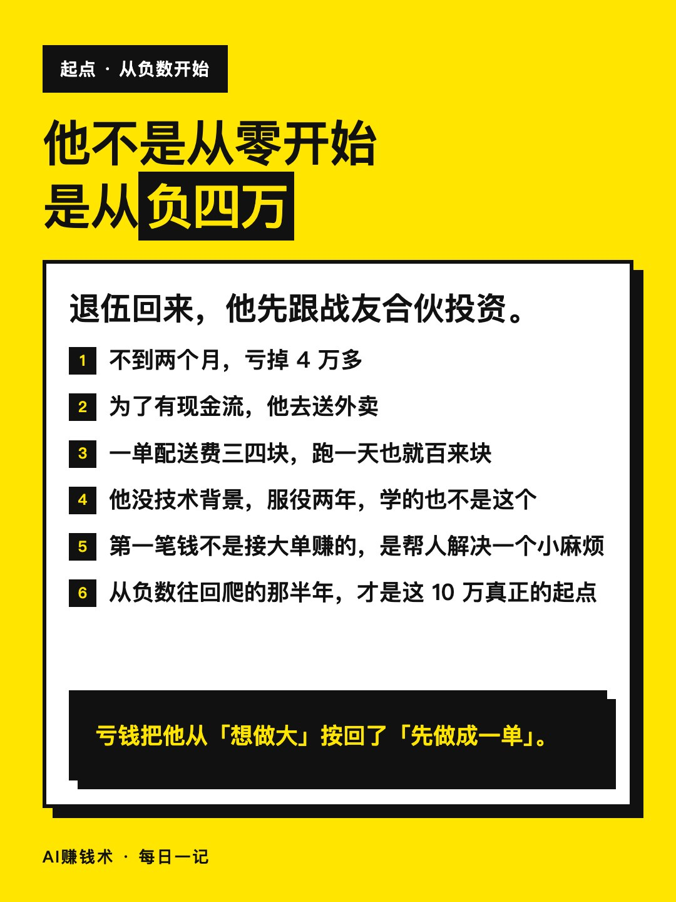
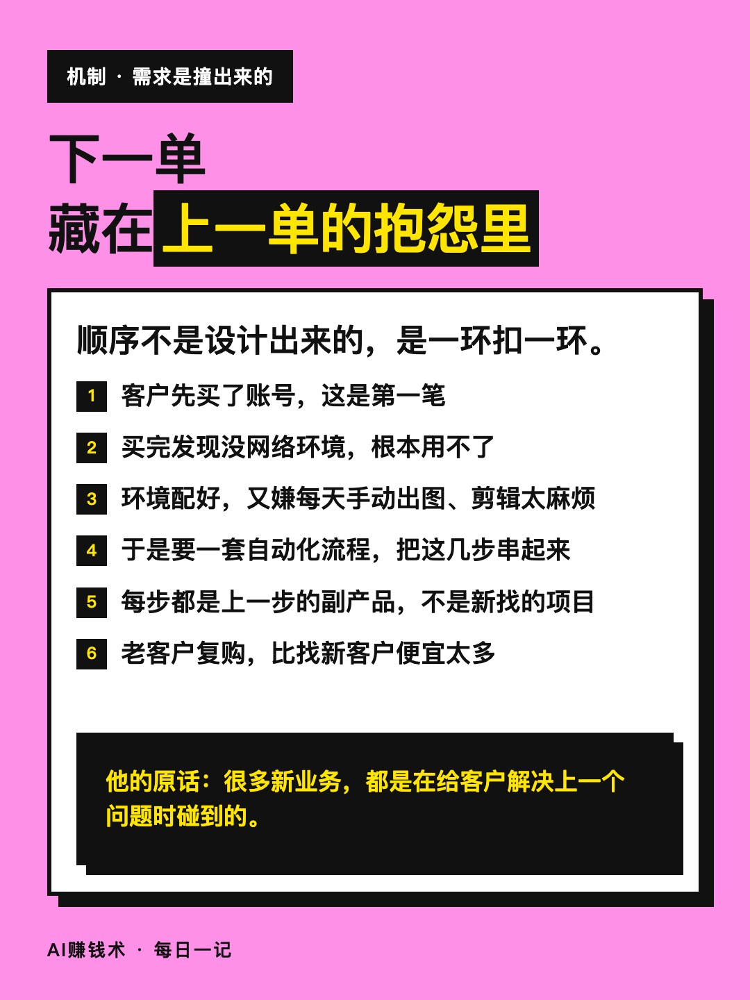
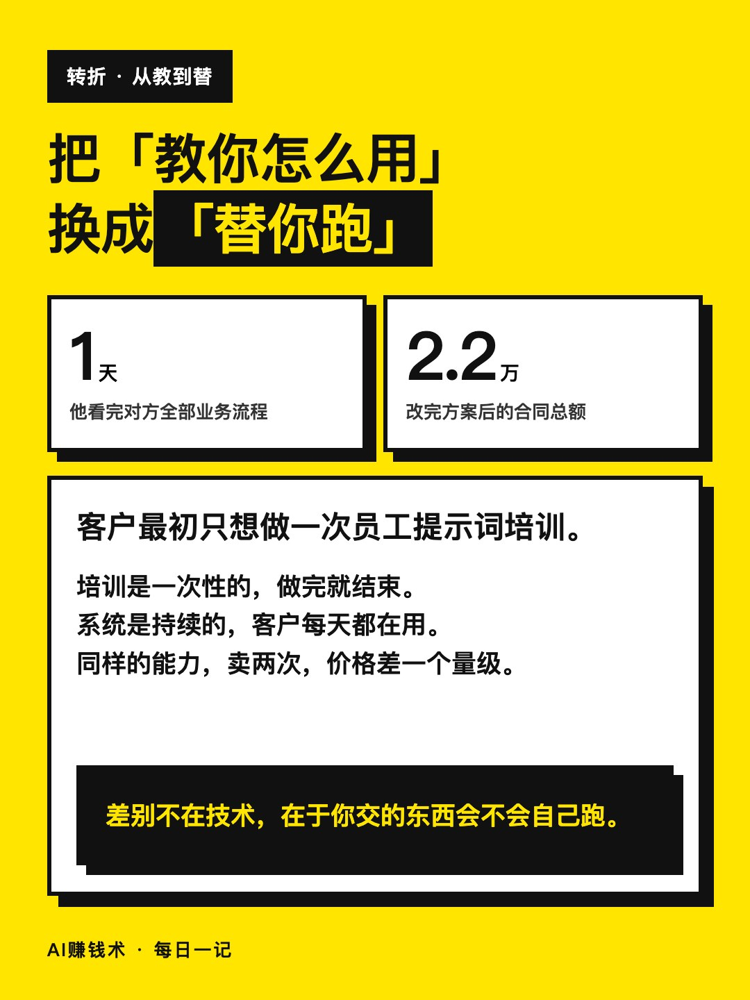
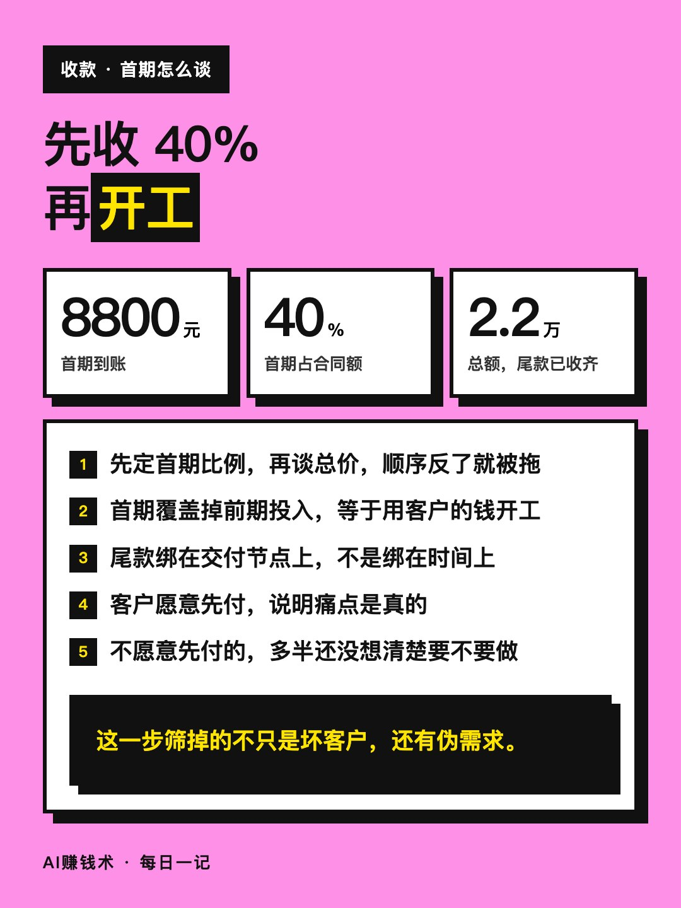
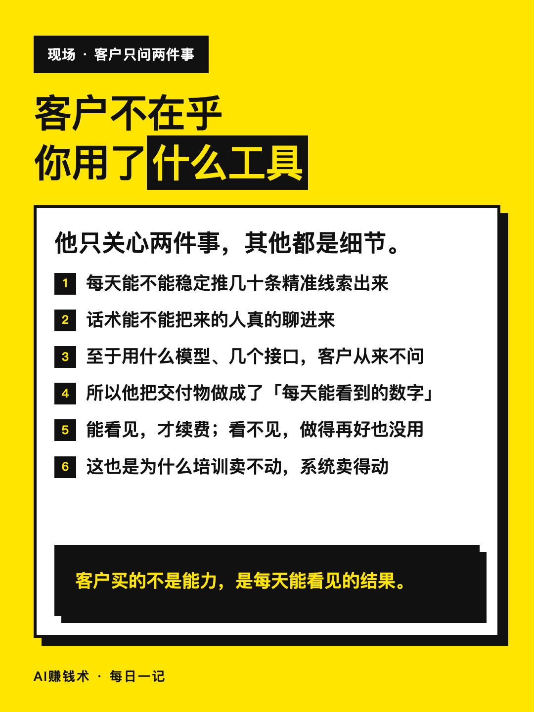
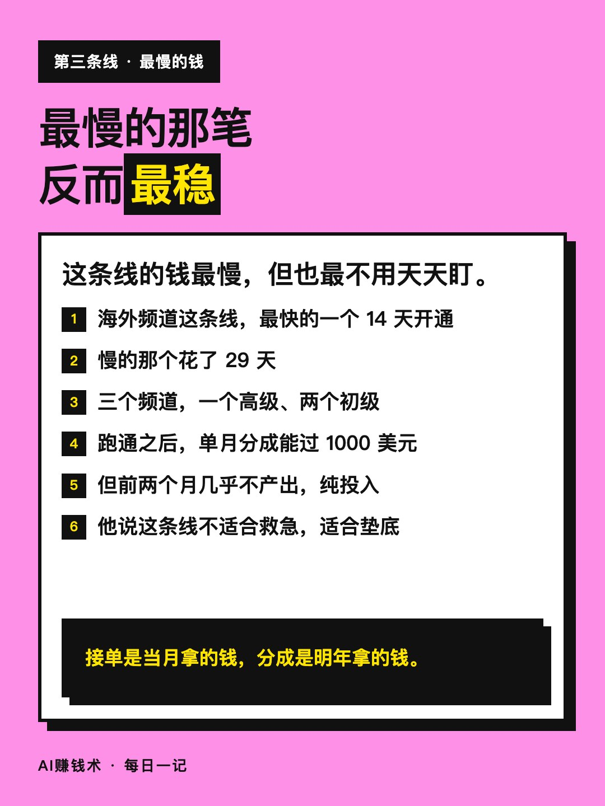
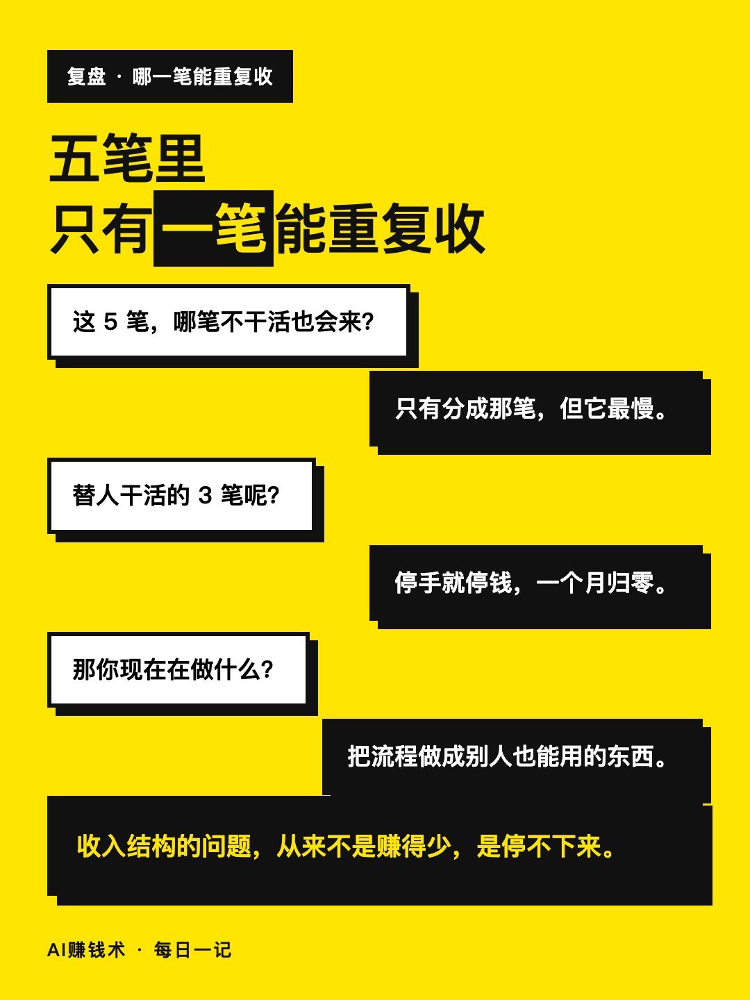
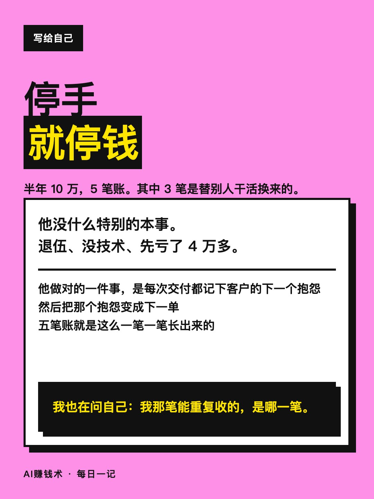

# 半年10万，拆成5笔账

> — · 2026-10-31 12:52 发布 · AI 赚钱内容

## 标题（可直接复制）

```
半年10万，拆成5笔账
```

## 正文（可直接复制发布）

去年 9 月退伍，他跟战友合伙投资，不到两个月亏了 4 万多。
后来去送外卖，一单配送费三四块。
半年后，他手上有一笔 10 万的净利。

拆开看，是 5 笔。

第一笔，帮一家公司把找线索、筛意向、备话术串成一套流程，约 5 万。
第二笔，团队网络配置和运维，约 3 万。
第三笔，海外频道的分成和陪跑，约 1.8 万。
第四笔，脚本定制，约 1.2 万，一单 500 到 800 元。
第五笔，早期零散的单子，约 1.5 万。

买网络节点、模型接口、工具会员，前后花掉几万。
所以 10 万是净利，不是流水。

这五笔不是规划出来的，是一笔带出下一笔。

客户先买了账号，接着发现没网络环境用不了；
环境配好，又嫌每天手动出图、下载、剪辑太麻烦。
自动化那套流程，就是这么冒出来的。

他自己总结了一句：很多新业务，都是在给客户解决上一个问题时碰到的。

最值钱的是那笔 2.2 万的合同。
客户最初只想做一次员工提示词培训。
他花一天看完对方的业务流程，把方案改成：先把找线索、筛意向、备话术三步串起来，直接替客户跑。
首期 8800 元到账，占 40%，尾款收齐。

差别就在一句话：客户要的是「教我们怎么用」，他交付的是「替你跑」。

那三个海外频道，最快的一个 14 天开通，慢的 29 天。
跑通之后单月分成能过 1000 美元，但这条线的钱最慢，也最不稳。

客户其实只在乎两件事：每天能不能稳定推几十条精准线索，话术能不能把人聊进来。别的都不重要。

现在回头看，这 5 笔里有 3 笔是替别人干活换来的，停手就停钱。
真正能重复收的那笔，只有他自己知道是哪一笔。

我也在问自己同样的问题。

## 话题标签

#副业 #AI #AI工具 #自媒体 #AI赚钱术日记

## 配图（10 张）












## 发布信息

| 项 | 值 |
|---|---|
| 平台 | 小红书 |
| 期数 | — |
| 发布时间 | 2026-10-31 12:52 |
| 正文长度 | 706 字 |
| 图片数量 | 10 张 |
| 状态 | 已发布 |
