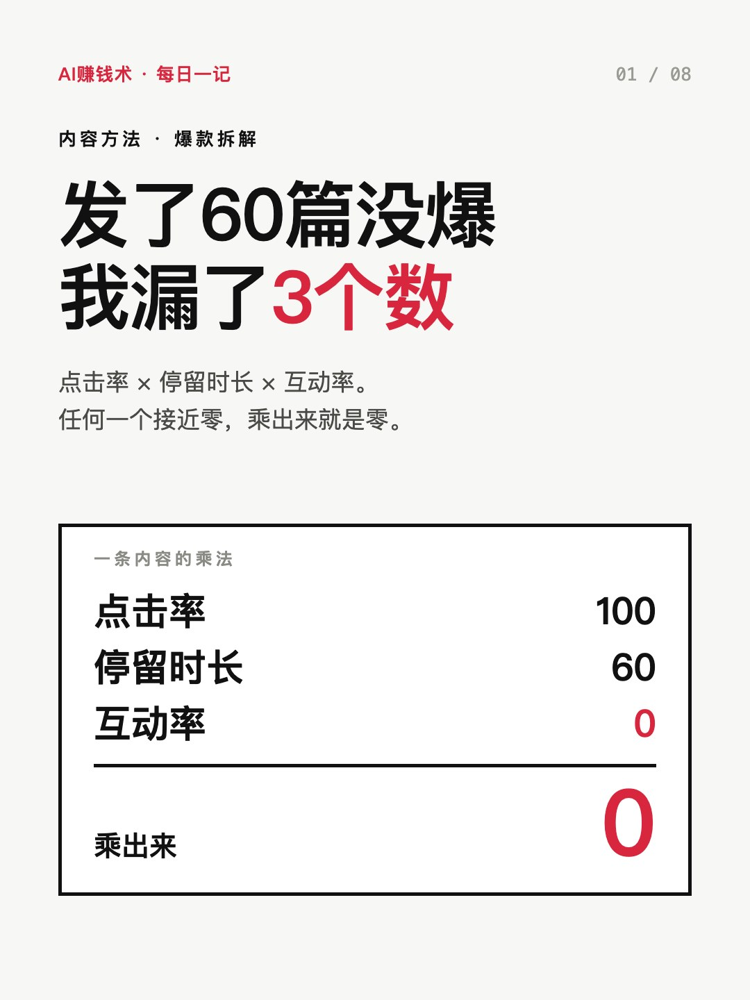
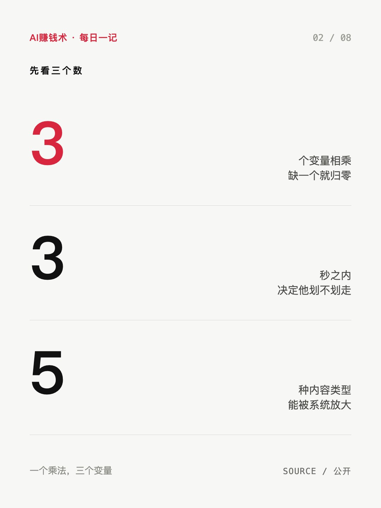
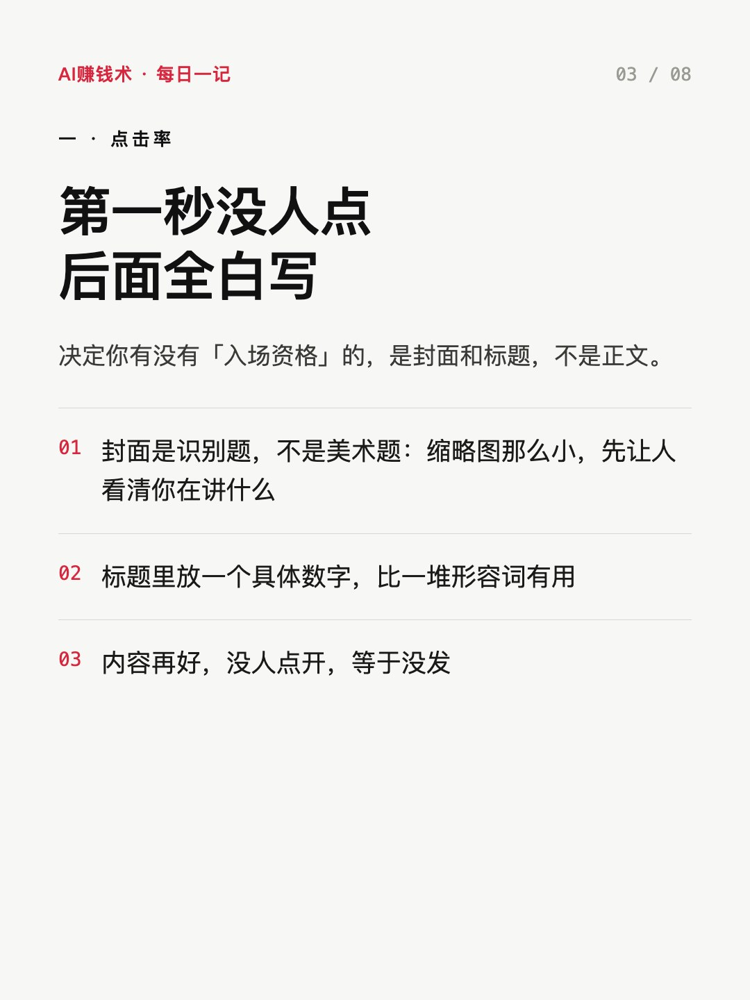
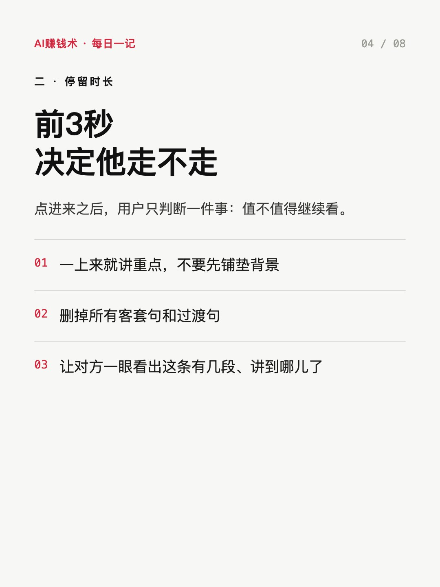
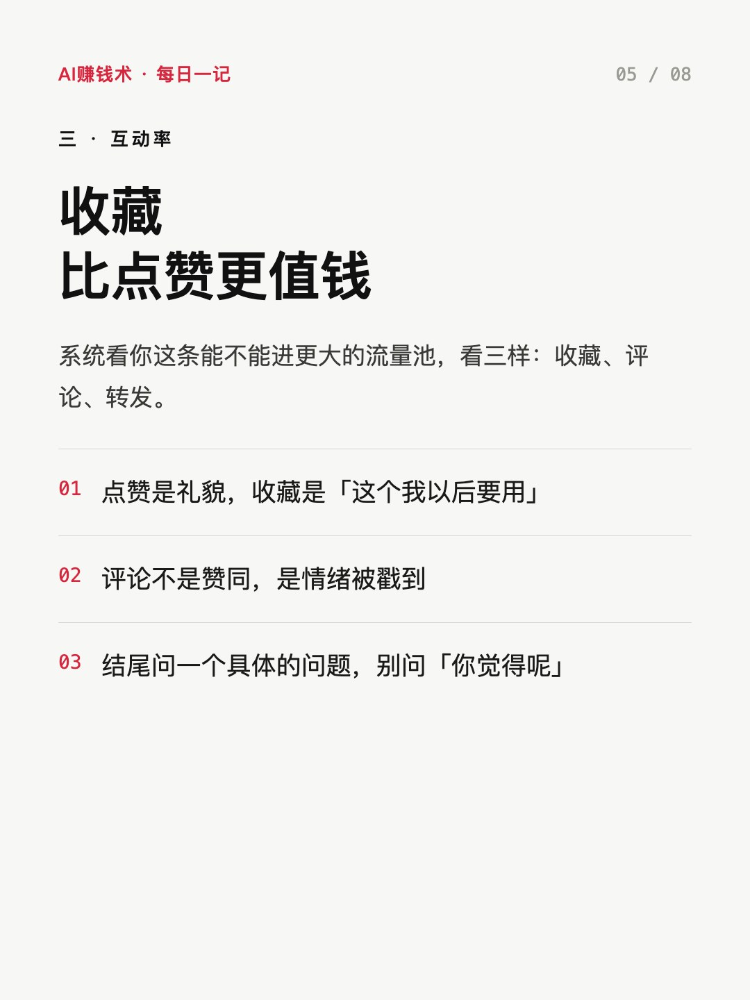
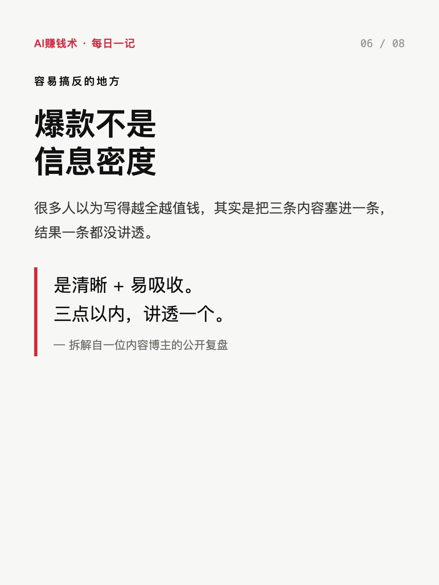
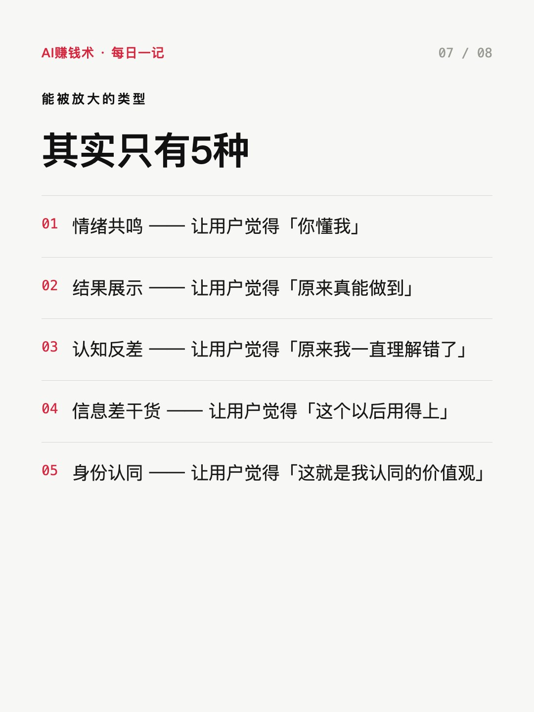
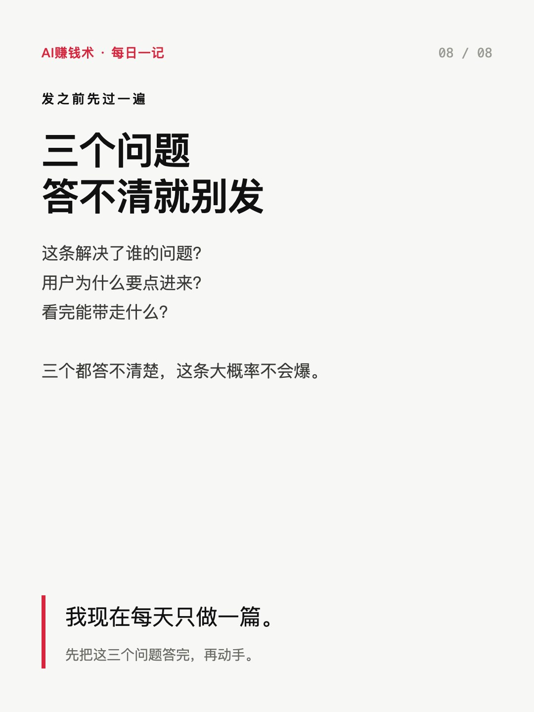

# 发了60篇没爆，我漏了3个数

> — · 2026-10-31 17:09 发布 · AI 赚钱内容

## 标题（可直接复制）

```
发了60篇没爆，我漏了3个数
```

## 正文（可直接复制发布）

我发了60多篇，一半以上的阅读量还停在两位数。😮

不是不努力。每天定选题、做图、写正文，一天两三篇，量上不比谁少。

直到看到一位博主拆自己的账号，我才发现自己一直在解决「写什么」，而决定一条内容能不能被放大的，从来不是写得好不好。

她给的公式只有一个乘法：

点击率 × 停留时长 × 互动率。

三个数里任何一个接近零，乘出来就是零。

① 点击率，决定有没有入场资格

用户刷到你，第一秒只问一句：我要不要点进去。

这一秒里他能看到的，只有封面和标题。内容再好，没人点开，等于没发。

所以封面不是美术题，是识别题。缩略图那么小，先让人看清你在讲什么，再谈好不好看。

② 停留时长，决定内容有没有价值

点进来之后，用户第二个判断是：值不值得往下看。

影响它的只有三件事：是不是一上来就讲重点、有没有废话、有没有结构感。

我以前的毛病是第一屏先铺背景、先客套，真正的信息压到第四段。人是不会等的。

③ 互动率，决定能不能进更大的池子

系统看三样：收藏、评论、转发。

收藏的权重比点赞更高。点赞是礼貌，收藏是「这个我以后要用」。

评论也不是赞同，是情绪被戳到了。所以结尾要给一个具体的问题，别问「你觉得呢」。

容易搞反的一点：爆款不是信息密度。

很多人以为写得越全越值钱，其实是把三条内容塞进一条，结果一条都没讲透。清晰、易吸收，比信息量重要。

她还把能被放大的内容归成 5 种：

情绪共鸣，让人说「你懂我」；结果展示，让人说「原来真能做到」；认知反差，让人说「原来我一直理解错了」；信息差干货，让人说「这个以后用得上」；身份认同，让人说「这就是我认同的价值观」。

写之前先问自己：这条满足的是哪一种？答不出来就先别发。

如果完全不知道怎么写，就反复问三个问题：

这条解决了谁的问题？
用户为什么要点进来？
看完能带走什么？

三个都答不清，这条大概率不会爆。

我现在每天只做一篇，动手前先把这三个问题答一遍。

你现在卡在哪一步——没人点（封面标题）、点进来就走（前 3 秒）、还是看完了不收藏？

评论区说一句，我按顺序回。

## 话题标签

#自媒体 #内容创作 #搞钱思路 #个人IP #AI赚钱术日记

## 配图（8 张）










## 发布信息

| 项 | 值 |
|---|---|
| 平台 | 小红书 |
| 期数 | — |
| 发布时间 | 2026-10-31 17:09 |
| 正文长度 | 884 字 |
| 图片数量 | 8 张 |
| 状态 | 已发布 |
