# 封面3秒定生死，靠的不是好看

> — · 2026-10-31 16:05 发布 · AI 赚钱内容

## 标题（可直接复制）

```
封面3秒定生死，靠的不是好看
```

## 正文（可直接复制发布）

我们的封面，一直做得挺好看。但好看没换来点击。

后来才想明白：读者在信息流里划的时候，不会欣赏你的排版。他只花 3 秒判断一件事——这东西跟我有没有关系。

📌 封面不是审美题，是识别题

好看但说不清，照样划走。不好看但说得清，人会停下来。

缩略图尺寸下，人先看形状，再看字。所以顺序是：先让人认出「这是讲什么的」，再让人想「我想知道答案」。

📌 决定点击的只有两个变量

一，信息密度：缩略图那么小，你的利益点还看得清吗。
二，视觉锚点：有没有一个位置，让眼睛停住。

密度不够，读者不知道你在说什么。锚点不够，眼睛没有落点，就划过去了。

📌 锚点只有五种

不用发明新的，从这五种里挑一个，放到最显眼的位置：人脸（哪怕是插画的脸）、一个特别大的数字、一张真实截图、手写感的标注、一块高对比色。

挑一个，然后每张都用同一个。换来换去，等于没有。

📌 四种结构，按内容挑

冲突型：反直觉标题 × 强对比色 × 人物遮罩。适合观点、认知、工具测评。风险是为了冲突而冲突，显得吵。

数字型：一个巨大的数字当锚点 × 色块分割 × 一句悬念副标题。适合干货、教程、清单。数字要具体到不像编的。

截图型：真实截图 × 手写感标注 × 低饱和底。适合案例、结果、后台数据。截图里要有一处能看懂。

情绪型：满屏的人物或场景 × 一行大字 × 一条撞色。适合故事、生活、共鸣。一行字要能独立成立。

📌 三条经验

文字占比超过画面三分之一，缩略图会显挤。

素人风——截图、手机框、手写标注——常比精修海报点击高。

封面和正文标题别完全重叠，留一点信息差，才有理由点进去。

📌 我的判断

我们过去的问题不是不会做图，是每张图都在换风格。读者记不住哪张是我们的。

锚点的作用不只是让人停，也是让人记住。同一个位置、同一种颜色、同一个主角，反复出现，才慢慢变成「哦这是他们」。

所以下一批封面，我打算先定死一个锚点，再谈好看不好看。

📌 提醒

上面那些结构是从别人的经验里拆的，不是官方规则。真正有效的判断只有一个：把你的封面缩到手机信息流的尺寸，还看得清吗。

## 话题标签

#副业 #自媒体 #内容创作 #AI赚钱术日记

## 配图（11 张）

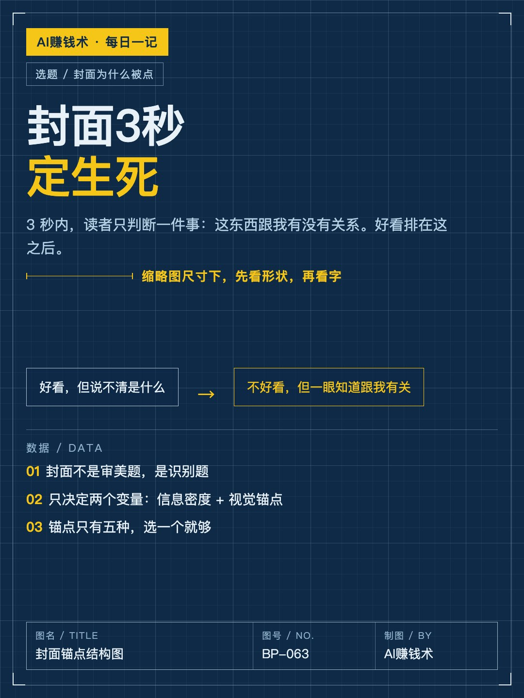
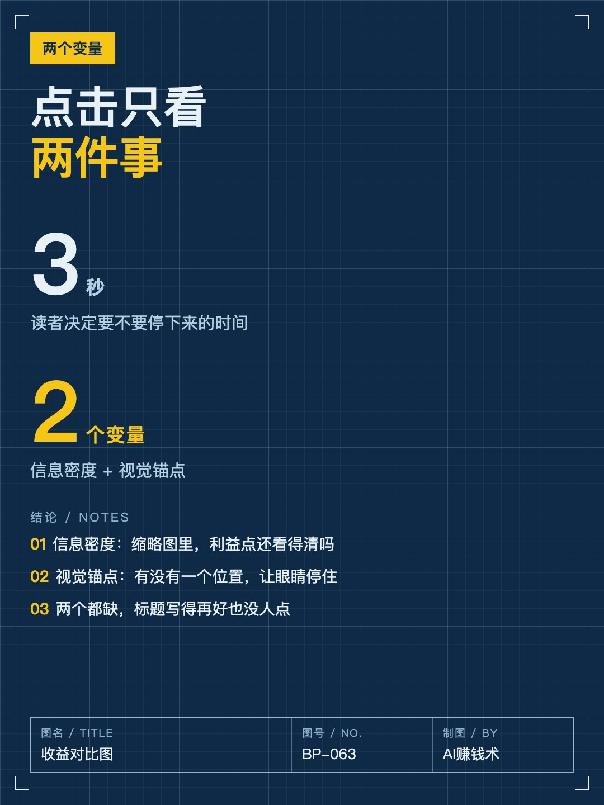
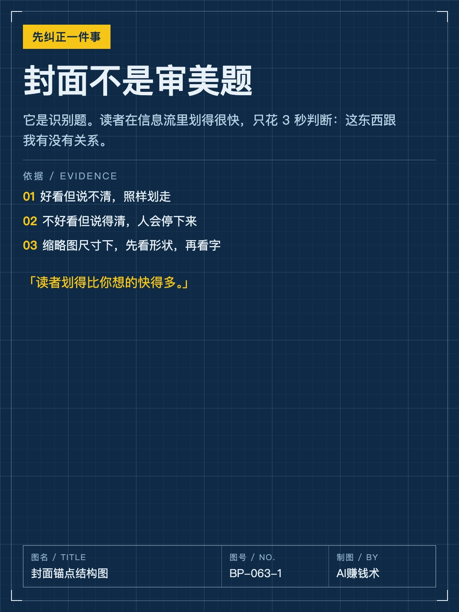
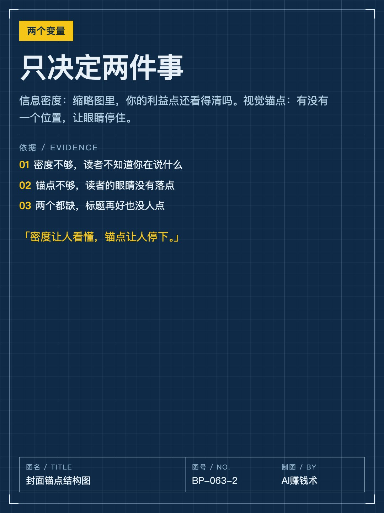
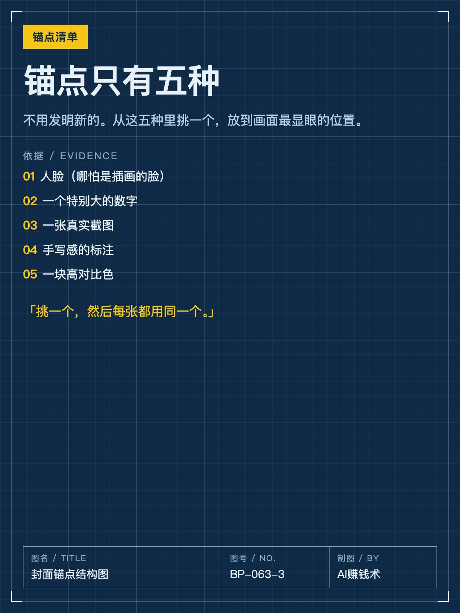
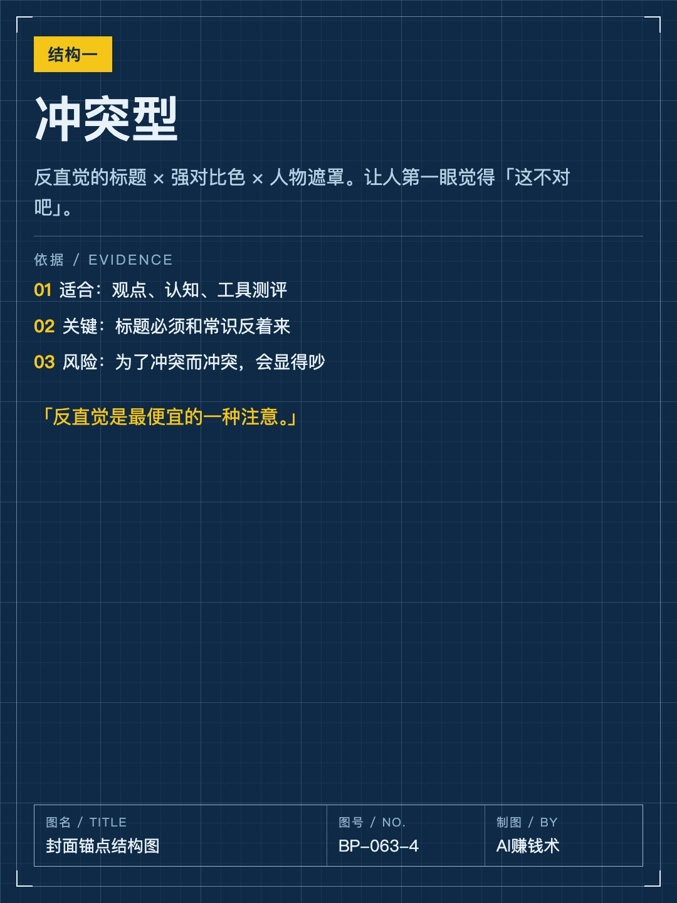
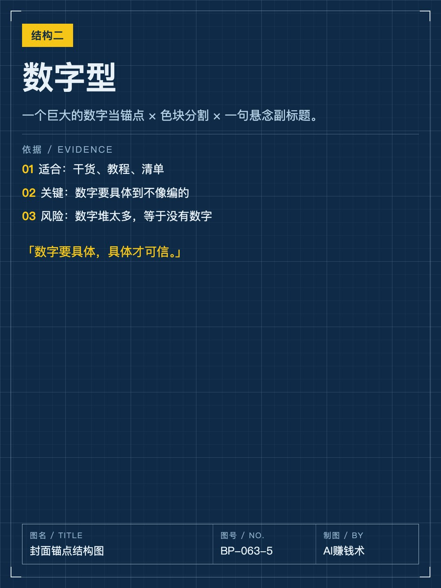
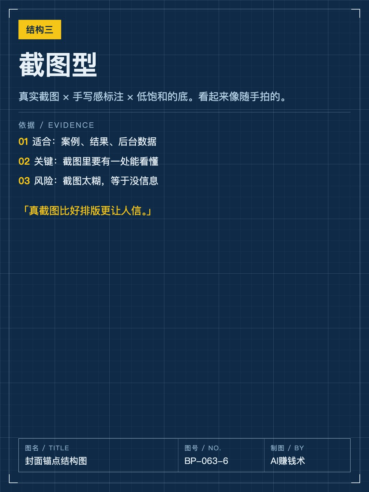
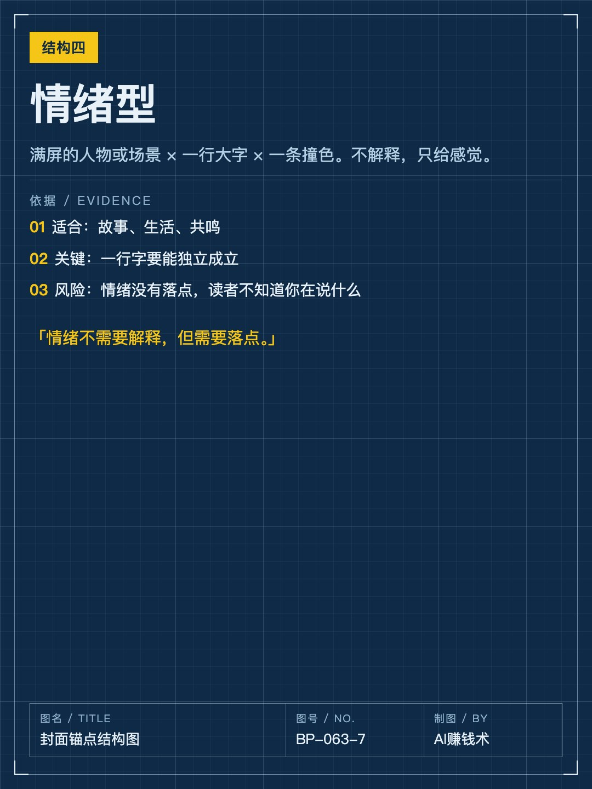
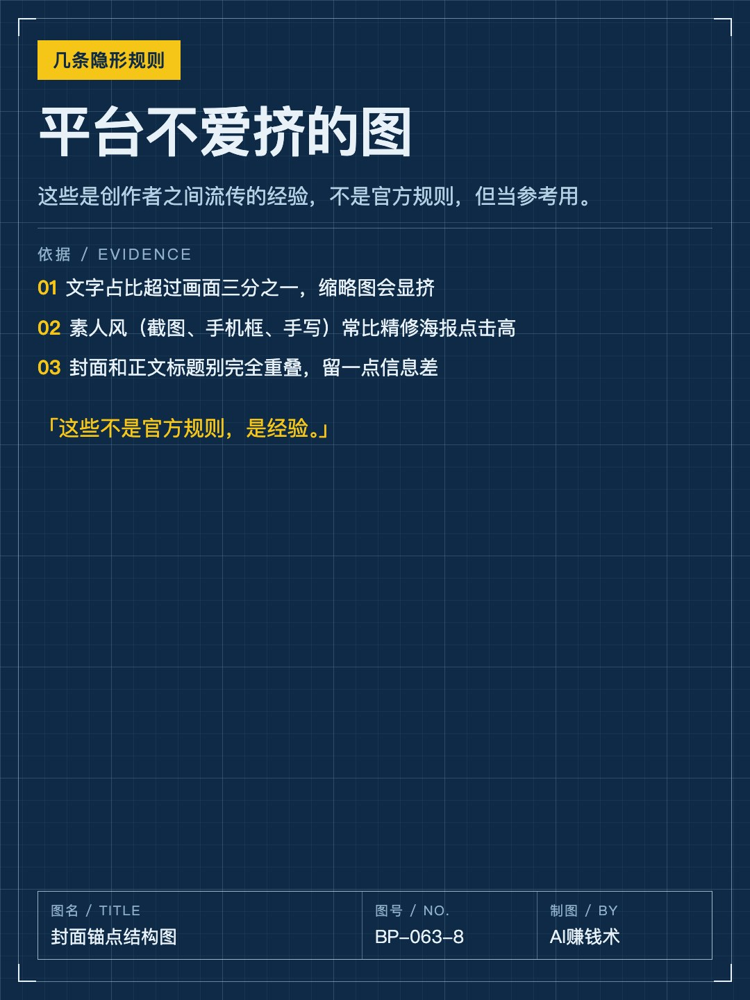
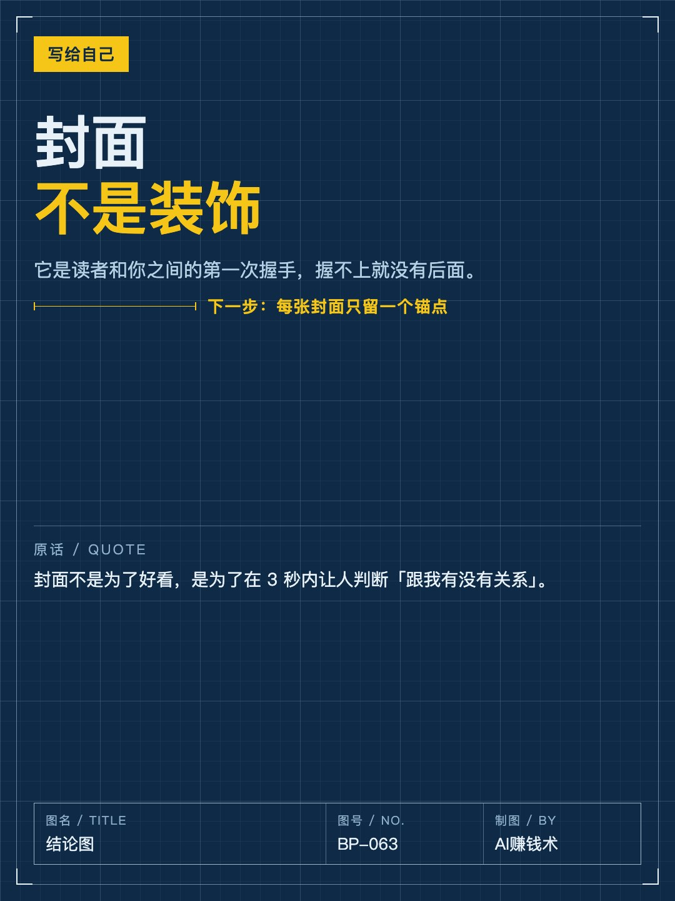

## 发布信息

| 项 | 值 |
|---|---|
| 平台 | 小红书 |
| 期数 | — |
| 发布时间 | 2026-10-31 16:05 |
| 正文长度 | 890 字 |
| 图片数量 | 11 张 |
| 状态 | 已发布 |
