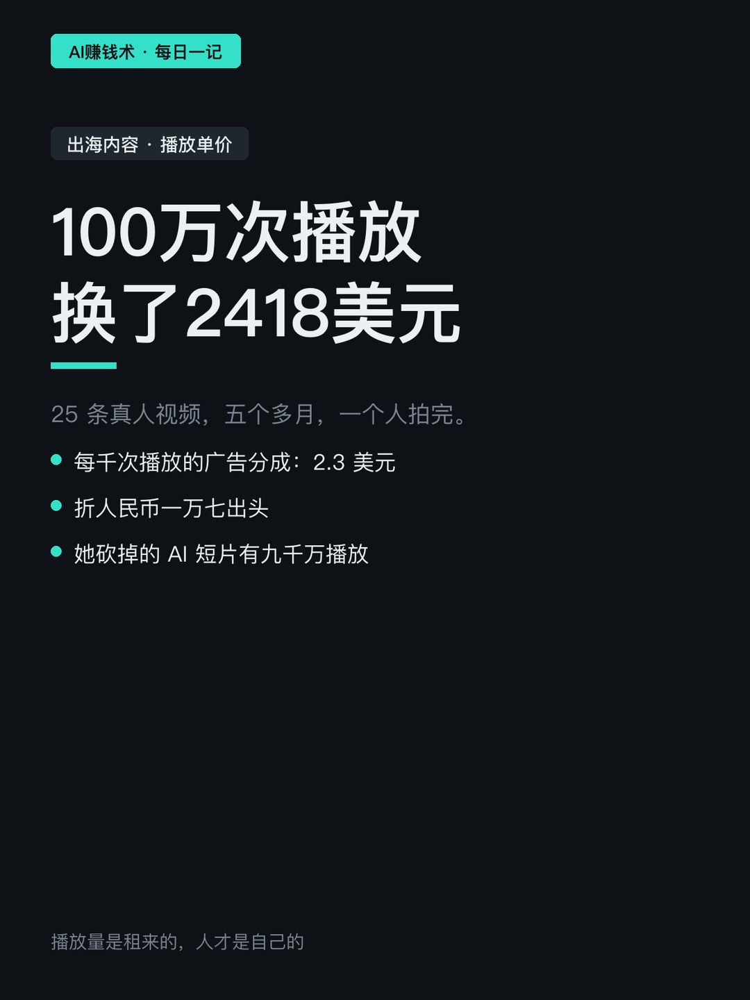
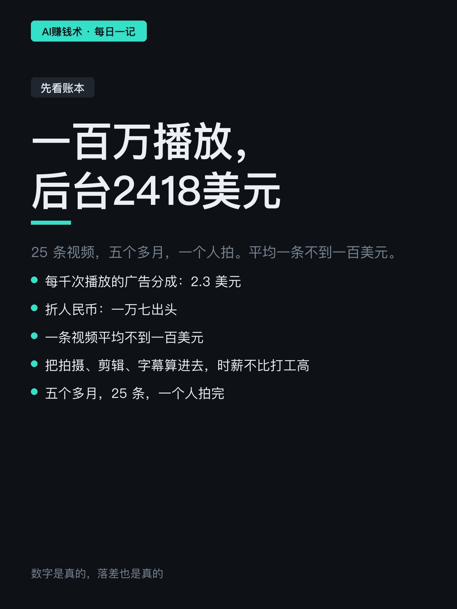
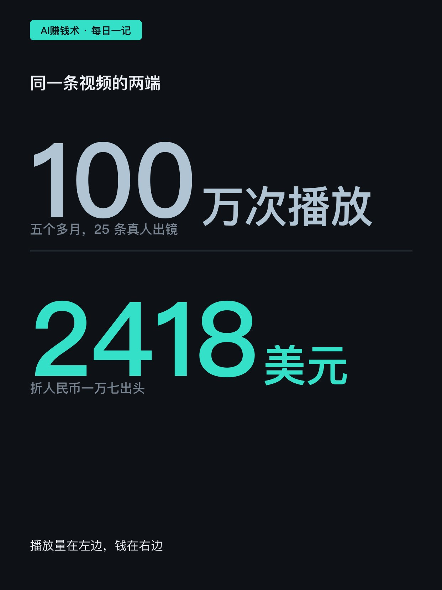
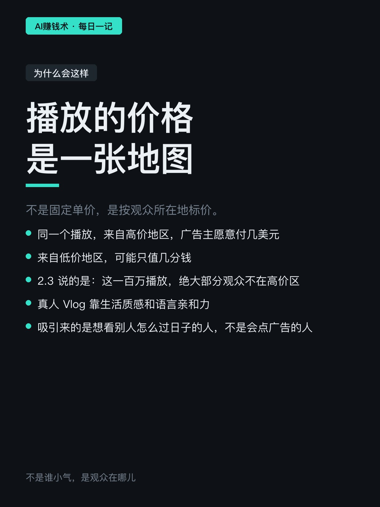
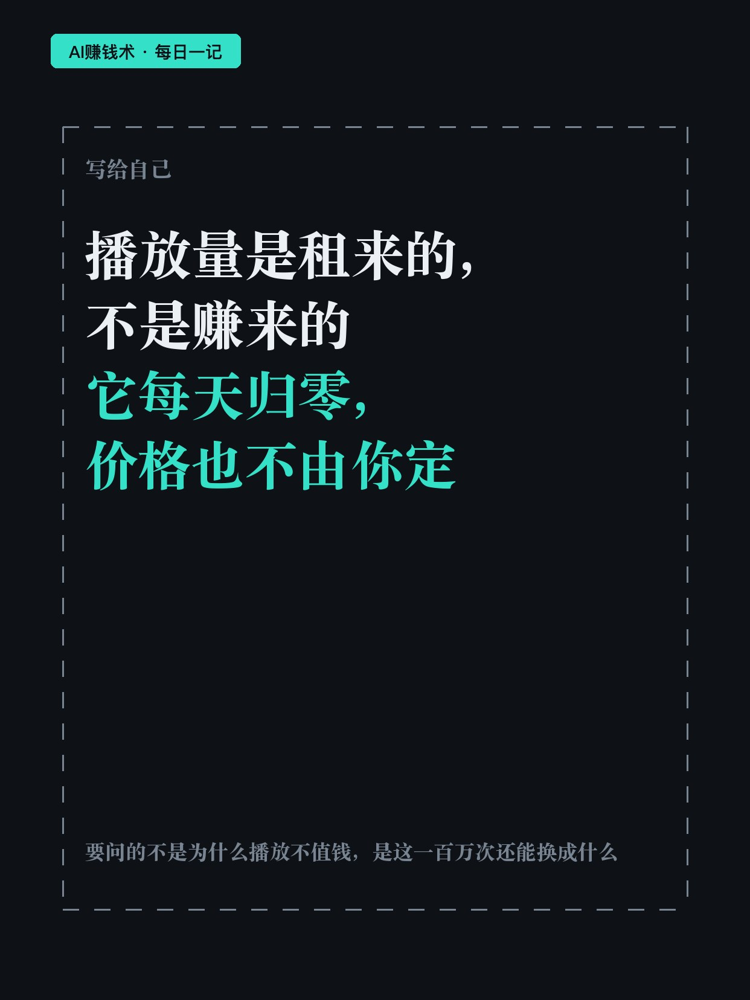

# 拍了25条，100万播放换2418美元

> — · 2026-10-31 11:00 发布 · AI 赚钱内容

## 标题（可直接复制）

```
拍了25条，100万播放换2418美元
```

## 正文（可直接复制发布）

25 条视频，100 万次播放，后台收益 2418.62 美元。

折成人民币一万七出头。每千次播放的广告分成，2.3 美元。

她五月底开始做，英语不好，零经验，一个人对着镜头讲英文，拍的是真人出镜的日常 Vlog。五个多月，二十五条，累计一百万播放。这笔账摊开看，平均一条不到一百美元，再把拍摄、剪辑、字幕的时间算进去，时薪并不比打工高。

很多人第一反应是「给得太少」。我一开始也这么想，但把数拆开就不成立了。

播放量的价格不是固定数字，它是一张按观众所在地标价的地图。同一个播放，来自出价高的地区，广告主愿意付几美元；来自出价低的地区，可能只值几分钱。2.3 这个数说的不是谁小气，说的是这一百万播放里，绝大部分观众不在高价区。真人 Vlog 尤其如此——它靠的是生活质感和语言亲和力，吸引来的是想看「普通人怎么过日子」的人，不是会顺手点广告的人。

这一点上，她踩过更狠的坑。

在这 25 条之前，她做的是 AI 生成的短视频，23 条，累计九千万播放。九千万，是现在这个数的九十倍。她把那条路砍了。

理由不是播放不好，是播放太好却换不来东西。AI 短片能批量生产，同质化来得也快，观众看完就走，记不住是谁做的；这类内容天生吸引的是看热闹的流量，广告价值低，粉丝也涨不动。九千万播放换来的是一个数字，不是一个能被记住的人。

她转真人，等于把「播放量」这个指标换成了「这个人是谁」。

但真人这条路的代价立刻显出来：产量掉下来，从一天几条变成几天一条；播放掉下来，从千万级掉到百万级；而单位播放的价格，并没有因为她更真诚就变高——观众在哪儿，还是那个价。

所以这 2418 美元不是失败，是一个校准过的数字。它告诉你两件事。

第一，播放量是租来的，不是赚来的。它每天归零，价格也不由你定。

第二，真人内容的价值不在播放分成里。她的钱如果只从这一项来，一百万播放确实只值一万七；但真人出镜换来的是能被记住的脸、能反复用的素材、能谈的其他合作——这些都不在每千次播放的价格里结算。

我不知道她会不会把这一百万播放换成别的收入。但如果只盯着后台那个 2418，她大概早就停了。

真正要问的，可能不是「为什么播放不值钱」，而是「我拍的这一百万次播放，除了广告分成，还能换成什么」。

## 话题标签

#副业 #搞钱思路

## 配图（8 张）









## 发布信息

| 项 | 值 |
|---|---|
| 平台 | 小红书 |
| 期数 | — |
| 发布时间 | 2026-10-31 11:00 |
| 正文长度 | 949 字 |
| 图片数量 | 8 张 |
| 状态 | 已发布 |
