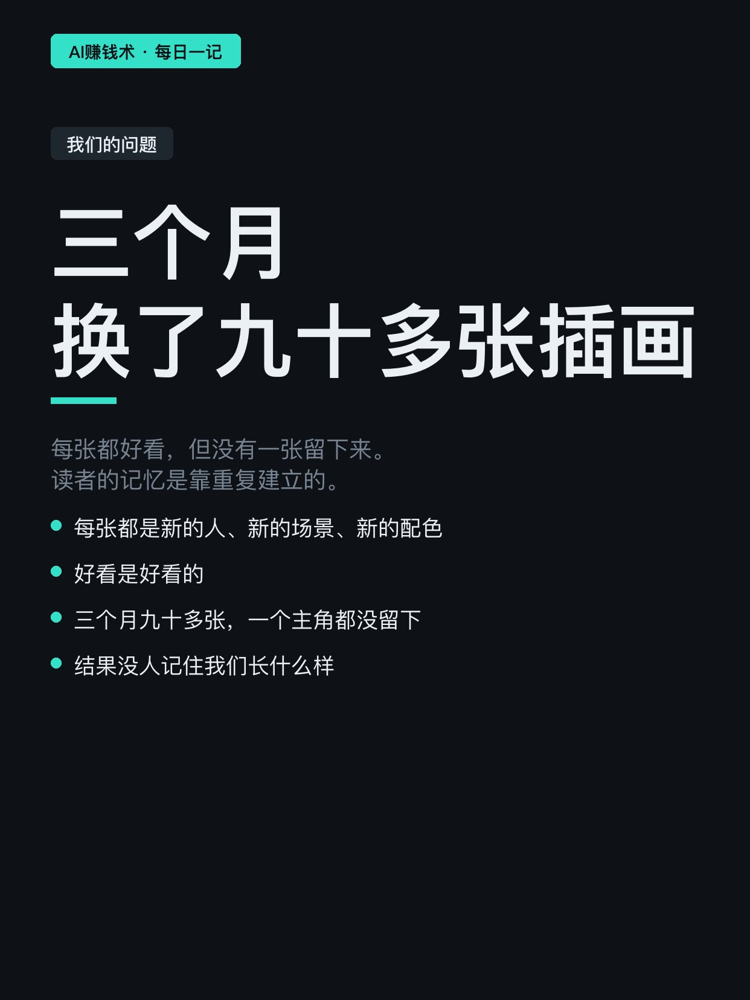
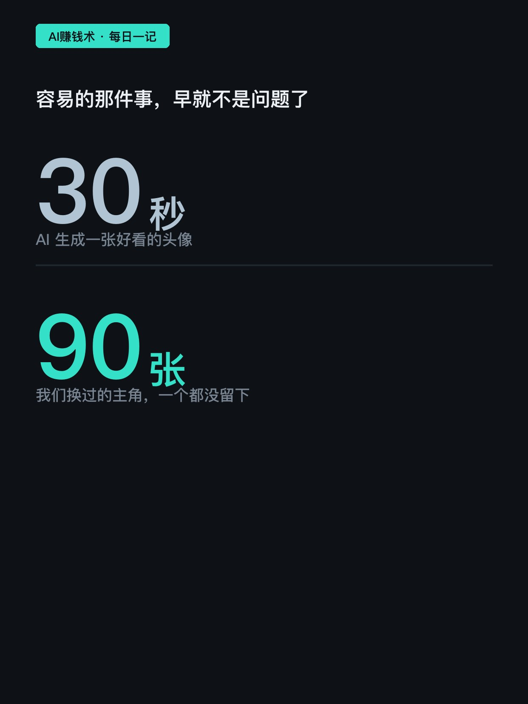
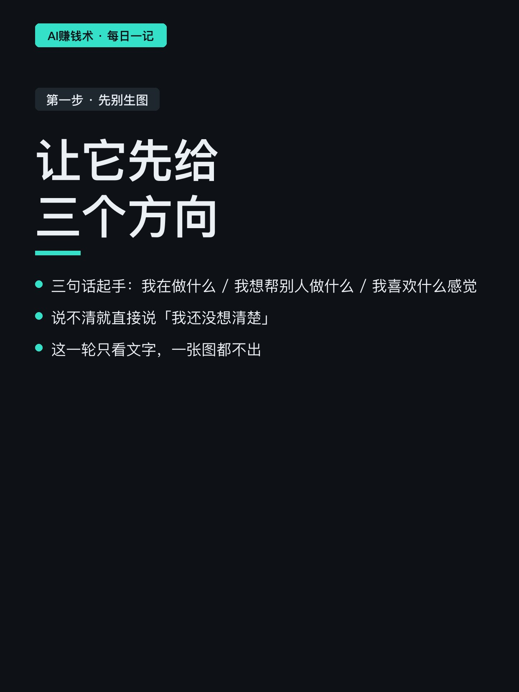
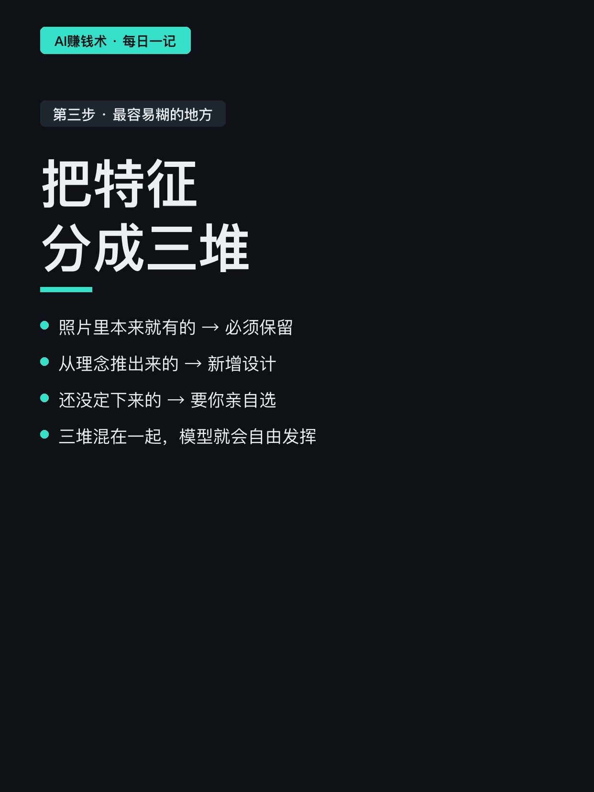
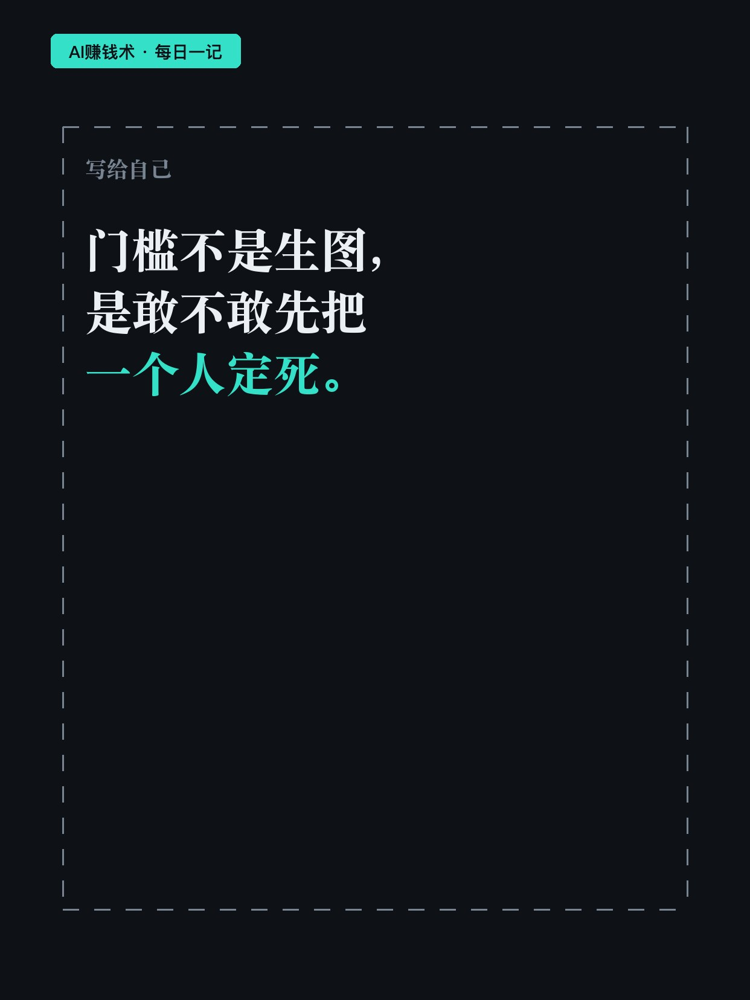

# 换了90张插画，没人记住

> — · 2026-10-31 08:06 发布 · AI 赚钱内容

## 标题（可直接复制）

```
换了90张插画，没人记住
```

## 正文（可直接复制发布）

我们账号做了三个月，封面插画换了九十多张。😮

每张都是新的一个人，新的场景，新的配色。结果是没有一个人记住我们长什么样。

📌 三十秒能出一张头像，但没用

现在让 AI 生成一张好看的头像，几十秒就够了。上传一张照片，写几句提示词，出来的东西能直接用。

所以问题从来不是「图好不好看」。问题是这张图代表什么，看完之后读者会不会觉得「还是这个人」。

📌 我看到的做法：先定人，再出图

一个做 AI 视觉的账号拆了自己的流程，我把它压缩成三步。

第一步，先不让 AI 生图，让它给三个方向。

描述只需要三句话：我在做什么、我想帮别人做什么、我喜欢什么感觉。说不清也没关系，直接说「我还没想清楚」。

然后要求它：三个方向必须真的不一样，不能只换画风或颜色，也不许都套同一类科技配件。

第二步，从三个里挑一个你愿意持续做的。

判断标准很土但很准：想象接下来十条内容，这个角色会在里面干什么。想不出来，就换一个。

第三步，让它把特征分成三堆。

照片里本来就有的（必须保留）、从理念推出来的（新增设计）、还没定要你选的。

这一步最容易糊。大部分人生图失败，就是这三堆混在一起，模型自己发挥了。⏱️

📌 一个我没想到的检查项

头像必须是 1:1，而且四周要留出圆形裁切的空间。

因为头像在评论区、消息列表、关注列表里都是圆的。很多人做出来方方正正很好看，一裁成圆，耳朵或者发型就被切掉了。

他给了四条检查：原型的辨识特征还在不在、轮廓和关键配色对不对得上、气质像不像你的账号、缩小并圆形裁切之后脸还清不清楚。💡

📌 最后一步，也是最容易被跳过的一步

头像定了不算完。要接着补全身、侧面、背面，每次都带着已经定稿的头像当参考，明确说「固定头部特征，不要重新设计」。

然后把这一整套存成一个角色档案。以后要换动作、要做配图，直接调它，不让模型自由发挥。

📌 我的判断

这件事真正的门槛不是生图，是「敢不敢先把一个人定死」。

定死了，你只能在一个形象里做变化，看起来选择变少了。但读者的记忆是靠重复建立的，你每换一次，等于把之前攒的全部清零。

我现在的疑问是：如果现在给账号定一个固定角色，前面九十多张风格各异的插画，算白做了吗。还是说它们本来就只是练手。🤔

## 话题标签

#副业 #AI #AI工具 #自媒体 #AI赚钱术日记

## 配图（8 张）










## 发布信息

| 项 | 值 |
|---|---|
| 平台 | 小红书 |
| 期数 | — |
| 发布时间 | 2026-10-31 08:06 |
| 正文长度 | 943 字 |
| 图片数量 | 8 张 |
| 状态 | 已发布 |
