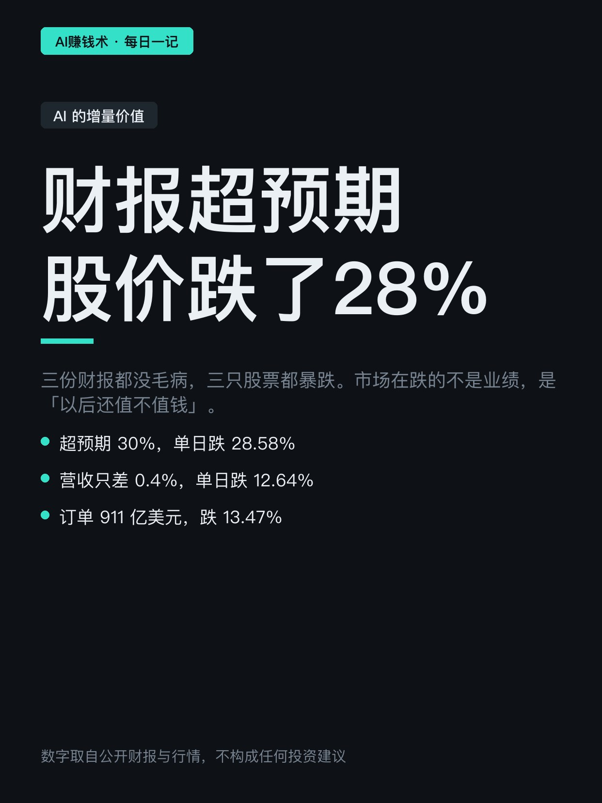
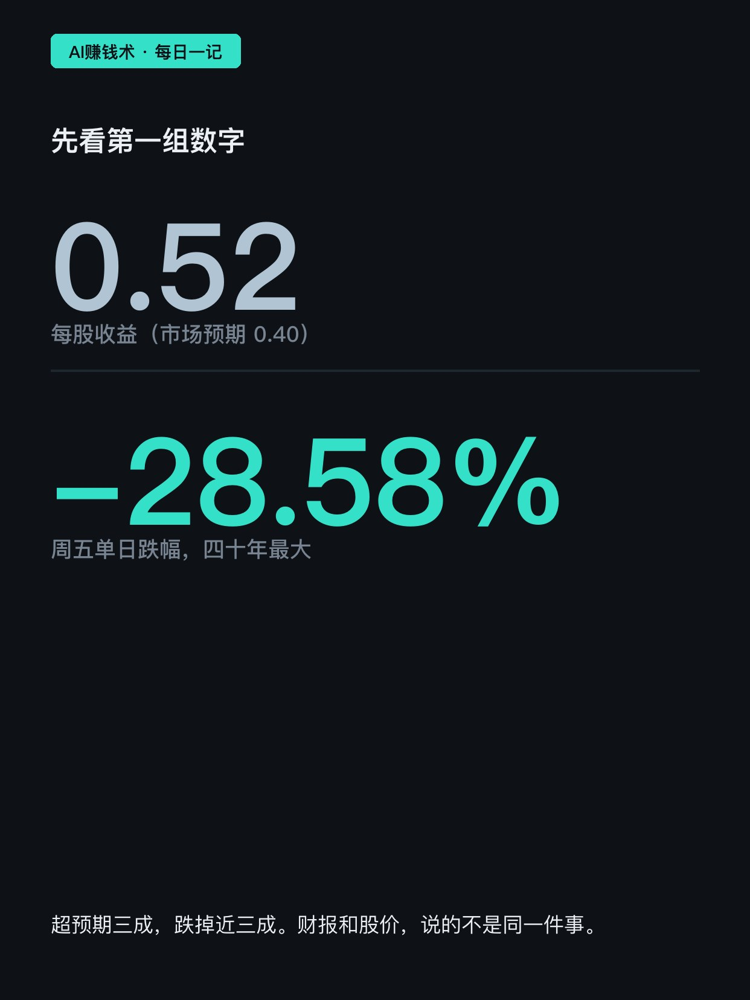
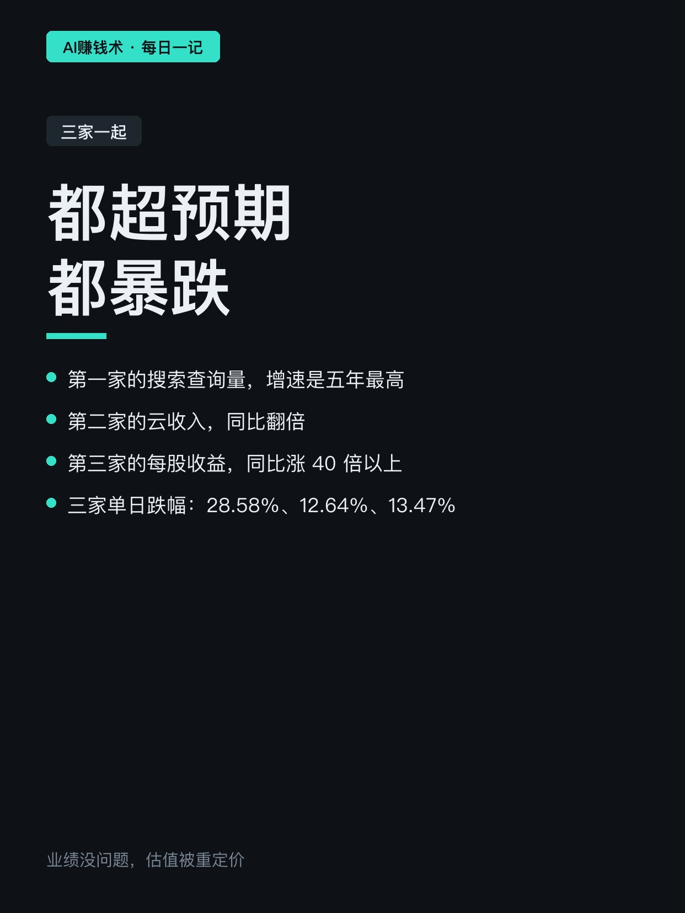
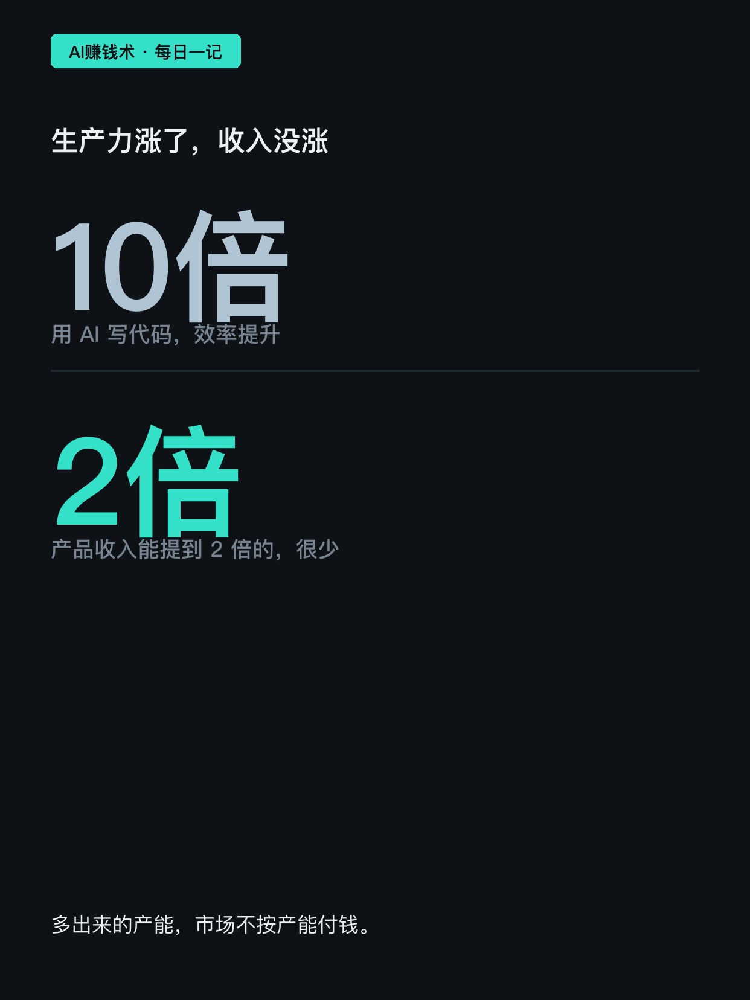
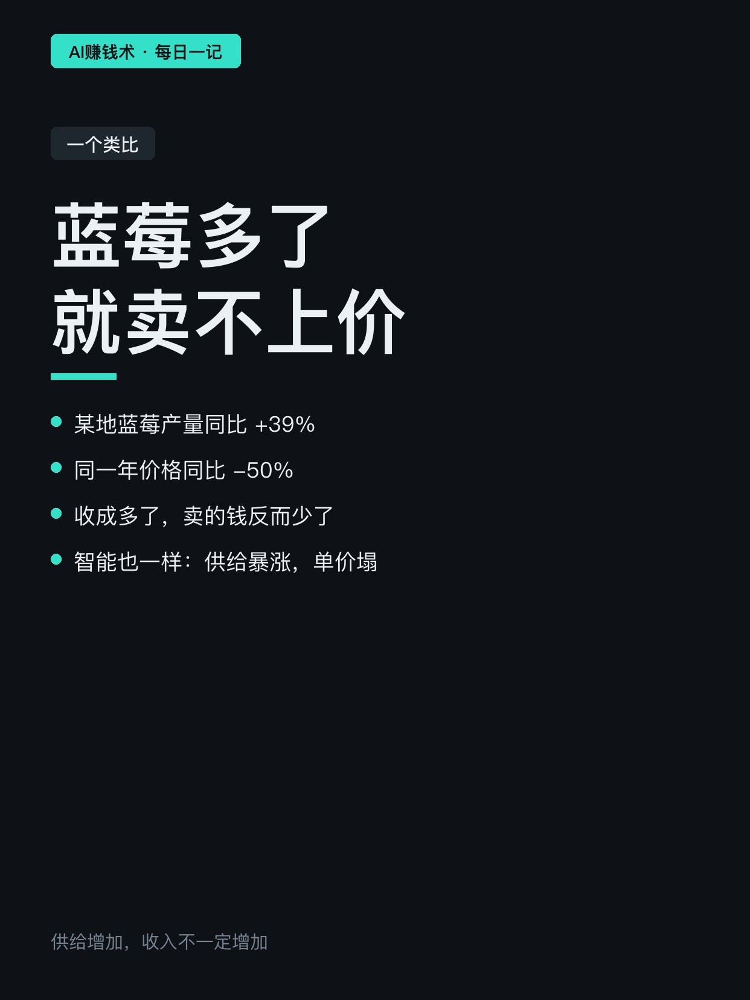
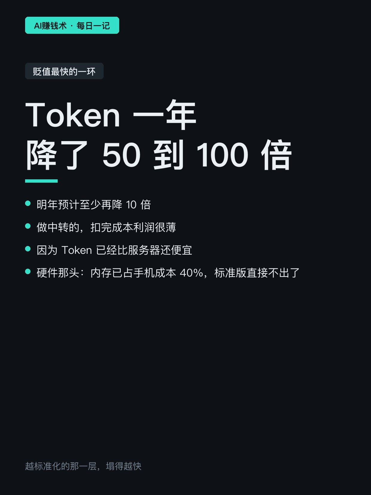
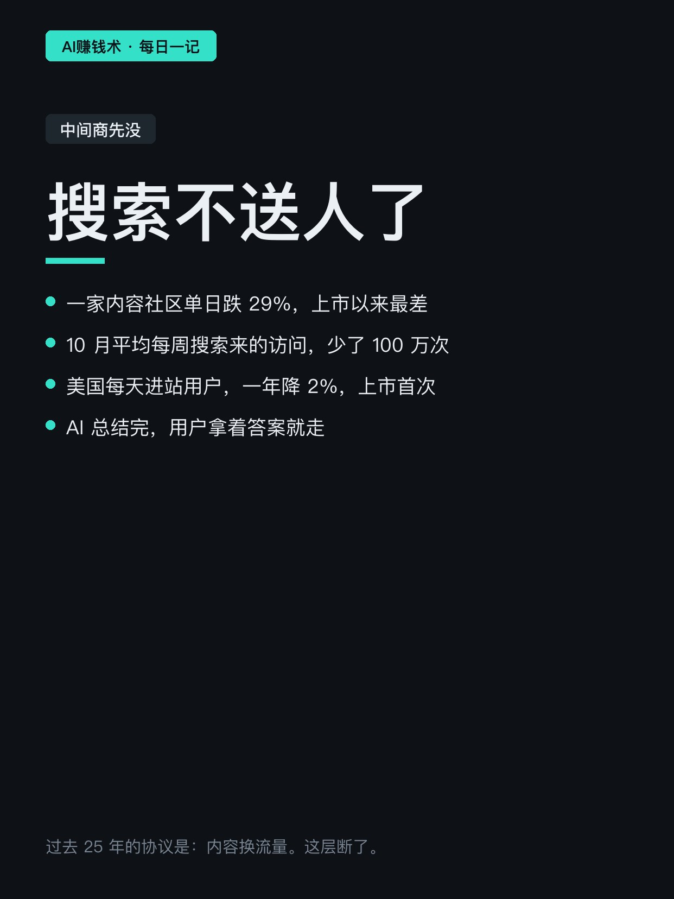
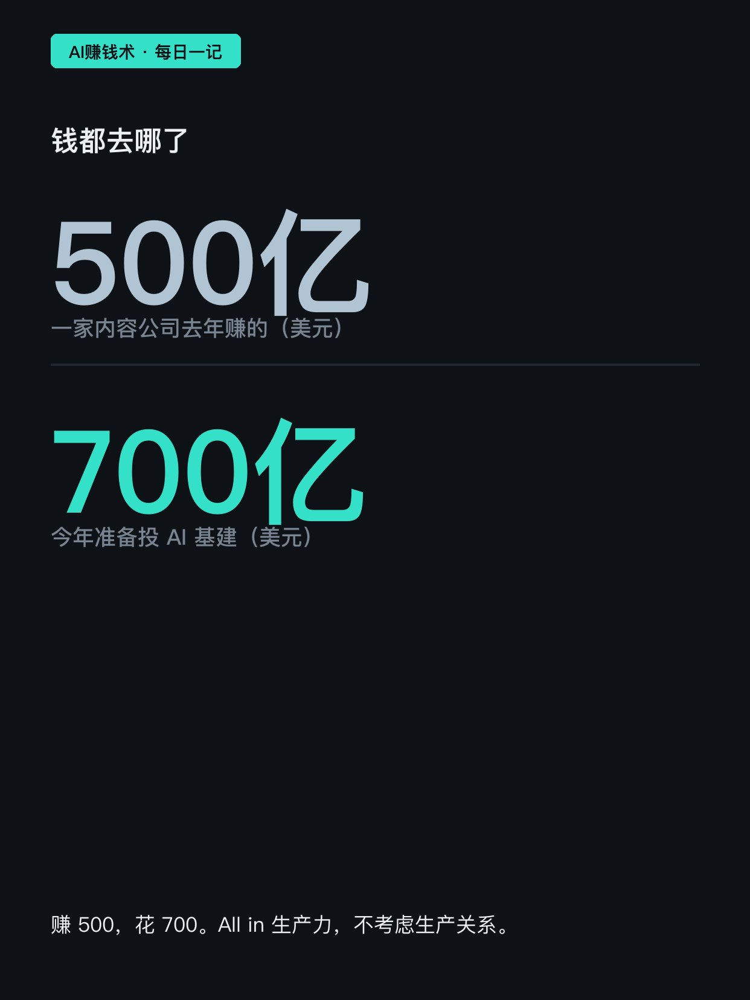
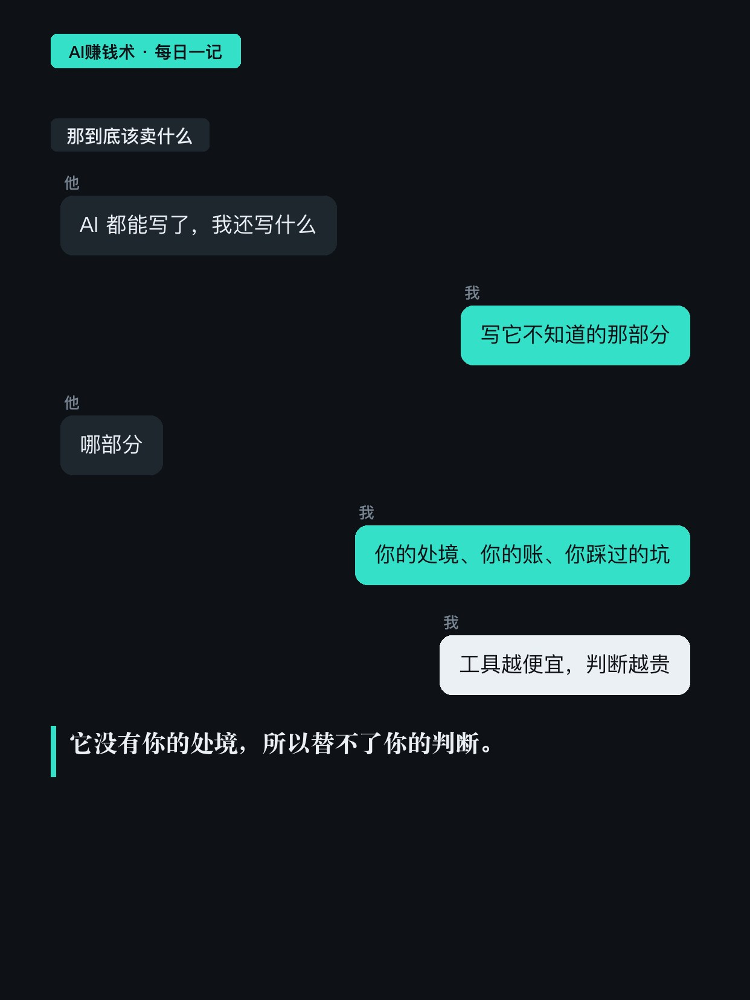
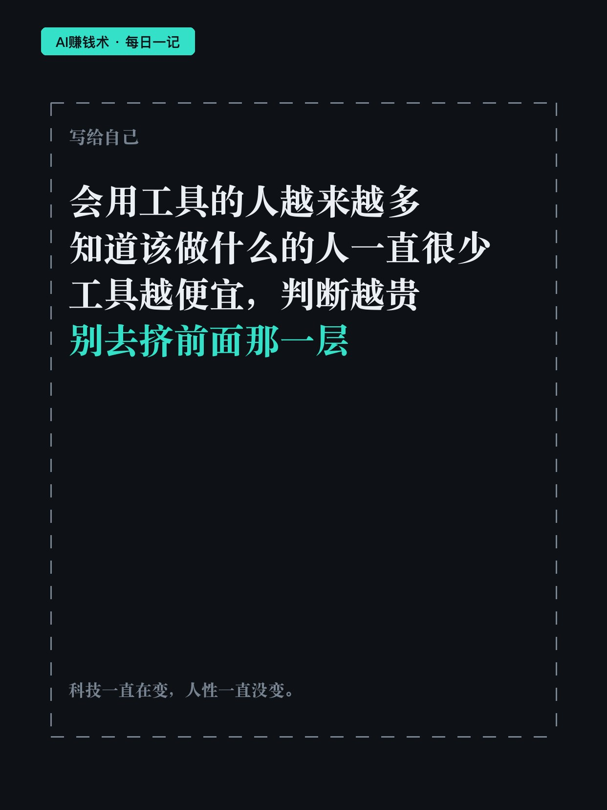

# 财报超预期，股价跌了28%

> — · 2026-10-31 15:01 发布 · AI 赚钱内容

## 标题（可直接复制）

```
财报超预期，股价跌了28%
```

## 正文（可直接复制发布）

三家公司发了财报，都超了预期。股价全跌了。😐

一家每股收益 0.52，市场预期 0.40，超了三成。周五股价跌 28.58%，四十年最大单日跌幅。

一家营收只比预期差 0.2% 到 0.4%，云收入翻倍，搜索查询量增速五年最高。单日跌 12.64%，一天蒸发近五千亿美元。

一家营收环比涨 23%，调整后每股收益同比涨 40 倍，手里 911 亿美元签约订单。跌 13.47%。

财报没毛病，钱也没少赚。市场在跌的不是业绩，是「这东西以后还值不值钱」。

📌 那个逻辑

AI 做的事情，是让智能不稀缺。不稀缺，就不值钱。

📌 三个证据

一，生产力涨了，收入没涨。用 AI 写代码效率能提 10 倍，但产品收入能提 2 倍的都很少。

二，供给涨了，价格就塌。一个地方蓝莓产量同比涨 39%，价格同比跌 50%。收成多了，卖的钱反而少了。

三，接口本身在贬值。Token 价格今年降了 50 到 100 倍，明年预计再降 10 倍。做中转的扣完成本利润很薄，因为 Token 比服务器还便宜。

📌 中间商先没

一家内容社区上市以来最差的一天，跌 29%。CEO 说得很直白：搜索的 AI 直接给答案，没人点进网页了。

10 月平均每周从搜索来的访问少了 100 万次以上。美国每天进站用户一年降 2%。

过去 25 年的协议是：网站给搜索内容，搜索把用户送回网站。现在 AI 总结完，用户拿着答案就走。中间那层没了。

📌 钱去哪了

一家软件巨头向 6 万员工开放自愿离职买断，占全员四分之一以上。公司越来越赚钱，但钱要投 AI。

一家内容公司去年赚约 500 亿美元，今年准备花最多 700 亿建 AI 基建。赚 500，花 700。

📌 我的判断

这条链上真正稳的，从来不是「会用工具」那一层。

工具越便宜，会用工具就越不值钱。值钱的是知道该做什么、先做哪一个、做到什么程度停手——这些判断 AI 替不了，因为它没有你的处境。

所以问题不是「我该学哪个 AI」，是「我手里有没有一个别人说不清楚的判断」。

📌 提醒

我不判断股价，也不给买卖建议。这些数字只说明一件事：市场在重新给「智能」定价。

周期都是这样：先泡沫，再大跌去泡沫，然后才被用在真正有价值的地方。

科技一直在变，人性一直没变。

## 话题标签

#副业 #自媒体 #内容创作 #AI赚钱术日记

## 配图（10 张）












## 发布信息

| 项 | 值 |
|---|---|
| 平台 | 小红书 |
| 期数 | — |
| 发布时间 | 2026-10-31 15:01 |
| 正文长度 | 969 字 |
| 图片数量 | 10 张 |
| 状态 | 已发布 |
