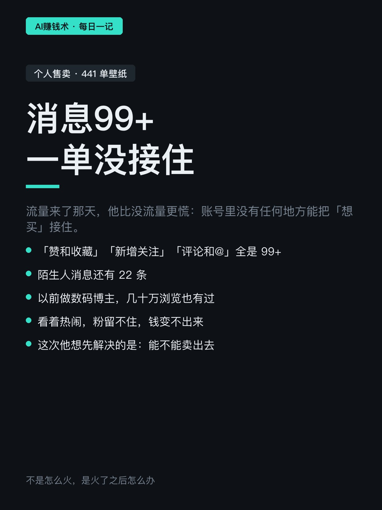
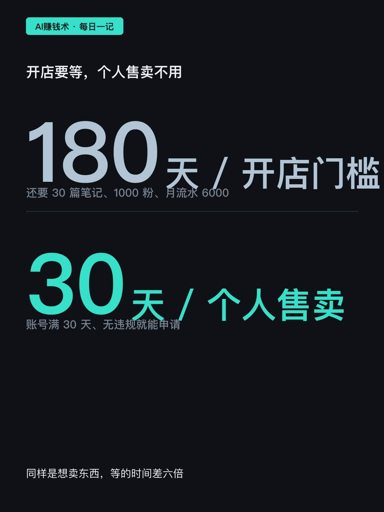
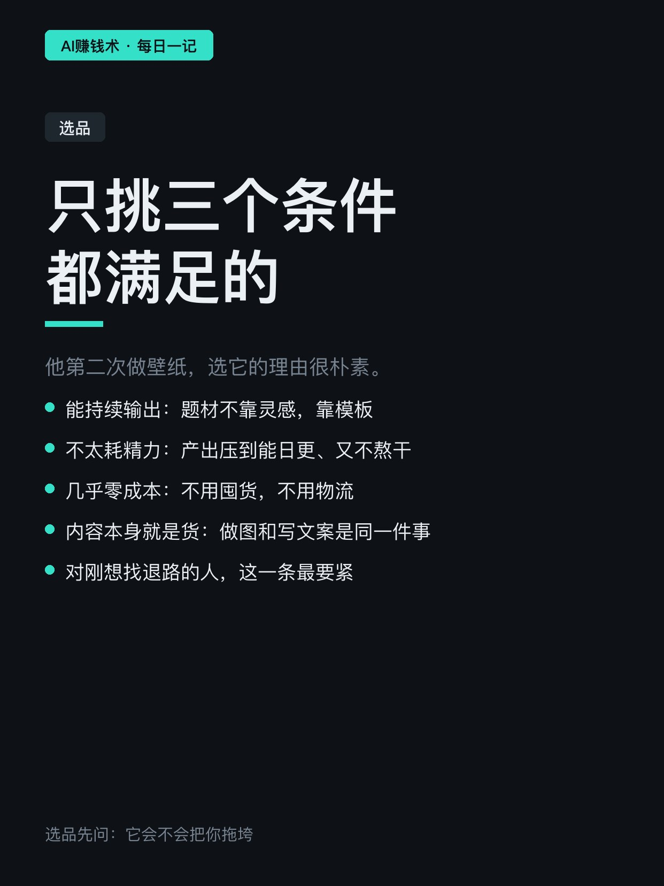
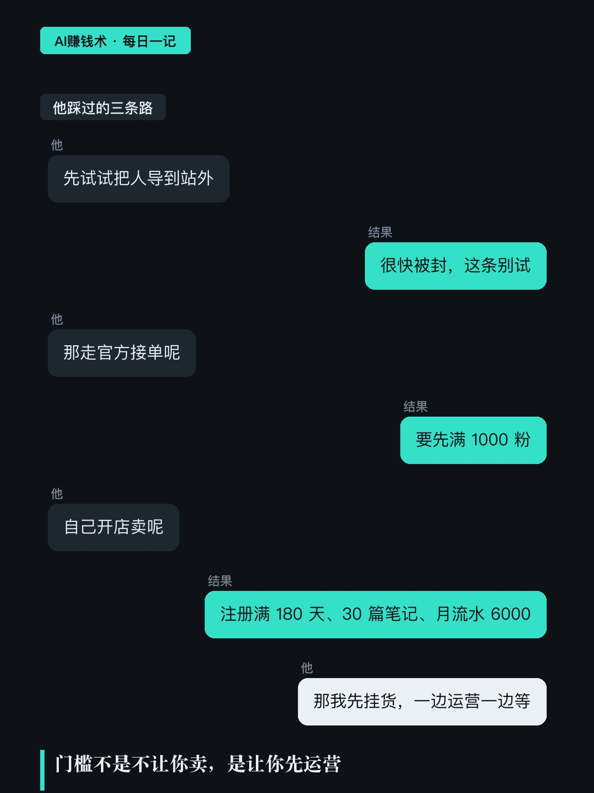
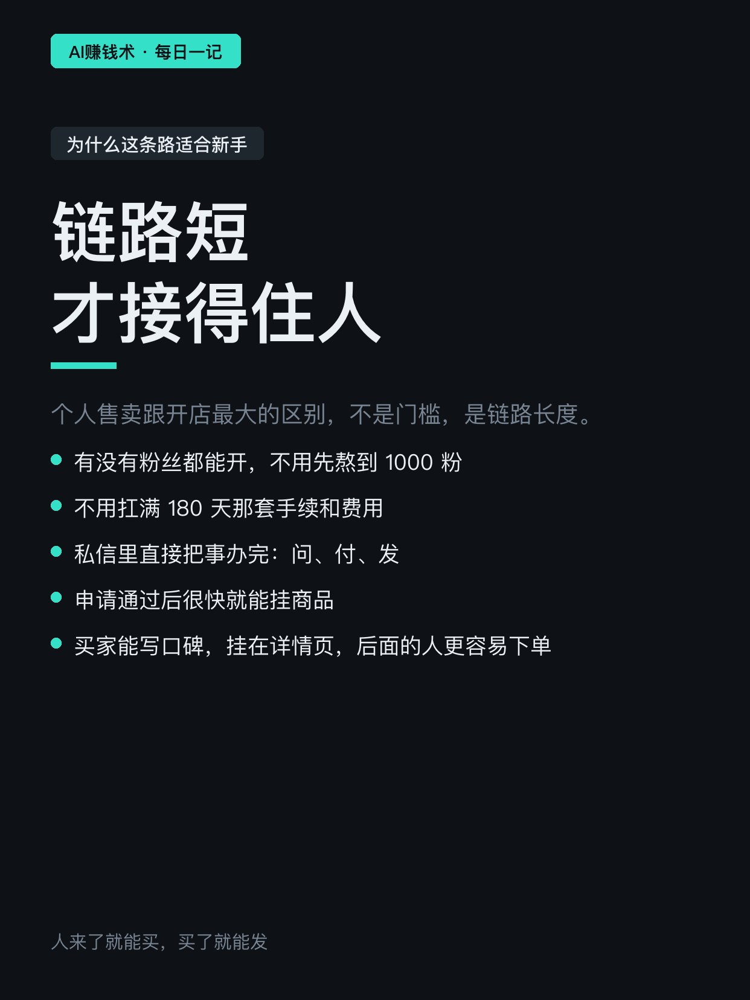
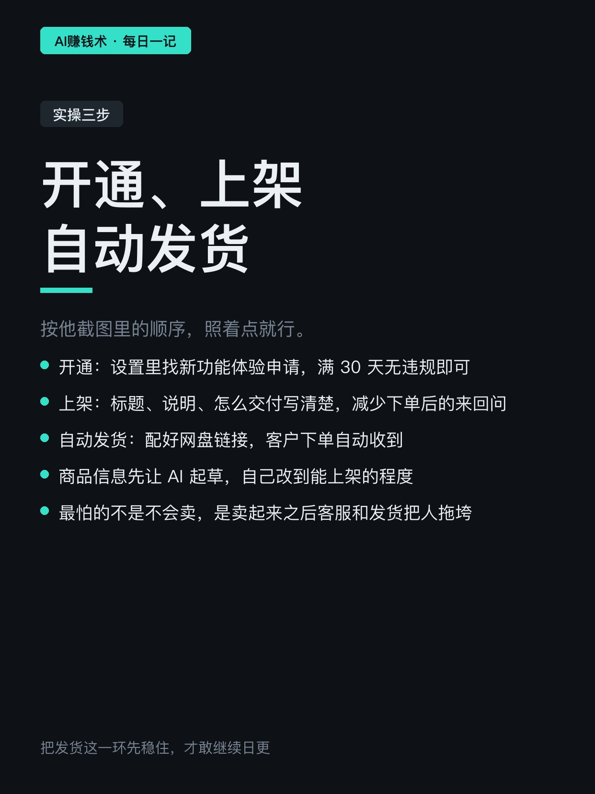
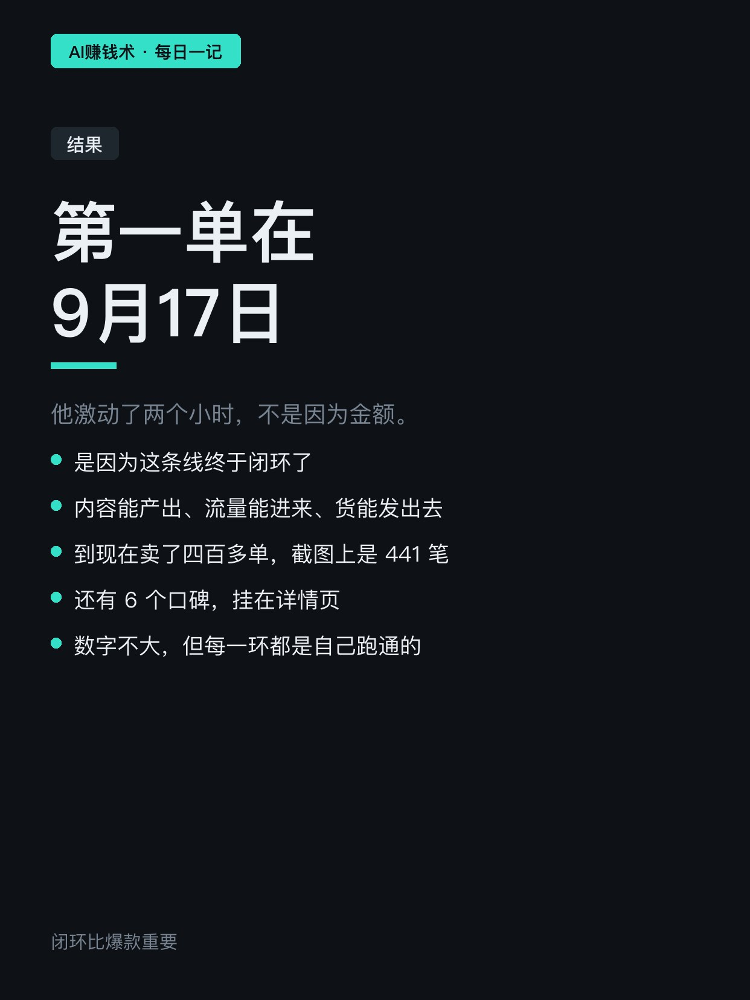
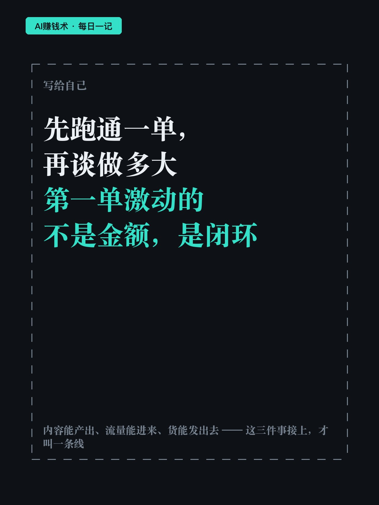

# 441单壁纸，他先跑通再谈放大

> — · 2026-11-01 19:11 发布 · AI 赚钱内容

## 标题（可直接复制）

```
441单壁纸，他先跑通再谈放大
```

## 正文（可直接复制发布）

441 单壁纸，一单几十块。数字不大，但他把「流量能不能变成钱」这件事跑通了。😮

之前他做数码博主，几十万浏览也有过——看着热闹，粉留不住，钱变不出来，精力倒是耗得厉害。所以这次他反过来了：先找一件能卖的东西。

① 先别急着做号，先找能卖的

他选壁纸就三条：能持续输出、不太耗精力、几乎零成本。

不用囤货、不用物流，内容本身就是货。做图和写文案是同一件事，产出能压到日更、又不把自己熬干。

对刚想找退路的人，这一条比「什么赛道火」重要得多。

② 三条路他都试过，只有一条不用等

站外引流，很快被封，这条他现在直接劝人别试。

官方接单，门槛是先满 1000 粉。

自己开店卖电子资料，要注册满 180 天、30 篇笔记、1000 粉、月流水 6000。

他最后用的是个人售卖：账号满 30 天、无违规就能申请，有没有粉都能开，私信里直接把事办完。买家还能写口碑挂在详情页，后面的人更容易下单。

③ 流量来了要接得住

他封面那张截图是消息页：「赞和收藏」「新增关注」「评论和@」全是 99+，陌生人消息还有 22 条。

很多人第一反应是「火了」。他第一反应是慌——如果账号里没地方把「想买」接住，这些人过两天就散了。

所以他配了自动发货：客户下单自动收到链接，不用一条条手动发。壁纸这种货，最怕的不是不会卖，是卖起来之后客服和发货把人拖垮。

9 月 17 日第一单，他激动了两个小时，不是因为金额，是因为闭环了：内容能产出、流量能进来、货能发出去。到现在 441 单，6 个口碑。

如果要我带走一句：先跑通一单，再谈做多大。

你手上有没有一件「能一直做、成本几乎为零」的东西？评论区说一句。

## 话题标签

#副业 #个人IP #小红书运营 #搞钱思路 #AI赚钱术日记

## 配图（8 张）










## 发布信息

| 项 | 值 |
|---|---|
| 平台 | 小红书 |
| 期数 | — |
| 发布时间 | 2026-11-01 19:11 |
| 正文长度 | 710 字 |
| 图片数量 | 8 张 |
| 状态 | 已发布 |
