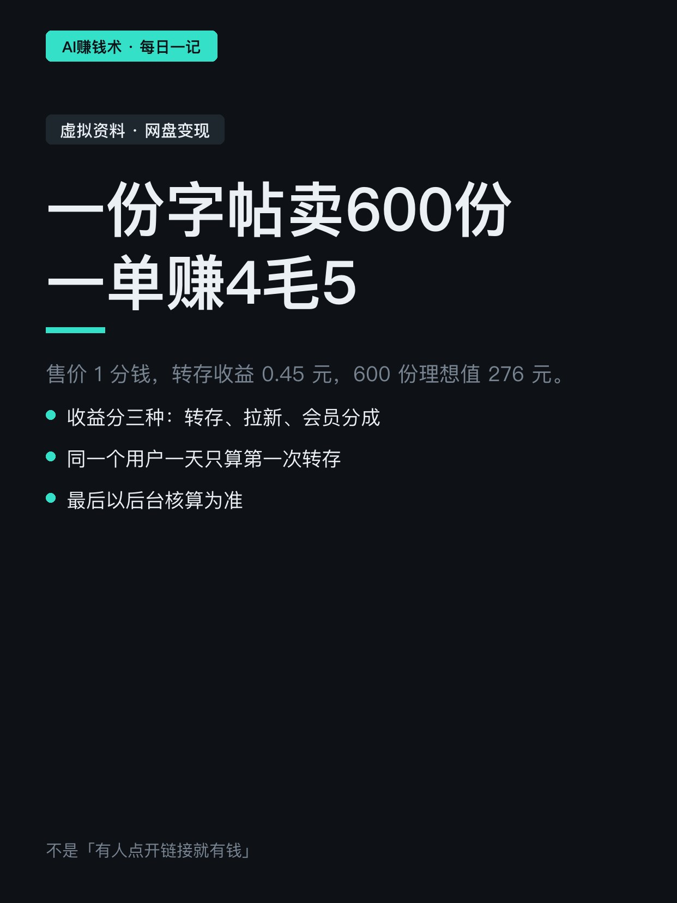
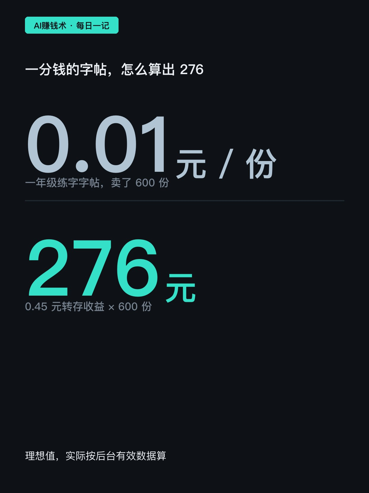
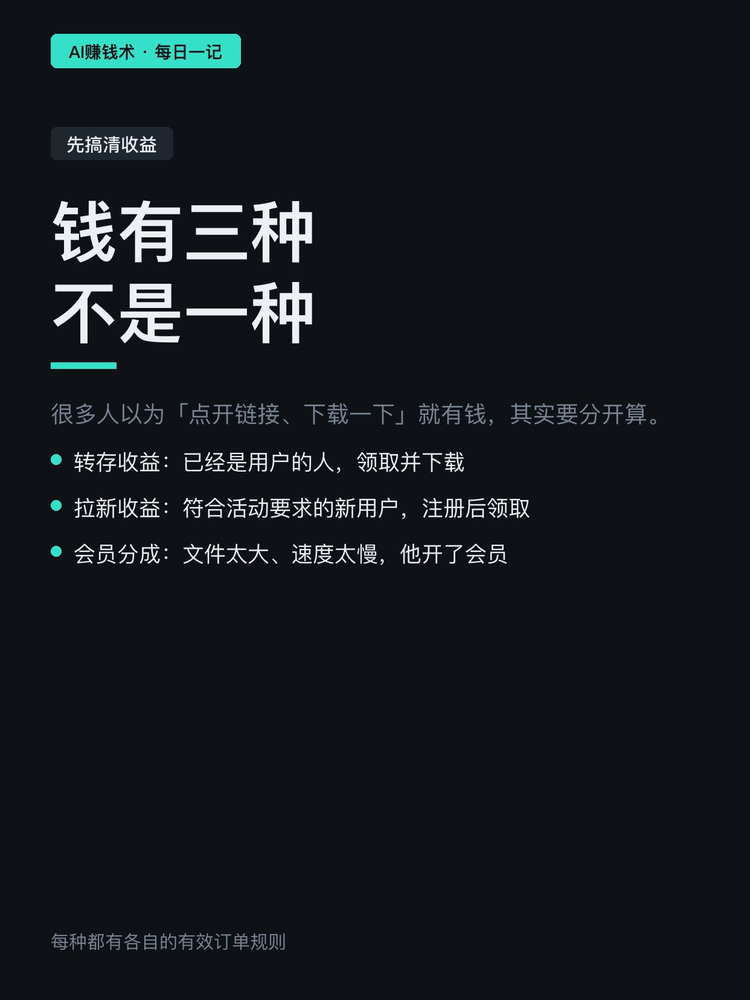
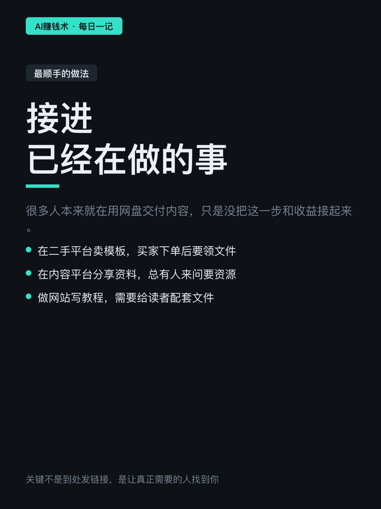
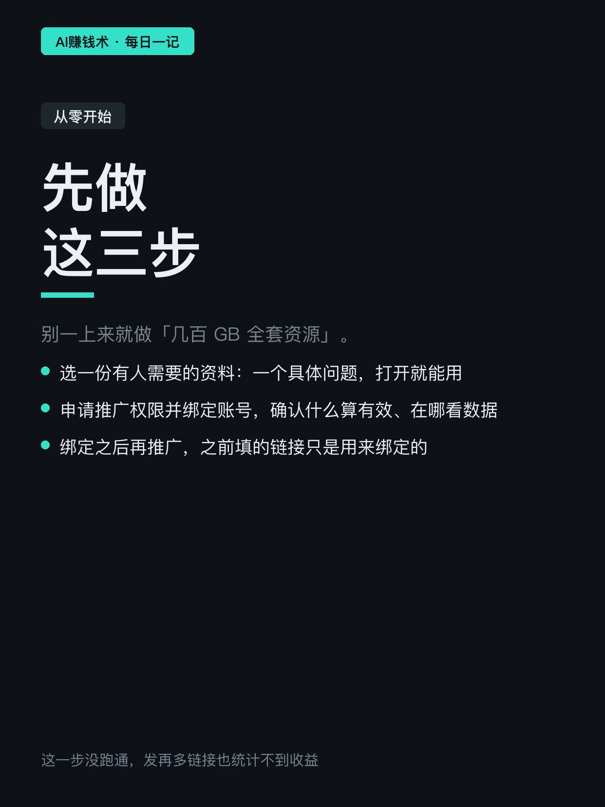
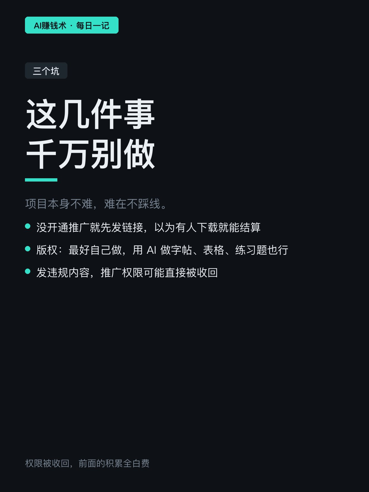
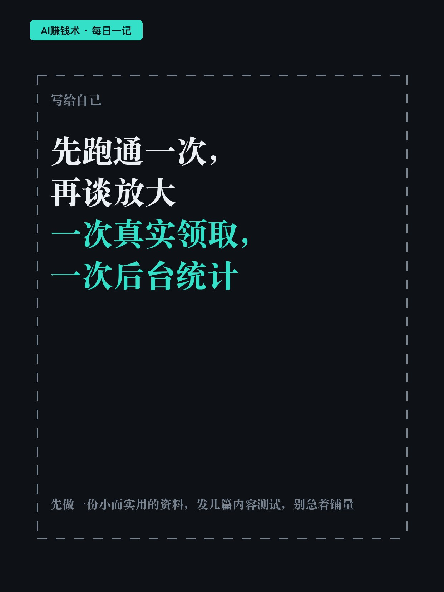

# 一份字帖卖600份，一单赚4毛5

> — · 2026-11-01 15:10 发布 · AI 赚钱内容

## 标题（可直接复制）

```
一份字帖卖600份，一单赚4毛5
```

## 正文（可直接复制发布）

一份一年级练字字帖，卖 1 分钱，卖出 600 份。每份还能带 0.45 元的转存收益，理想值 276 元。😮

这是他把「发货」这一步接上网盘推广之后算出来的账。项目本身不复杂：把资料放网盘，别人领取、转存、下载，符合规则就有收益。

但很多人对它有误解。

① 收益有三种，不是一种

- 转存收益：对方已经是这个网盘的用户，领取并下载
- 拉新收益：符合活动要求的新用户，注册后领取
- 会员分成：文件太大、下载太慢，他顺手开了会员

所以不是「有人点开链接就有钱」。规则很细：同一个用户一天只算第一次转存，他今天先转了别人的资料，再转你的，你这单就没有收益。最后以后台核算为准。

② 最顺手的做法，是接进已经在做的事

你本来就在用网盘交付内容：在二手平台卖模板，买家下单后要领文件；在内容平台分享资料，总有人来问要资源；做网站写教程，得给读者配套文件。

这些场景里，网盘推广只是把「发货」这一步接上收益，不用另起一个项目。资料本身卖钱，符合规则的转存再带一笔。

能做的不止模板。考试资料、简历、面试清单，跟着节点走——12 月四六级，现在需求就很高。也有人做手抄报下载站、教师用的 PPT、壁纸、键盘皮肤，一个资料类型配一个平台，就能跑起来。

关键不是到处发链接，是让真正需要资料的人找到你。

资料最好自己原创，或者已经取得分享许可。用 AI 做字帖、表格、练习题，几分钟一份，成本几乎为零。

③ 先跑通一次，再谈放大

三步：选一份有人需要的资料（别做几百 GB 全套，先解决一个具体问题）、申请推广权限并绑定账号（确认什么算有效、在哪看数据）、绑定之后再推广。

三个坑：没开权限就先发链接，以为有人下载就能结算；版权，最好自己做，用 AI 做字帖、表格、练习题也行；发违规内容，推广权限可能直接被收回。

一个项目最怕的是，链接发了一堆，后台一条有效数据都没有，还不知道问题出在哪。

你现在是哪种情况——已经在卖资料但没接推广、想做但不知道选什么资料、还是发过链接但没收益？评论区说一句。

## 话题标签

#副业 #虚拟资料 #搞钱思路 #AI工具 #AI赚钱术日记

## 配图（8 张）










## 发布信息

| 项 | 值 |
|---|---|
| 平台 | 小红书 |
| 期数 | — |
| 发布时间 | 2026-11-01 15:10 |
| 正文长度 | 859 字 |
| 图片数量 | 8 张 |
| 状态 | 已发布 |
