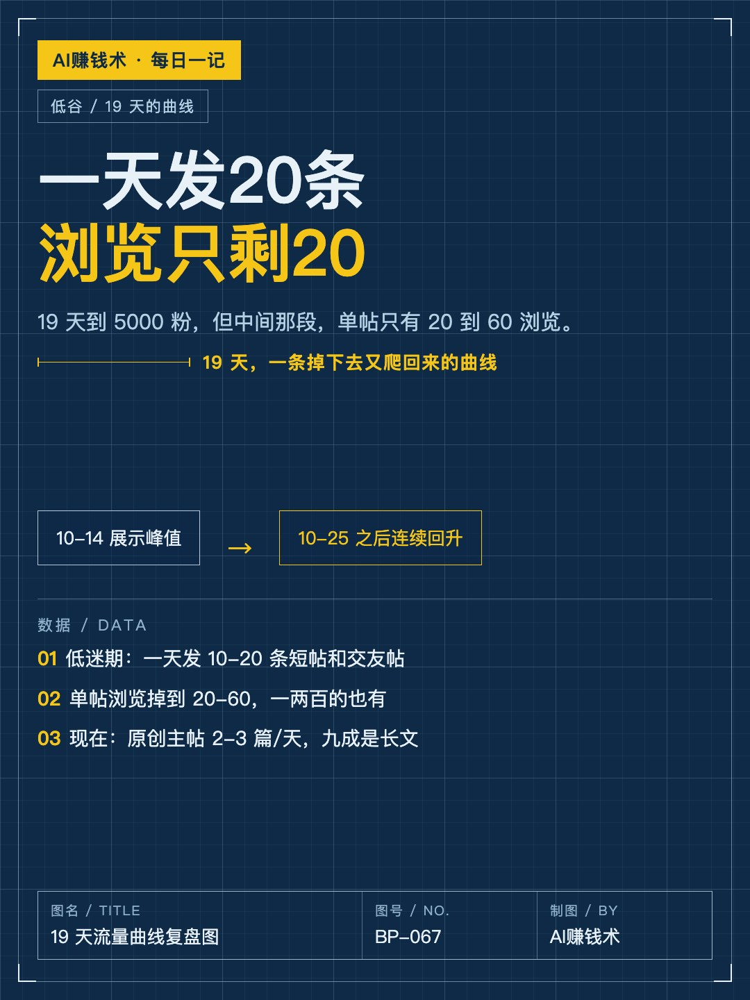
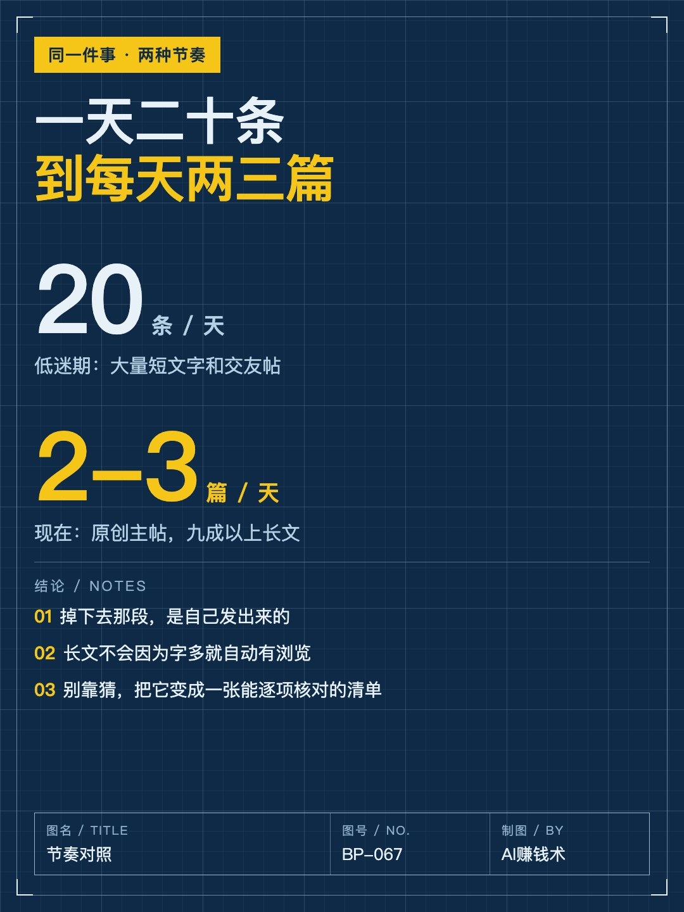
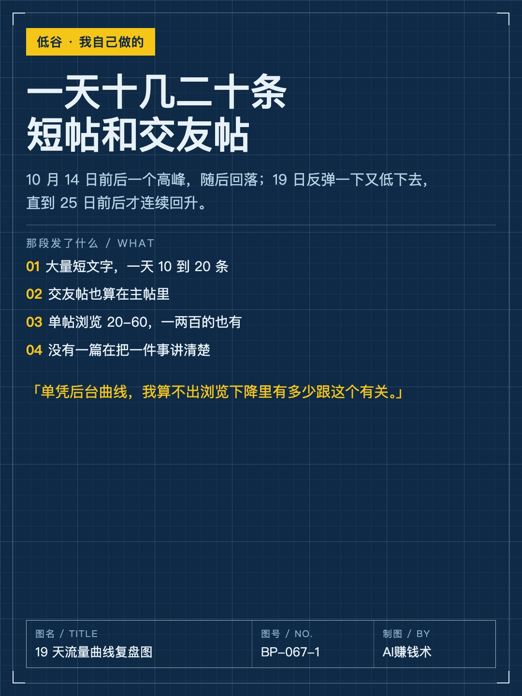
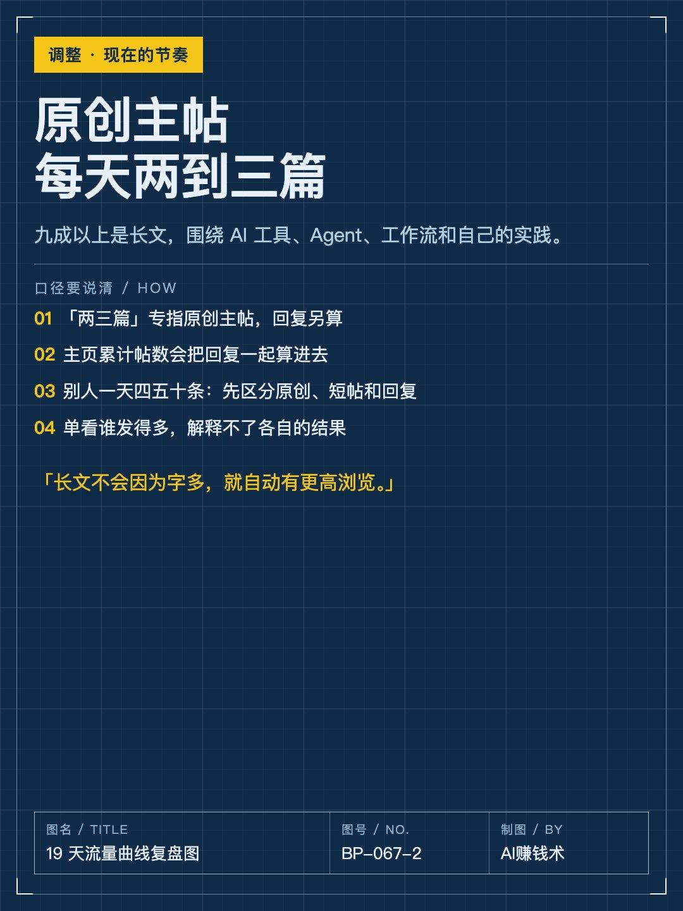
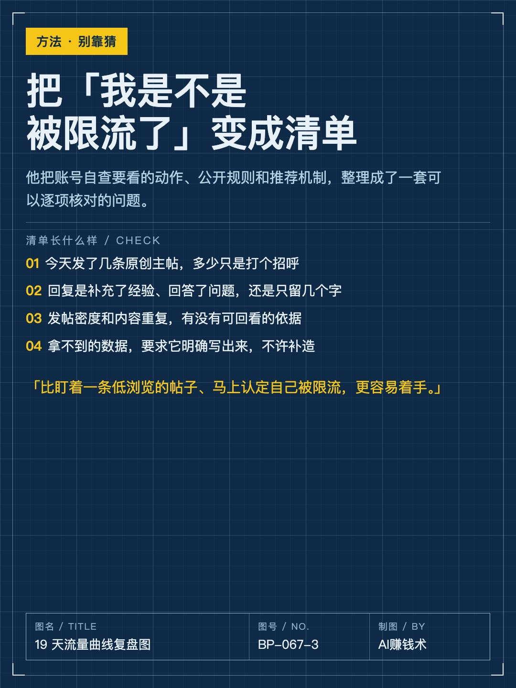
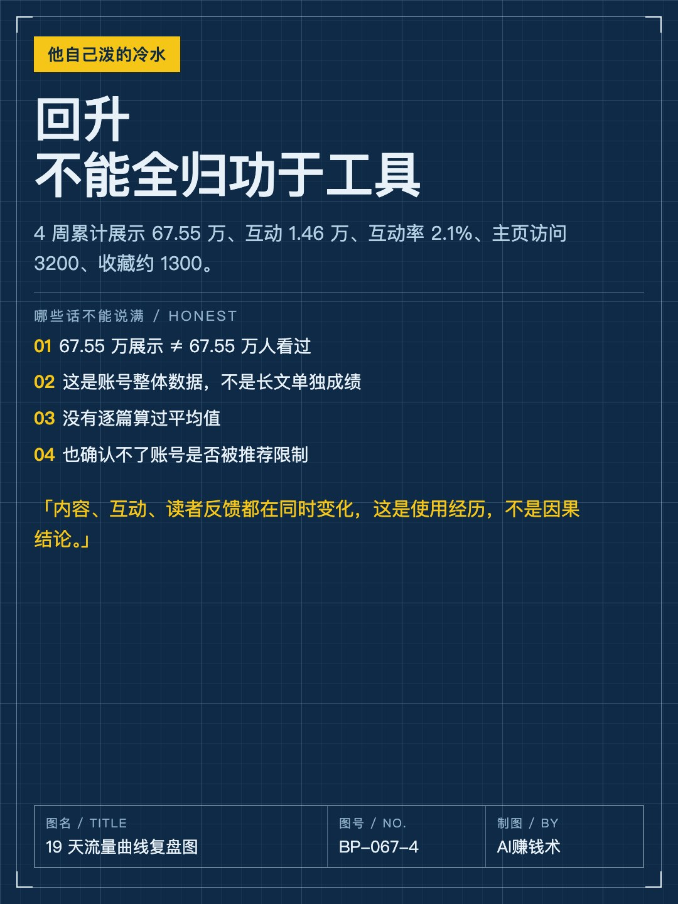
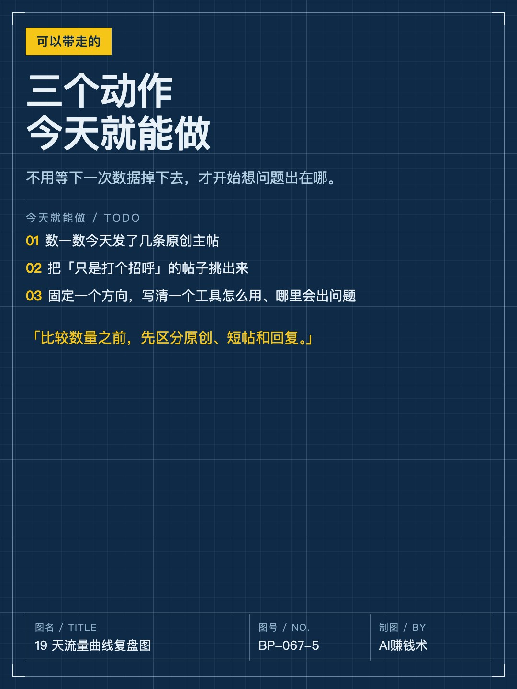
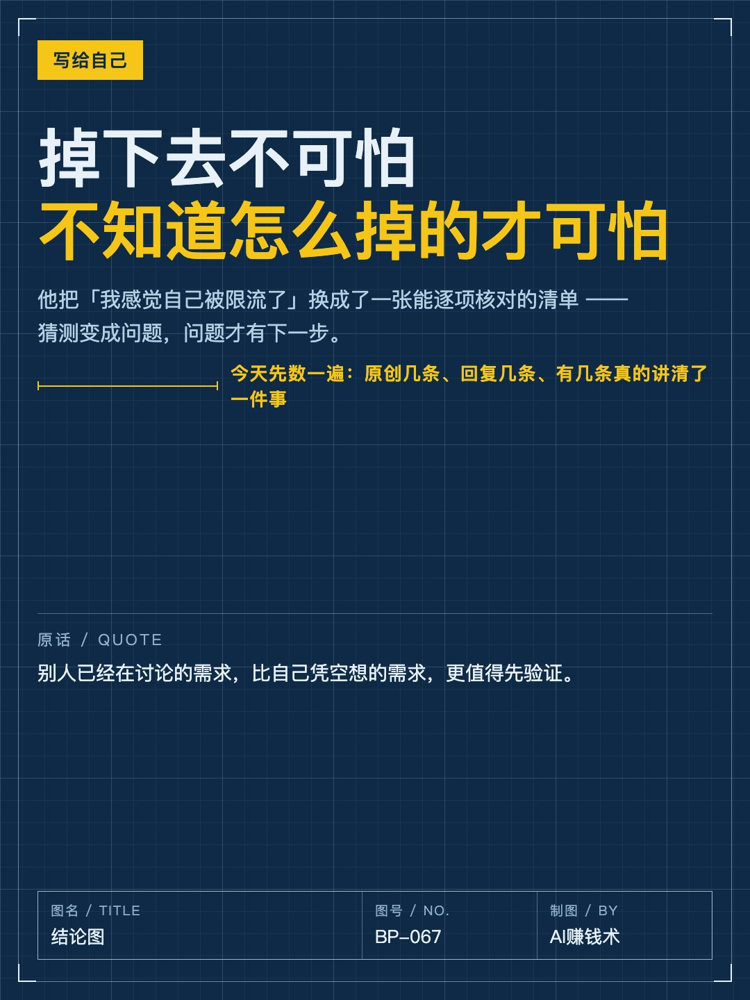

# 一天发20条，浏览只剩20

> — · 2026-11-01 08:17 发布 · AI 赚钱内容

## 标题（可直接复制）

```
一天发20条，浏览只剩20
```

## 正文（可直接复制发布）

19 天，5000 粉。但中间有一段，我发出去的帖子只有 20 到 60 浏览。😮

10 月 11 日建号，30 日晚上到 5000 粉。曲线是这么走的：14 号前后一个特别高的峰值，然后回落；19 号反弹一下，又低下去；直到 25 号前后才连续回升。最近这轮也没超过最早的高点。

他写的不是成绩，是掉下去那一段。

① 掉下去那段，是自己发的

低迷的时候，他一天发 10 到 20 条，大量短文字和交友帖。现在复盘，这种发法是他重点调整的部分。

他自己也说得很实在：单凭后台曲线，算不出浏览下降里有多少跟这个有关。

② 调整：原创主帖每天两到三篇

九成以上是长文，围绕 AI 工具、Agent、工作流和自己的实践。这里的「两三篇」专指原创主帖，回复另算——主页累计帖数会把回复一起算进去。

他还补了一句关键的：长文不会因为字多，就自动有更高浏览。要做的还是把一个工具怎么用、哪里可能出问题、自己实际做过什么讲清楚。

有人一天发四五十条，他选两三篇。比较数量之前，得先区分原创、短帖和回复。

③ 别靠猜，把它变成一张清单

他干脆把账号自查要看的动作、公开规则和推荐机制，整理成了一套能逐项核对的问题：今天发了几条原创主帖、里面多少只是打个招呼、回复是补充了经验还是只留几个字、发帖密度和内容重复能不能回看。

用的时候他还加了一条硬要求：先说明实际检索到哪些帖子、日期范围、去重后样本多少，原创主帖和回复各几条；材料不足就继续找，拿不到就明确写出来，不许补造。

好处是：不用盯着一条低浏览的帖子，马上认定自己被限流，而是有一套具体问题逐项核。

数据他也说得很克制。4 周累计展示 67.55 万、互动 1.46 万、互动率 2.1%、主页访问 3200、收藏约 1300。这是账号整体数据，不是长文单独成绩；67.55 万展示也不等于 67.55 万人看过。

他也承认这套东西的边界：看不到平台内部评分，确认不了账号是不是真被限制了。

流量是调了发帖之后慢慢转好的，但内容、互动、读者反馈都在同时变化，不能把回升全归功于一个工具。

如果要我带走一句：掉下去不可怕，不知道自己怎么掉的才可怕。

你现在是哪一种——发太多没重点、发太少没手感、还是根本不知道问题出在哪？评论区说一句。

## 话题标签

#自媒体 #内容创作 #复盘 #个人IP #AI赚钱术日记

## 配图（8 张）










## 发布信息

| 项 | 值 |
|---|---|
| 平台 | 小红书 |
| 期数 | — |
| 发布时间 | 2026-11-01 08:17 |
| 正文长度 | 955 字 |
| 图片数量 | 8 张 |
| 状态 | 已发布 |
