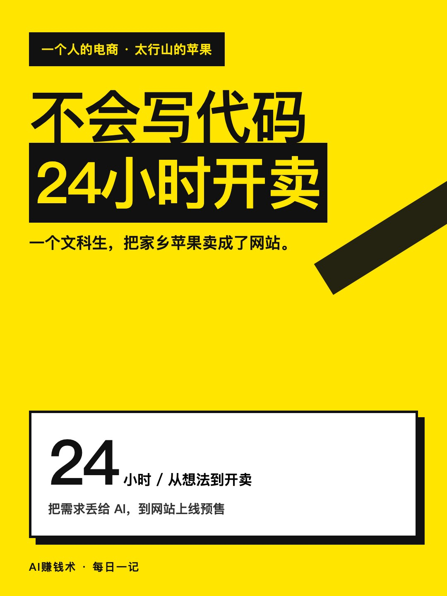
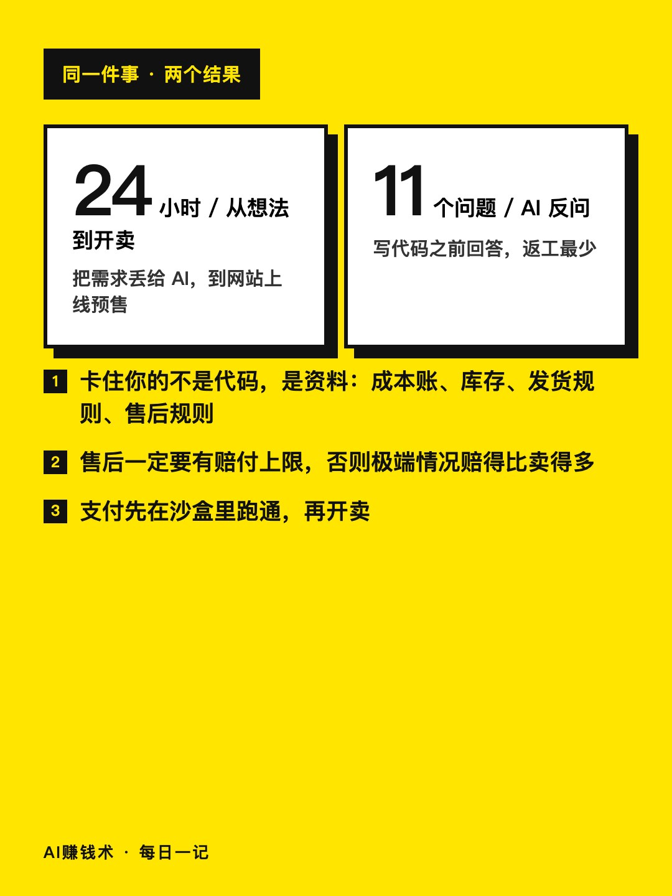
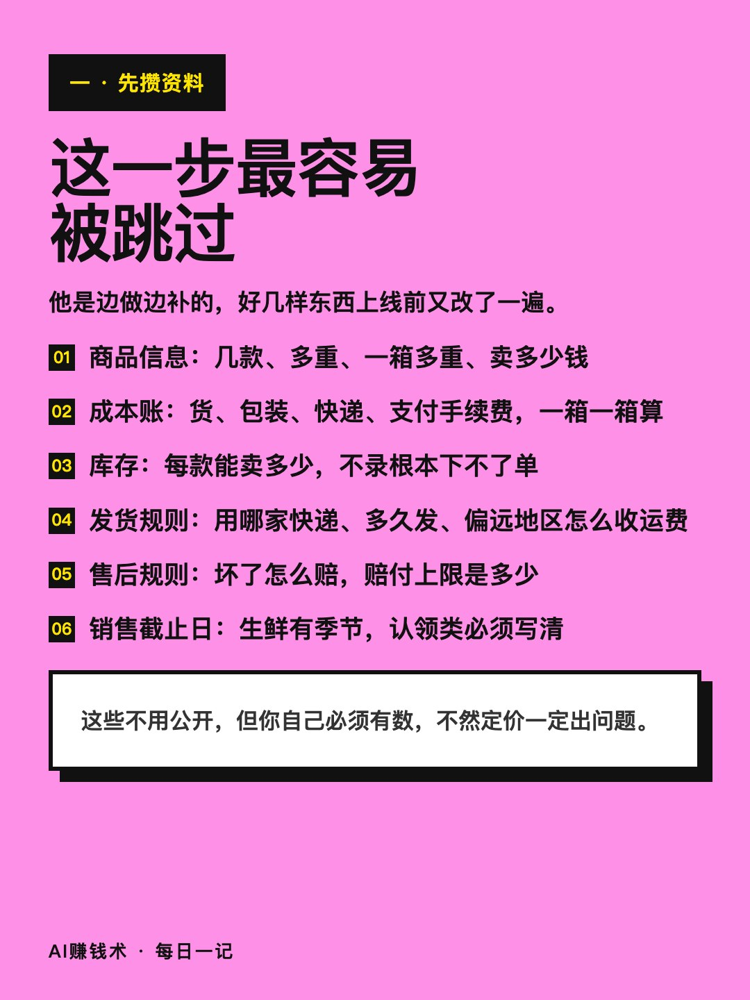
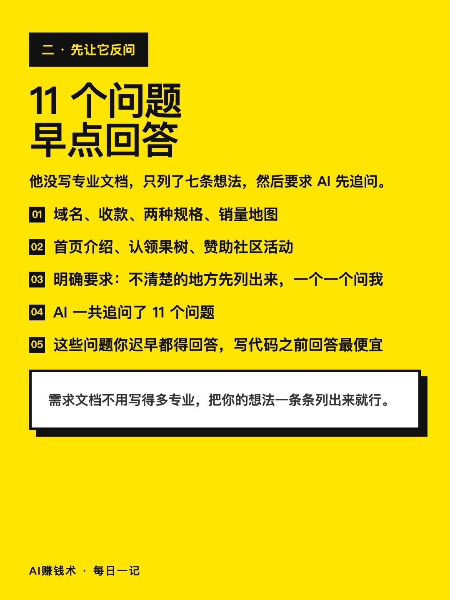
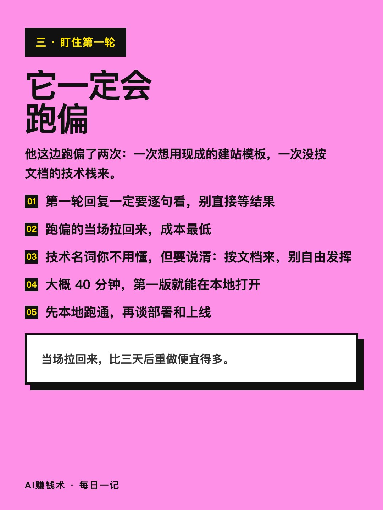
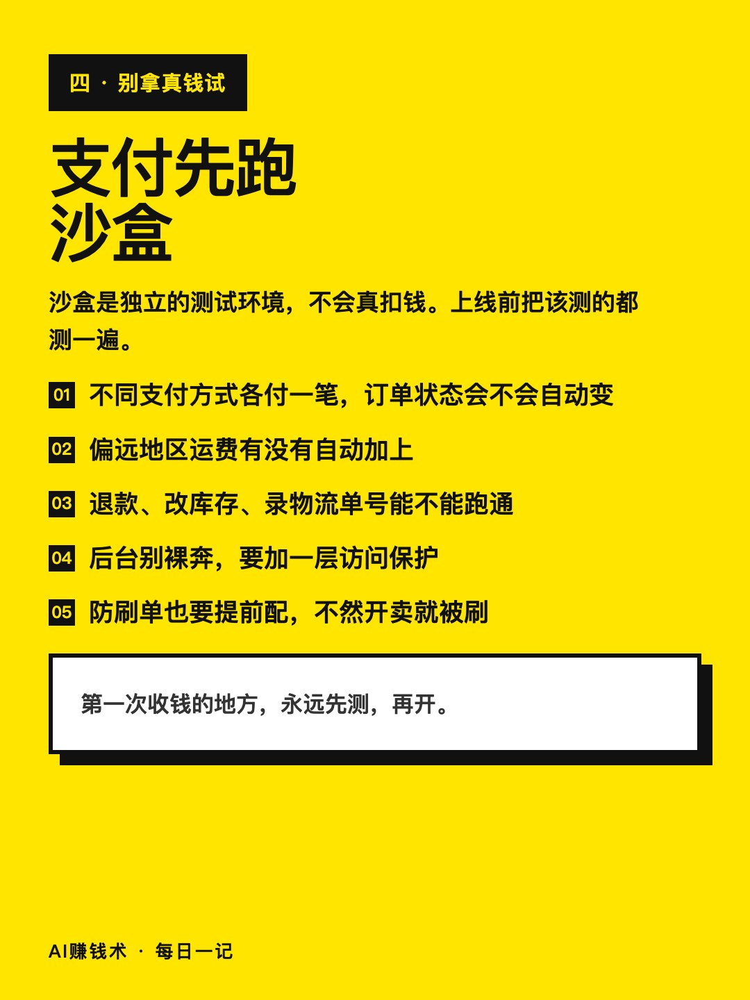
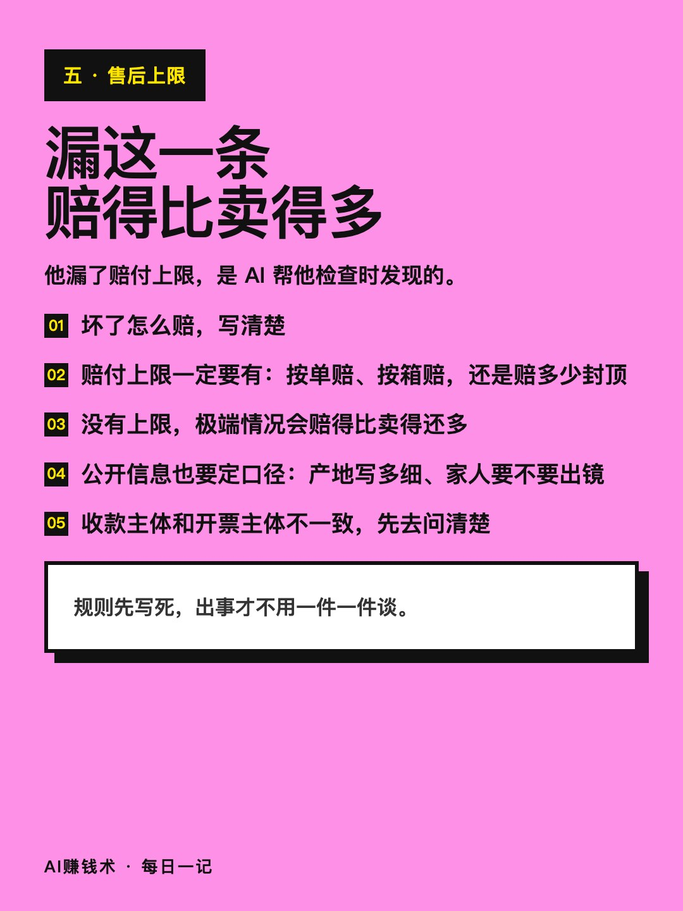
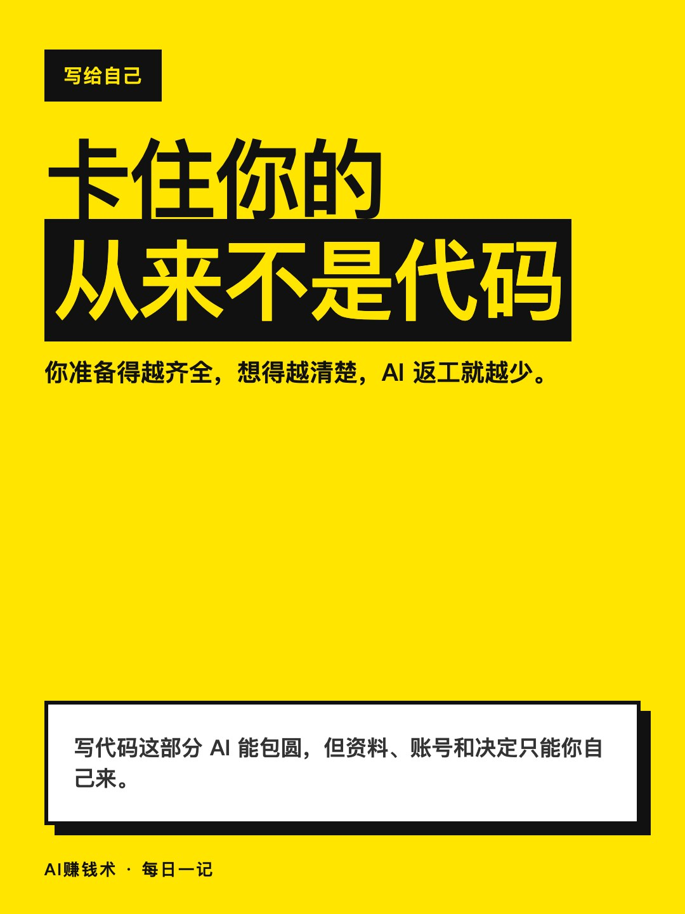

# 不会写代码，他24小时做出了收钱网站

> — · 2026-11-01 17:06 发布 · AI 赚钱内容

## 标题（可直接复制）

```
不会写代码，他24小时做出了收钱网站
```

## 正文（可直接复制发布）

一个文科生，不到 24 小时，把家乡苹果做成了一个能收钱的网站。😮

他连技术栈是什么都说不清。这篇不讲他多厉害，讲他开工前准备了什么——这部分跟会不会写代码没关系。

① 卡住你的不是代码，是资料

他把要攒的东西列了一份：商品信息、成本账、库存、发货规则、售后规则、销售截止日、公开信息口径。

最值钱的是成本账：货本身、包装、快递、支付手续费，一箱一箱算清楚。这个不用公开，但你自己必须有数，不然定价一定出问题。

他自己也是边做边补的，好几样东西上线前又改了一遍。他说得很实在：写代码这部分 AI 能包圆，但资料、账号和决定只能你自己来。

② 先让 AI 追问你，再让它写代码

他没写专业文档，只列了七条想法：域名、收款、两种规格、销量地图、首页介绍、认领果树、赞助社区活动。

然后加了一句要求：有不清楚的地方先列出来，一个一个问我，问完再更新文档。

AI 一共追问了 11 个问题。这些问题你迟早都得回答，写代码之前回答，是最便宜的。

③ 第一轮一定要盯住

需求丢给开发 AI 之后，第一轮就跑偏了两次：一次想用现成的建站模板，一次没按文档里的技术栈来。

当场拉回来，成本最低。大概 40 分钟，第一版就能在本地打开。

还有两条容易被跳过的：支付先在沙盒里跑通——不同支付方式各付一笔、偏远运费有没有自动加、退款和改库存能不能跑通；后台要加访问保护，防刷单也要提前配，不然开卖就被刷。

售后那条最狠：他漏了赔付上限，是 AI 帮他检查时发现的。没有上限，极端情况会赔得比卖得还多。

如果要我带走一句：卡住你的从来不是代码。

你手上有没有那种「东西是好的，就是没个地方能收钱」的事？评论区说一句。

## 话题标签

#副业 #独立开发 #电商 #AI工具 #AI赚钱术日记

## 配图（8 张）










## 发布信息

| 项 | 值 |
|---|---|
| 平台 | 小红书 |
| 期数 | — |
| 发布时间 | 2026-11-01 17:06 |
| 正文长度 | 713 字 |
| 图片数量 | 8 张 |
| 状态 | 已发布 |
