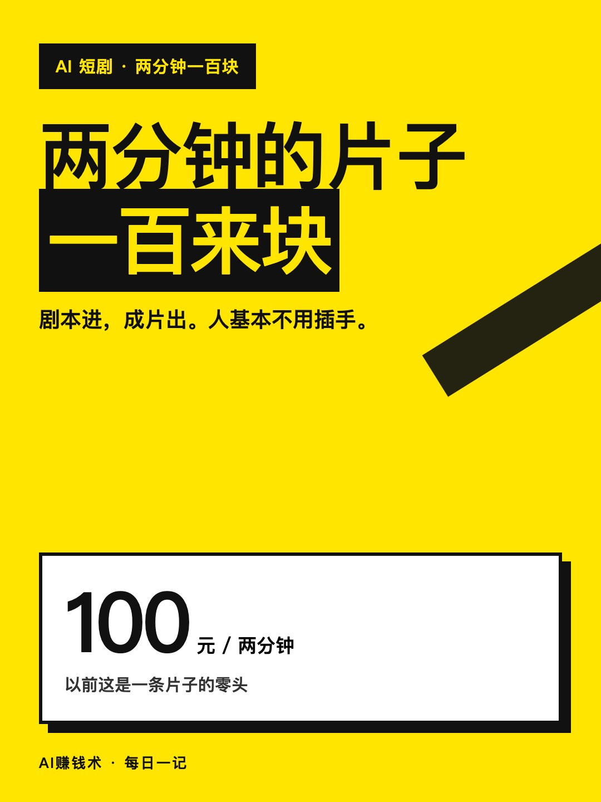
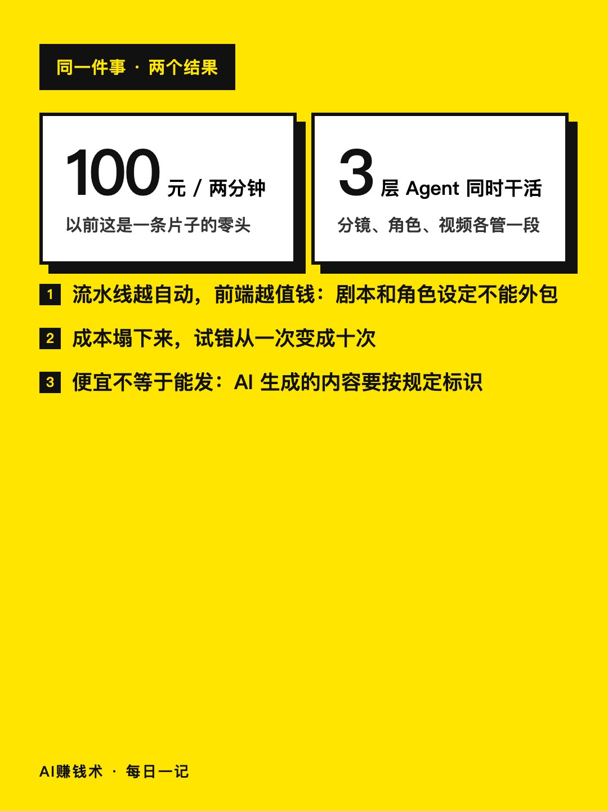
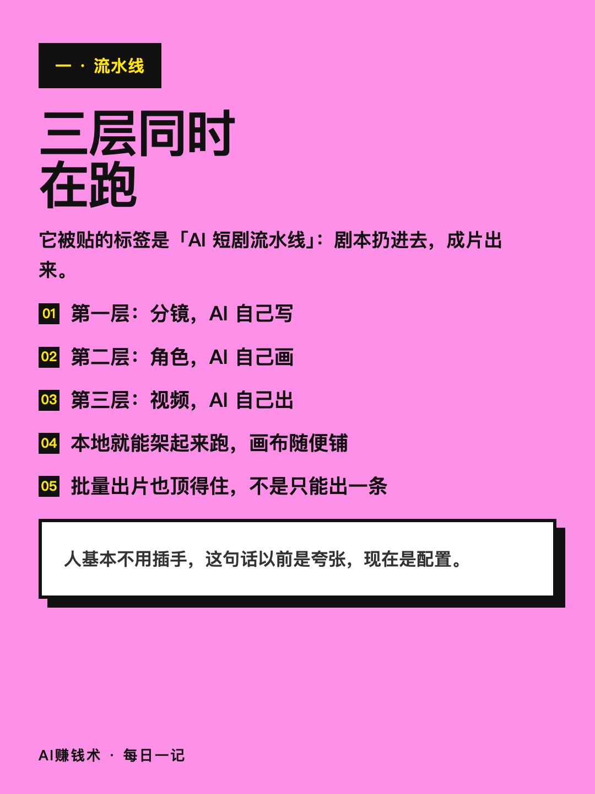
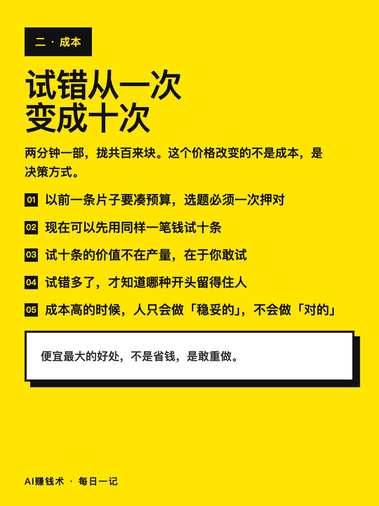
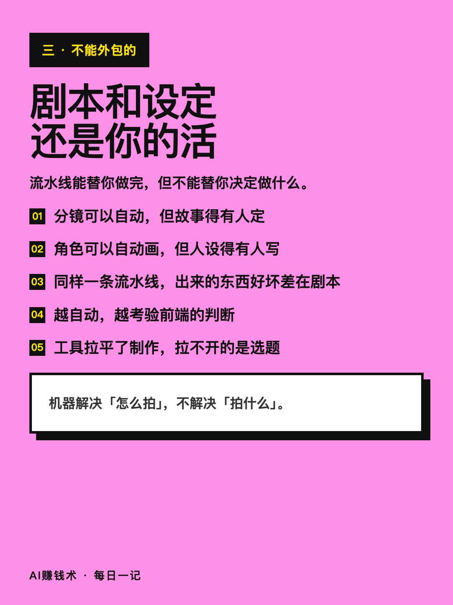
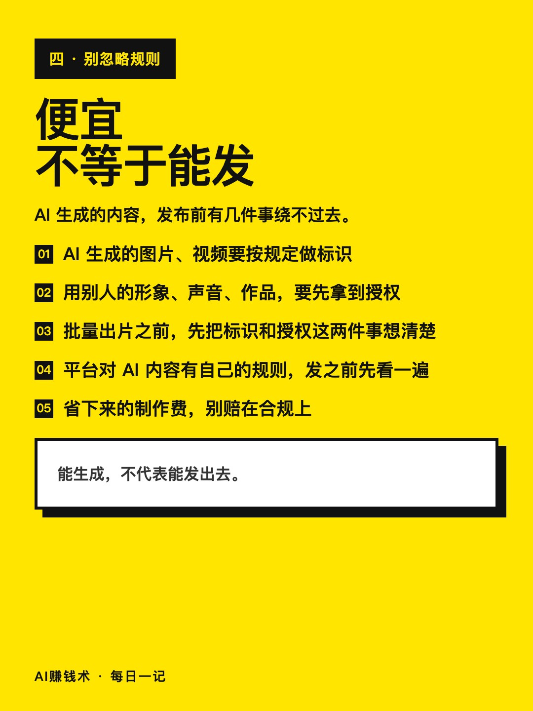
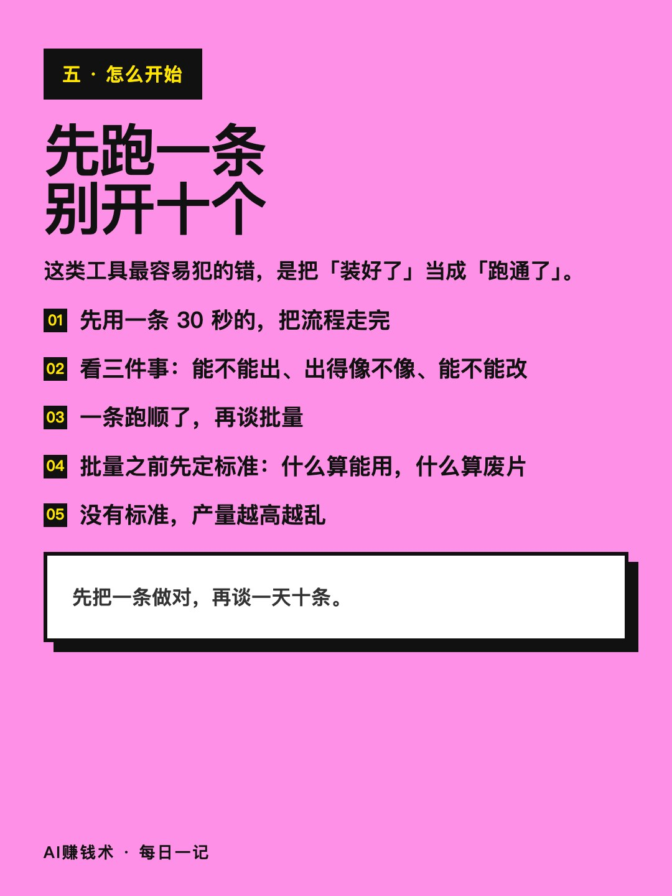
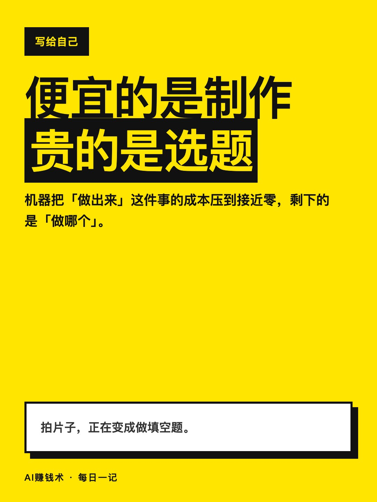

# 两分钟的片子，成本一百来块

> — · 2026-11-01 21:16 发布 · AI 赚钱内容

## 标题（可直接复制）

```
两分钟的片子，成本一百来块
```

## 正文（可直接复制发布）

两分钟一部的片子，拢共百来块。这个价格改变的不是成本，是决策方式。😮

有人把一个开源项目贴了个标签：AI 短剧流水线，剧本扔进去，成片出来。

① 三层同时跑

分镜 AI 自己写，角色 AI 自己画，视频 AI 自己出。本地就能架起来跑，画布随便铺，批量出片也顶得住。

人基本不用插手——这句话以前是夸张，现在是配置。

以前这类活要一个组：写分镜的、画角色的、剪片的、配音的。现在配置一次，剩下的交给它跑，你只在中途改方向。

② 便宜最大的好处，是敢重做

以前一条片子要凑预算，选题必须一次押对。现在同样一笔钱可以试十条。

试十条的价值不在产量，在于你敢试。成本高的时候，人只会做「稳妥的」，不会做「对的」。

但试十条也有前提：你得有办法筛。十条里哪条能用，标准要提前定好，不然试得越多越乱。

③ 越自动，前端越值钱

分镜可以自动，但故事得有人定；角色可以自动画，但人设得有人写。

同一条流水线，出来的东西好坏差在剧本。工具拉平了制作，拉不开的是选题。

还有一件别忽略：AI 生成的内容，发布前要按规定做标识；用别人的形象、声音、作品，要先拿到授权。

批量出片之前先把这两件事想清楚，省下来的制作费别赔在合规上。

如果要我带走一句：机器解决「怎么拍」，不解决「拍什么」。

所以它真正适合的不是「想做短剧行业的人」，是「手上有个故事一直没拍出来的人」。前者拼资源，后者拼判断。

你手上有没有一个「想了很久但一直没拍」的故事？评论区说一句。

## 话题标签

#AI工具 #短视频 #副业 #内容创作 #AI赚钱术日记

## 配图（8 张）










## 发布信息

| 项 | 值 |
|---|---|
| 平台 | 小红书 |
| 期数 | — |
| 发布时间 | 2026-11-01 21:16 |
| 正文长度 | 634 字 |
| 图片数量 | 8 张 |
| 状态 | 已发布 |
