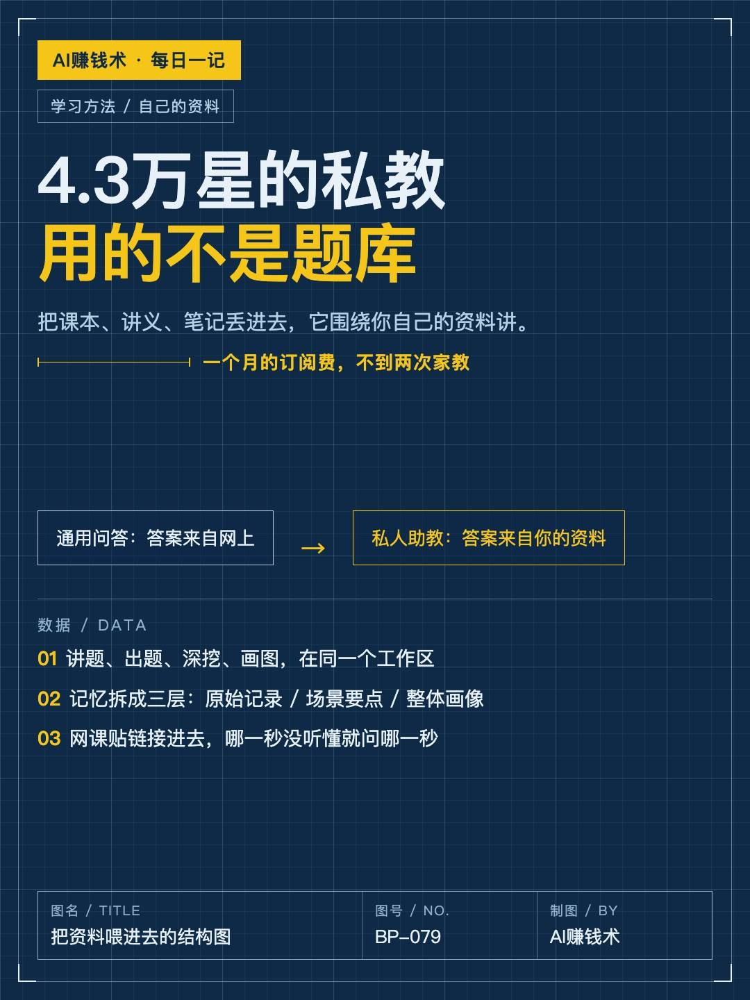
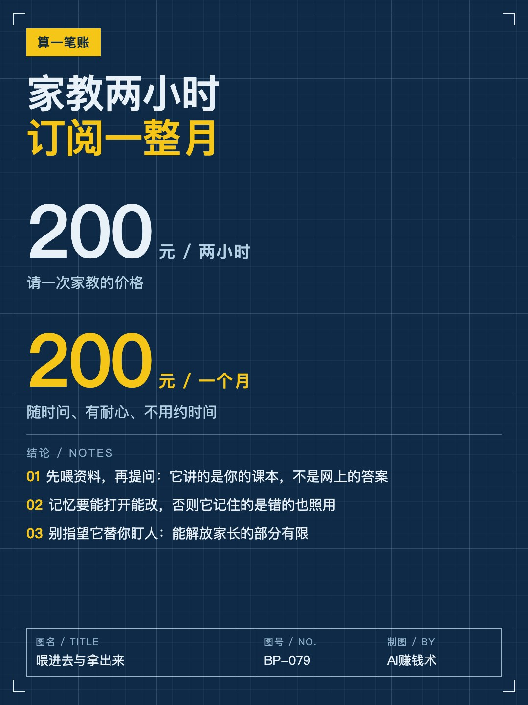
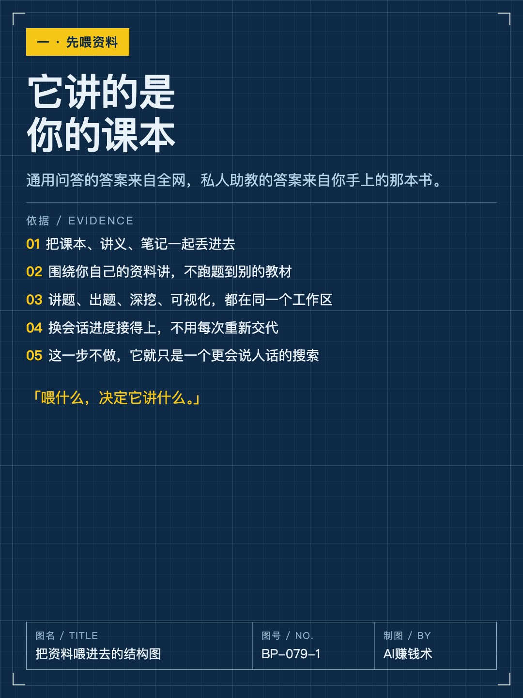
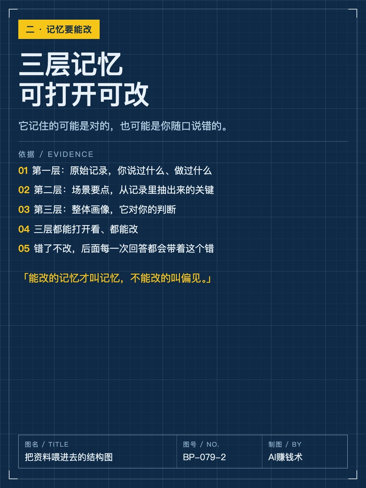
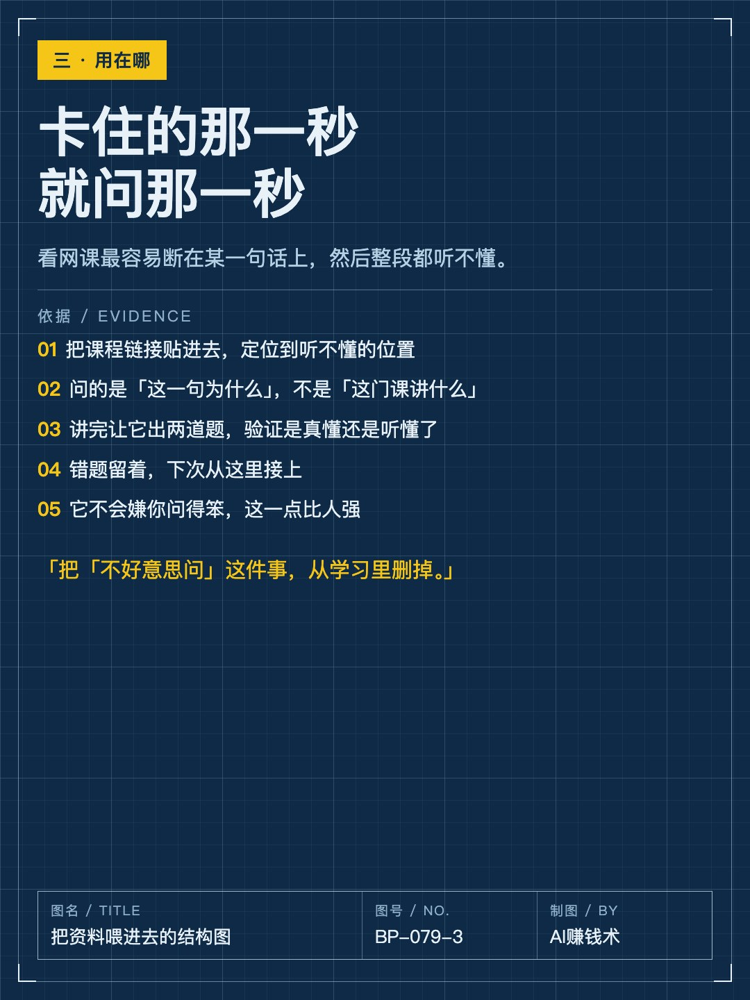
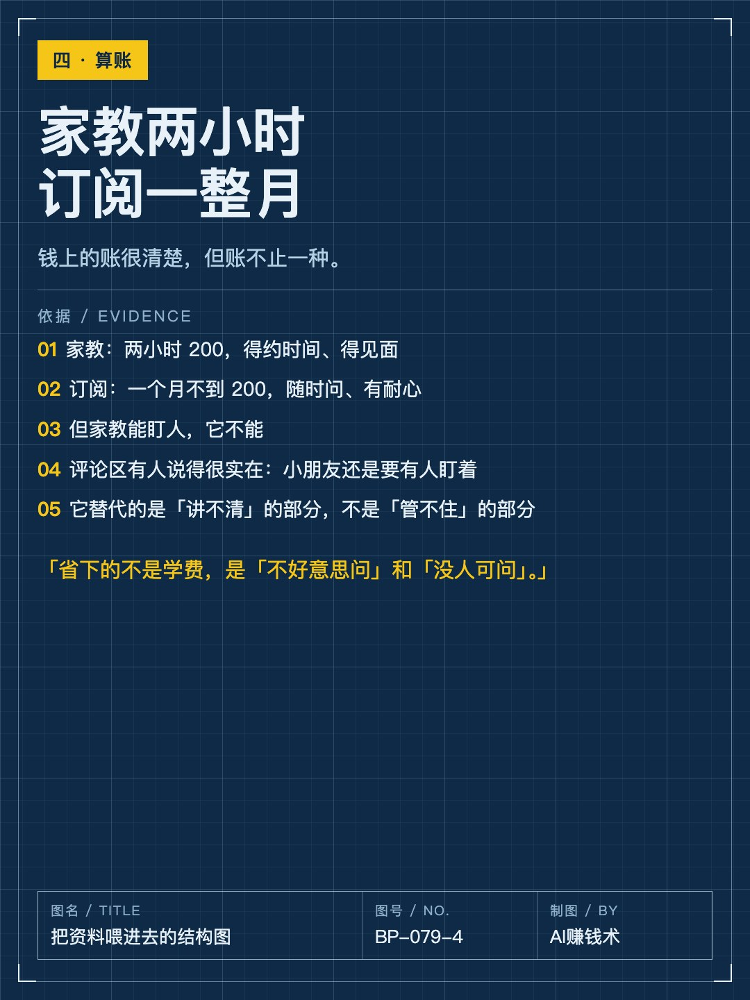
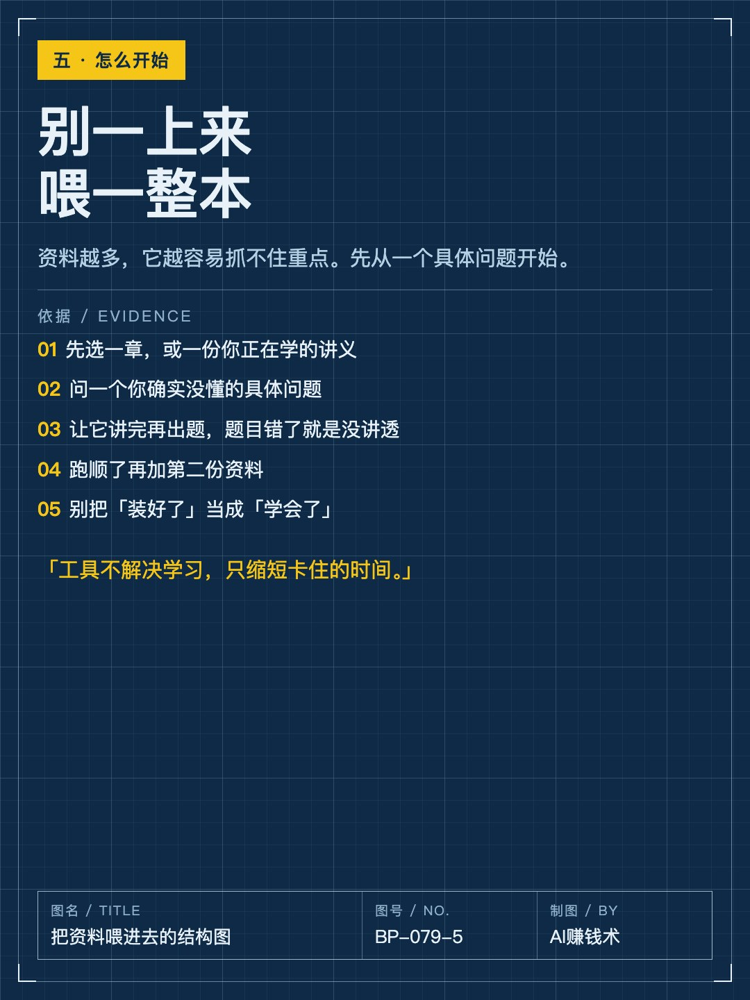
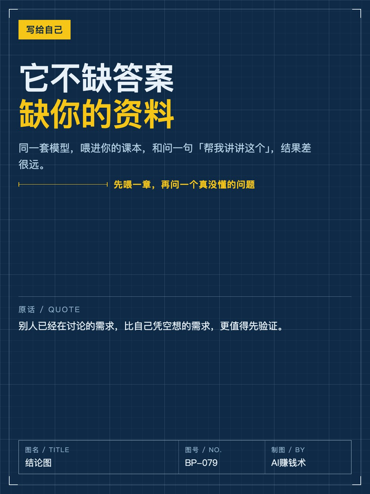

# 两小时家教的钱，够它用一个月

> — · 2026-11-01 20:13 发布 · AI 赚钱内容

## 标题（可直接复制）

```
两小时家教的钱，够它用一个月
```

## 正文（可直接复制发布）

两小时 200 的家教，和一个月的订阅，价格差不多。但它们替代的不是同一种东西。😮

港大开源了一个 AI 私教，四万多 star。它跟普通问答的区别只有一个：你把课本、讲义、笔记丢进去，它围绕你自己的资料讲。

① 先喂资料，再提问

通用问答的答案来自全网，它的答案来自你手上那本书。

讲题、出题、深挖、可视化都在同一个工作区；换会话进度接得上，不用每次重新交代。

这一步不做，它就只是一个更会说人话的搜索。

举个具体的：同一道错题，通用问答给你一个标准解法；喂过你讲义的，会按你老师那套符号和步骤讲，还能指出你上一章哪一步没打牢。

② 记忆要能打开能改

它的记忆拆三层：原始记录（你说过什么）、场景要点（抽出来的关键）、整体画像（它对你的判断）。

三层都能打开看、都能改。

为什么重要：错了不改，后面每一次回答都会带着这个错。很多人抱怨「它越聊越偏」，其实是前面喂进去的东西没人清。

③ 卡住的那一秒就问那一秒

看网课最容易断在某一句话上，然后整段都听不懂。

用法是：把课程贴进去，定位到没听懂的位置，问「这一句为什么」。讲完让它出两道题，验证是真懂还是听懂了。错题留着，下次从这里接上。

算账很清楚：家教两小时 200，得约时间、得见面；订阅一个月不到 200，随时问、有耐心。

但家教能盯人，它不能。评论区有句话很实在：小朋友还是要有人盯着。

如果要我带走一句：它替代的是「讲不清」，不是「管不住」。

适合的人其实很集中：在备考的、跨行自学没人带的、给孩子找讲解又不想天天陪着的。共同点不是「想学」，是「卡住了没人可问」。

你现在学的东西，卡在哪一句？评论区说一句。

## 话题标签

#AI工具 #学习方法 #效率工具 #自我提升 #AI赚钱术日记

## 配图（8 张）










## 发布信息

| 项 | 值 |
|---|---|
| 平台 | 小红书 |
| 期数 | — |
| 发布时间 | 2026-11-01 20:13 |
| 正文长度 | 703 字 |
| 图片数量 | 8 张 |
| 状态 | 已发布 |
