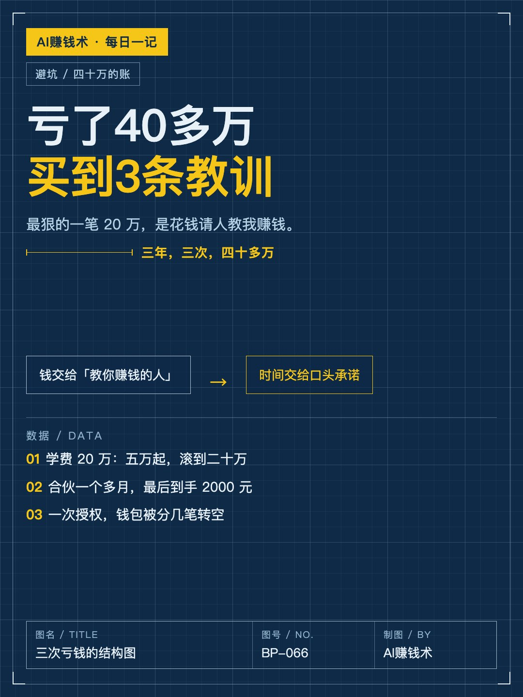
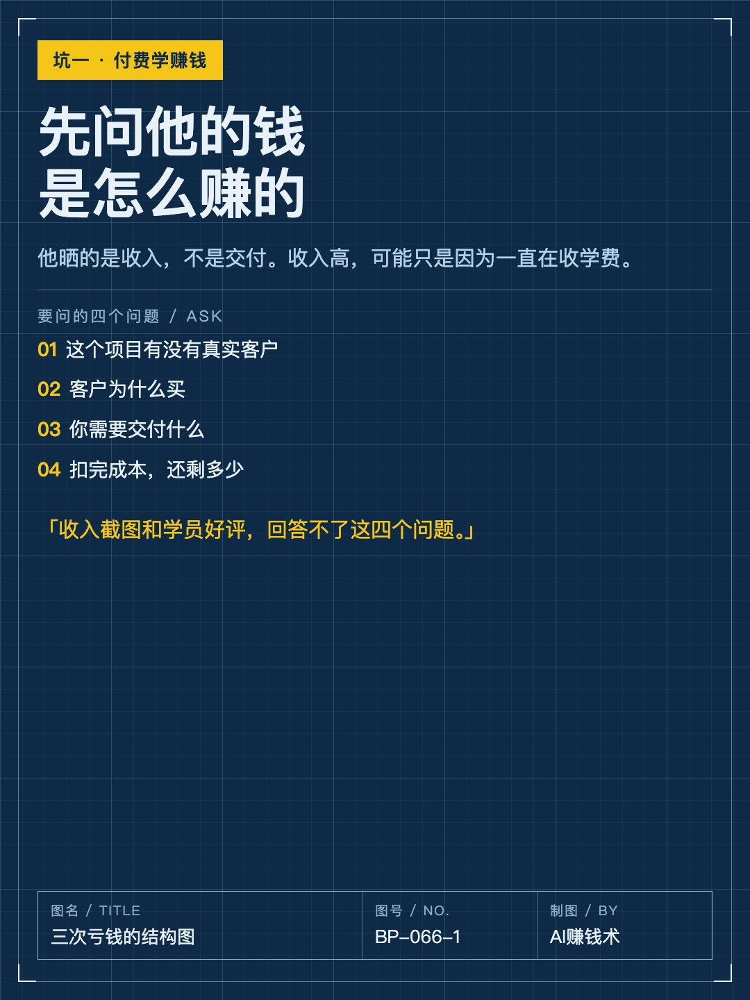
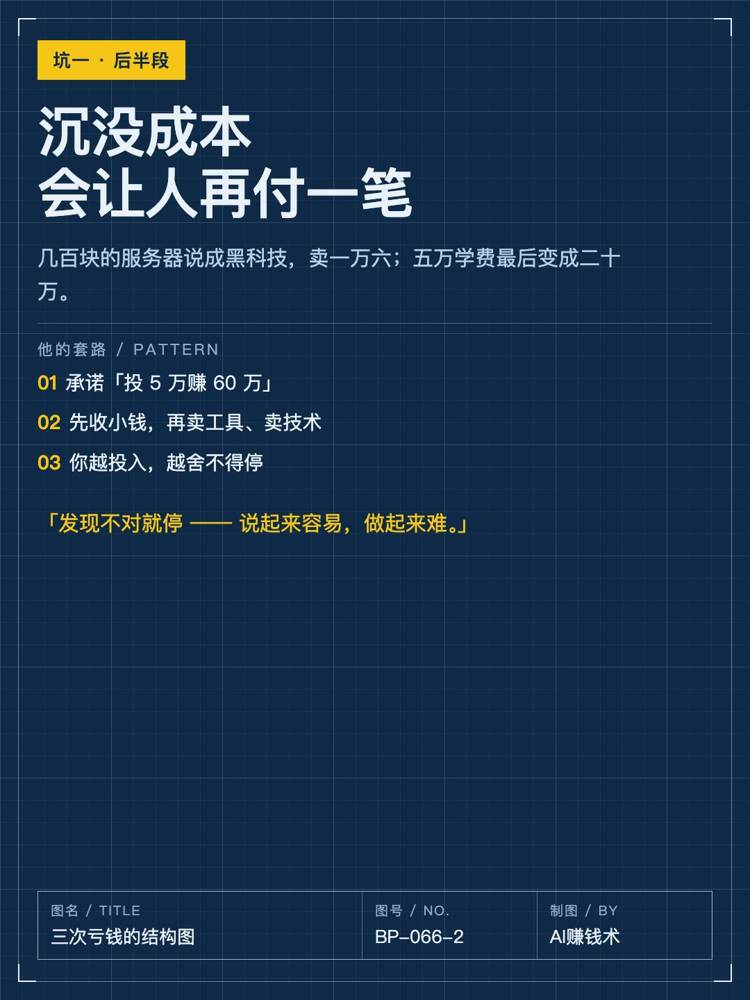
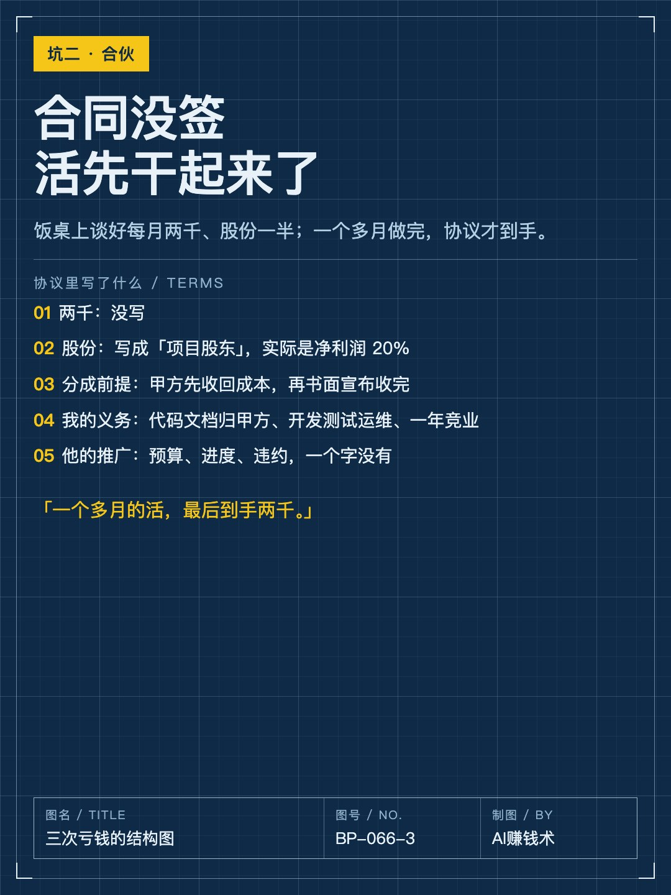
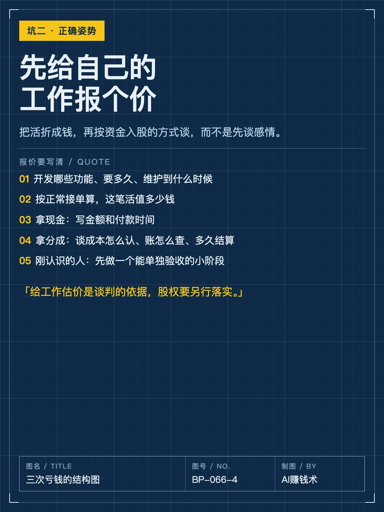
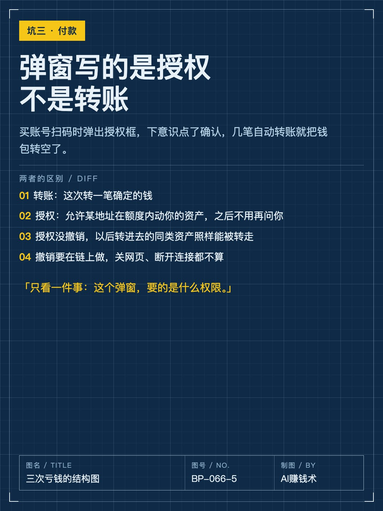
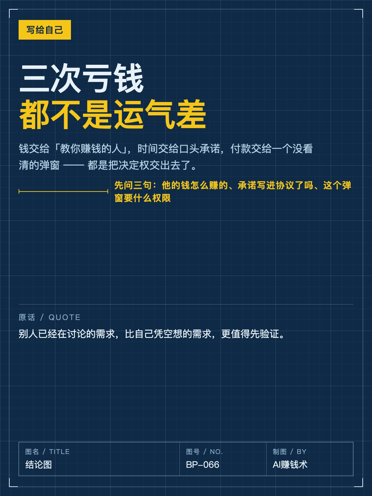

# 亏了40多万，总结出3个坑

> — · 2026-11-01 14:06 发布 · AI 赚钱内容

## 标题（可直接复制）

```
亏了40多万，总结出3个坑
```

## 正文（可直接复制发布）

亏了四十多万。最狠的一笔 20 万，是花钱请人教我赚钱。😮

2019 年我 25 岁，辞职创业。在网上看到一位程序员写自己单日收入 59 万，聊了几次，我就去了重庆。

① 付费之前，先问他的钱是怎么赚的

第一次交五万，说是学费。到了才知道，他要带我做的项目我完全不了解。几百块的服务器，被说成黑科技，卖我一万六。

他承诺「投 5 万赚 60 万」。我出于信任，也出于面子，没往骗局上想。等我发现他前后说的对不上，五万已经变成了二十万。

回头看，我只顾着看他晒了多少钱，没问这些钱是怎么来的。如果他的收入主要靠收学费、卖工具，那他自己赚多少，都不能说明跟着做的人能赚到。

付费前问四件事：有没有真实客户？客户为什么买？你要交付什么？扣完成本还剩多少？收入截图和学员好评，回答不了这些。

② 口头约定不写进协议，等于没有

今年四月饭桌上谈好合伙：每月两千，股份拿他的一半。为了表示诚意，我主动往下让。合同还没签，活先干起来了。

一个多月做完，协议才到手。两千没写；股份写成「项目股东」，实际是净利润 20%，还得先由甲方收回成本、书面宣布收完了才分。

反过来，我的义务写得很细：代码文档归甲方，开发、测试上线、运维，还有一年竞业。他的推广职责，预算、进度、拖着不做怎么办，一个字没有。

最后我拿到两千块，一个多月的活没跑过最低工资。

后来一个懂行的朋友说：先把自己的工作折成钱，再按资金入股去谈。开发哪些功能、要多久、维护到什么时候、按接单算多少钱，先报这个价；现金写金额和时间，分成谈清成本怎么认、账怎么查、多久结算。

③ 付款弹窗写的是「授权」，不是「转账」

有次买账号，对方给了个付款码。我付的时候弹出一个授权框，下意识点了确认。随后几笔自动转账，钱包里的钱全被转走了。

转账是这次转一笔确定的钱。授权是允许某个地址，在额度内动用你的资产，之后他再转，不用你确认。

授权没撤销，你以后转进去的同类资产照样能被转走。撤销要在链上做，关网页、断开连接都不算。

三次亏钱都不是运气差，是我把决定权交出去了：钱交给「教你赚钱的人」，时间交给口头承诺，付款交给一个没看清的弹窗。

现在我会先问三句：他的钱怎么赚的、承诺写进协议了吗、这个弹窗要什么权限。

你现在最怕踩哪个坑？评论区说一句。

## 话题标签

#副业 #避坑 #搞钱思路 #个人经历 #AI赚钱术日记

## 配图（8 张）










## 发布信息

| 项 | 值 |
|---|---|
| 平台 | 小红书 |
| 期数 | — |
| 发布时间 | 2026-11-01 14:06 |
| 正文长度 | 959 字 |
| 图片数量 | 8 张 |
| 状态 | 已发布 |
