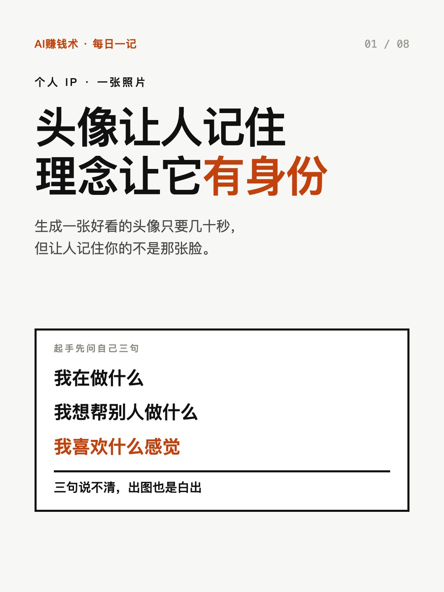
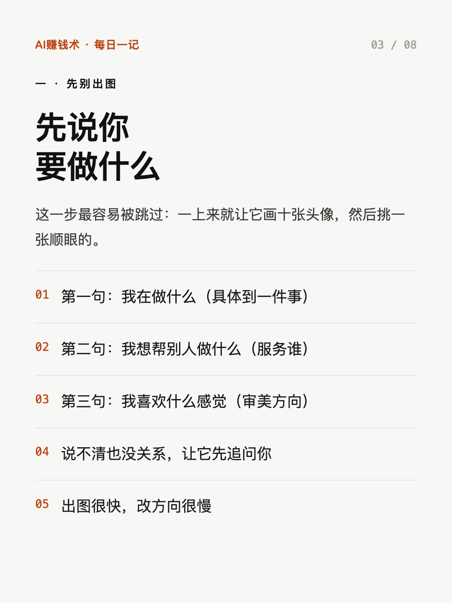
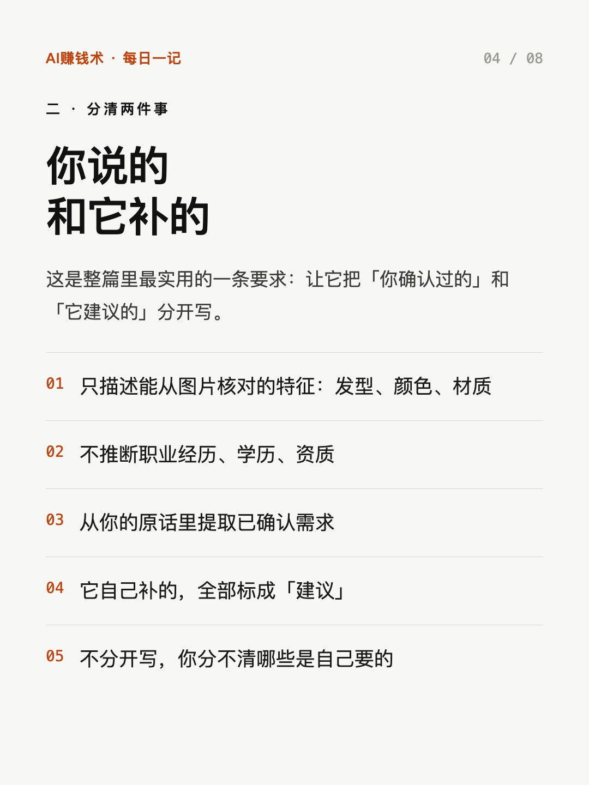
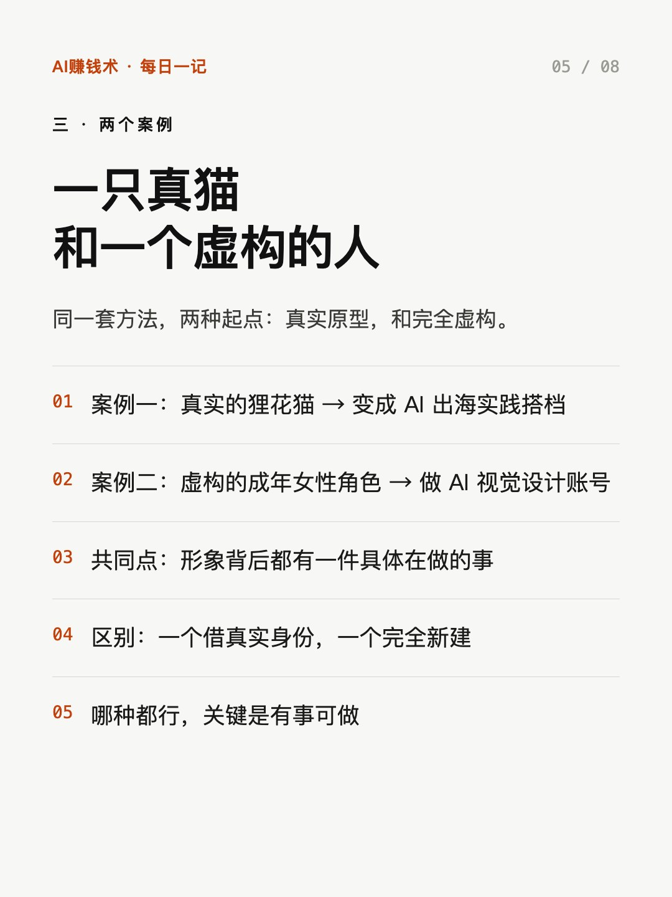
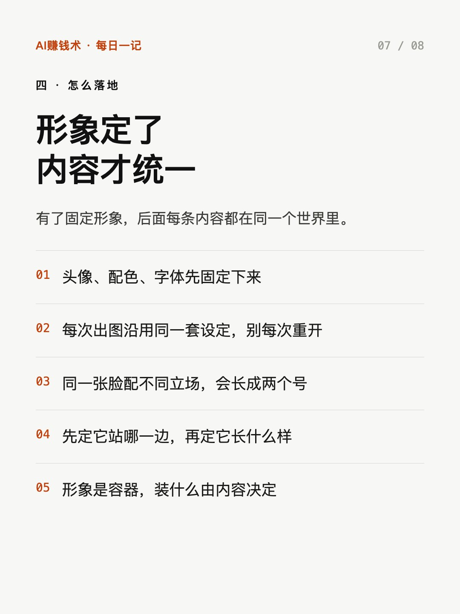

# 头像让人记住，事才让人留下

> — · 2026-11-01 22:03 发布 · AI 赚钱内容

## 标题（可直接复制）

```
头像让人记住，事才让人留下
```

## 正文（可直接复制发布）

生成一张好看的头像，现在只要几十秒。但让人记住你的，不是那张脸。😮

这是我看一篇做 AI 形象账号的复盘，最有价值的部分不是出图技巧，是出图之前那几步。

① 先别出图，先说清三件事

我在做什么、我想帮别人做什么、我喜欢什么感觉。

三句说不清，出图也是白出——你会得到十张「都还行」的头像，挑一张顺眼的，过两周又觉得不对。

出图很快，改方向很慢。这三句还有个副作用：写完你会发现，自己到底想做什么。很多人卡住的不是形象，是这件事本身没想清楚。

② 让它分清「你说的」和「它补的」

这是整篇最实用的一条要求。

具体做法：让它只描述能从图片核对的特征，比如发型、颜色、材质；不推断职业经历、学历、资质；从你的原话里提取已确认需求；它自己补的，全部标成「建议」。

不分开写，你最后分不清哪些是自己要的，哪些是它替你想象的。

③ 好看不是护城河

生成工具每升级一次，「像不像真人」这个门槛就掉一次。

所以真正要定的是：这个形象站哪一边、做什么事。

两个案例能说明：一个是真实的狸花猫，变成 AI 出海实践搭档；一个是完全虚构的角色，做 AI 视觉设计账号。共同点不是好看，是背后都有一件具体在做的事。

头像负责让人记住，理念和行为负责让它成为谁。同一张脸配不同立场，会长成两个号。

反过来也成立：一个号做久了，形象会自己长出来。你讲什么、站哪边、怎么回复评论，慢慢就定型了——只是这个定型过程，你可以选主动还是被动。

如果要我带走一句：形象是入口，事才是内容。

顺序也建议反过来：先定它做什么、站哪一边，再定它长什么样。反着来，你会一直在换头像，一直觉得不对。

如果要给自己做一个形象，你第一句话会怎么写？评论区说一句。

## 话题标签

#个人IP #AI工具 #自媒体 #副业 #AI赚钱术日记

## 配图（8 张）










## 发布信息

| 项 | 值 |
|---|---|
| 平台 | 小红书 |
| 期数 | — |
| 发布时间 | 2026-11-01 22:03 |
| 正文长度 | 723 字 |
| 图片数量 | 8 张 |
| 状态 | 已发布 |
