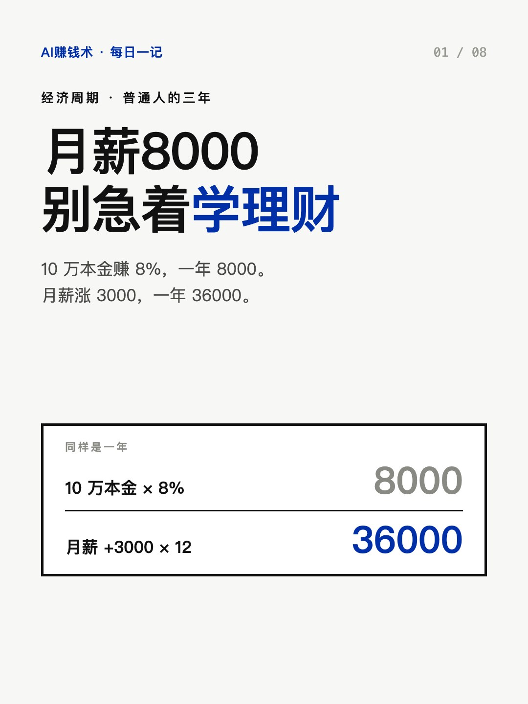
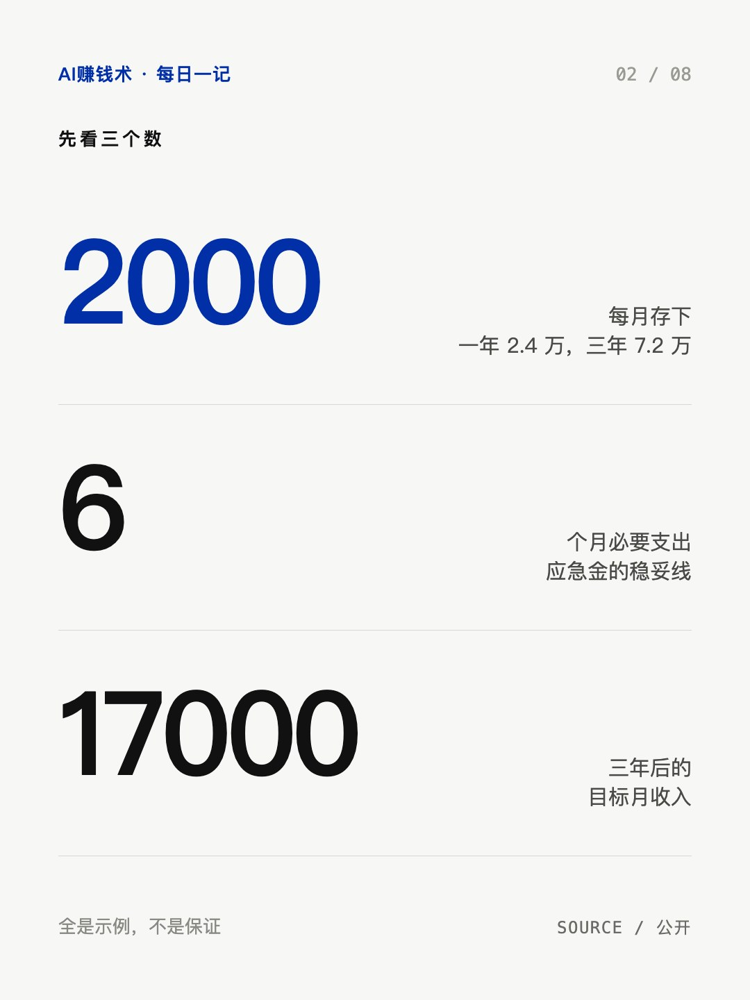
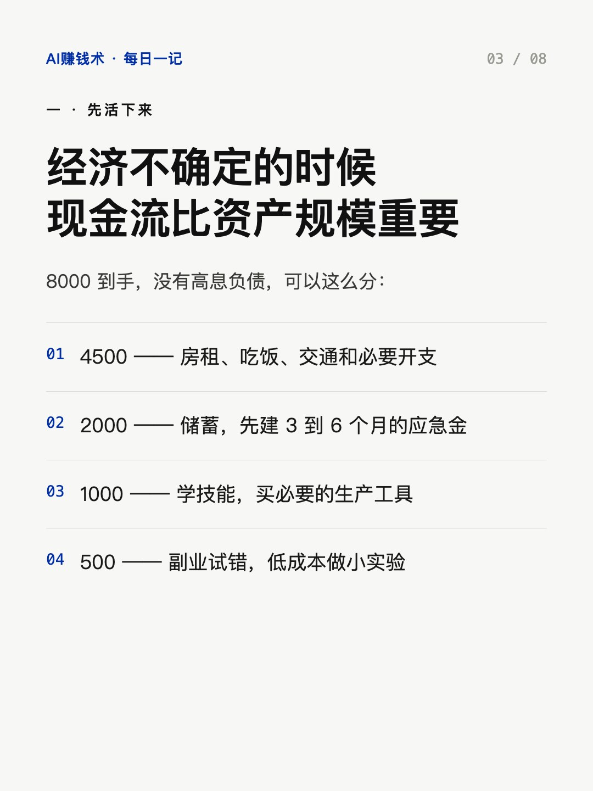
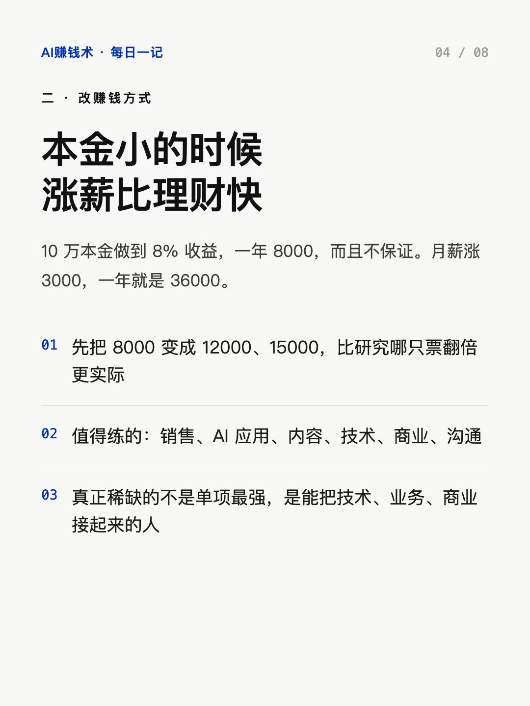
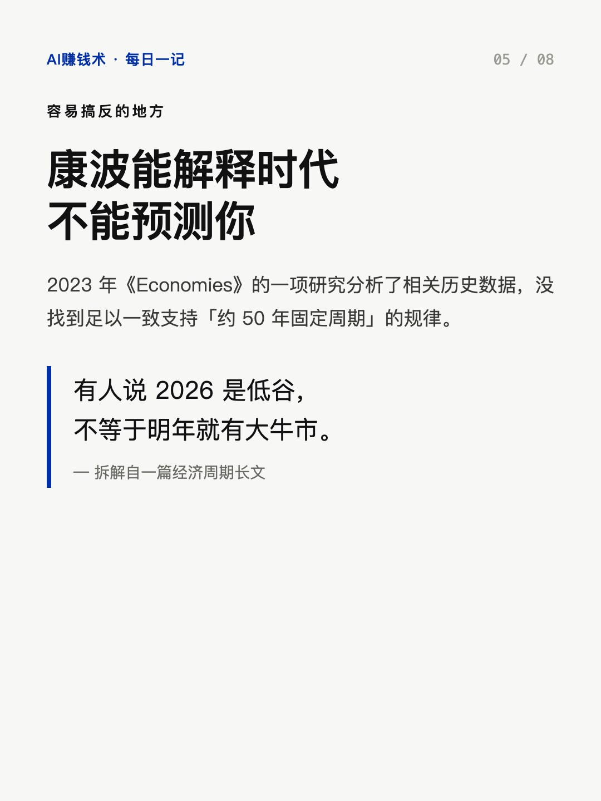
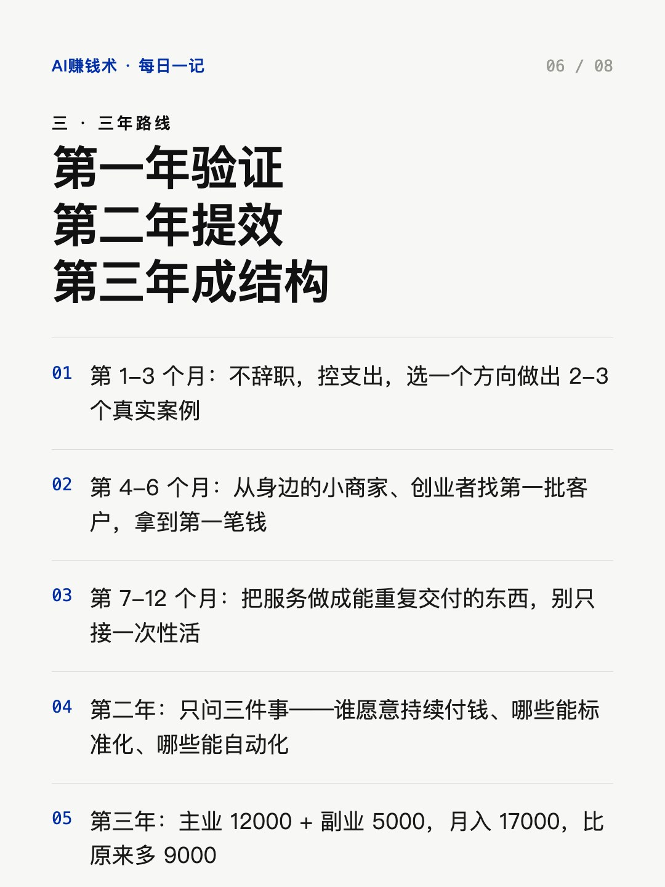
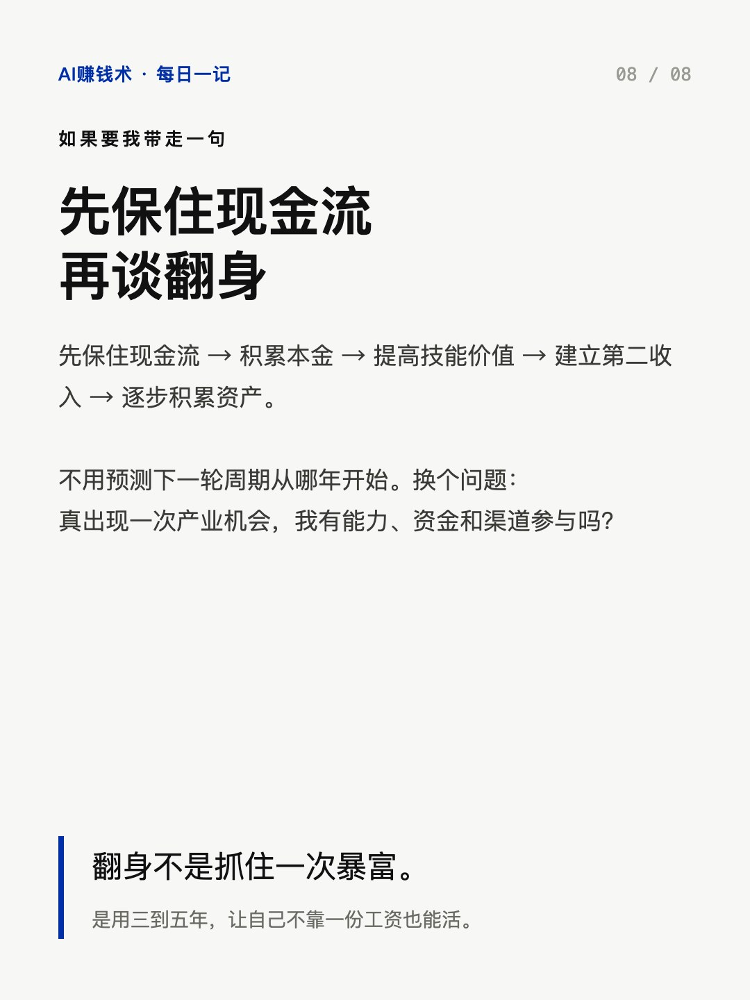

# 月薪8000，先别急着学理财

> — · 2026-11-01 16:03 发布 · AI 赚钱内容

## 标题（可直接复制）

```
月薪8000，先别急着学理财
```

## 正文（可直接复制发布）

月薪 8000，10 万本金做到 8% 收益，一年 8000。月薪涨 3000，一年 36000。😮

这篇长文开头就摆了这个对比。它讲康波周期，但作者先把结论说清了：这个理论能解释时代，预测不了你的机会。

① 先活下来，攒本金

8000 到手、没有高息负债，可以这么分：4500 房租吃饭交通，2000 存起来，1000 学技能买工具，500 拿去试错。

每月 2000，一年 2.4 万，三年 7.2 万。第一笔钱不是让你发财的，是让你有得选：能换工作、能学新东西、能试副业。应急金按 3 到 6 个月必要支出准备，工作不稳就按 6 到 12 个月。

如果房租就超过 4500，先砍学习和试错的钱，别借钱创业。

② 本金小的时候，涨薪比理财快

10 万本金就算做到 8%，一年 8000，还不保证。月薪从 8000 到 11000，一年多 36000。

所以他的建议是：先别研究哪只票翻倍，先研究怎么把月收入从 8000 提到 12000、15000。值得练的能力他列了七项，最实用的是销售、AI 应用、内容和技术。

他也不主张只练一项。真正稀缺的是能把技术、业务、商业接起来的人。

③ 三年怎么走

第一年只做一件事：验证自己能不能独立赚钱。前三个月不辞职、控支出、选一个方向做出 2 到 3 个真实案例；四到六个月从身边的小商家找第一批客户，拿到第一笔钱；七到十二个月把服务做成能重复交付的东西。

第二年只问三件事：谁愿意持续付钱、哪些服务能标准化、哪些工作能自动化。以前 5 小时的活压到 1 小时，才有余量接更多。

第三年形成结构：主业 12000 加副业 5000，一个月一万七。

有句话他写得很克制：康波周期本身有争议，2023 年《Economies》的一项研究分析了历史数据，没找到足以支持「约 50 年固定周期」的规律。所以有人说 2026 是低谷，不等于明年就有大牛市。

他还列了六个坑：借钱投资、以为房价跌了就该买、把全部积蓄砸进创业、什么热追什么、先买贵课、副业没验证就辞职。

如果要我带走一句：先保住现金流，再谈翻身。

你现在卡在哪一步——存不下钱、收入涨不动、还是不知道第二收入从哪开始？评论区说一句。

## 话题标签

#普通人翻身 #副业 #搞钱思路 #职场 #AI赚钱术日记

## 配图（8 张）










## 发布信息

| 项 | 值 |
|---|---|
| 平台 | 小红书 |
| 期数 | — |
| 发布时间 | 2026-11-01 16:03 |
| 正文长度 | 932 字 |
| 图片数量 | 8 张 |
| 状态 | 已发布 |
