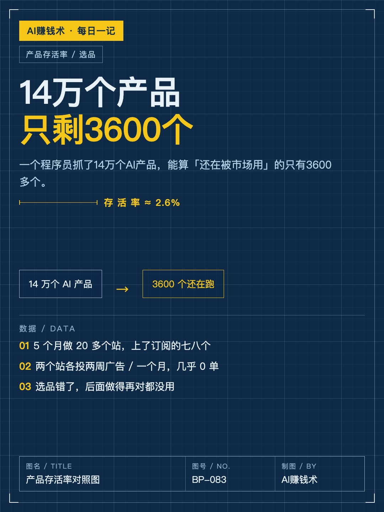
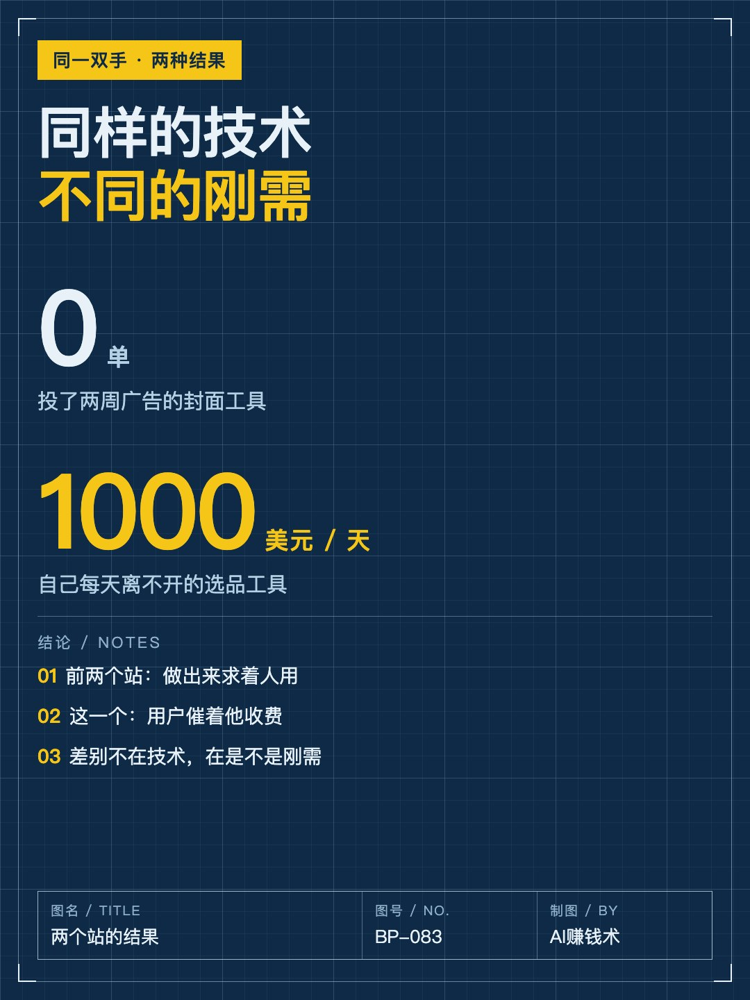
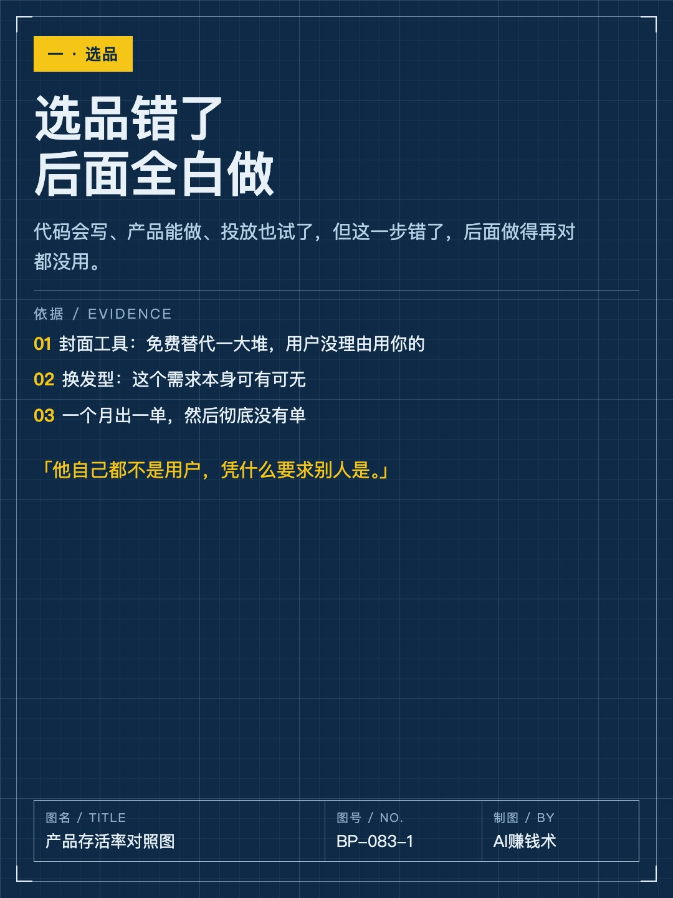
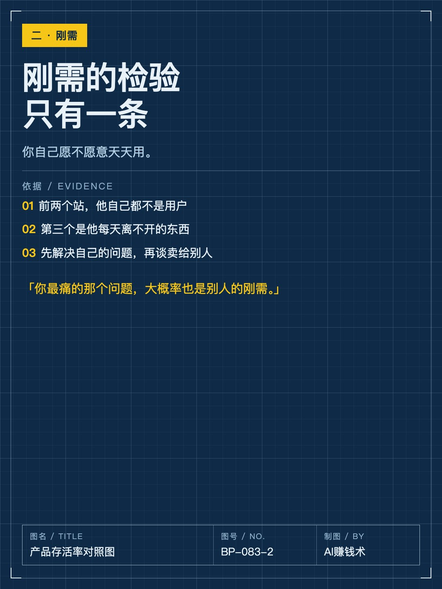
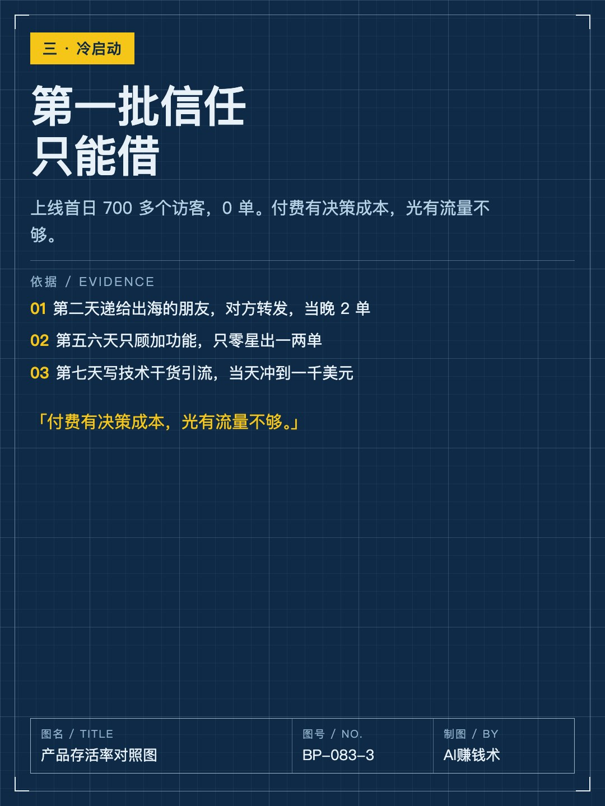
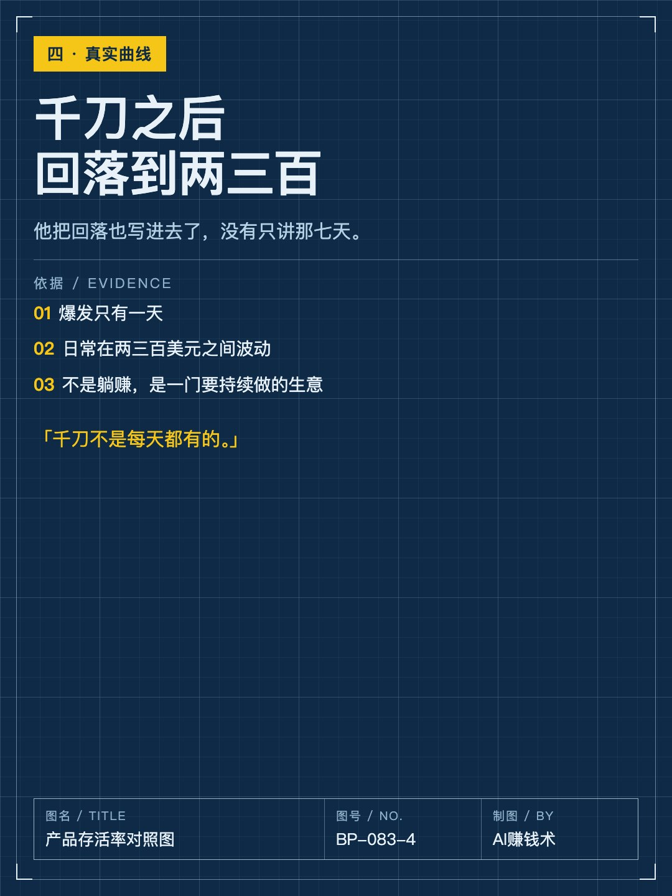
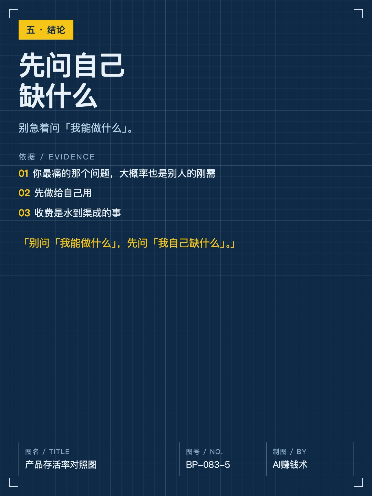
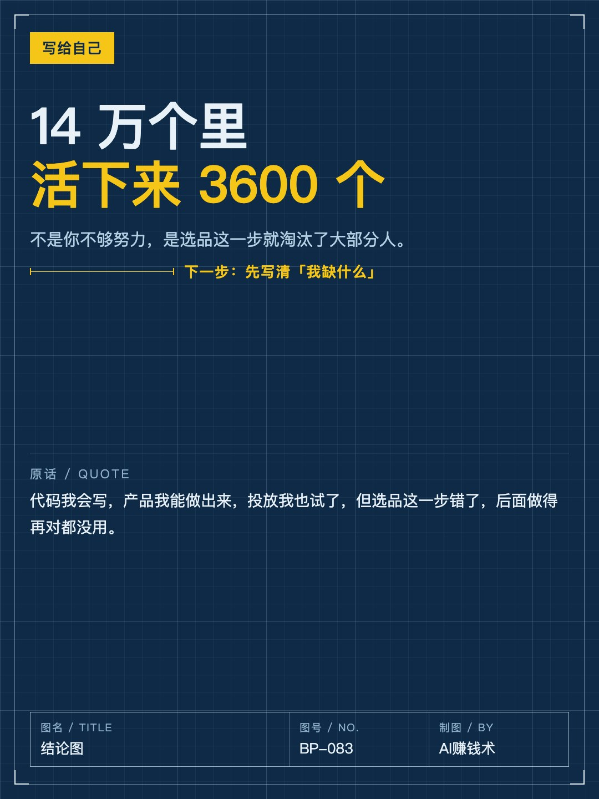

# 14万个产品，活下来的只有3600个

> — · 2026-11-02 10:12 发布 · AI 赚钱内容

## 标题（可直接复制）

```
14万个产品，活下来的只有3600个
```

## 正文（可直接复制发布）

14万个AI产品，还在跑的只有3600个。

这不是我统计的。一个程序员把自己攒了5个月的数据库跑了一遍：从搜索和导航站抓了14万个AI产品，补上访问量和增长，最后符合「还在被市场用」这条线的，只有3600多个。

他自己就是那批没活下来的人：5个月做了20多个站，真正上了订阅的七八个，挣得都不多。

① 选品错了，后面做得多对都没用

他挑了两个站复盘。

第一个是给视频做封面的工具，投了两周广告，每天10美元，0单。原因很直接：免费替代一大堆，随便一个聊天工具也能出图，用户没有理由用他的。

第二个是AI换发型，上线一个月出了一单，之后零星几单，再没有然后。这个需求本身就可有可无。

他的原话：代码我会写，产品我能做出来，投放我也试了，但选品这一步错了，后面做得再对都没用。

② 刚需的检验标准只有一条

这句是整篇里最硬的：你自己愿不愿意天天用。

前面两个站，他自己都不是用户——封面他不做，换发型他不玩。做出来之后是求着人用。

后来跑起来的那个，是他自己每天离不开的东西。他做数据抓取出身，不会选品，就干脆把14万个产品的流量、分类、增长做成一个能筛的库，先解决自己的问题。这一次，是用户催着他收费。

③ 付费用户是被催出来的，不是求来的

上线第一天，700多个访客，0单。他的解释很实在：付费有决策成本，光有流量不够，人得先信你。

第二天他把产品递给一个做出海的朋友，对方帮他转发了一条，当晚2单。他说，这就是一条高权重的信任背书。

第五、六天他闷头加功能，没做推广，只零星出一两单。第七天他把技术方案写成一篇干货，人才涌进来，当天冲到一千美元。后面回落到两三百美元一天，这个他也写进去了。

三件事连起来是一句：先找自己缺什么，再想自己能做什么。

你现在天天在用的那个东西，有没有人愿意为它掏钱？评论区说说。

## 话题标签

#AI出海 #产品思维 #选品 #副业 #AI赚钱术日记

## 配图（8 张）










## 发布信息

| 项 | 值 |
|---|---|
| 平台 | 小红书 |
| 期数 | — |
| 发布时间 | 2026-11-02 10:12 |
| 正文长度 | 772 字 |
| 图片数量 | 8 张 |
| 状态 | 已发布 |
