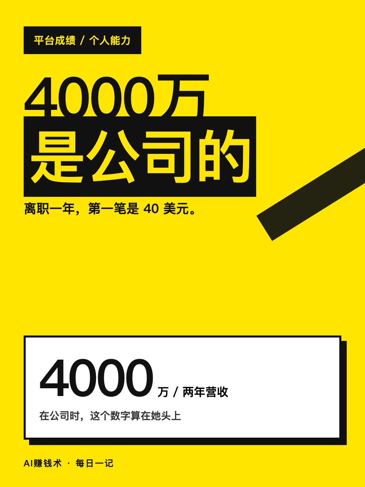
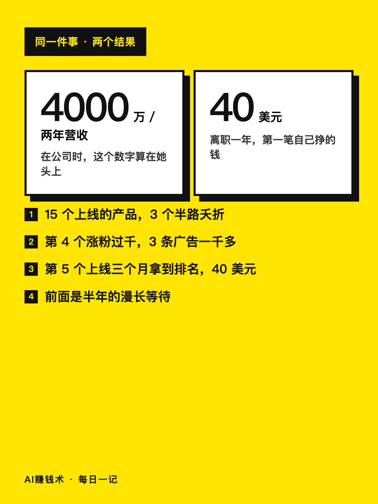
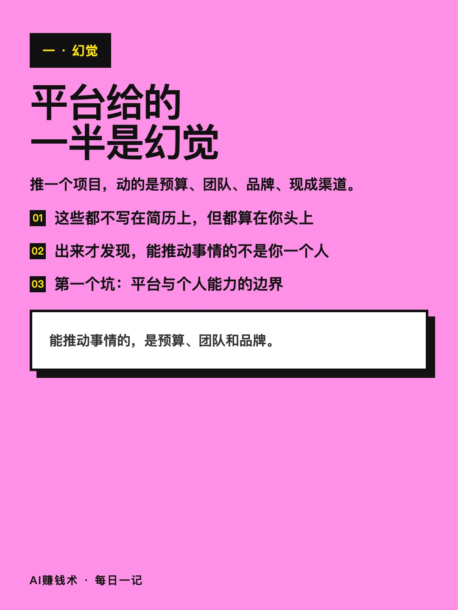
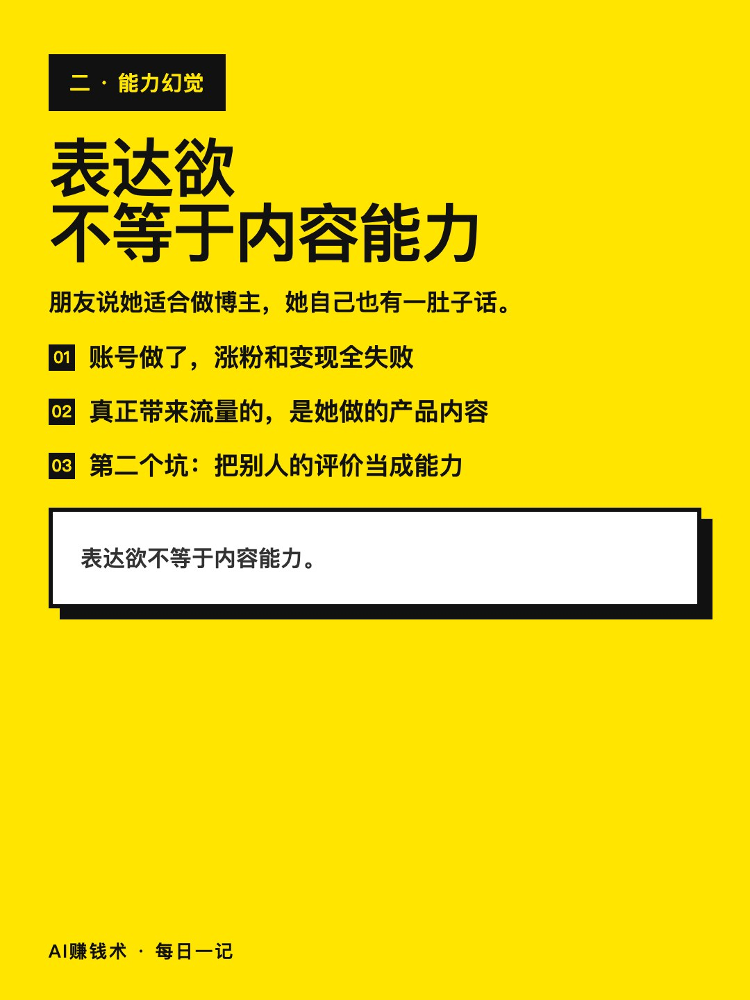
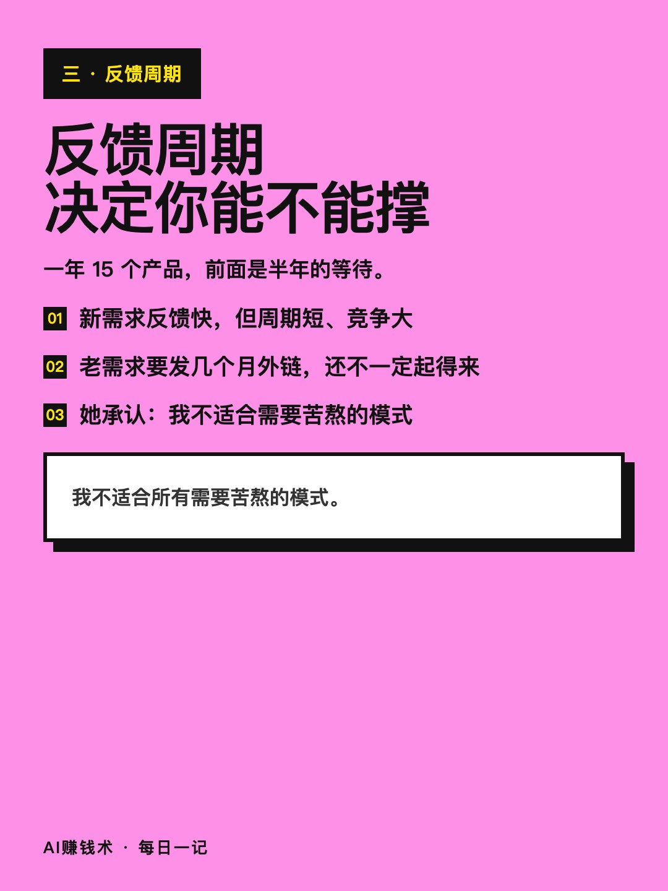
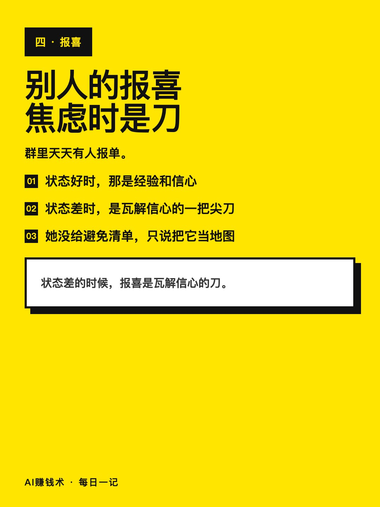
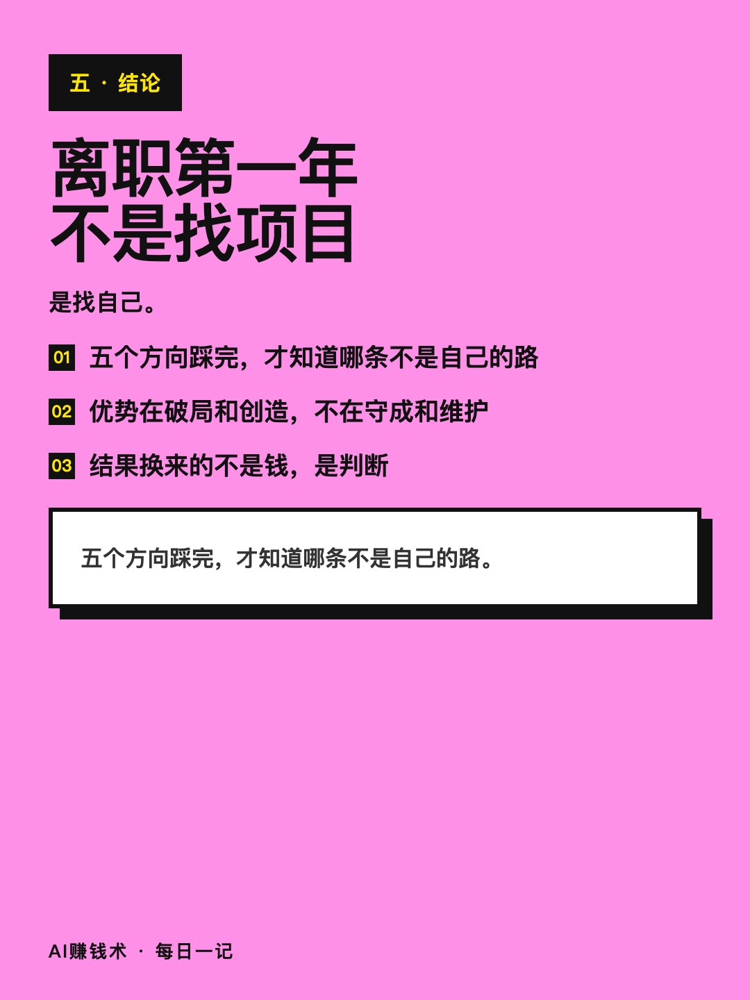
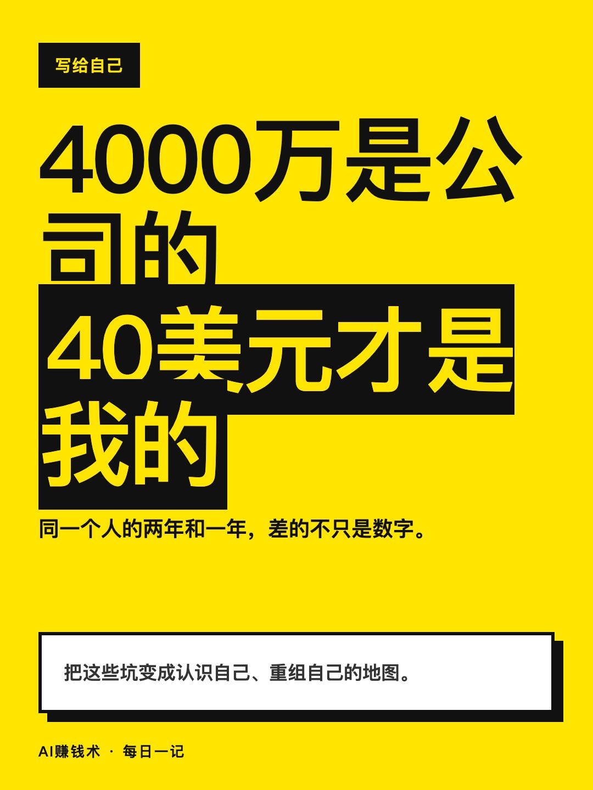

# 4000万是公司的，40美元是我的

> — · 2026-11-02 11:04 发布 · AI 赚钱内容

## 标题（可直接复制）

```
4000万是公司的，40美元是我的
```

## 正文（可直接复制发布）

我在公司两年做到4000万营收，离职一年，第一笔收入是40美元。

说这话的人叫甜芝士，前教育公司增长负责人，去年3月底裸辞。她当时以为，离开平台照样能复制一遍。

① 平台给的，一半是能力，一半是幻觉

她自己列的五个坑，第一个就是平台与个人能力的边界混淆。

在公司里推一个项目，动的是预算、团队、品牌、现成的渠道。这些都不写在简历上，但都算在你头上。出来之后才发现，4000万是公司的营收，40美元才是自己挣的。

第二个坑更扎心：表达欲不等于内容能力。朋友说她适合做博主，她自己也有满肚子话想说，于是做了账号——涨粉和变现全失败，真正带来流量的反而是她做的产品内容。

五个方向她一个个数过：做海外小产品、做博主、摆摊做文创、做社群、做企业服务。前四个都不是白干，但都没长成她的路。

② 反馈周期，决定你能不能撑住

这是她复盘里最有用的一个词。

一年做了15个上线的产品，还有3个半路夭折。第4个产品涨粉过千，接了3条广告，赚到一千多；第5个产品上线三个月拿到搜索排名，赚到第一笔40美元。前面是半年的漫长等待。

她的结论很干脆：我不适合所有需要苦熬和重复的模式，我的优势是破局和创造，不是守成和维护。

③ 别人的报喜，焦虑时会变成刀

这句我记了很久。

她说群里天天有人报单。状态好的时候，那是经验和信心；状态差的时候，就是瓦解信心的一把尖刀。

她没给一份「如何避免」的清单。她说的是，把这些坑变成认识自己的地图。

还有个细节她写得很实：那几个月钱不多，但也不是活不下去，于是就这么拖着。真正逼她动起来的，是钱快见底，不是计划表。

离职第一年，不是找项目，是找自己。这话听着虚，但她的账很实：五个方向踩完，才知道哪条不是自己的路。她现在也还在补，产品在完善，客户在交付。

你现在手里最拿得出手的那个成绩，有多少是平台给的？评论区聊聊。

## 话题标签

#职场 #裸辞 #个人成长 #副业 #AI赚钱术日记

## 配图（8 张）










## 发布信息

| 项 | 值 |
|---|---|
| 平台 | 小红书 |
| 期数 | — |
| 发布时间 | 2026-11-02 11:04 |
| 正文长度 | 782 字 |
| 图片数量 | 8 张 |
| 状态 | 已发布 |
