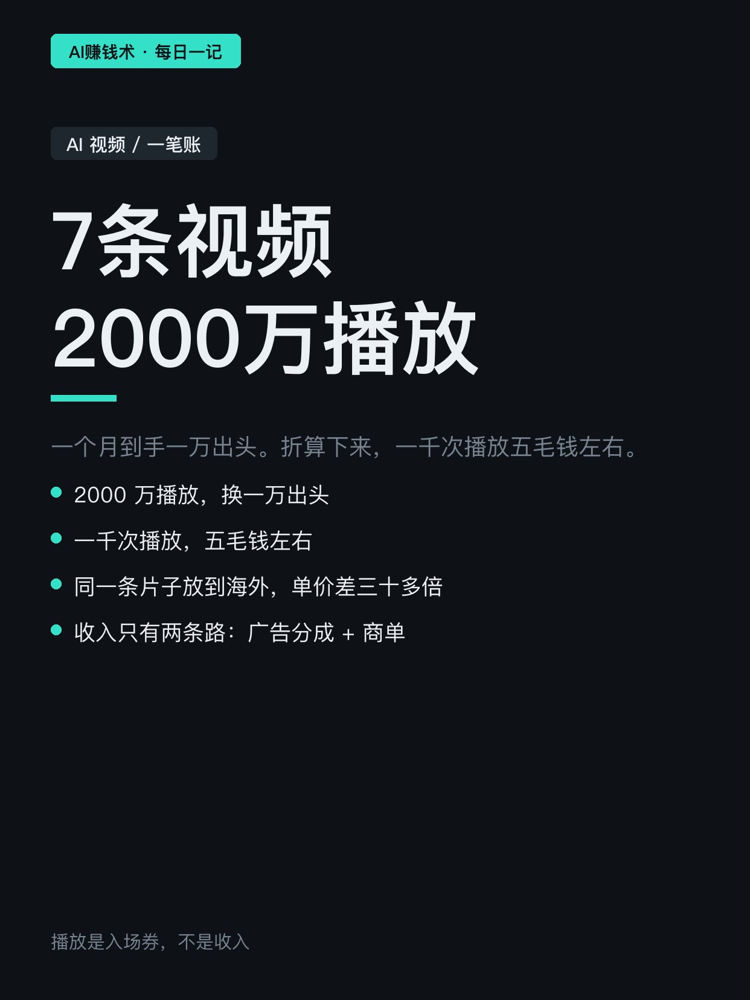
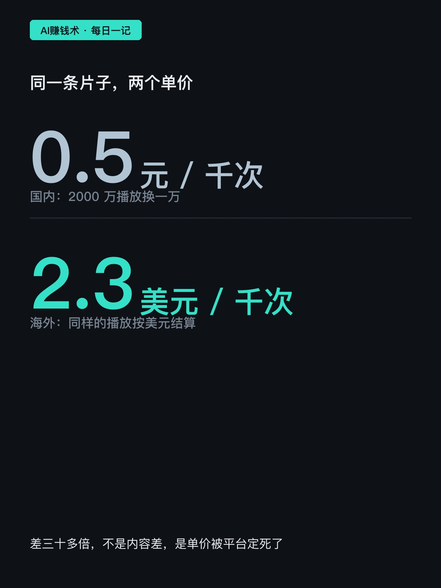
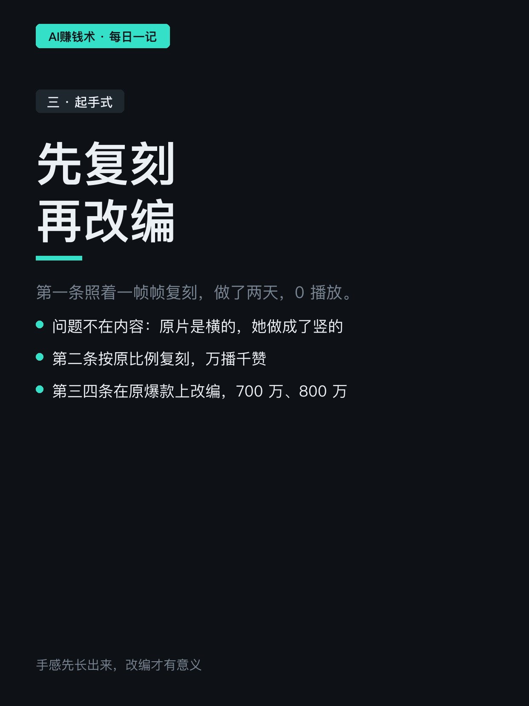
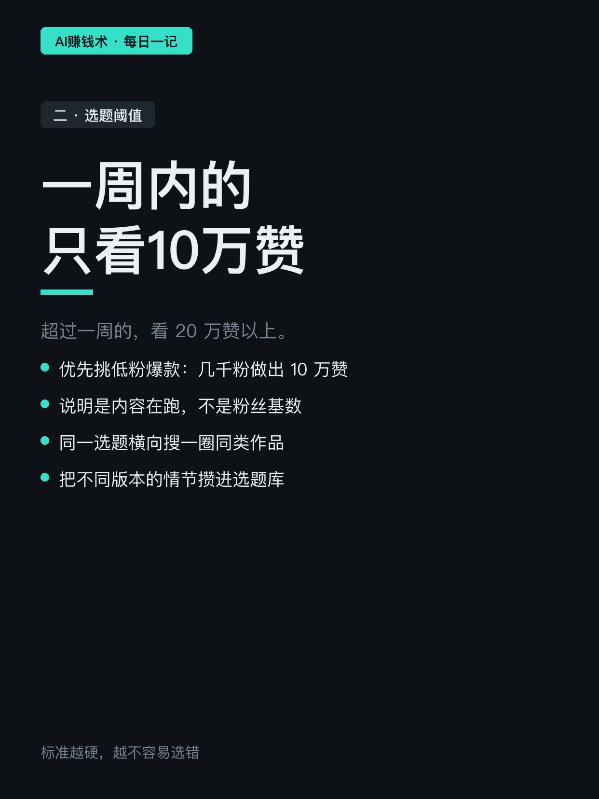
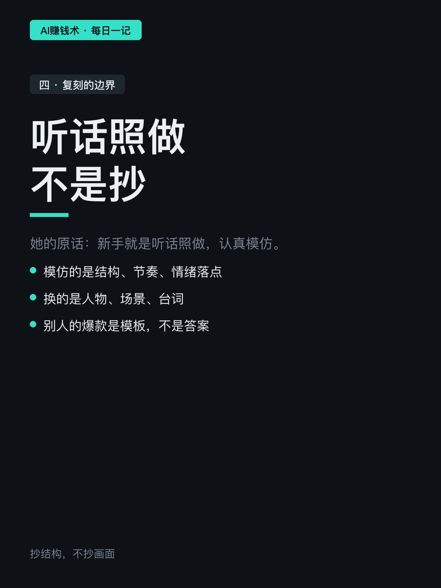
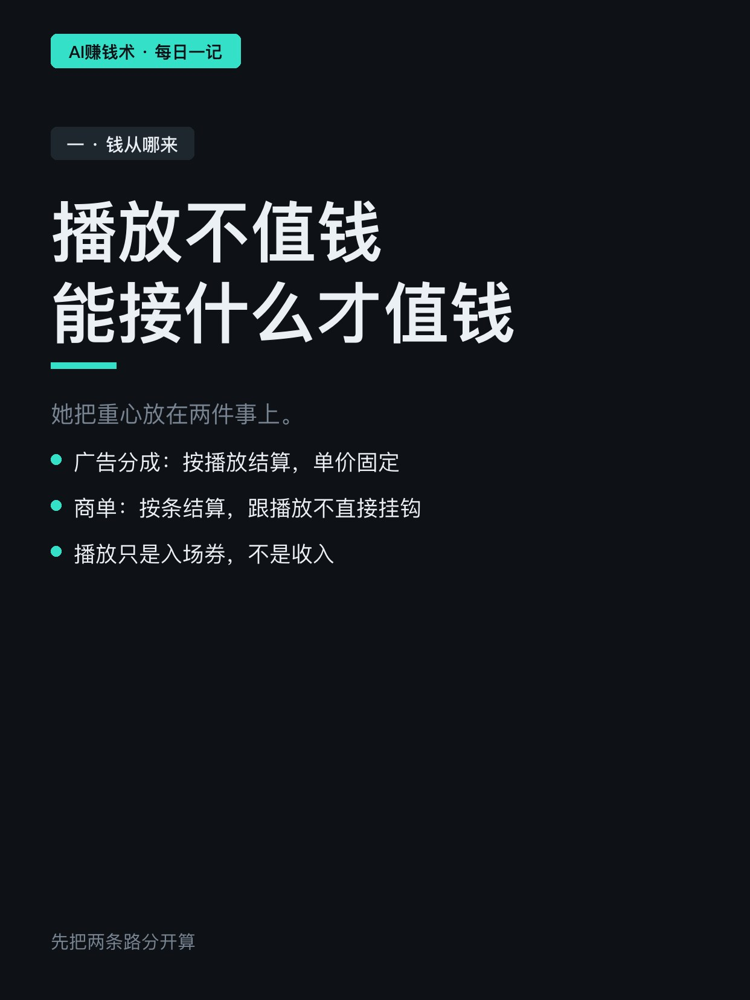

# 7条视频2000万播放，收入1万

> — · 2026-11-02 15:03 发布 · AI 赚钱内容

## 标题（可直接复制）

```
7条视频2000万播放，收入1万
```

## 正文（可直接复制发布）

7条视频，2000万播放，一个月到手一万出头。

这是一个去年刚毕业的女生做的账。她做AI情感短片，去年下半年还在摆烂，钱快花完了才开始认真做。

她原本想做海外，因为想赚美金。但看了一圈发现自己对那类短片无感，硬着头皮复刻一条两年前的爆款，断断续续做了两天，发出去 0 播放。

① 播放不值钱，值钱的是这条能接什么

2000万播放换1万，折算下来一千次播放五毛钱左右。

同样一条片子放到海外，一千次播放是两块多美元。差三十多倍——不是内容差，是单价被平台定死了。

所以她把重心放在两件事上：一是广告分成，二是商单。播放只是入场券。

② 选题有硬阈值，不靠感觉

她的标准很简单：一周内的作品只看10万赞以上，超过一周的看20万赞以上。

优先挑低粉爆款——几千粉的号做出10万赞，说明是内容本身在跑，不是粉丝基数。

同一个选题她还会横向搜一圈同类作品，把不同版本的情节攒进选题库，一个月能复用一两次。普适性也是判断标准之一——同一个情绪下得有一批同类作品在跑，才说明这个方向撑得住。

③ 先复刻，再改编

第一条她照着一帧帧复刻，做了两天，0播放。后来被点出问题：原片是横的，她做成了竖的。

第二条改成真人、按原比例复刻，万播千赞。第三条第四条在原爆款基础上改编，700万、800万播放，其中一条在另一个平台也跑到300多万。

她的流程是三段：先把原片一帧帧拆成画面描述，再按分镜做资产图，最后进画布生成。听着慢，但比反复重做快。

她的原话是：新手就是听话照做，认真模仿，别自己埋头钻。

这话跟「原创」听着矛盾，但顺序是对的——手感先长出来，改编才有意义。

你现在播放最高的那条内容，实际到手多少钱？评论区算一下。

## 话题标签

#AI视频 #内容创作 #自媒体 #变现 #AI赚钱术日记

## 配图（8 张）










## 发布信息

| 项 | 值 |
|---|---|
| 平台 | 小红书 |
| 期数 | — |
| 发布时间 | 2026-11-02 15:03 |
| 正文长度 | 720 字 |
| 图片数量 | 8 张 |
| 状态 | 已发布 |
