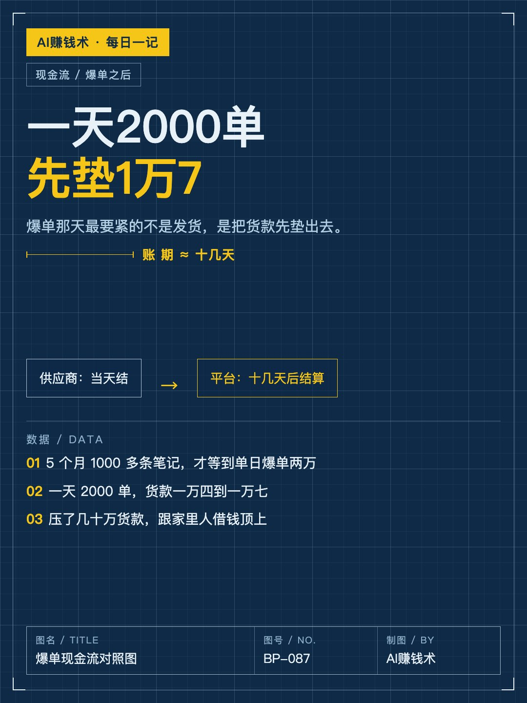
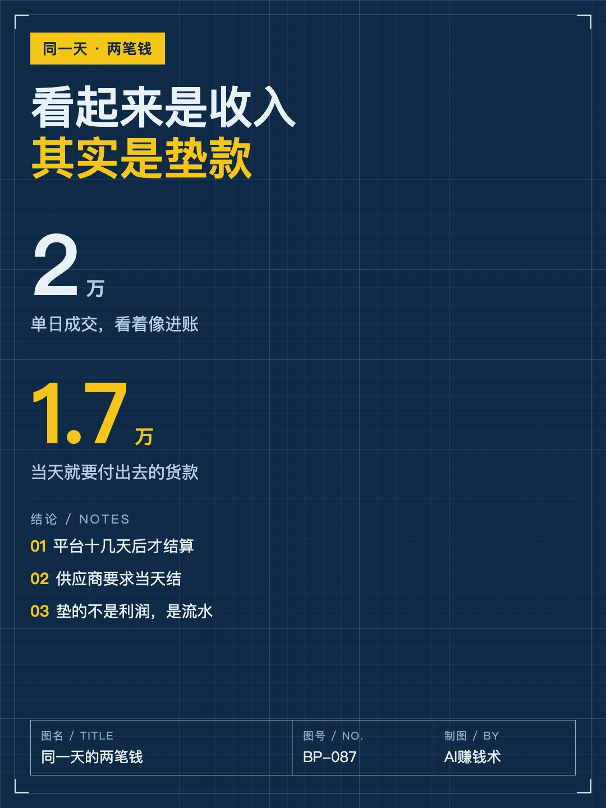
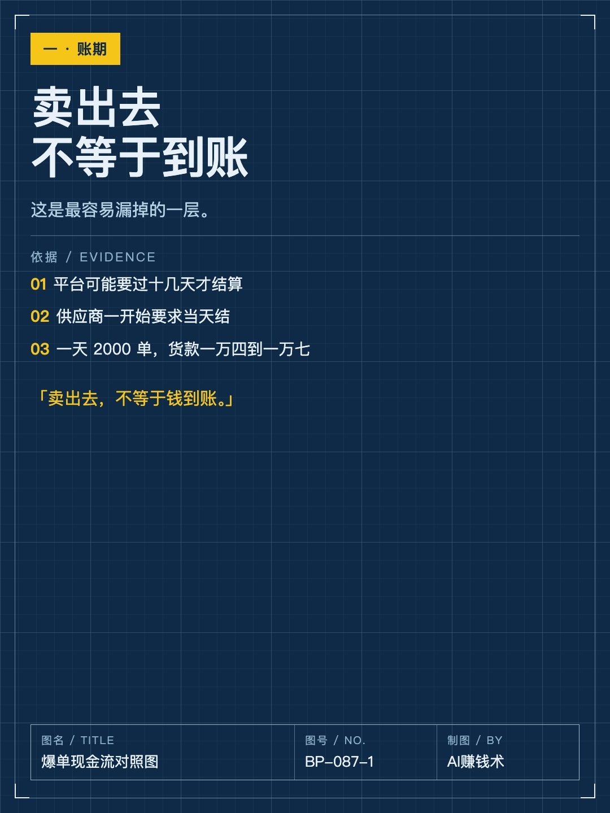
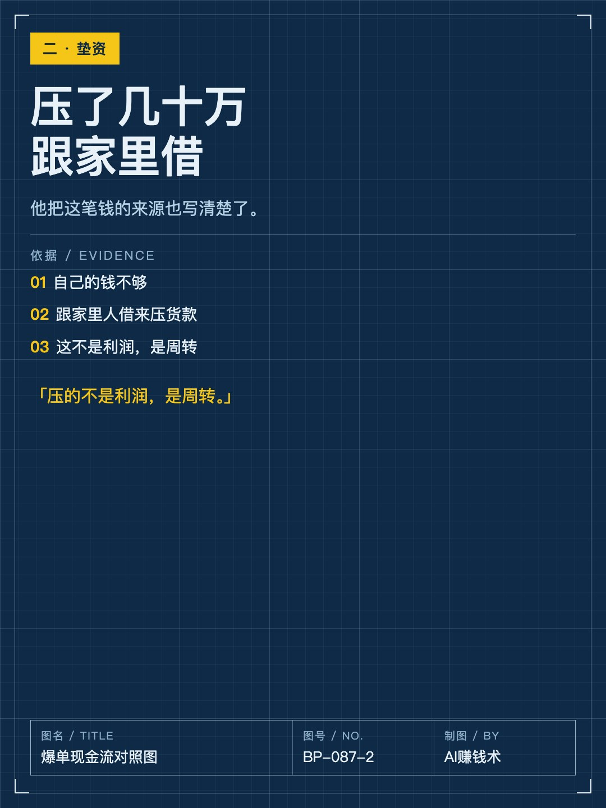
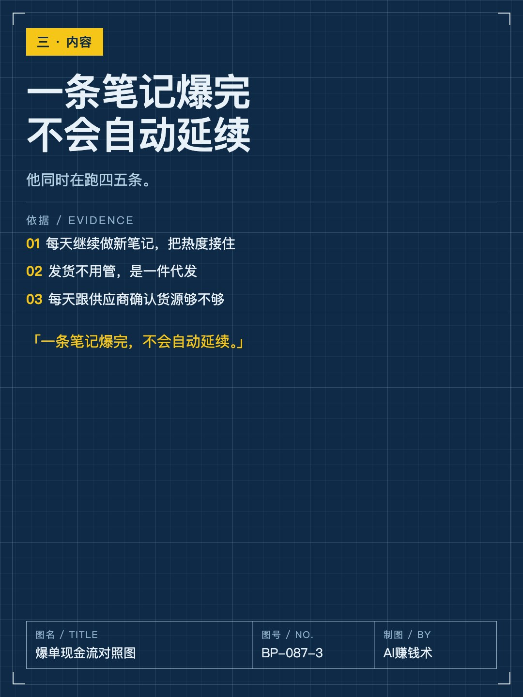
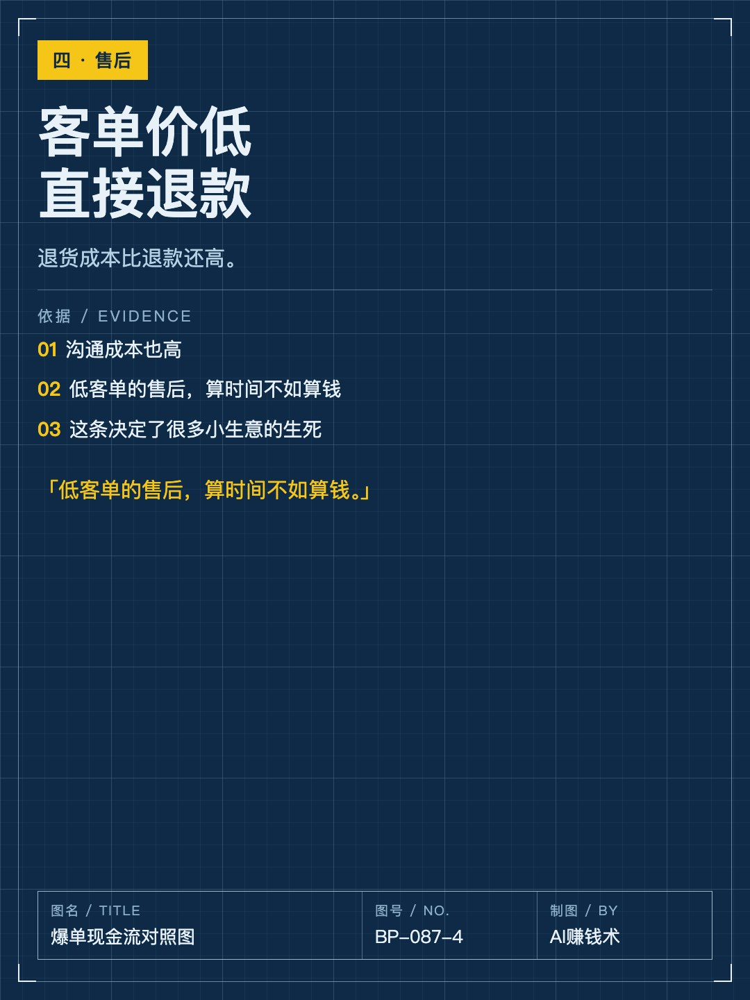
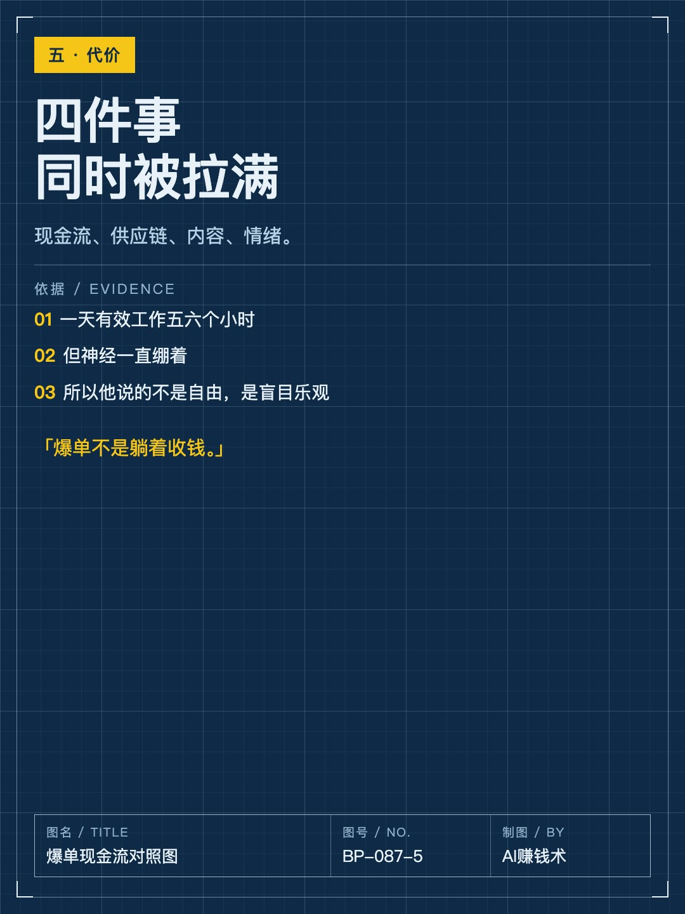
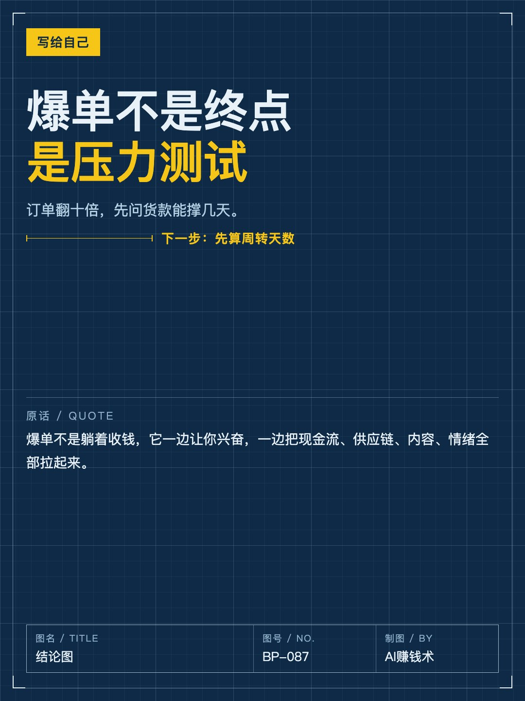

# 一天2000单，先垫出去1万7

> — · 2026-11-02 16:03 发布 · AI 赚钱内容

## 标题（可直接复制）

```
一天2000单，先垫出去1万7
```

## 正文（可直接复制发布）

爆单那天最要紧的不是发货，是先垫一万七。

说这话的人发了5个月、1000多条笔记，才等到单日爆单两万。他原来也以为爆单就是收钱。

那五个月里，前两个月他天天做，像打了鸡血；后面几个月没爆单，但他还有别的收入，心里没那么慌。真正等到爆单，是12月。

① 结算有账期，货款要现结

平台不是当天卖、当天到账，可能要过十几天才结算。

但供应商那边一开始要求当天结。一天卖2000单，货款就是一万四到一万七，这些钱得先垫出去。

他压了几十万货款，最后是跟家里人借钱顶上的。

这笔钱不是利润，是流水。很多人算爆单收益的时候，把这一层直接漏掉了。更麻烦的是，它跟你卖得快不快成正比——卖得越猛，垫得越多。

② 爆单不是一条笔记的事

一条笔记爆完不会自动延续。他同时在跑四五条笔记，每天继续做新的，把热度接住。

发货不用他管，是一件代发。但他每天要跟供应商确认货源够不够——太爆了，怕断货，也怕质量掉。

售后的处理很干脆：客单价低，退货成本比退款还高，直接退钱。

他做的是饰品。后来复盘他才总结出三个条件：有颜值、有用、顾客觉得占了便宜。当时他只是觉得这个能卖。

③ 爆单同时拉起四件事

现金流、供应链、内容产能、情绪。

他现在判断一个品能不能做，会先问一句：这单我要垫多久。

他说有效工作时间其实不长，一天五六个小时集中做笔记，但神经一直绷着：今天发了吗、货还有吗、售后有没有、钱够不够结、这个爆款还能撑几天。

所以他给「一人公司」的注解不是自由，是盲目乐观——不乐观根本撑不到爆单那天。

他还说过一句很实在的话：爆单以后你甚至会期待它赶紧结束，因为太累了。

如果明天你的订单翻十倍，你的货款能撑几天？评论区算算。

## 话题标签

#电商 #一人公司 #现金流 #副业 #AI赚钱术日记

## 配图（8 张）










## 发布信息

| 项 | 值 |
|---|---|
| 平台 | 小红书 |
| 期数 | — |
| 发布时间 | 2026-11-02 16:03 |
| 正文长度 | 719 字 |
| 图片数量 | 8 张 |
| 状态 | 已发布 |
