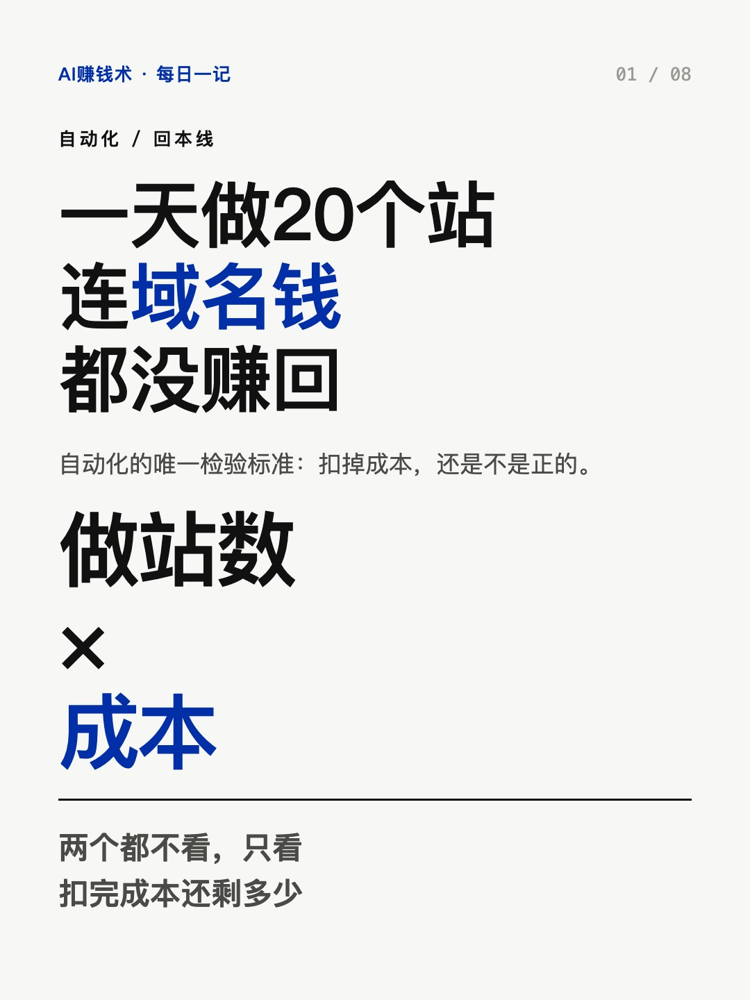
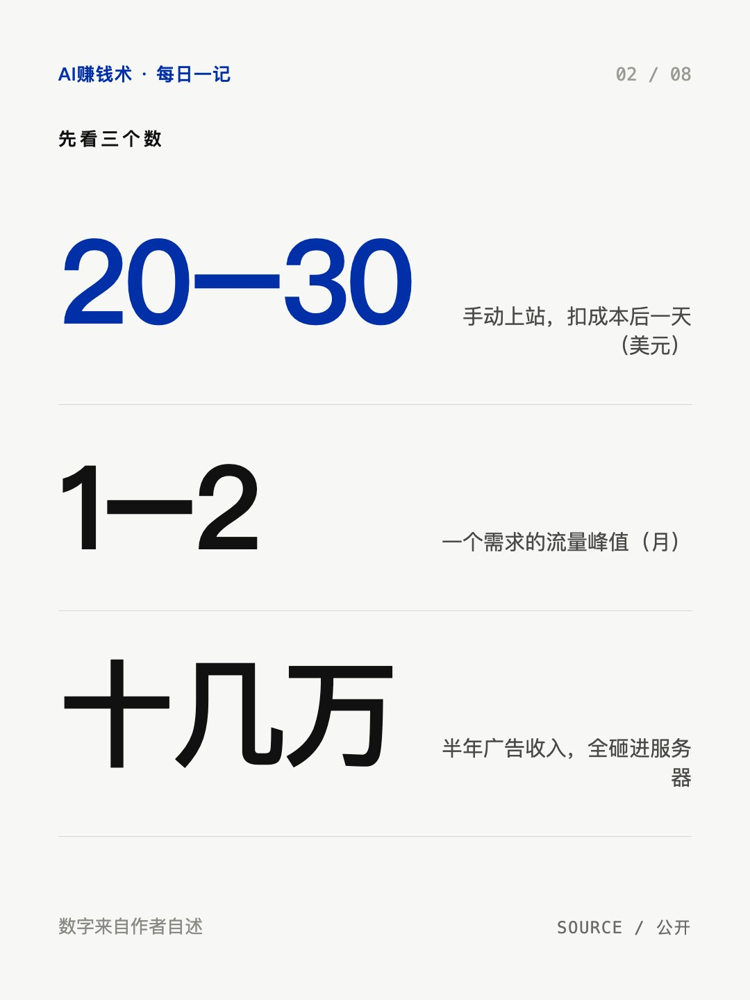
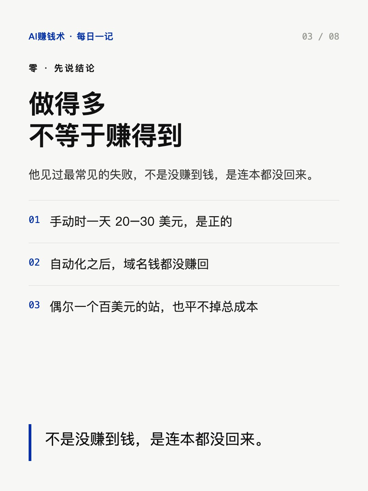
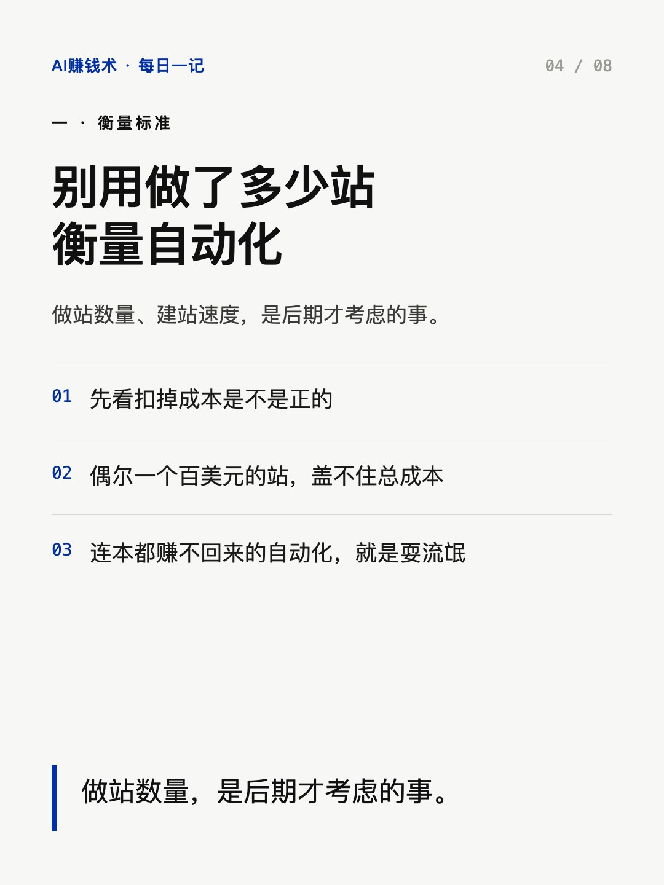
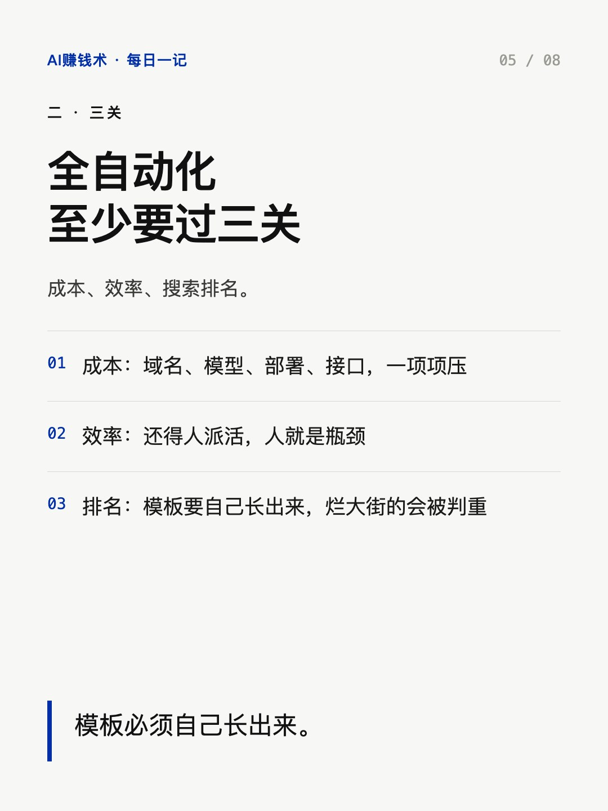
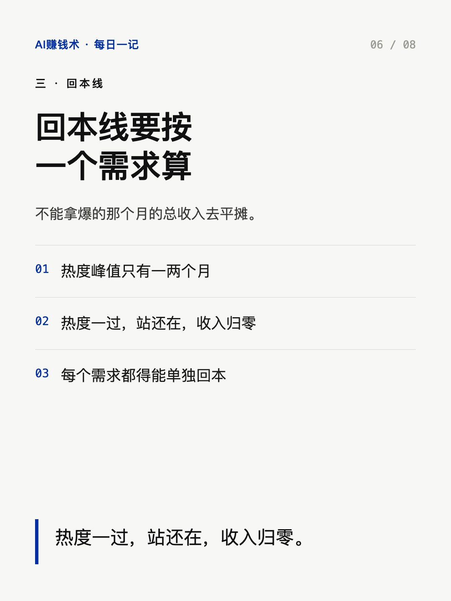
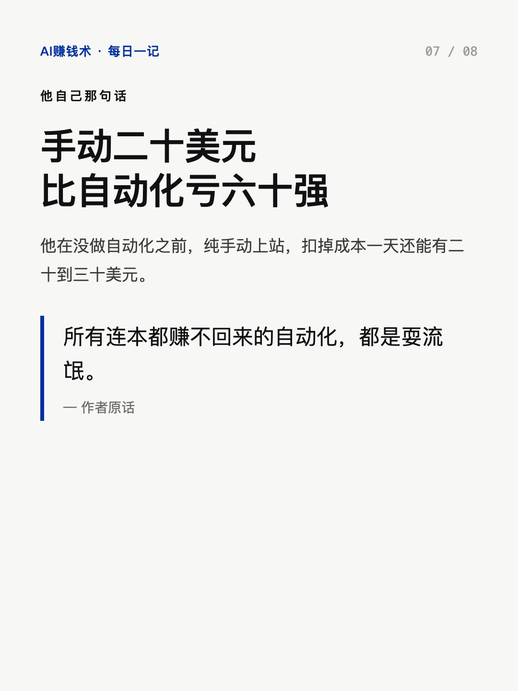
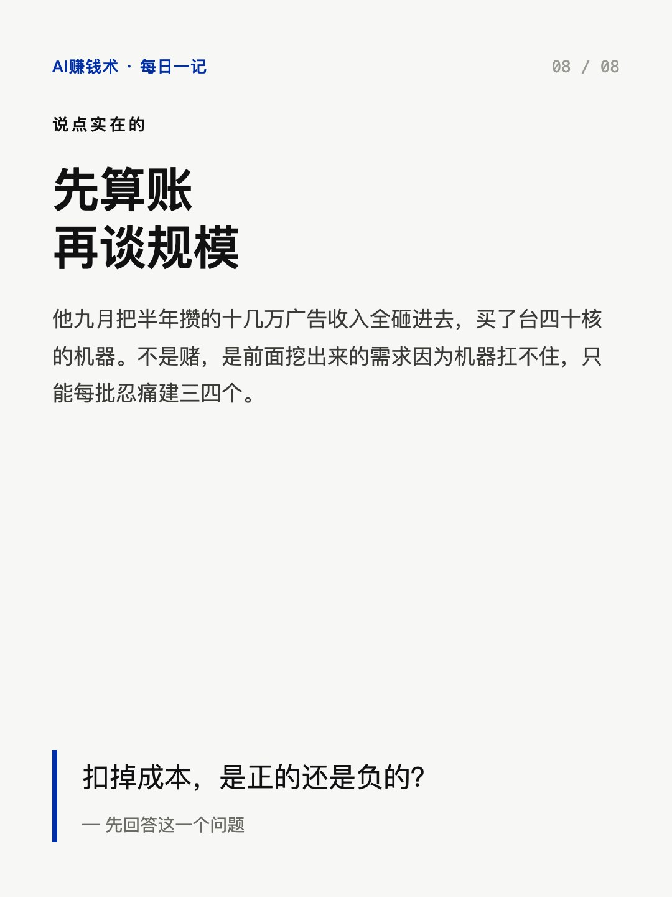

# 一天做20个站，连域名钱都没赚回

> — · 2026-11-02 14:04 发布 · AI 赚钱内容

## 标题（可直接复制）

```
一天做20个站，连域名钱都没赚回
```

## 正文（可直接复制发布）

所有连本都赚不回来的自动化，都是耍流氓。

这话是一个做游戏攻略站的人说的。他没做自动化之前，纯手动上站，扣掉成本一天还能有二十到三十美元。

① 别用「做了多少站」衡量自动化

他见过太多人效仿：写两个技能、生成几页纯文字、套一个开源模板，看起来像自动化了，做了一堆站，域名钱都没赚回来，更别说模型成本和搭进去的时间。

偶尔运气好出一个百美元的站，也盖不住总成本。

这些人的共同点不是懒，是把「能跑起来」当成了「能赚钱」。

所以检验标准只有一个：扣掉成本，是不是正的。做多少站、做多快，是后期才考虑的事。

② 全自动化至少要过三关

第一关是成本：域名、模型、部署、接口，一项一项往下压。

第二关是效率：能不能真的全交给机器。如果还得人一个个派活，人就是系统的瓶颈。他现在一轮挖需求能有十来个过关，一台机器同时建几十个站。

他还有个判断很硬：以前抢一个热词是按天算，现在是按小时算。每天只挖一轮，两三个月前就不够用了，所以他一天要跑好几轮。挖到的时候如果已经有两三个同行在做，他直接放弃。

第三关是搜索排名和体验，也是最容易被跳过的一关：模板必须自己长出来。他说烂大街的模板用的人太多，会被直接判重，白干。宁可让模型从零生成，至少是独一份。

③ 回本线要按「一个词」算

他讲了个关键前提：这类新需求的热度峰值只有一两个月，热度一过，站还在，收入慢慢归零。

所以每个词都得能单独回本，不能拿爆的那个月的总收入去平摊。

换句话说，回本这件事跟做了多少站没关系，跟每个需求能不能自己养自己有关系。

他九月的动作是：把这半年攒的十几万广告收入全砸进去，买了一台本地服务器，四十核、九十六G内存。不是赌，是前面几轮挖出来的需求因为机器扛不住，只能每批忍痛建三四个。

手动一天二十美元，比自动化一天五十、成本六十要强。

你上个月那套流程，扣掉域名和模型钱，是正的还是负的？评论区报个数。

## 话题标签

#自动化 #AI工具 #独立开发 #出海 #AI赚钱术日记

## 配图（8 张）










## 发布信息

| 项 | 值 |
|---|---|
| 平台 | 小红书 |
| 期数 | — |
| 发布时间 | 2026-11-02 14:04 |
| 正文长度 | 802 字 |
| 图片数量 | 8 张 |
| 状态 | 已发布 |
