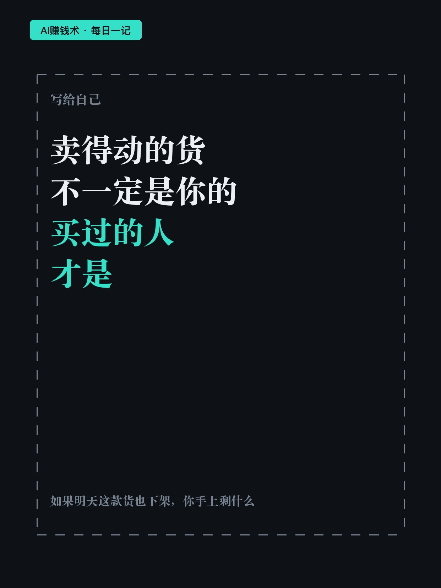
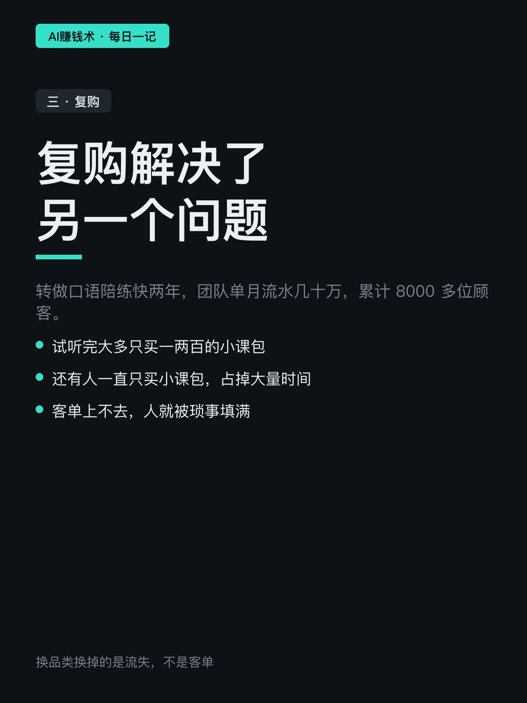
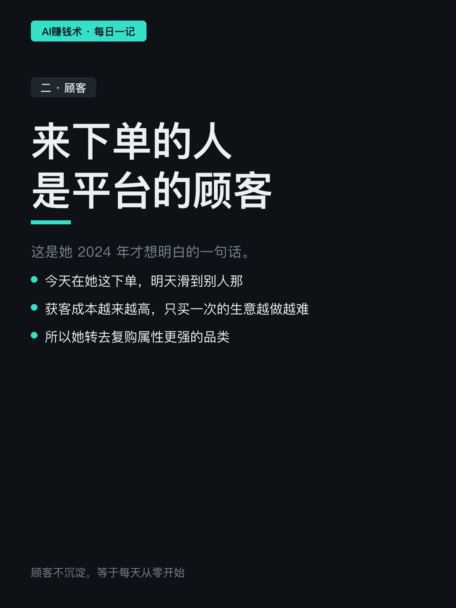
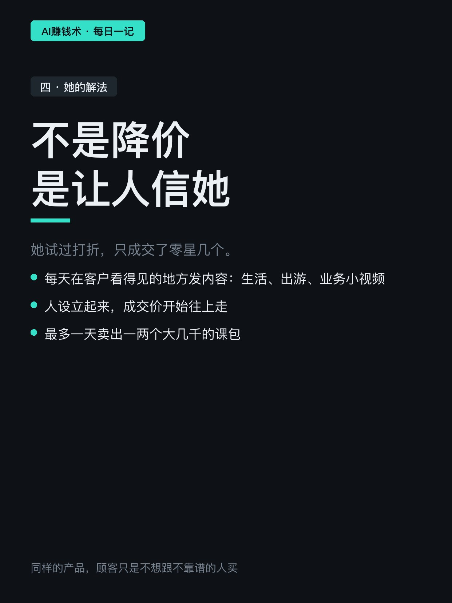
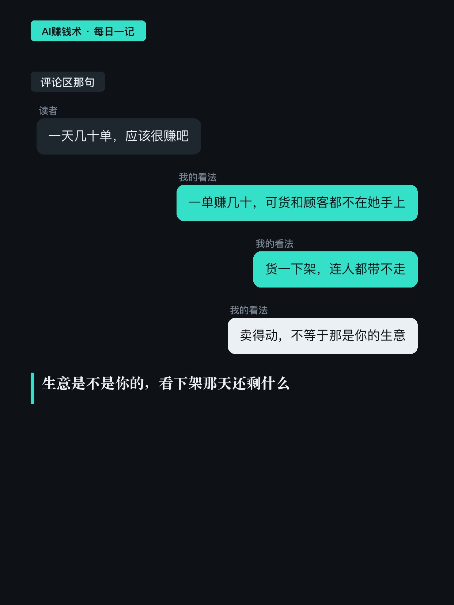
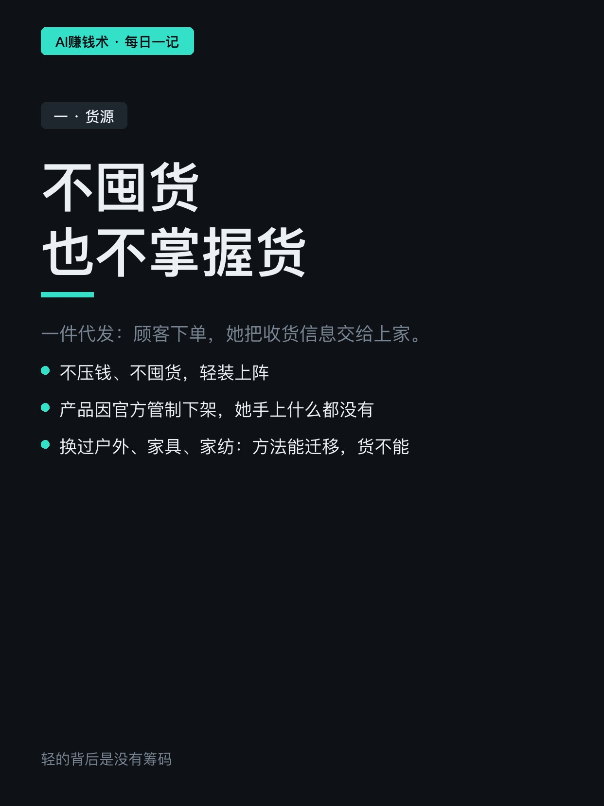
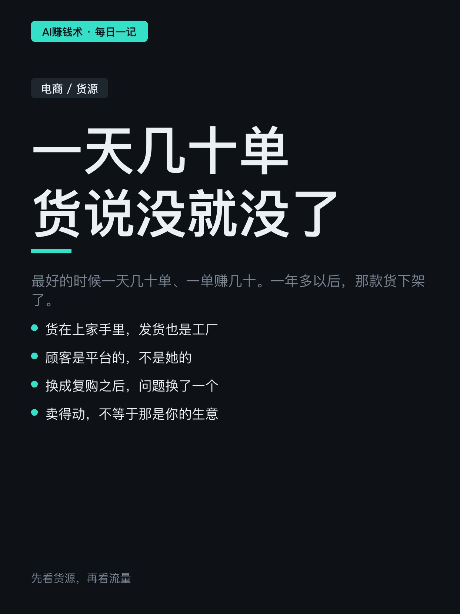
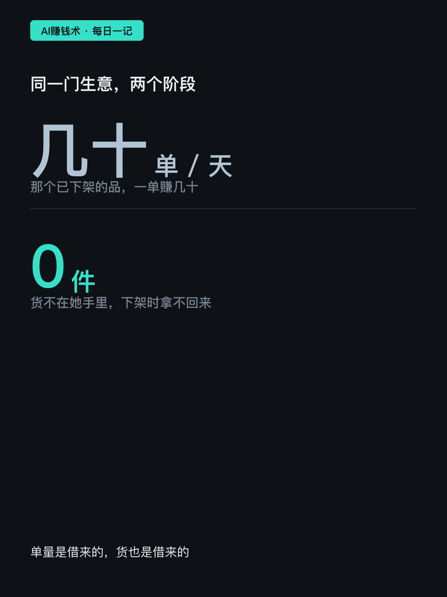

# 一天几十单，货说没就没了

> — · 2026-11-02 13:03 发布 · AI 赚钱内容

## 标题（可直接复制）

```
一天几十单，货说没就没了
```

## 正文（可直接复制发布）

一天几十单，一单赚几十。一年多以后，货没了。

她做了很多年药师，生完老二还没出月子就开始做电商。一件代发，第三天出了第一单，全程没碰过一件货。

① 货不在你手里

一件代发是这么跑的：顾客下单，她把收货信息交给上家，工厂直接发货。不囤货、不压钱，轻装上阵。📦

代价是那款产品因为官方管制下架时，她手上什么都没有。后来又做了户外用品、家具、家纺，同一套方法能迁移，货不能。

她后来的选品思路很朴素：没资金没资源，就找需求大、供给少的。用数据工具一个个类目翻，最后选了强季节性的户外，旺季前把位置占好，旺季一到跟着走。帐篷做起来，顺手把桌椅、气垫床挂上去，同一拨人会搭配着买。

方法确实能复用。但复用的是一个卖法，不是一门生意。

② 顾客也不在你手里

2024 年她才想明白一件事：来下单的人是平台的顾客，不是她的顾客。今天在她这下单，明天就滑到别人那。

获客成本越来越高，只买一次的生意只会越做越难。她开始按渠道给顾客分组、定期触达，还专门建了一个不打扰组，谁嫌烦就移进去。

③ 换成复购之后，问题换了一个

她转做口语陪练，做了快两年。现在团队单月流水几十万，累计 8000 多位顾客。

但新烦恼是：试听完大多只买一两百的小课包，还有人一直只买小课包，占掉她大量时间。

她的解法不是降价。她试过打折，只成交了零星几个。真正管用的是每天在客户看得见的地方发内容：生活、出游、和业务相关的小视频。人设立起来之后，成交价往上走，最多一天卖出一两个大几千的课包。

所以选品要看三件事，缺一件都会在某天还回来：货源稳不稳，顾客能不能沉淀，复购撑不撑得起客单。🔍

如果明天这款货也被下架，你手上剩下什么？是 8000 个买过的人，还是一堆聊天记录。

## 话题标签

#电商 #选品 #复购 #AI赚钱术日记 #副业

## 配图（8 张）










## 发布信息

| 项 | 值 |
|---|---|
| 平台 | 小红书 |
| 期数 | — |
| 发布时间 | 2026-11-02 13:03 |
| 正文长度 | 731 字 |
| 图片数量 | 8 张 |
| 状态 | 已发布 |
