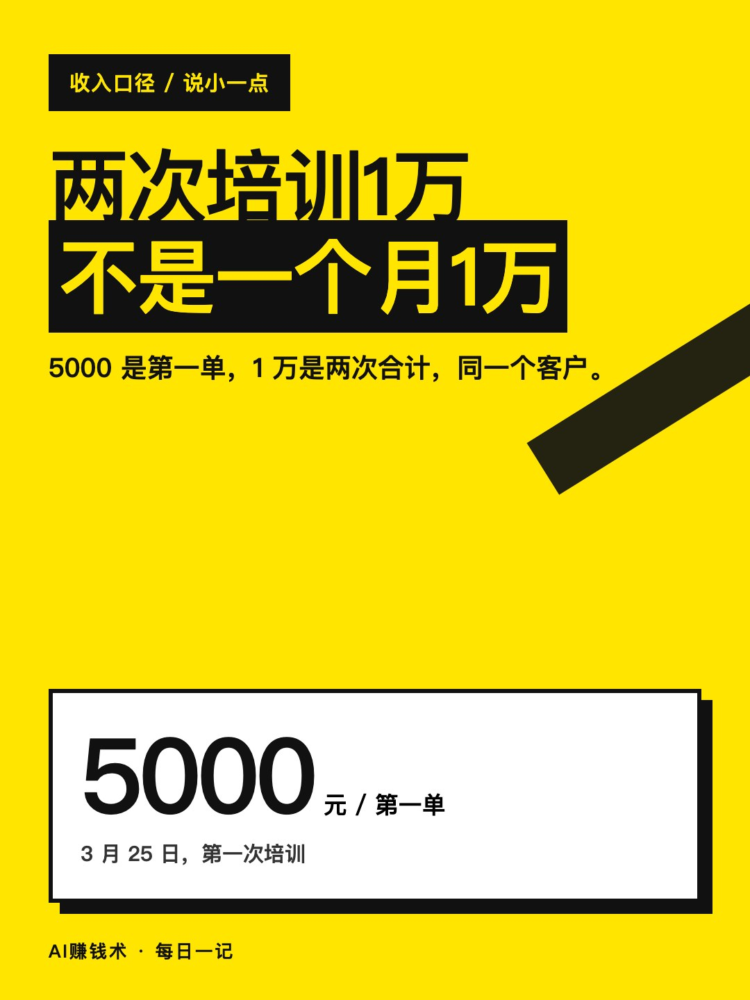
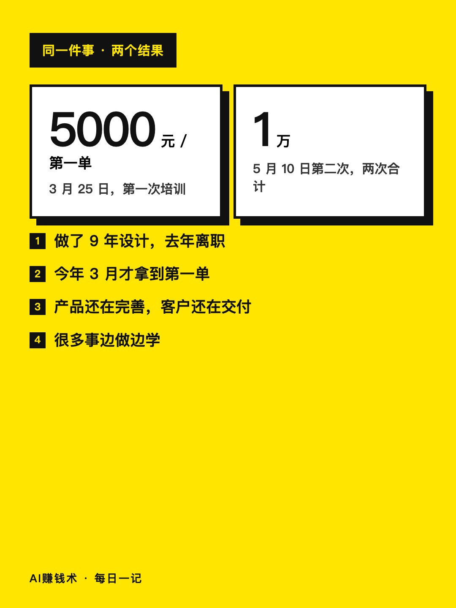
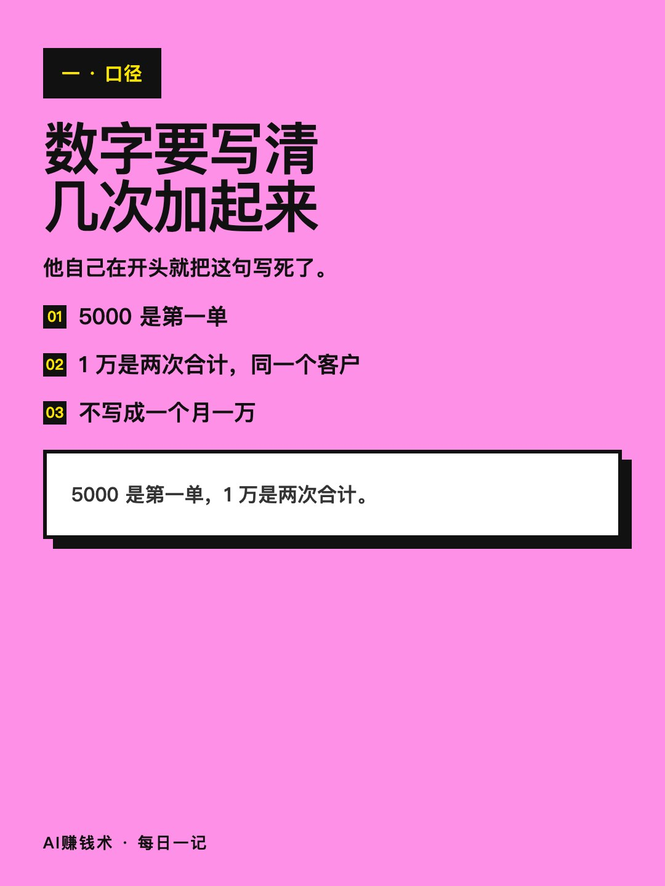
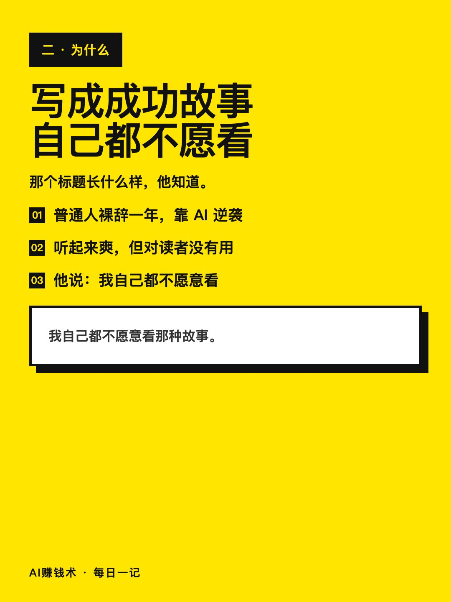
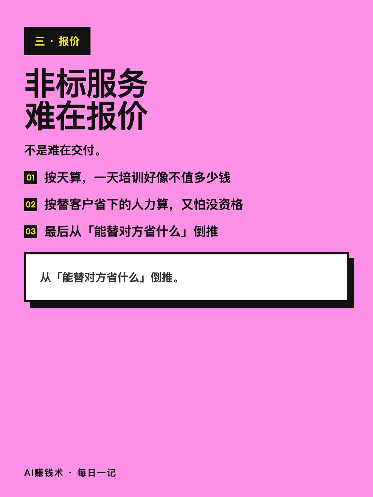
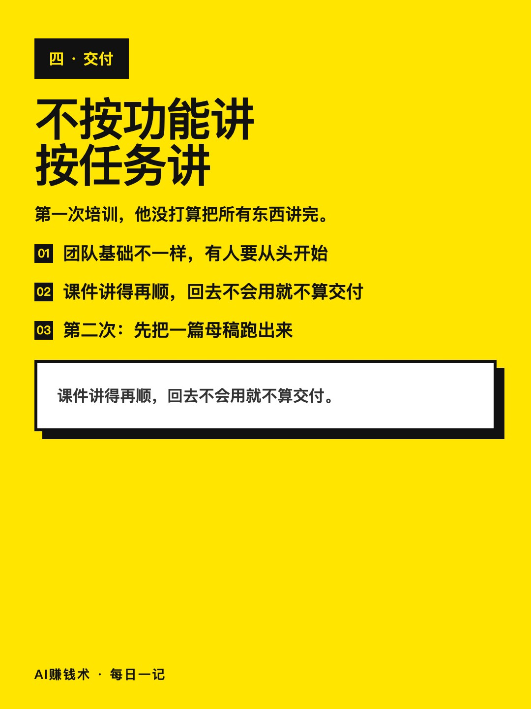
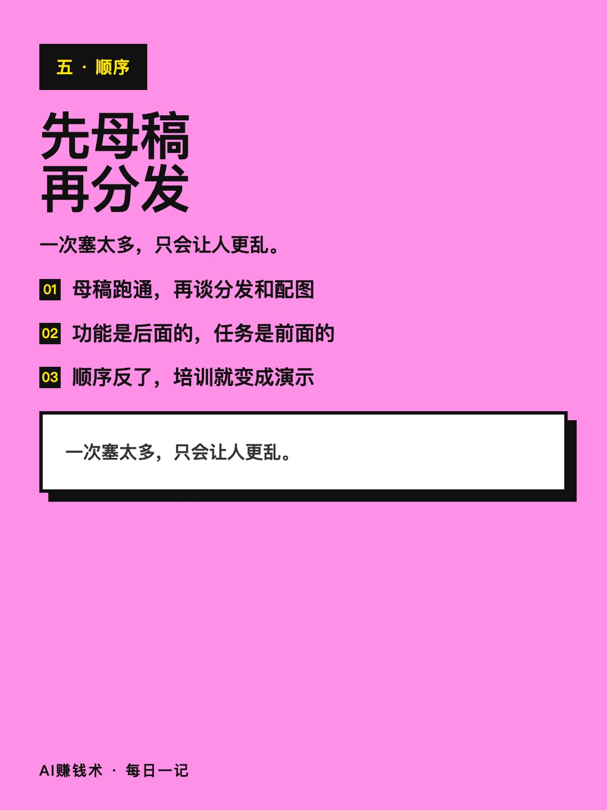
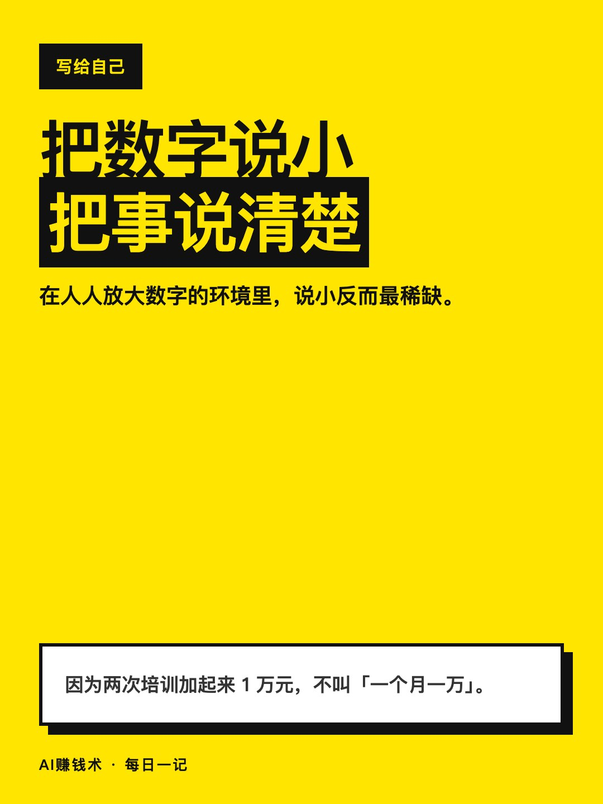

# 两次培训1万，不是一个月1万

> — · 2026-11-02 17:03 发布 · AI 赚钱内容

## 标题（可直接复制）

```
两次培训1万，不是一个月1万
```

## 正文（可直接复制发布）

两次培训加起来1万，我不会写成「一个月一万」。

写这句话的人做了9年设计，去年离职，今年3月才拿到第一单。

① 口径要写清楚：5000是第一单，1万是两次合计

3月25日，他给一个团队做了第一次AI内容工作流培训，5000元。5月10日，又给同一个团队做了第二次。两次加起来大约1万。

第一单怎么来的他也写清楚了：一次线下分享，现场加到一个后来邀请他做培训的人，13天后成交。不是什么投放来的，是当面讲了一遍。

他在文章开头就把这句写死了：因为两次加起来1万，不叫一个月一万。产品还在完善，客户还在交付，很多事边做边学。

他知道那个标题长什么样：普通人裸辞一年，靠AI逆袭，一个月一万。他说要是真写成跑通的成功故事，自己都不愿意看。

② 非标服务最难的是报价，不是交付

按天算，一天培训好像不值多少钱；按这套流程给客户省下的人力和后续价值算，他又不确定自己有没有资格报那么高。

他最后是从「这套流程能替对方省掉什么」倒推的，不是从自己的工时倒推。

他也没套同行价格做锚。做法是把交付拆开：几个小时培训、几份物料、后续答疑，逐项估一遍，再加起来。

③ 培训不按工具功能讲，按现场要完成的任务讲

第一次培训他没把目标定成把所有东西讲完。

团队里基础不一样，有人要从前面的步骤开始。课件讲得再顺，人回去还是不知道怎么开始，这次交付就不算成。

第二次他更确定：先把一篇母稿跑出来，再谈分发和配图。一次塞太多，只会让人更乱。

他的判断是，客户不缺功能演示，缺的是明天上班能直接用上的那一步。

这三条其实是一条：把数字说小，把事说清楚。

在这个人人都在放大数字的环境里，说小反而是最稀缺的一种可信。

你最近一次对外说的收入数字，是几次加起来的？评论区说说。

## 话题标签

#职场转型 #AI应用 #内容创作 #诚实 #AI赚钱术日记

## 配图（8 张）










## 发布信息

| 项 | 值 |
|---|---|
| 平台 | 小红书 |
| 期数 | — |
| 发布时间 | 2026-11-02 17:03 |
| 正文长度 | 740 字 |
| 图片数量 | 8 张 |
| 状态 | 已发布 |
