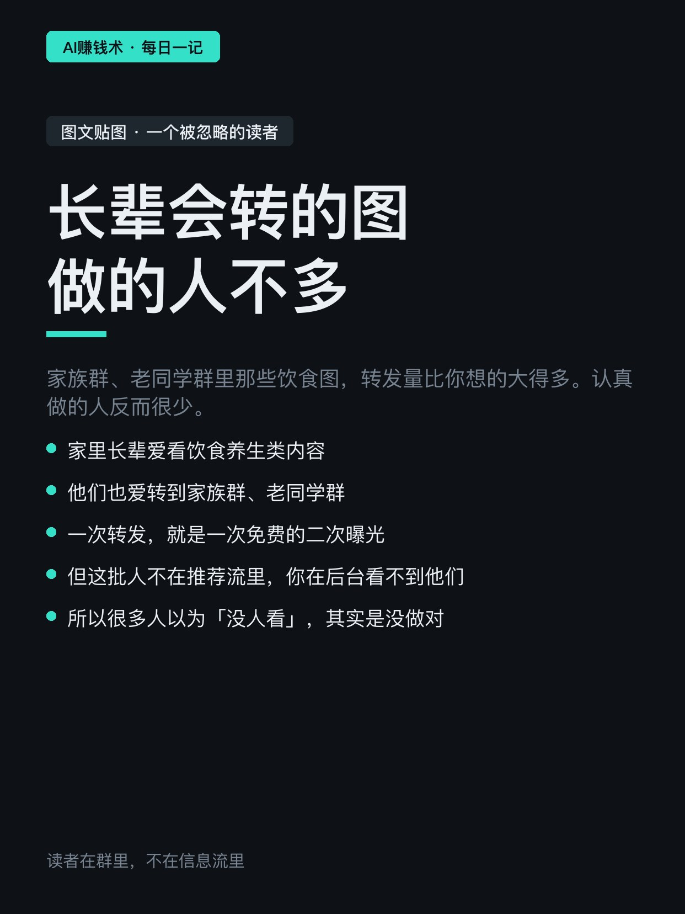
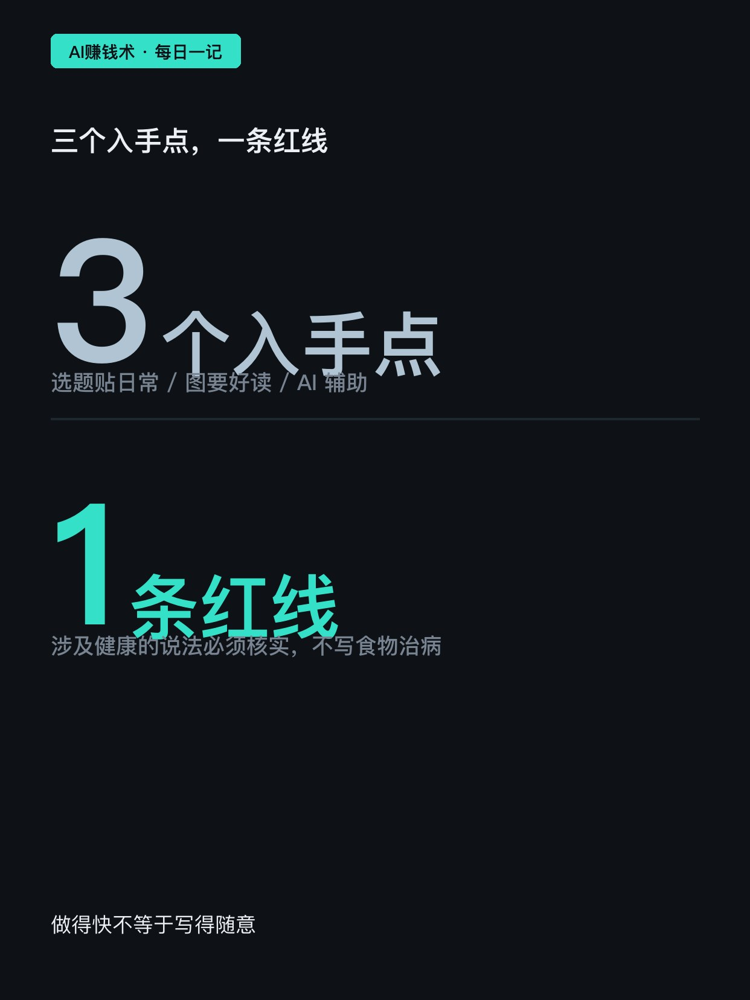
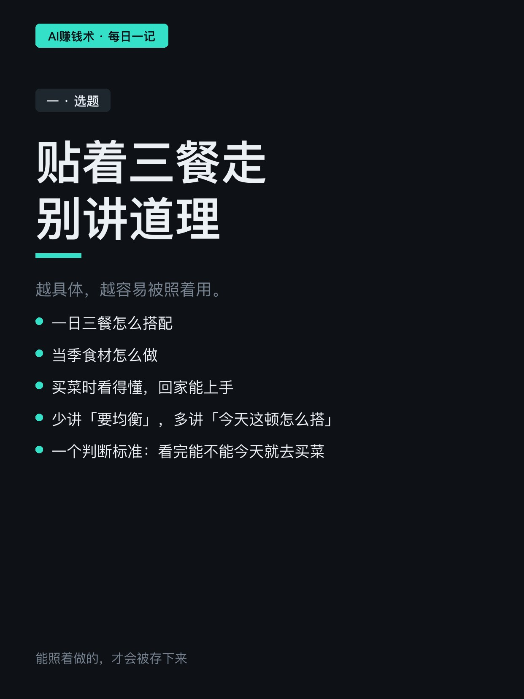
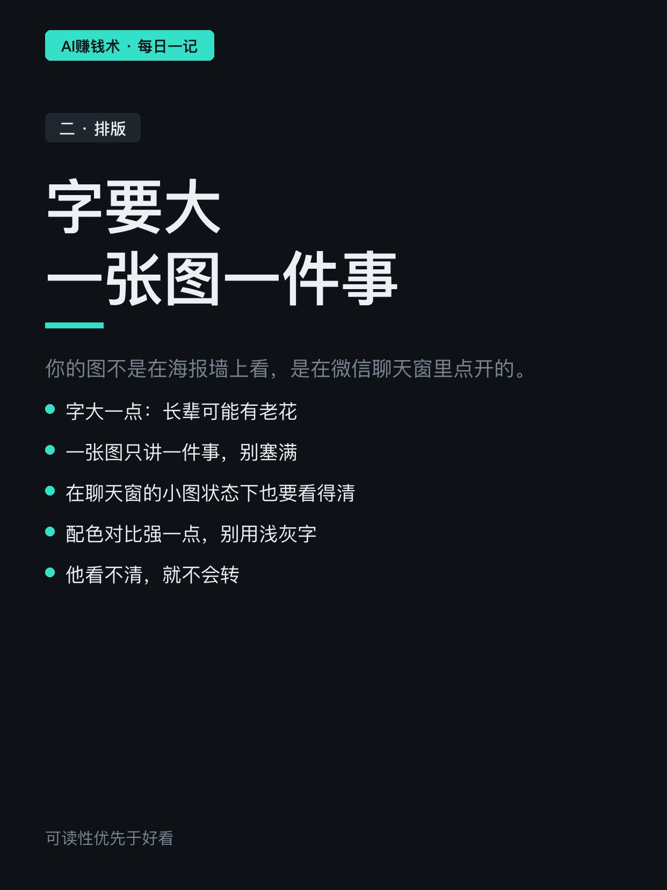
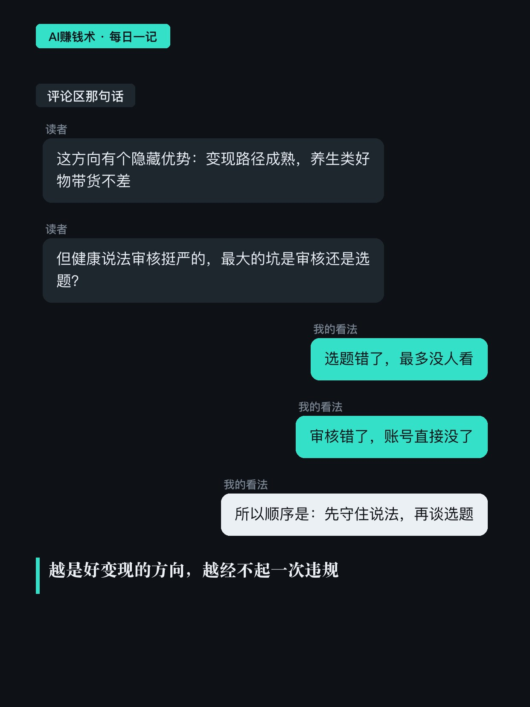
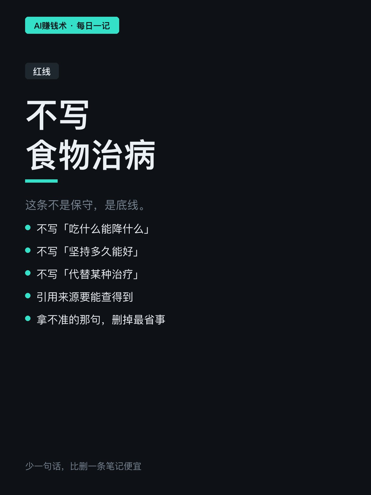
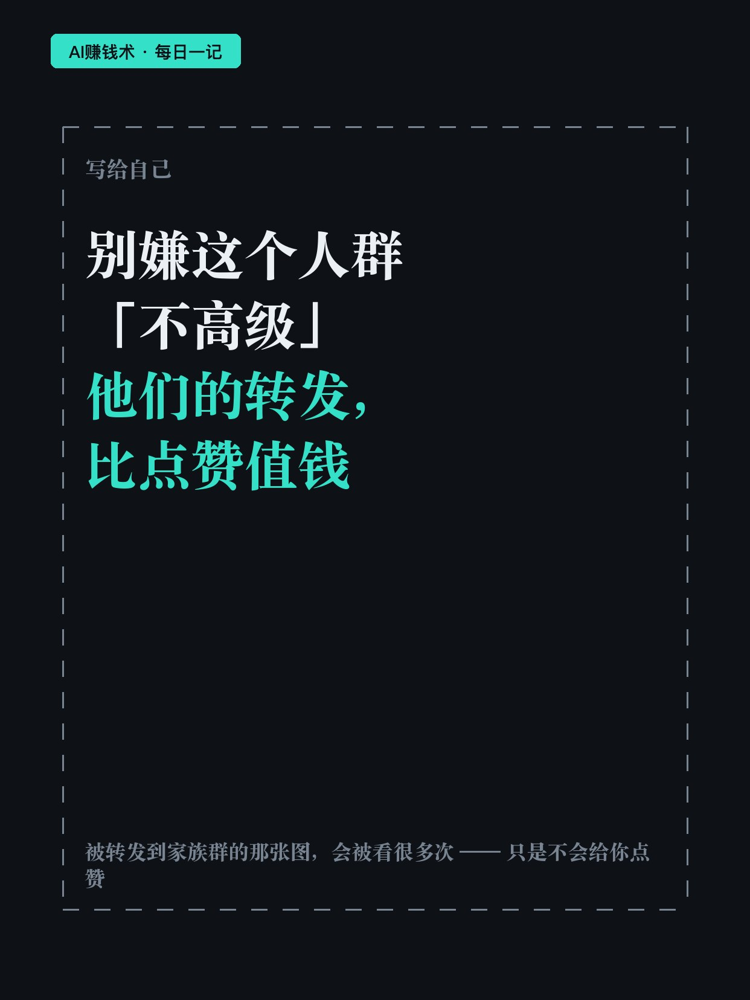

# 家族群里被转最多的图，没人认真做

> — · 2026-11-02 09:08 发布 · AI 赚钱内容

## 标题（可直接复制）

```
家族群里被转最多的图，没人认真做
```

## 正文（可直接复制发布）

家族群里那些饮食图，转发量比你想的大得多。认真做的人反而很少。😮

这是我在一篇讲「图文贴图」的帖子里看到的观察：家里长辈爱看饮食类内容，也爱转到家族群、老同学群。

这个人群不在推荐流里，所以你在后台看不到他们。很多人因此以为「没人看」，其实是没做对。

① 选题贴着三餐走

一日三餐怎么搭配、当季食材怎么做。越具体，越容易被照着用。

少讲「要均衡」，多讲「今天这顿怎么搭」。一个判断标准：看完他能不能今天就去买菜。

跟着时令走还有个好处：夏天讲瓜果、秋天讲根茎，内容自己就有更新节奏，不用每周硬想选题。

② 图要好读，不是好看

你的图不是在海报墙上看，是在聊天窗里被点开的那张小图。

所以字要大一点——长辈可能有老花；一张图只讲一件事，别塞满；配色对比要强，别用浅灰字。

他看不清，就不会转。看不清的东西，没人愿意往群里发。

还有个细节：这类图的封面要能自己说明白——他在群里看到缩略图的那一秒，就得知道这张图讲的是哪顿饭。

③ AI 用在体力活上，不用于结论

整理资料、写初稿、做排版，这三件事交给 AI 没问题，能明显提效。

但涉及健康的说法必须自己核实。不写「吃什么能降什么」，不写「坚持多久能好」，更不写「代替某种治疗」。引用要能查到来源。

拿不准的那一句，删掉最省事——少一句话，比删一条笔记便宜。

评论区有个人补了个角度，我觉得挺关键：这个方向变现路径成熟，养生类好物带货转化不差；但健康说法审核很严。

我的看法是顺序不能反：选题错了，最多没人看；说法错了，账号可能直接没了。

如果要我带走一句：读者在群里，不在信息流里。

你家群里，最近被转发最多的是哪一类图？评论区说一句。

## 话题标签

#内容创作 #自媒体 #中老年 #副业 #AI赚钱术日记

## 配图（8 张）










## 发布信息

| 项 | 值 |
|---|---|
| 平台 | 小红书 |
| 期数 | — |
| 发布时间 | 2026-11-02 09:08 |
| 正文长度 | 712 字 |
| 图片数量 | 8 张 |
| 状态 | 已发布 |
