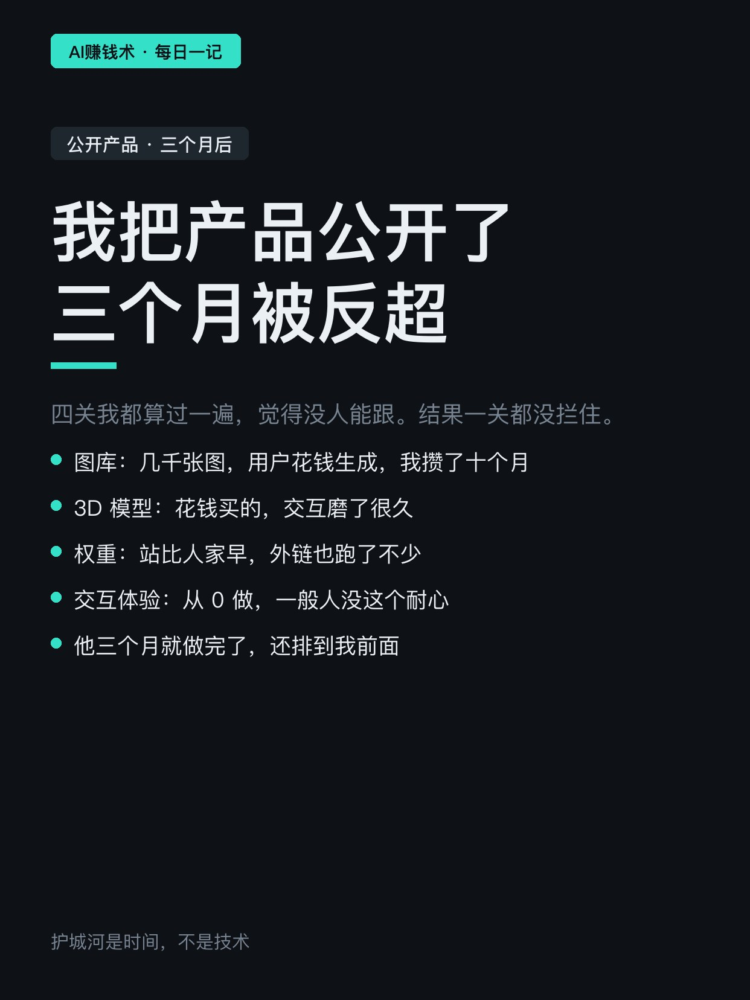
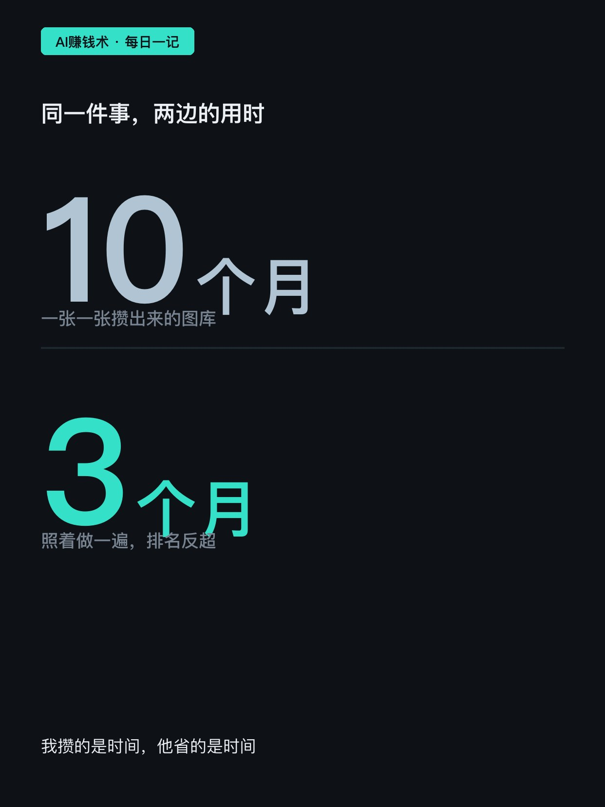
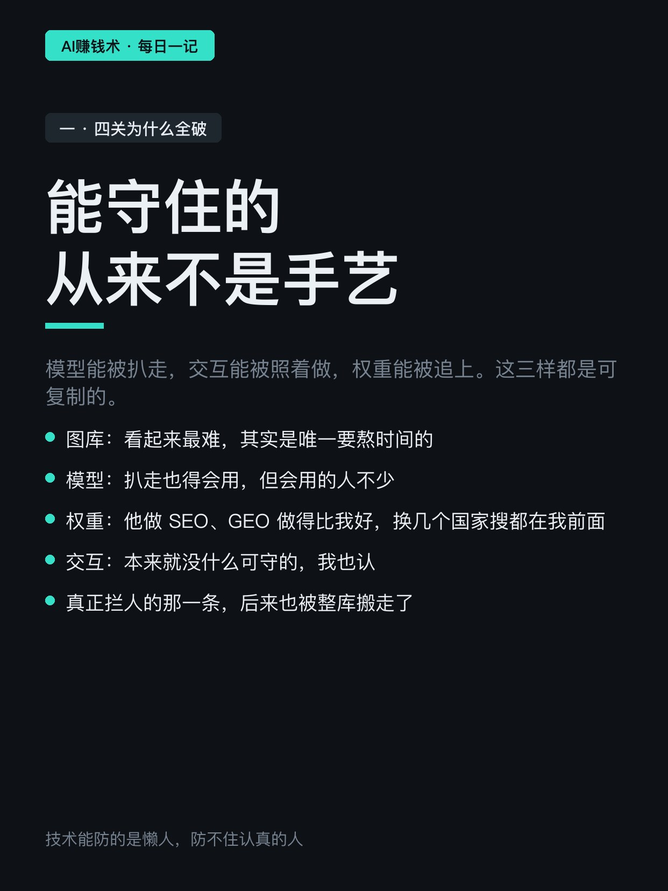
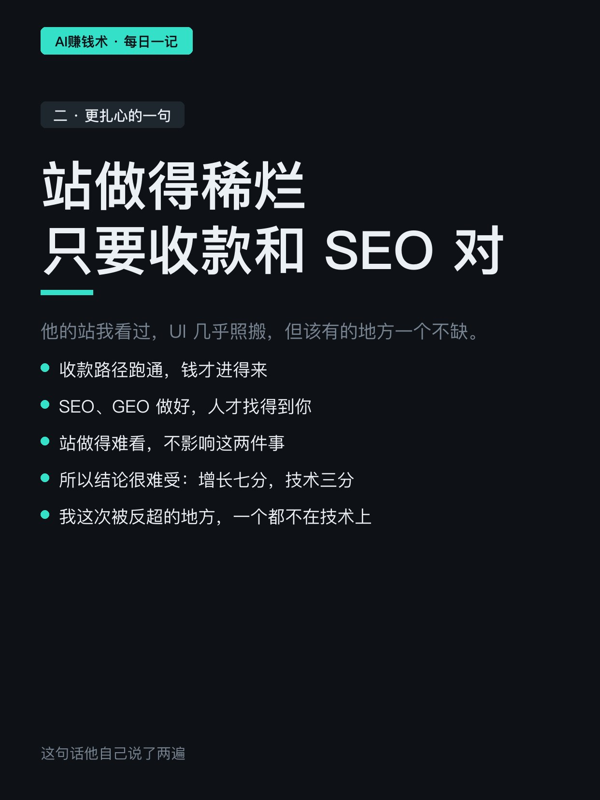
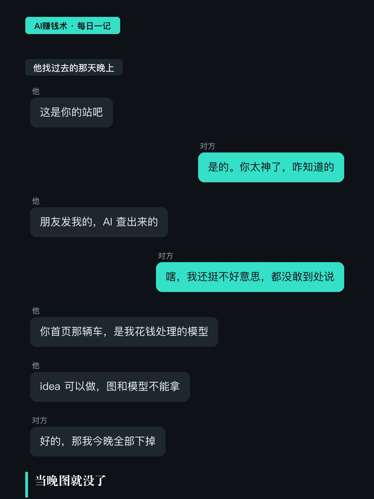
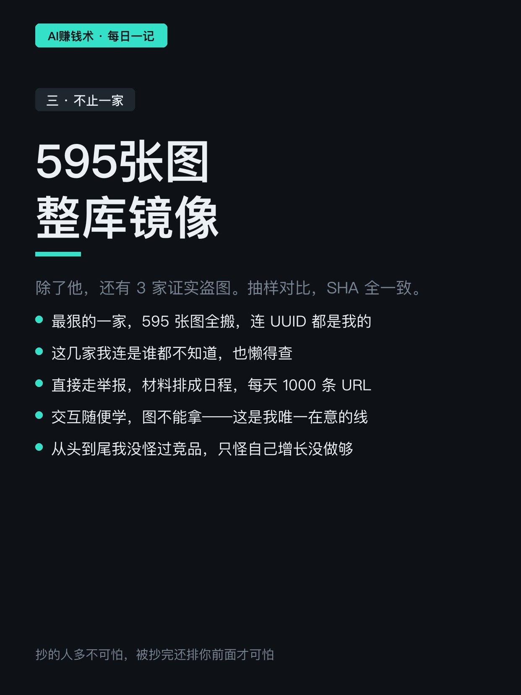
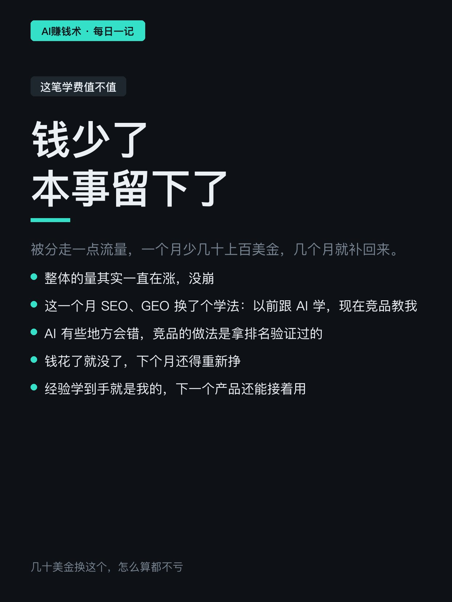
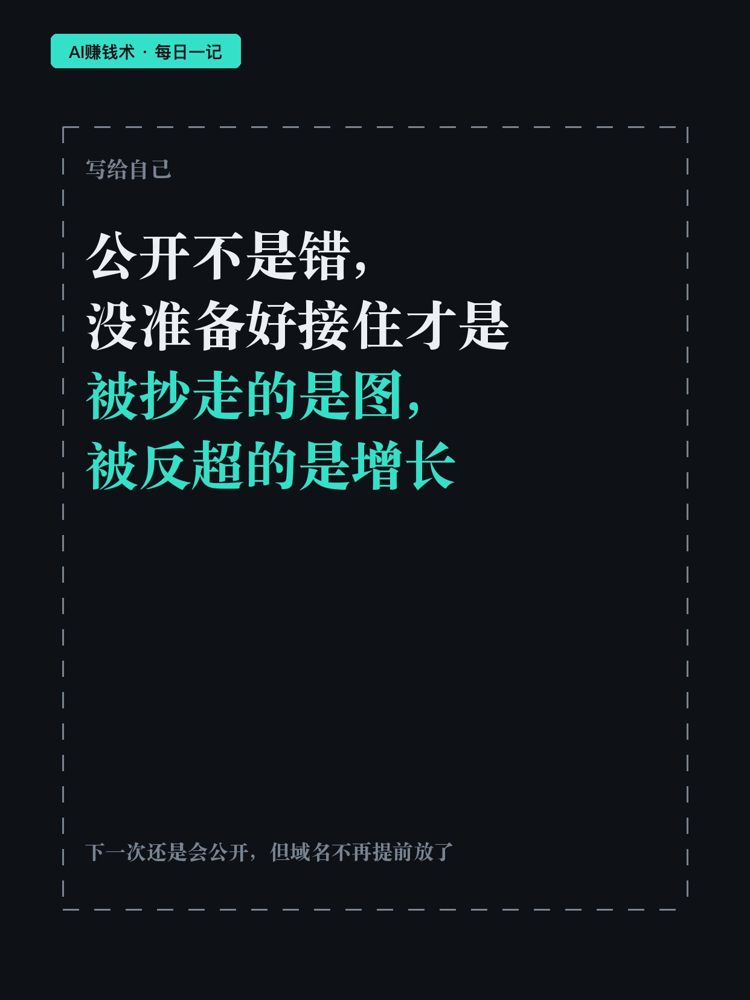

# 我把产品公开了，三个月被反超

> — · 2026-11-02 08:04 发布 · AI 赚钱内容

## 标题（可直接复制）

```
我把产品公开了，三个月被反超
```

## 正文（可直接复制发布）

我把自己做了十个月的产品，公开在群里。三个月后，有人照着做了一遍，搜同一个词，他排在我前面。😮

原文作者做的是个给特斯拉设计车衣的网站，纯 AI 开发，上线十个月。

他公开的初衷很朴素：去年 12 月纯 AI 开发的人还不多，他想分享怎么用 AI 搭站、怎么零成本上站、怎么接登录、怎么跑通收款。群里不少人劝他别说，理由都一样——赛道太小，一公开别人照着做就行了。

他还是说了。公开之前他算过四关：图库攒了十个月、3D 模型是花钱买的、站上得早权重有二十多、交互体验一般人没耐心磨。

结果四关一关都没拦住。

① 能守住的，从来不是手艺

模型能被扒走，交互能被照着做，权重能被追上。这三样都是可复制的。

唯一看起来要熬时间的，是那几千张用户花钱生成的图。后来也被整库搬走——最狠的一家 595 张全镜像，连图片索引里的编号都是他的。

他让工具把竞品的站挨个过了一遍，除了朋友发给他的那个，还有 3 家证实盗图，抽样对比哈希全一致。这几家他连是谁都不知道，直接走举报，材料排成日程，一天交 1000 条地址。

更拧巴的是，那个朋友 7 月还在群里问过他一个 3D 效果怎么做，他把原理讲了。也是那阵子，他在群里发了自己的站，对方看到了。

② 站做得稀烂，只要收款和搜索做对

这是原文最扎心的一句。那个站的界面几乎照搬，但该有的地方一个不缺：收款路径跑通，搜索优化做好。

所以他自己的结论是：增长七分，技术三分。这次被反超的地方，一个都不在技术上。

他还说得很实在：就算站做得稀烂，只要这两件事做好，一样能赚到钱。

③ 这笔学费，他算成赚的

钱上确实亏：流量被分走一点，一个月少几十上百美金，几个月就补回来。整体的量还在涨。

经验上他说赚了：这一个月搜索优化换了个学法——以前跟 AI 学，现在是竞品教他。AI 有些地方会错，竞品的做法是拿排名验证过的。

他也没怪竞品。交互随便学，图不能拿，这是他唯一在意的线。对方当晚就把图全下了，之后见面还是朋友。

如果要我带走一句：公开不是错，没准备好接住才是。

你现在做的东西，如果明天被人照着做一遍，你靠什么还站得住？评论区说一句。

## 话题标签

#独立开发 #出海 #副业 #个人产品 #AI赚钱术日记

## 配图（8 张）










## 发布信息

| 项 | 值 |
|---|---|
| 平台 | 小红书 |
| 期数 | — |
| 发布时间 | 2026-11-02 08:04 |
| 正文长度 | 904 字 |
| 图片数量 | 8 张 |
| 状态 | 已发布 |
