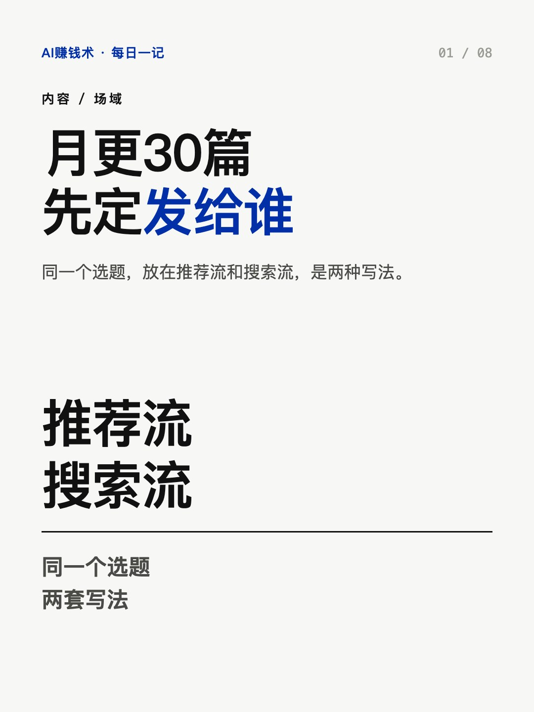
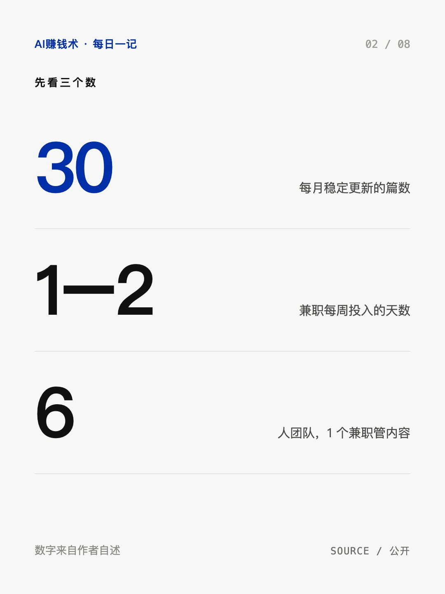
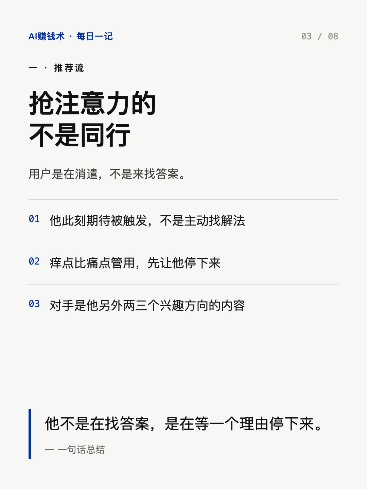
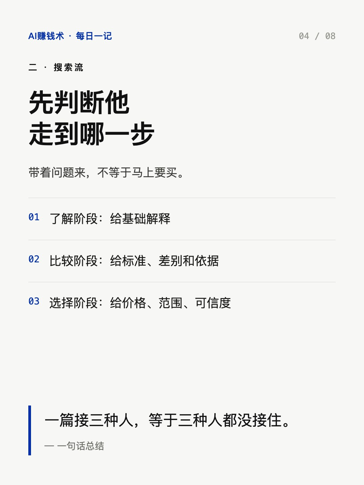
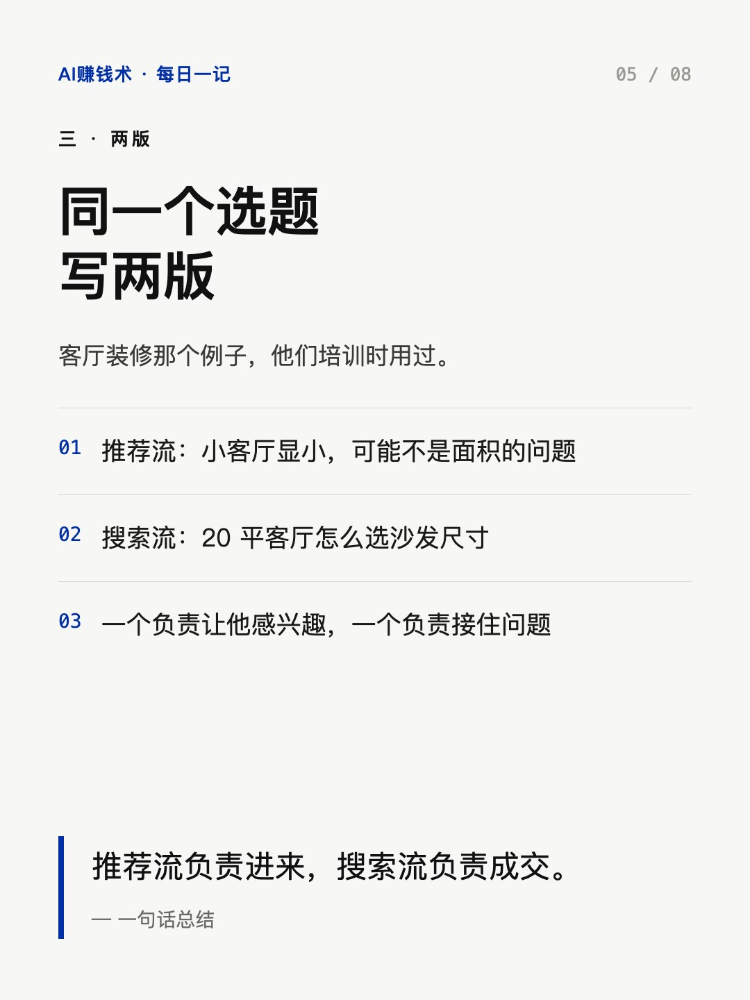
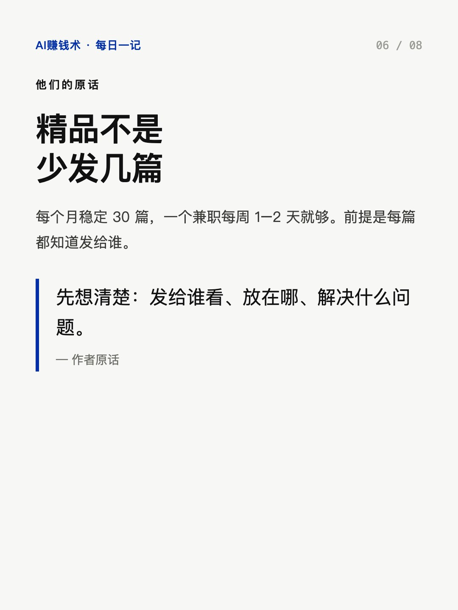
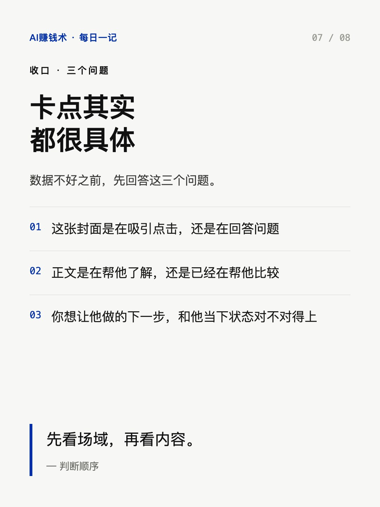
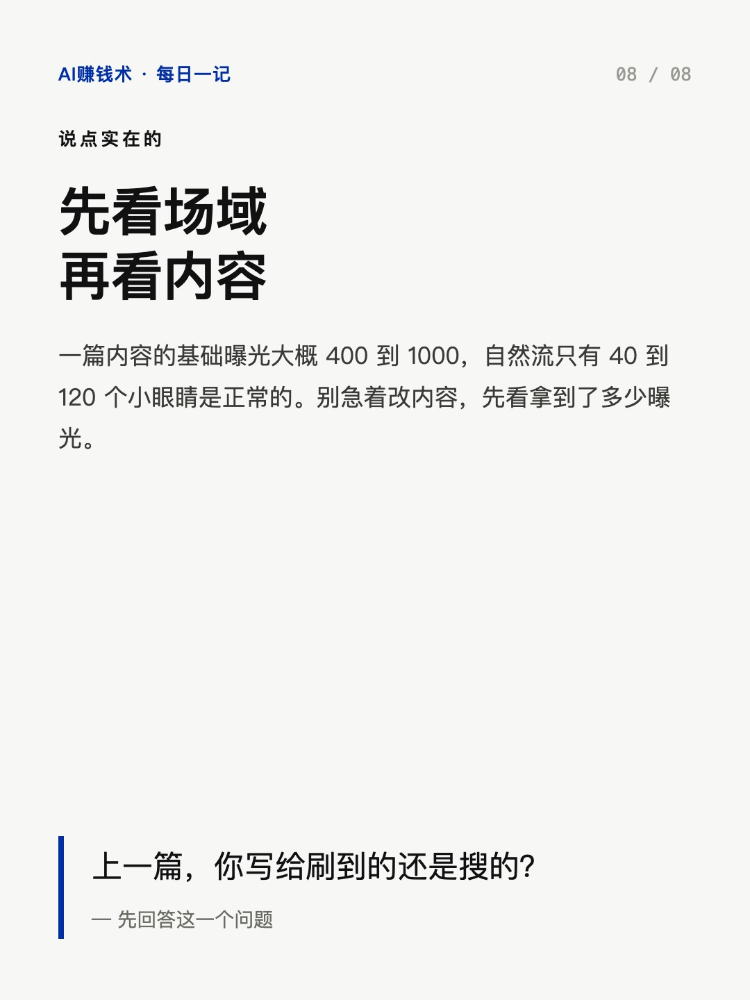

# 月更30篇，先定发给谁

> — · 2026-11-02 12:06 发布 · AI 赚钱内容

## 标题（可直接复制）

```
月更30篇，先定发给谁
```

## 正文（可直接复制发布）

一个月 30 篇，一个兼职每周花一两天。他们 10 月做到了 100 万营收。

说这话的是两口子，做获客代运营。团队 6 个人：出镜 1 个、销售 3 个、流量 1 个、兼职运营 1 个。内容端就靠那 30 篇。📌

他们的说法是走精品逻辑，不堆量。但精品不是少发几篇，是每篇发之前先想清楚：发给谁看、放在哪、解决什么问题。

① 推荐流里，抢注意力的不是同行

用户刷推荐时是什么状态？他们内部有个说法：时刻期待被触发的咸鱼。人在消遣，没有明确需求，所以勾起兴趣的痒点，比直戳痛点管用。

真正的对手也不是同行。你刷到我们之前和之后，看到的可能是他另外两三个兴趣方向的内容。所以选题要从那些内容里跳出来，先让他愿意停下来。

② 搜索流里，先判断他走到哪一步

主动搜索的人已经带着问题来了，但有问题不等于要买：有人在了解，有人在比较方案，有人在比价。🔍

这三种人不能用同一篇接。了解阶段给基础解释，比较阶段给标准和差别，选择阶段给价格、范围、可信度。

所以搜索笔记不是把关键词塞进标题就行。封面要让人判断这里有我要的答案，正文要真把答案给到。

③ 同一个选题，要写两版

他们培训时用过客厅装修的例子。推荐流写：小客厅显小，可能不是面积的问题。搜索流写：20 平客厅怎么选沙发尺寸。

同一个方向，切进去的方式完全不同。推荐流负责让他感兴趣，搜索流负责接住他已经问出来的问题。

还有个数字可以放宽心：一篇内容的基础曝光大概 400 到 1000，自然流只有 40 到 120 个小眼睛是正常的。别一看到这个数就慌，先看拿到了多少曝光，再看有没有吸引到对的人。

先看场域，再看内容。所以很多卡点会变得很具体：这张封面是在吸引点击，还是在回答问题？正文是在帮他了解，还是在帮他比较？

你上一篇笔记，是写给刷到的人，还是写给搜的人？💬

## 话题标签

#小红书运营 #内容创作 #AI赚钱术日记 #选题 #副业

## 配图（8 张）










## 发布信息

| 项 | 值 |
|---|---|
| 平台 | 小红书 |
| 期数 | — |
| 发布时间 | 2026-11-02 12:06 |
| 正文长度 | 773 字 |
| 图片数量 | 8 张 |
| 状态 | 已发布 |
