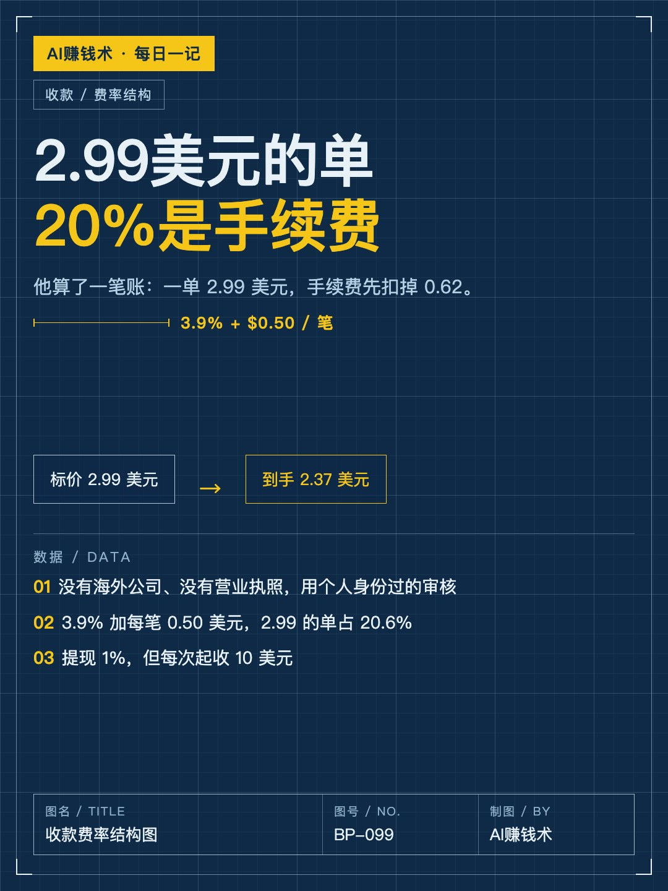
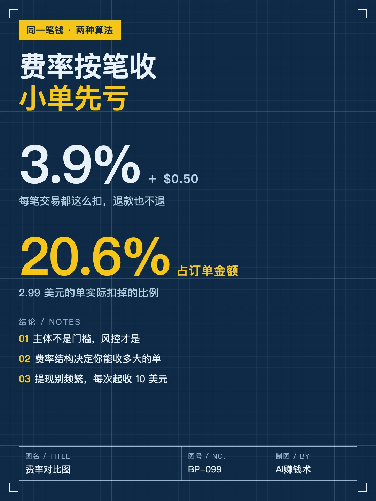
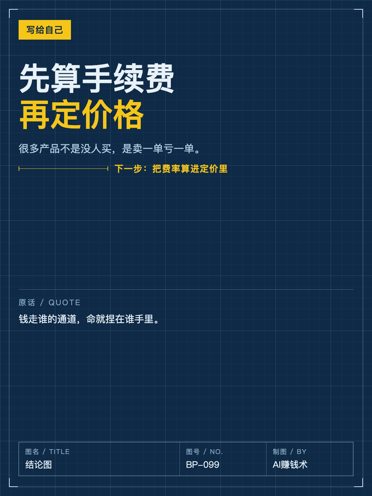
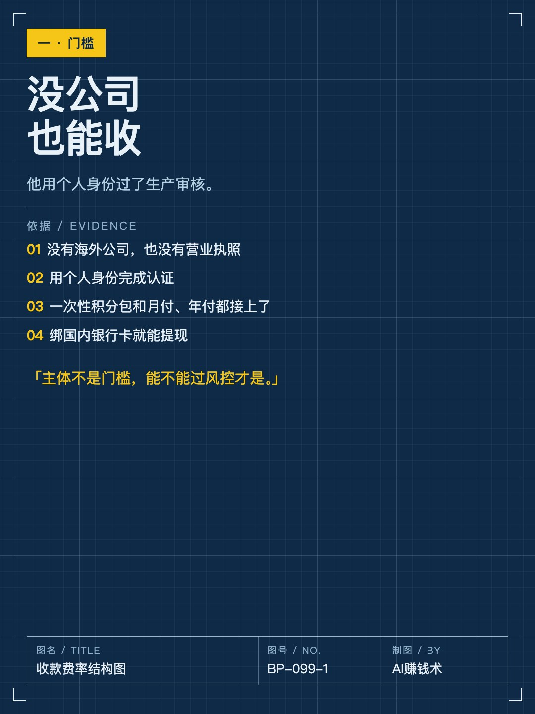
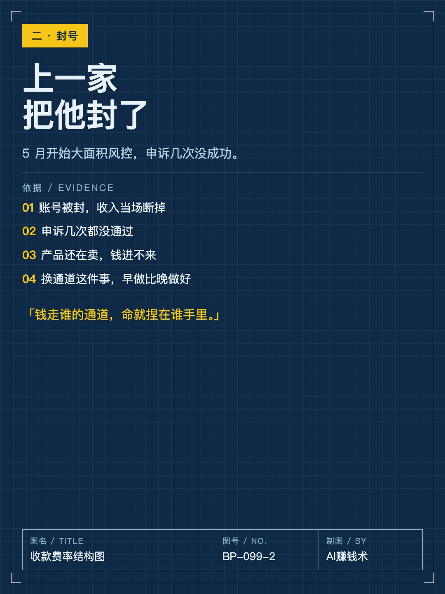
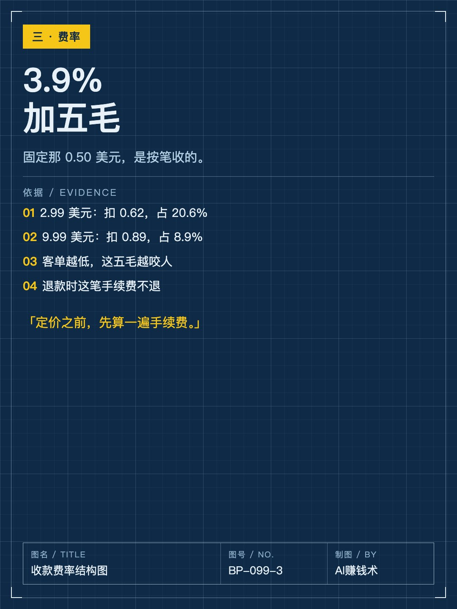
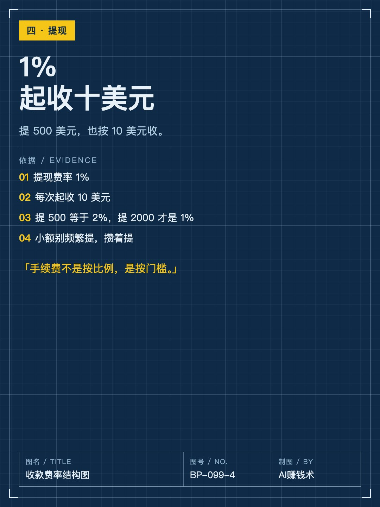
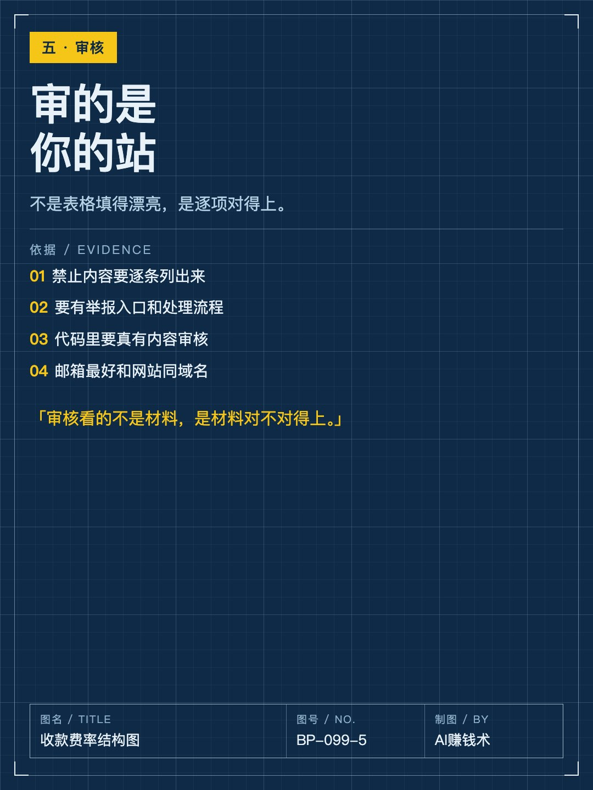

# 2.99美元的单，20%是手续费

> — · 2026-11-03 12:10 发布 · AI 赚钱内容

## 标题（可直接复制）

```
2.99美元的单，20%是手续费
```

## 正文（可直接复制发布）

「2.99 美元的单，扣完手续费只剩 2.37。」

这是独孤风算给我看的一笔账。他没公司、没海外营业执照，靠一个网站收海外的钱。今年 5 月，上一家收款服务商大面积风控，他的账号被封，申诉几次都没成功，产品还在卖，钱进不来。

后来他换了通道：用个人身份重新做完认证，一次性积分包、月付、年付都接上，钱能提到国内银行卡。整个过程他写成了复盘，我挑三件对做产品的人有用的。

① 主体不是门槛，风控才是

很多人以为没公司就收不了海外的钱。其实个人身份也能过审核，真正的门槛在后面：这个账号能活多久。

他那家被封的时候，申诉没有用，损失的收入也没人补。所以选通道时先问的不是费率多少，是这家封不封号、封了多久能换好。他现在的做法是：主通道之外留一条备用，把退款和拒付的规则提前写进网站。

② 费率结构决定你能收多大的单

3.9% 加每笔 0.50 美元。听着不高，但固定那五毛是按笔收的：

2.99 美元的单，扣 0.62，占 20.6%；
9.99 美元的单，扣 0.89，占 8.9%。

客单越低，这五毛越咬人。还有一条容易漏：退款的时候，原来那笔手续费不退。做小额订阅的人，定价前必须先把这笔算进去，要么把客单提上去，要么用年付把固定费摊薄。

③ 提现别频繁，每次起收 10 美元

提现费率 1%，但每次起收 10 美元。提 500 美元，本该收 5 美元，实际按 10 美元收，等于 2%；提到 2000 美元才回到 1%。

小额高频提现，等于自己给自己加了一道税。钱在账上多放几天，比反复交给通道划算。

还有一个细节：审核看的不是表格填得多漂亮，是你的网站对不对得上——禁止内容要逐条列出来，要有举报入口，代码里要真有内容审核。

收钱这件事，门槛不在注册，在费率结构和风控。

你现在的收款通道，如果明天被封，你多久能换好？

## 话题标签

#AI产品 #出海收款 #独立开发 #AI赚钱术日记 #副业 #定价

## 配图（8 张）










## 发布信息

| 项 | 值 |
|---|---|
| 平台 | 小红书 |
| 期数 | — |
| 发布时间 | 2026-11-03 12:10 |
| 正文长度 | 777 字 |
| 图片数量 | 8 张 |
| 状态 | 已发布 |
