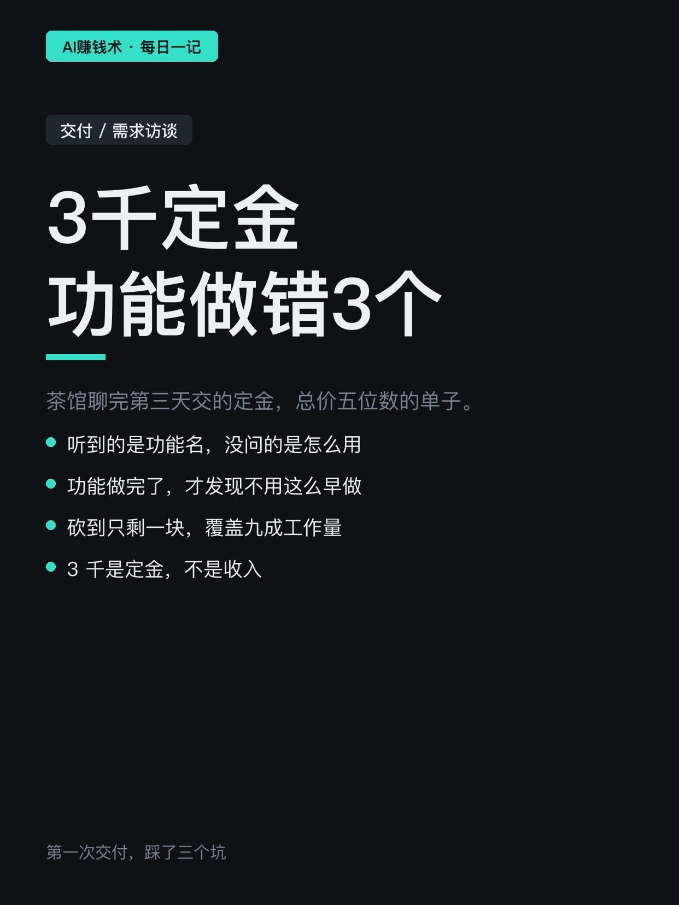
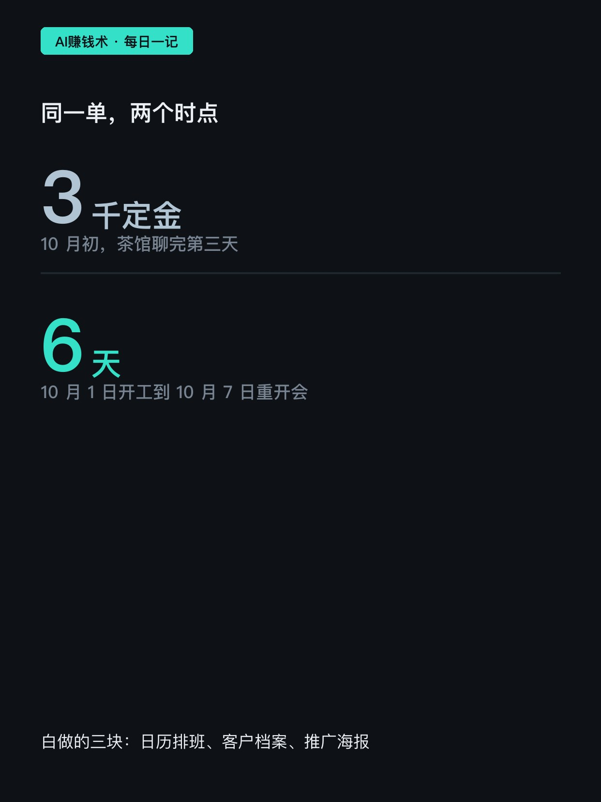
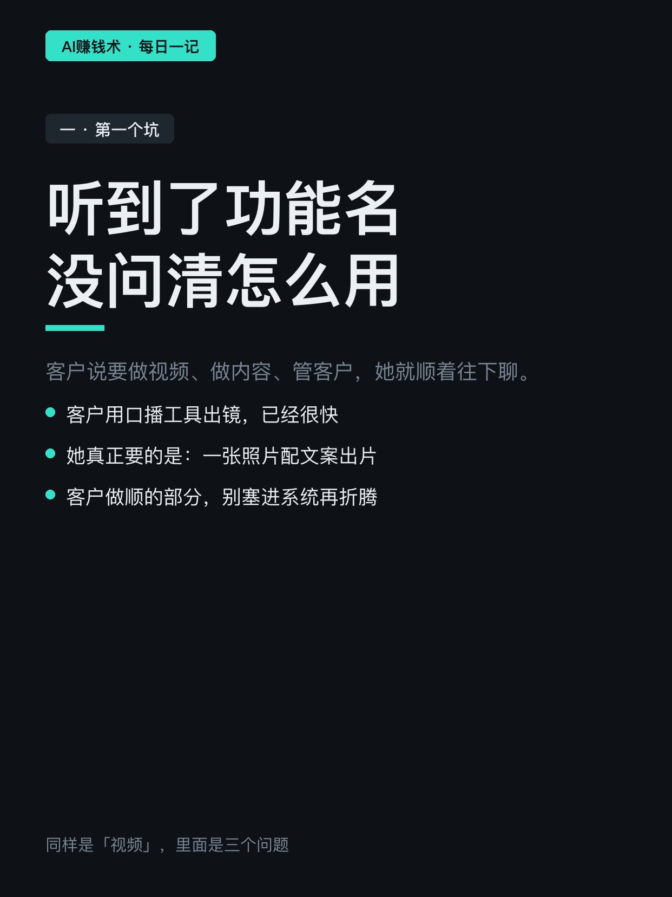
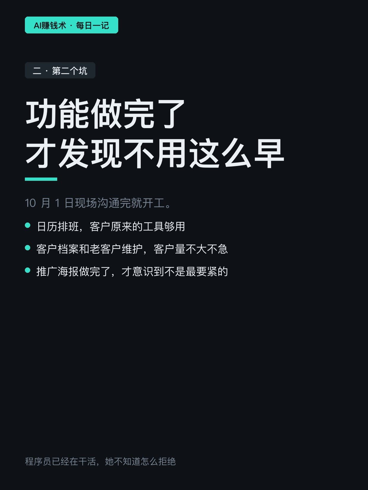
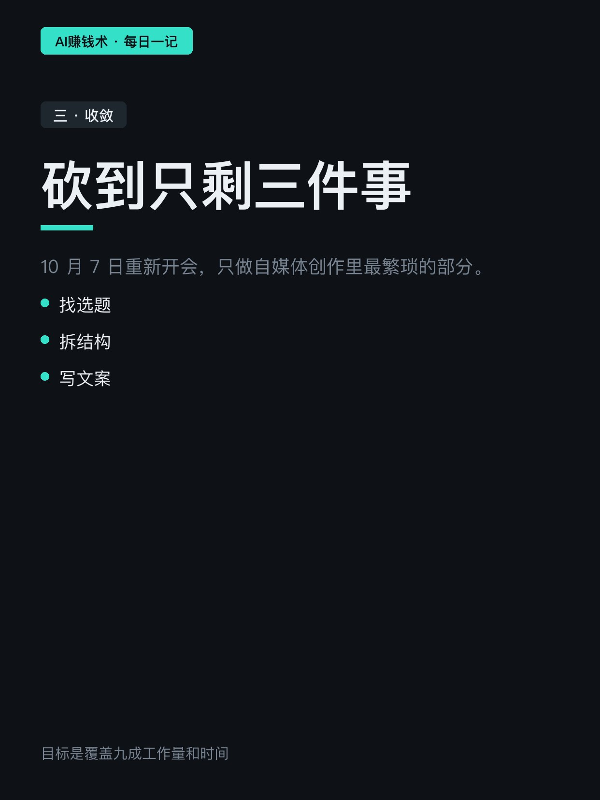
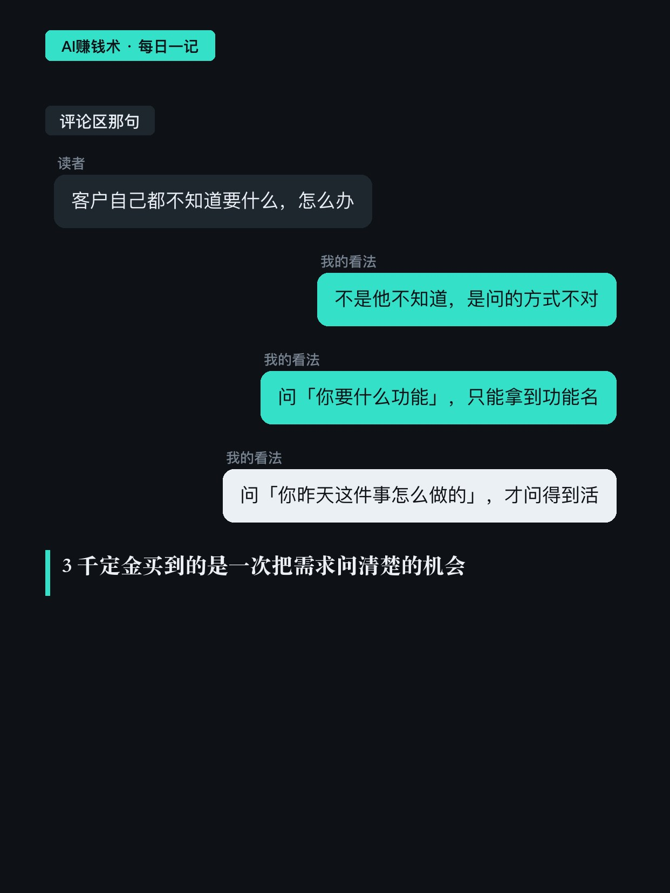
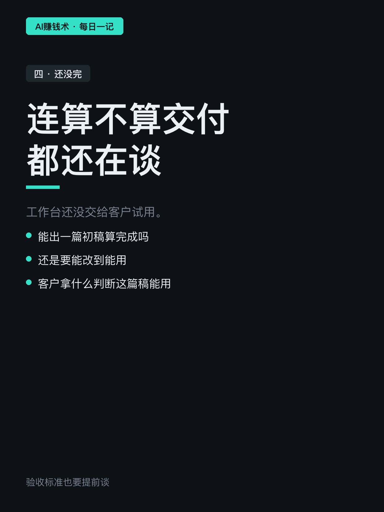
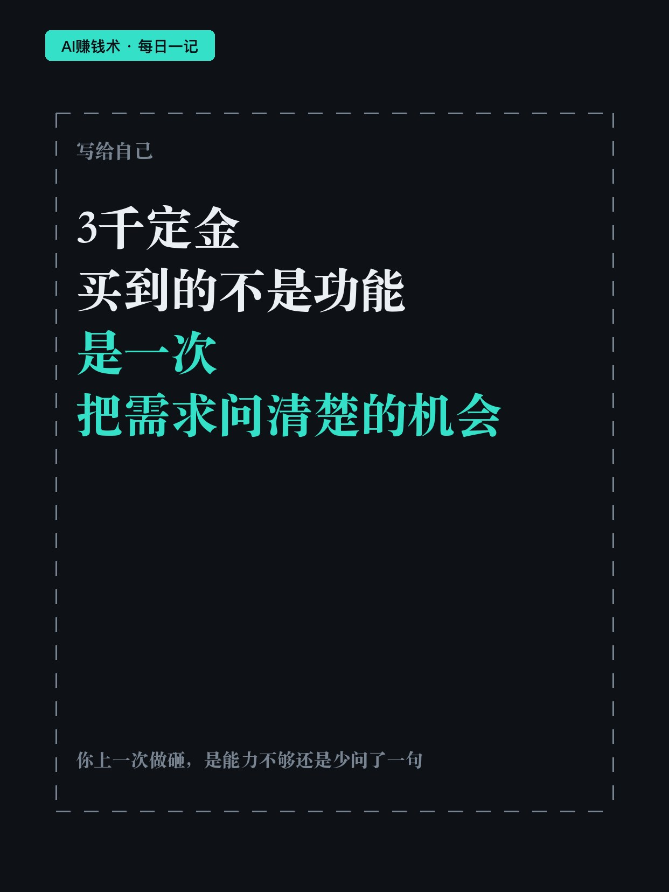

# 3千定金到账，功能做错3个

> — · 2026-11-03 15:18 发布 · AI 赚钱内容

## 标题（可直接复制）

```
3千定金到账，功能做错3个
```

## 正文（可直接复制发布）

定金到账那天，她以为最难的一关已经过了。

小满第一次给客户交付。茶馆聊完第三天，客户交了 3 千定金，总价五位数的单子。她之前只会用 AI，没真正交付过一个项目。

① 第一个坑：听到了功能名，没问清怎么用

客户说要做视频、做内容、管客户，她就顺着这几个词往下聊。

后来才知道，客户用口播工具做真人出镜已经很快，不想再换一个更麻烦的。她真正要的是：一张照片配一段文案，直接出片。

同样是「视频功能」，里面其实是三个不同的问题：已有的口播方式、文案怎么写、非口播的成片。客户已经做顺的部分，没必要塞进系统再折腾一遍。

如果重来一次，她会先请客户拿一条最近发过的内容，讲讲选题怎么来、文案怎么写、在哪一步反复改。这比记下「需要视频功能」具体得多。

② 第二个坑：功能做完了，才发现不用这么早做

10 月 1 日现场沟通完就开工，日程、自媒体、客户档案、老客户维护全铺开。

一周后发现：日历排班可以继续用客户原来的工具；客户档案和老客户维护，因为她客户量不大，也不急；推广海报更明显——做完了才意识到，它不是当下最要紧的。

那几天她压力很大：客户想做的东西不少，她不懂怎么区分、怎么拒绝，程序员已经在干活了。功能铺得太多，很可能每个都做了，每个都不够好用。

③ 砍到只剩一块，目标是覆盖九成工作量

10 月 7 日重新开会，只做三件事：找选题、拆结构、写文案。

其他不着急的先停——停下来的功能不是白写，是排到后面。目标是把这三件最繁琐的事做到覆盖九成的工作量和时间，能不能达到，还要等客户真用起来才知道。

到现在这个工作台还没交给客户试用，连「算不算交付完成」都还在谈：能出一篇初稿算完成吗，还是要能改到能用。

所以这 3 千定金买到的不是一套功能，是一次把需求问清楚的机会。这单还没结束，但她至少知道了下次先问什么。

你上一次做砸的那件事，是能力不够，还是开工前少问了一句？

## 话题标签

#AI交付 #需求访谈 #创业踩坑 #AI赚钱术日记 #新手

## 配图（8 张）










## 发布信息

| 项 | 值 |
|---|---|
| 平台 | 小红书 |
| 期数 | — |
| 发布时间 | 2026-11-03 15:18 |
| 正文长度 | 801 字 |
| 图片数量 | 8 张 |
| 状态 | 已发布 |
