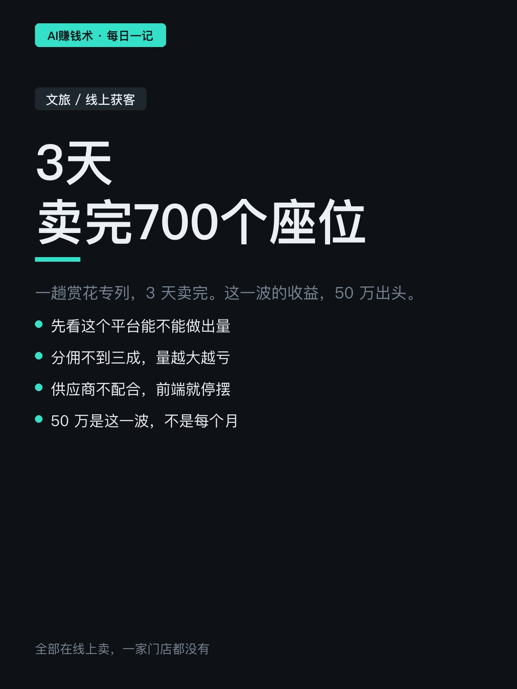
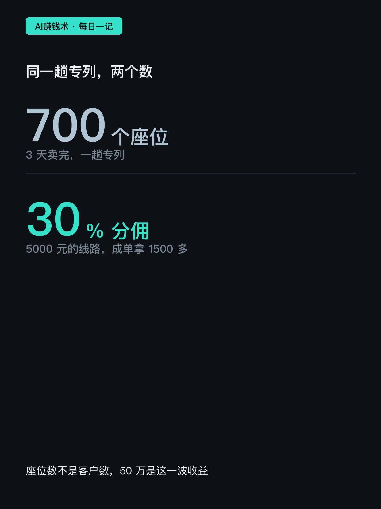
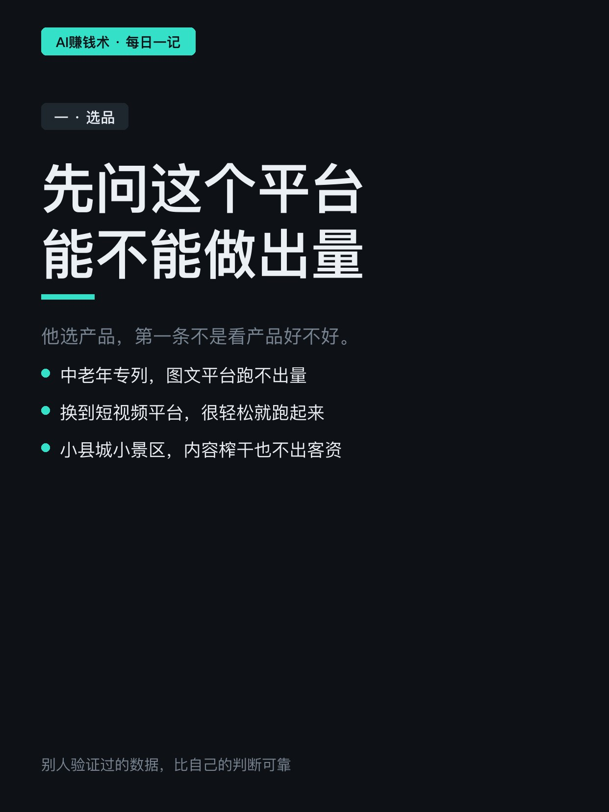
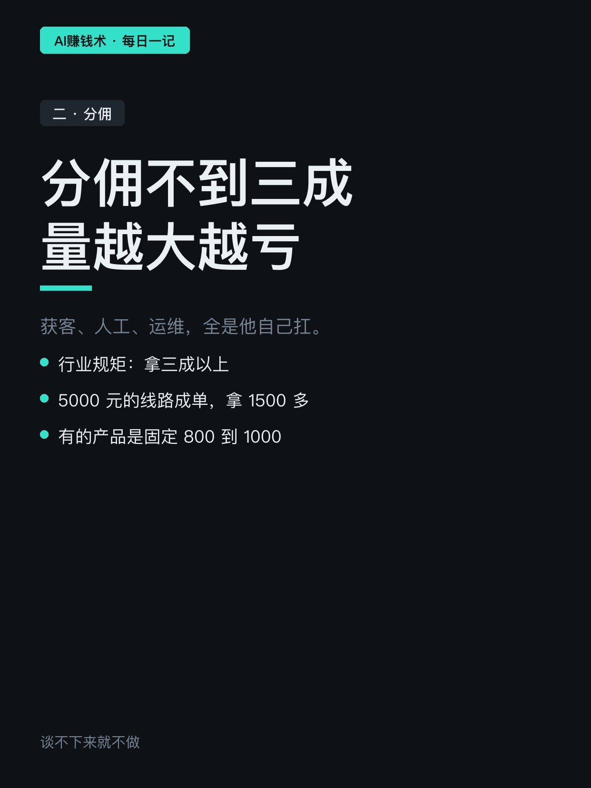
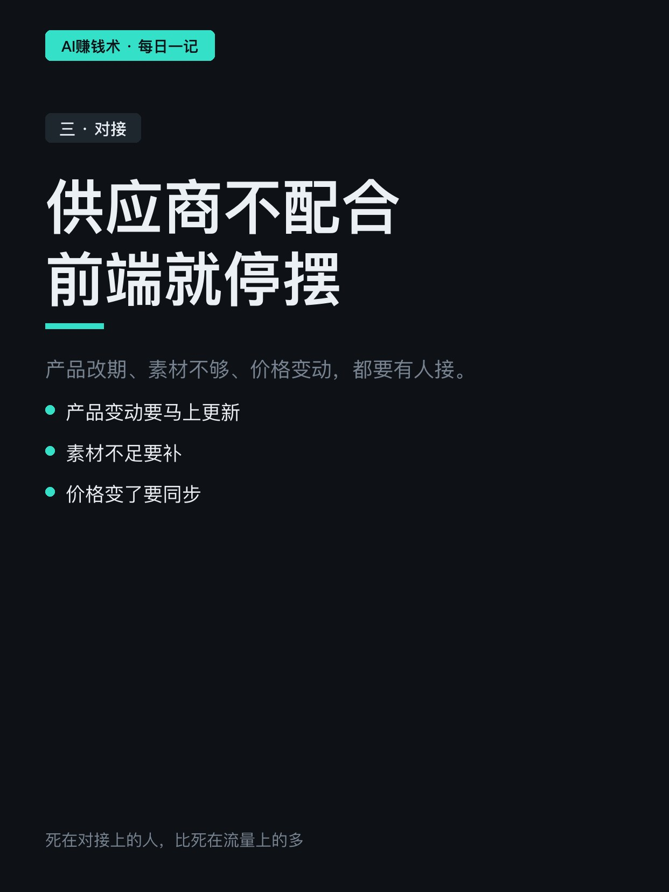
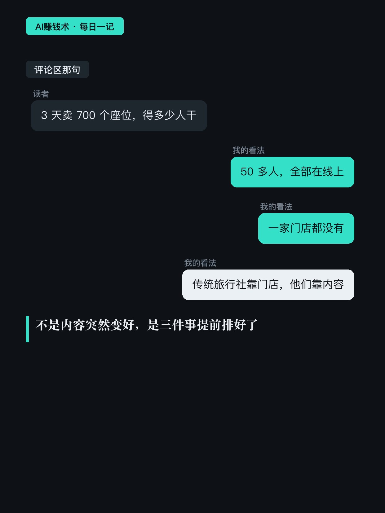
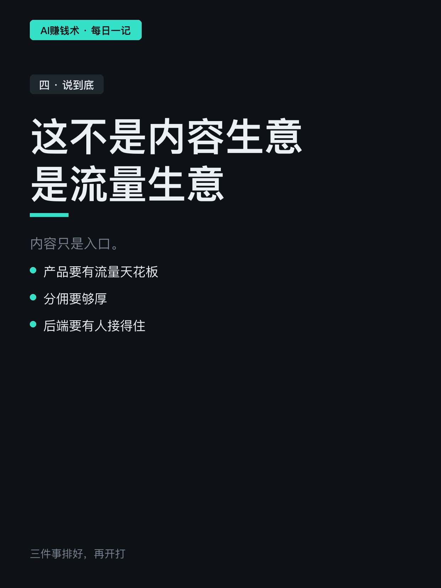
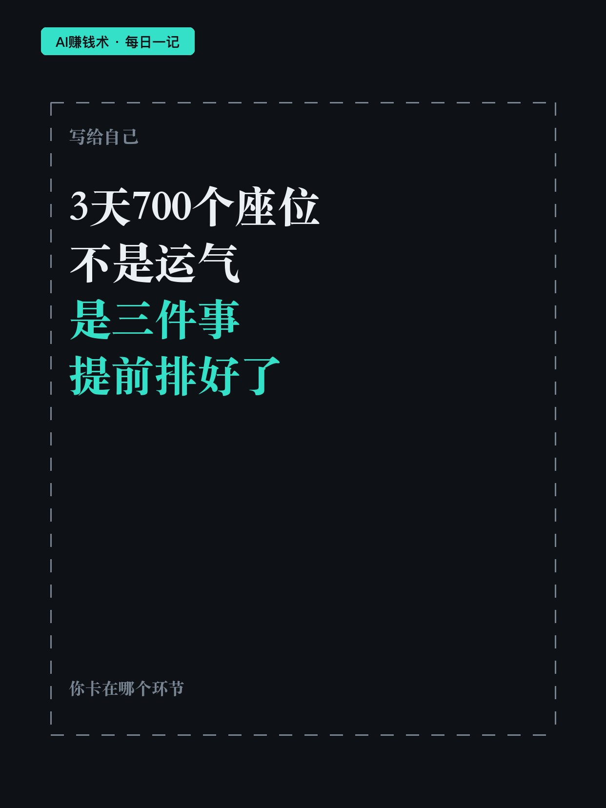

# 3天，700个座位卖完

> — · 2026-11-03 09:06 发布 · AI 赚钱内容

## 标题（可直接复制）

```
3天，700个座位卖完
```

## 正文（可直接复制发布）

一趟专列，3 天卖完 700 个座位。

说这话的是元榕。他之前做淘客，去年把 99% 的精力挪到文旅，现在 50 多人的团队，全部在线上卖旅游产品，一家门店都没有。

他们做的事说白了不复杂：用 AI 产出文案和视频，在平台上拿自然流量，把人引到自己手里，再卖旅游产品。传统旅行社靠门店、靠会销、靠渠道，他们全在线上完成。团队 50 多人，做的是内容、聊单、转化、对接，一环都不外包。

① 先看这个平台能不能做出量

他选产品，第一条不是看产品好不好，是看它在哪个平台跑得出来。

同样是中老年火车专列，放在一个以图文为主的平台，跑不出量；换到另一个以短视频为主的平台，很轻松就跑起来了。

反过来，小县城的小景区，内容做到榨干脑袋，也不出几个客资。

他的依据不是自己的判断，是别人已经跑出来的数据——太阳底下没有新鲜事，你能想到的产品，一定有人在平台上验证过。有产品的人很多，随便发一条内容就有一堆旅游公司找上来，所以选谁，反而是他在挑。

② 分佣不到三成，量越大越亏

这门生意的获客成本、人工、运维全是他自己扛，所以单个产品的利润必须够厚。

行业里的规矩是拿三成以上：5000 元的线路成单，他拿 1500 多；有的产品是固定 800 到 1000。

谈不下来就不做。因为量跑起来之后，成本是跟着量走的，分佣薄的产品，卖得越多越亏。

③ 供应商配不配合，决定你能不能干下去

产品改期要马上更新，素材不够要补，价格变了要同步。

这些事很碎，但产品方不配合，前端的内容就停摆。他见过不少人，产品选对了、流量也跑出来了，最后死在对接上。

所以那 3 天的 700 个座位，不是内容突然变好了。是这三件事在开打之前就排好了：平台选对、分佣够厚、有人接得住。

顺便说清楚两个口径：700 是专列的座位数，不是 700 个客户；那一波进线的大几万条也只是线索，不是成交。50 万是这一趟的收益，不是每个月。

你手上那门生意，是产品不行，还是这个平台根本跑不出量？

## 话题标签

#文旅 #线上获客 #AI赚钱术日记 #副业 #创业

## 配图（8 张）










## 发布信息

| 项 | 值 |
|---|---|
| 平台 | 小红书 |
| 期数 | — |
| 发布时间 | 2026-11-03 09:06 |
| 正文长度 | 840 字 |
| 图片数量 | 8 张 |
| 状态 | 已发布 |
