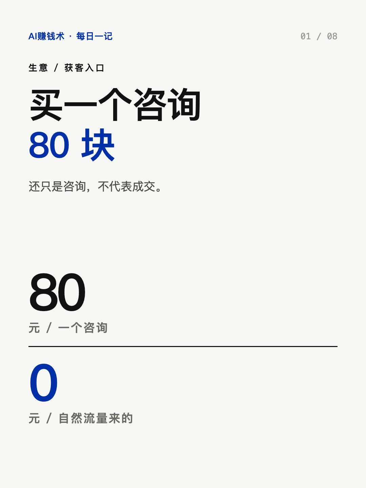
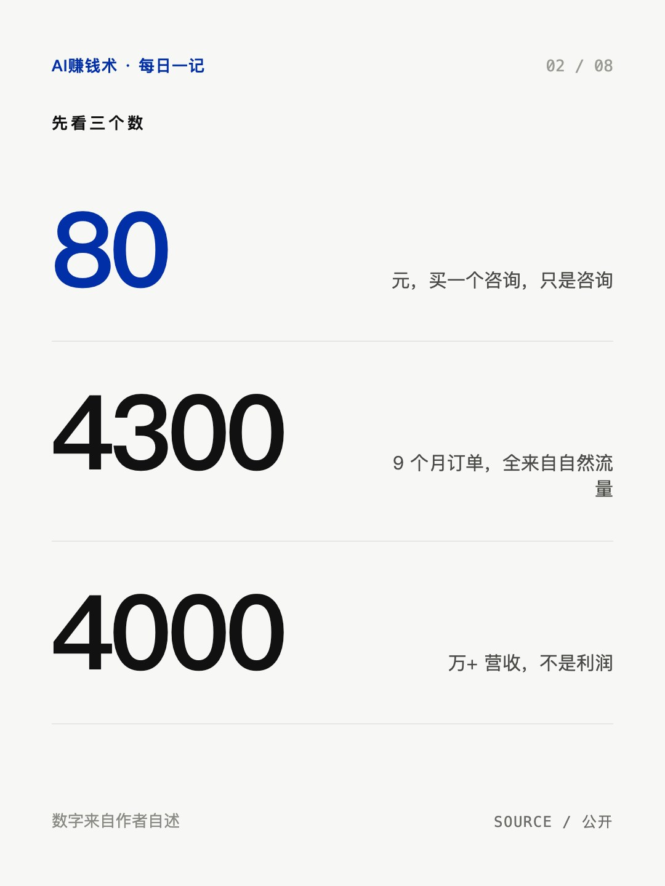
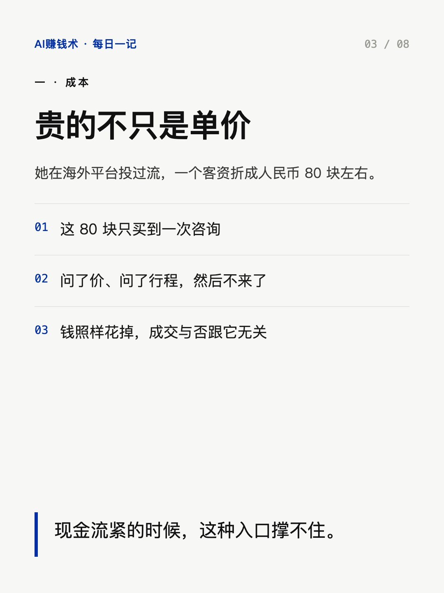
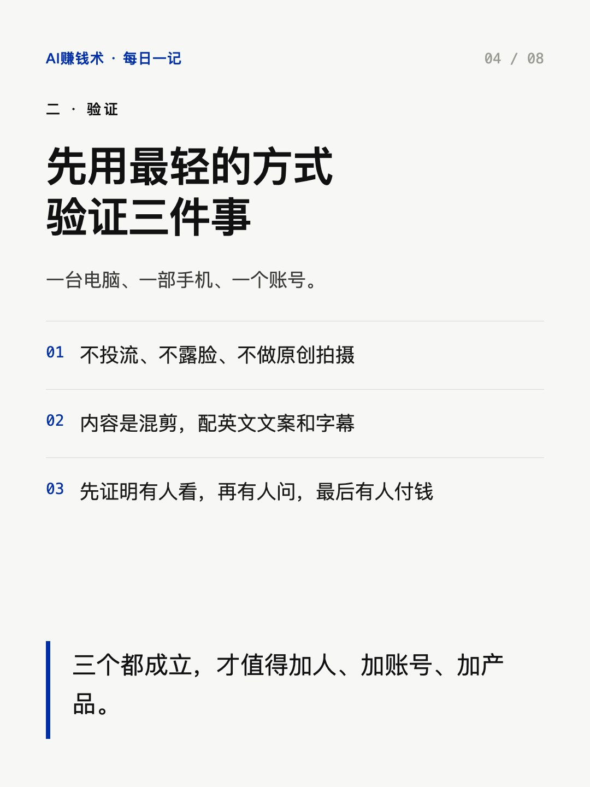
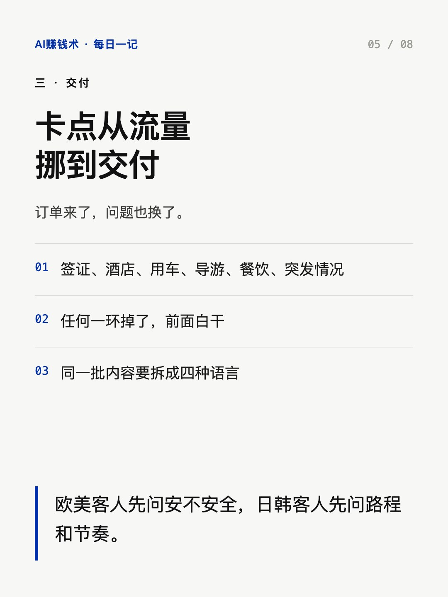
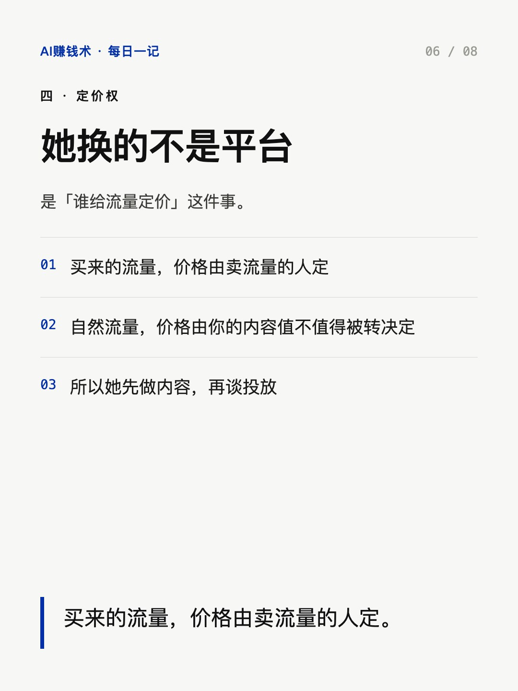
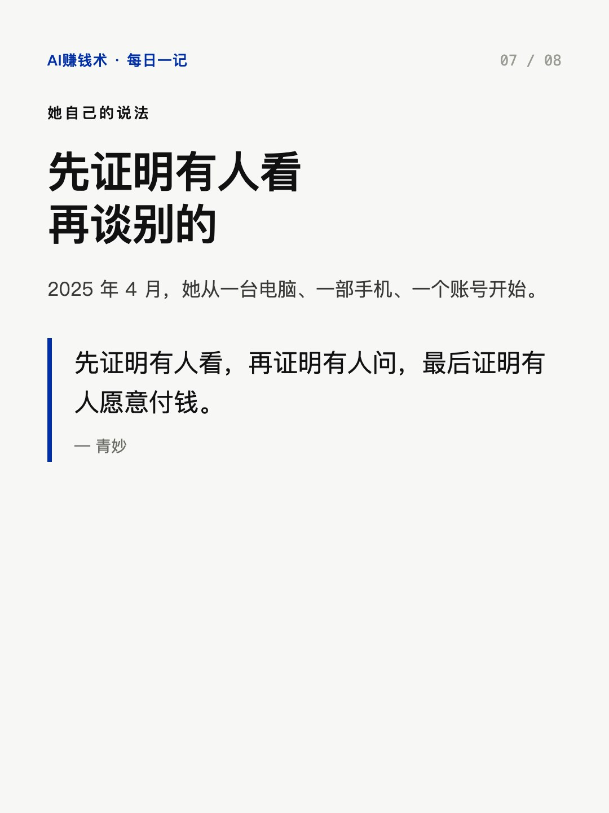
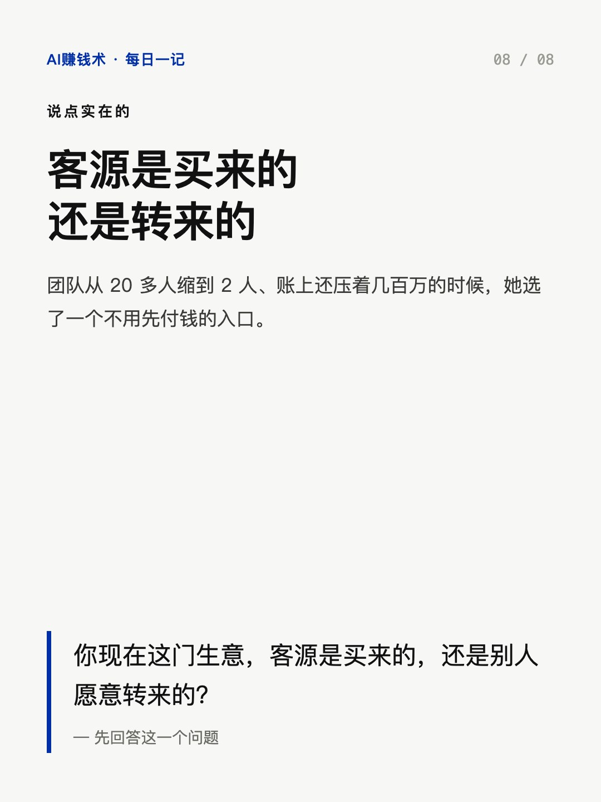

# 一个咨询80块，她换了个入口

> — · 2026-11-03 14:16 发布 · AI 赚钱内容

## 标题（可直接复制）

```
一个咨询80块，她换了个入口
```

## 正文（可直接复制发布）

买一个咨询 80 块，还只是咨询，不代表成交。

这是青妙 2025 年初算的账。那时候她团队从 20 多人缩到 2 个人，账上还压着几百万。

① 贵的不只是单价，是买了不一定成交

她在海外平台投过流，一个客资折成人民币 80 块左右。

关键在于，这 80 块只买到一次咨询。客户问了价、问了行程，然后不来了，钱照样花掉。成交与否，跟这笔钱没关系。

这跟「投放贵」是两件事。单价高，你还能靠提高转化摊薄；但如果一次咨询本身就是终点，你连摊薄的余地都没有。现金流紧的时候，这种「先付钱、后看结果」的入口撑不住。

② 换入口之前，先用最轻的方式验证三件事

一台电脑、一部手机、一个账号。不投流、不露脸、不做原创拍摄。

内容是混剪：别人的城市、美食、高铁、景点，重新剪，配上英文文案和字幕。

选题也不靠灵感，靠猜海外客人对中国好奇什么：高铁、移动支付、城市安不安全、干不干净、方不方便，还有长城、熊猫、美食。她手里没有试错的钱，只敢用最轻的方式开局——没先招人、没先租办公室、没先做系统，那三件事都会把试错成本抬高。

她要验证的顺序是：先证明有人看，再证明有人问，最后证明有人愿意付钱。三个都成立，才值得加人、加账号、加产品。顺序不能反——先加人，等于用最贵的成本去赌一个没验证过的判断。

③ 换入口之后，卡点从流量挪到交付

2025 年 4 月到 12 月，4300 单，营收 4000 多万。这些单几乎全来自自然流量，投放的钱是零。

但订单来了，问题也换了：签证、酒店、用车、导游、餐饮、突发情况，一条链上任何一环掉了，前面白干。

所以同一批内容还要拆成英语、日语、韩语、西班牙语——欧美客人先问安不安全，日韩客人先问路程和节奏。这不是翻译，是同一门生意在不同客群里的不同问法。

她换的不是平台，是「谁给流量定价」这件事。买来的流量，价格由卖流量的人定；自然流量，价格由你的内容值不值得被转决定。

你现在这门生意，客源是买来的，还是别人愿意转来的？

## 话题标签

#创业复盘 #获客 #自然流量 #AI赚钱术日记 #出海

## 配图（8 张）










## 发布信息

| 项 | 值 |
|---|---|
| 平台 | 小红书 |
| 期数 | — |
| 发布时间 | 2026-11-03 14:16 |
| 正文长度 | 838 字 |
| 图片数量 | 8 张 |
| 状态 | 已发布 |
