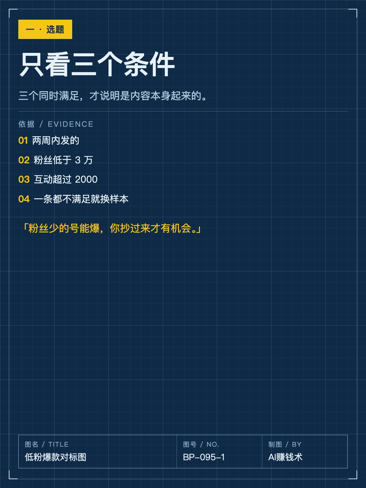
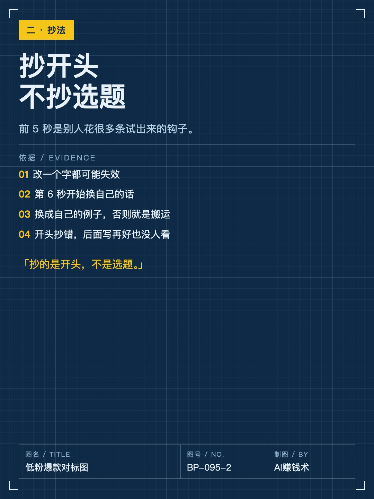
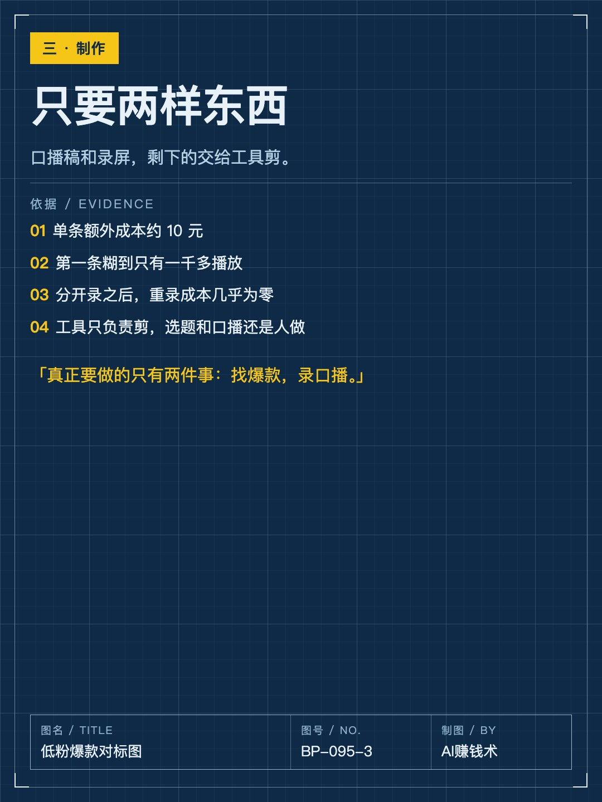
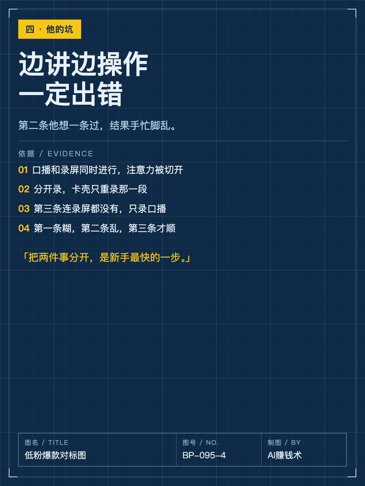
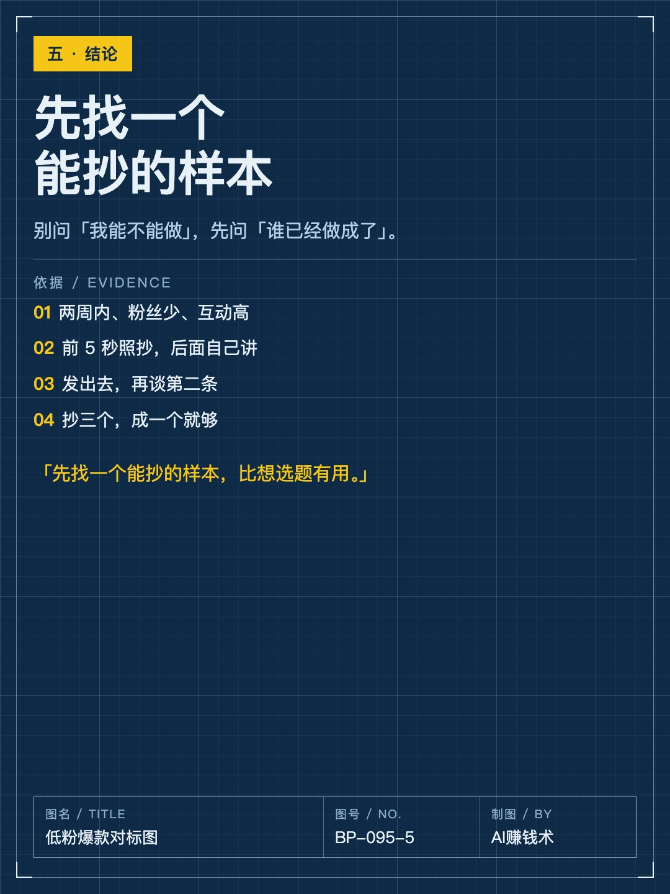

# 一条视频50万播放，粉丝3300

> — · 2026-11-03 10:04 发布 · AI 赚钱内容

## 标题（可直接复制）

```
一条视频50万播放，粉丝3300
```

## 正文（可直接复制发布）

一条视频 50 万播放，账号才 3300 粉。

这是苏格上个月发的第三条视频。他跟着一个做 AI 工具教学的号学的，那套方法只有三步，听起来简单到不像方法。

① 选题只看三个条件

两周内发的、粉丝低于 3 万、互动超过 2000。

三个同时满足，说明这条内容是靠内容本身起来的，不是靠账号权重。粉丝少的号能爆，你抄过来才有机会；粉丝几十万的号爆了，你抄也没用，人家是账号在托。

这一条其实是在替你筛掉「不可复制」的样本。很多人抄爆款失败，不是抄得不好，是抄了一个只有那个号才能爆的题。粉丝多的号爆了，你分不清是内容好还是账号大；互动低的爆了，多半是推的，不是内容自己跑起来的。

② 抄的是开头，不是选题

前 5 秒一字不改。

那 5 秒是别人花很多条视频试出来的钩子，改一个字都可能失效。但从第 6 秒开始，必须换成自己的话、自己的例子，否则就是搬运，平台不会给你第二次机会。

他说的很直白：抄前 5 秒，后面用自己的话讲。这一条最难执行——前 5 秒往往正是你自己觉得「太土了」的那句话。

③ 制作只需要两样东西

口播稿和录屏，剩下的交给工具剪。单条的额外成本大约 10 元。

录屏就是你把这件事在电脑上做一遍，观众看你点哪里、卡在哪一步；口播稿是把这件事讲清楚的那几百字，不是文案腔。

苏格自己踩了两个坑：第一条用电脑前置摄像头拍，画面很糊，只有一千多播放；第二条边讲边操作，总出错。后来把口播和录屏分开录，一下顺了——卡壳只重录那一段，不用从头再来。

他现在真正要做的只有两件事：找爆款，录口播。前面两条都是废的，真正的转折不是学会了什么技巧，是把两件事拆开，各自变成一件不用动脑的事。

所以别再问「我能不能做」。先去找三个两周内、粉丝少、互动高的样本，把前 5 秒抄下来，第 6 秒开始讲自己的。第一条糊一点没关系，发出去才算开始。

你上一次想抄的那条爆款，是抄了开头，还是只抄了选题？

## 话题标签

#内容创作 #对标 #AI工具 #AI赚钱术日记 #新手起号

## 配图（8 张）









## 发布信息

| 项 | 值 |
|---|---|
| 平台 | 小红书 |
| 期数 | — |
| 发布时间 | 2026-11-03 10:04 |
| 正文长度 | 813 字 |
| 图片数量 | 8 张 |
| 状态 | 已发布 |
