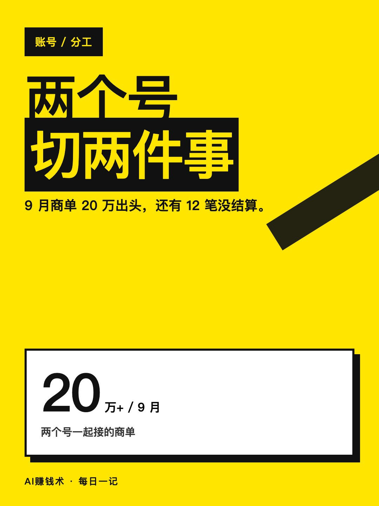
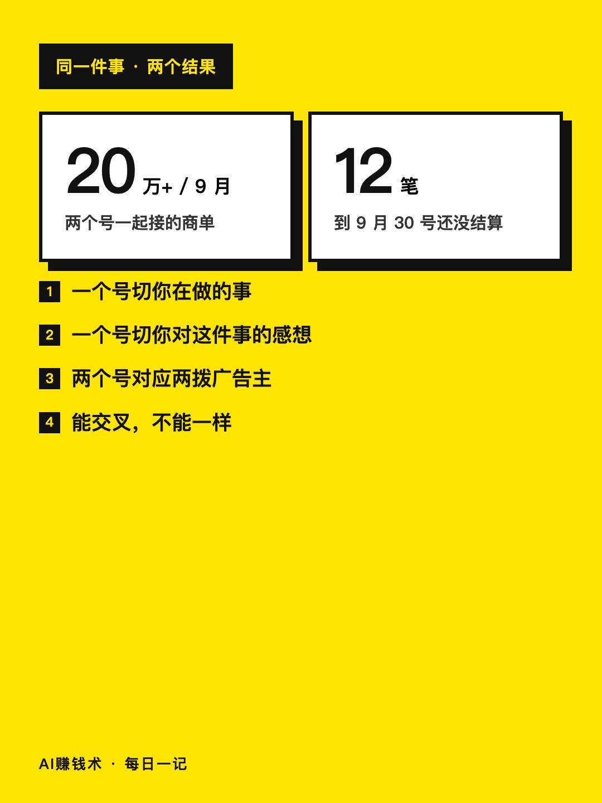
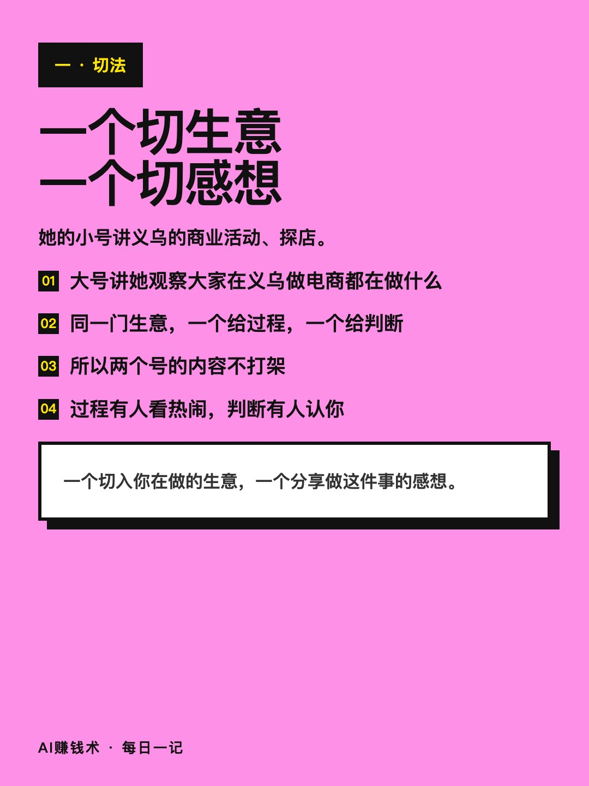
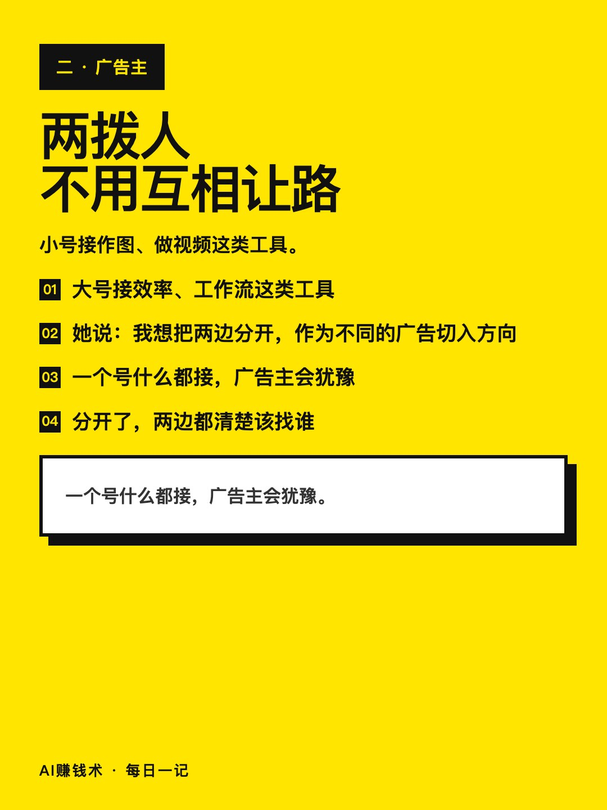
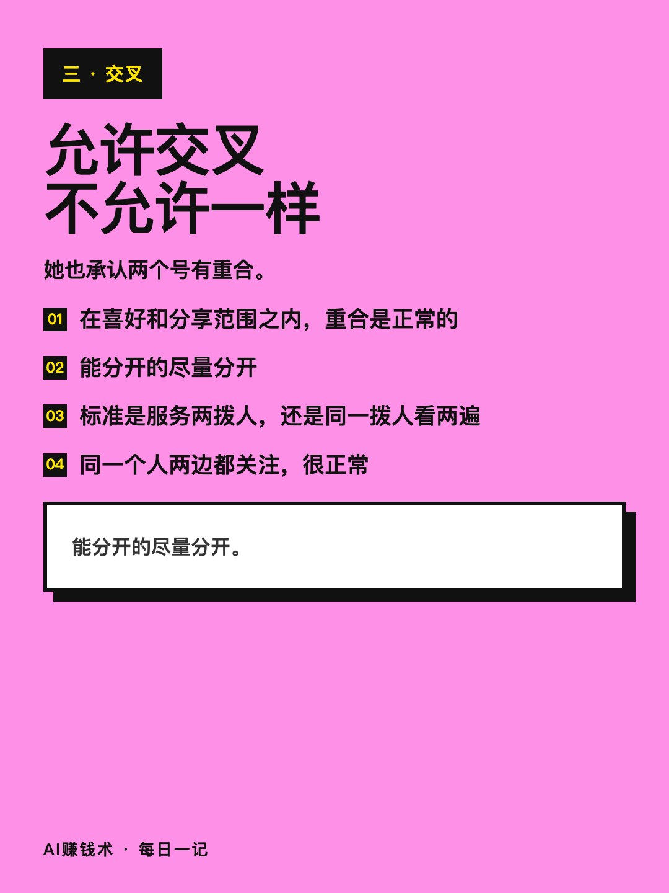
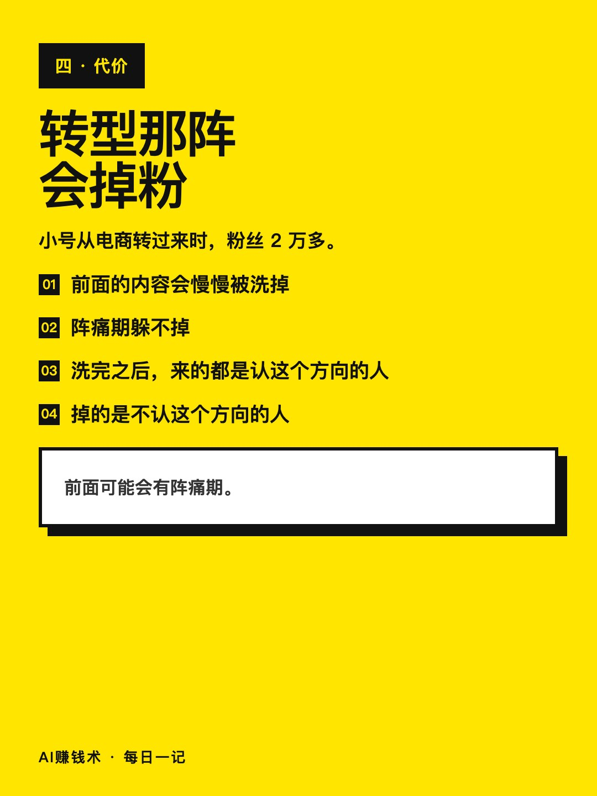
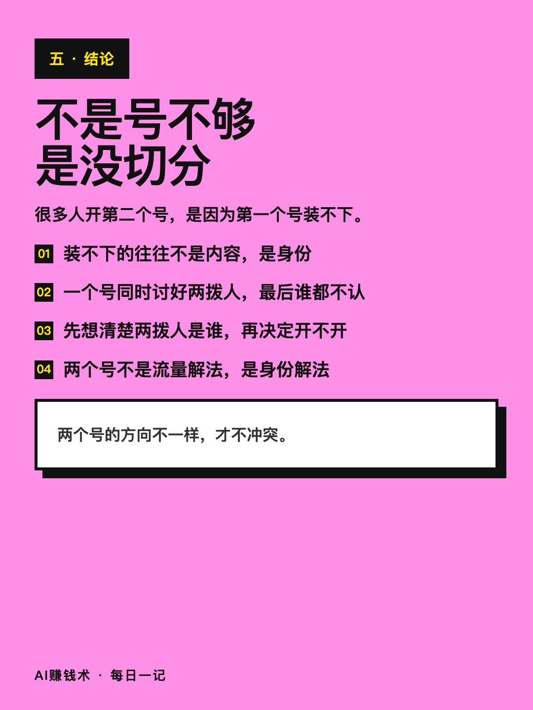

# 两个号分工，9月接了20万

> — · 2026-11-03 11:05 发布 · AI 赚钱内容

## 标题（可直接复制）

```
两个号分工，9月接了20万
```

## 正文（可直接复制发布）

两个号不是「一个不够再开一个」，是切两件事。

阿甜做了两个号，9 月商单 20 万出头，后台还有 12 笔没结算。

① 一个号切你在做的事，一个号切你对这件事的感想

她的小号讲义乌的商业活动、探店；大号讲她观察大家在义乌做电商都在做什么。一个是「我在这里看到了什么」，一个是「我看这件事看出了什么」。

同一门生意，一个给过程，一个给判断。所以两个号的内容不打架，也不会自己抢自己的读者。

多数人开第二个号的理由是「这个号装不下了」。但装不下的往往不是内容量，是身份——你想同时当「在现场的人」和「在旁边看的人」，一个号说不清。

② 两个号对应两拨广告主，所以不用互相让路

小号接作图、做视频这类工具；大号接效率、工作流这类工具。

她的原话是：我想把两边分开，作为我不同的广告切入方向。

一个号什么都接，广告主会犹豫——这个号到底代表谁。分开了，两边都清楚你在替谁说话。她说两个号的内容有交叉、有重合，但方向不一样，所以不冲突。广告主看的不是你粉丝多少，是你这个号的人是不是他要的那批人。

③ 允许交叉，不允许一样

她也承认两个号有重合。她的处理是：只要在你自己的喜好和分享范围之内，重合是正常的；能分开的尽量分开。

判断标准很简单：这两条内容，是真的在服务两拨人，还是同一拨人看两遍。她给的做法不是「严禁重合」，是「尽量分开」——完全分开做不到，硬分开反而两个号都做得别扭。

还有一件事她没藏着：小号转型那阵，粉丝 2 万多，前面的内容会慢慢被洗掉。阵痛期躲不掉，但洗完之后，来的都是认这个方向的人。

所以 20 万不是一个号撑起来的，是两个号各自有一拨人认。9 月这个数里还含 12 笔没结算的，是「接了」，不是「到账」。

她自己也说，一年前不敢想这个数。变的不是内容能力，是她终于知道这两个号分别在替谁说话。

如果明天只让你留一个号，你留哪个？为什么？

## 话题标签

#自媒体 #账号运营 #商单 #AI赚钱术日记 #个人IP

## 配图（8 张）










## 发布信息

| 项 | 值 |
|---|---|
| 平台 | 小红书 |
| 期数 | — |
| 发布时间 | 2026-11-03 11:05 |
| 正文长度 | 794 字 |
| 图片数量 | 8 张 |
| 状态 | 已发布 |
