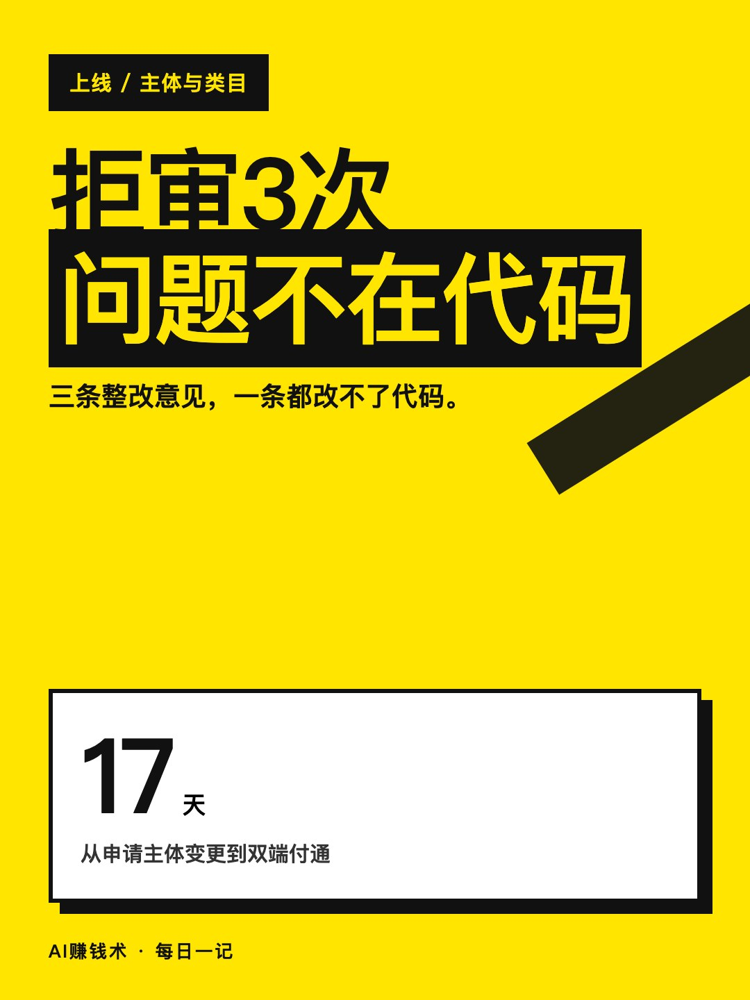
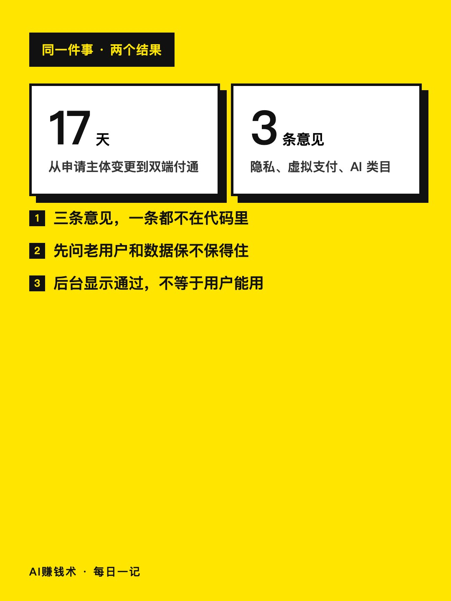
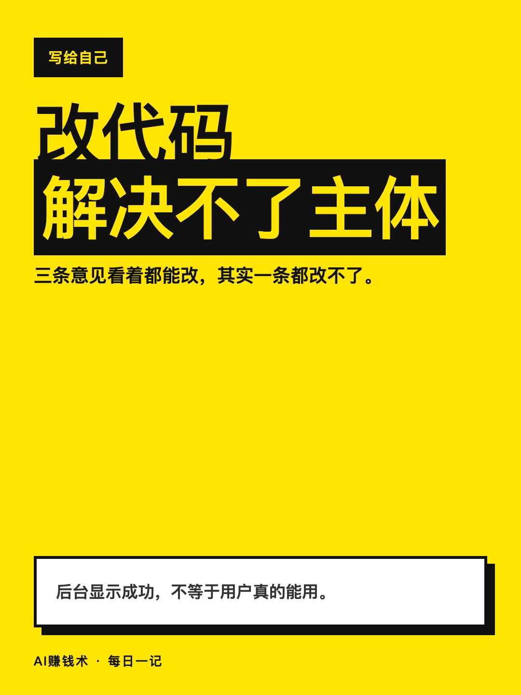
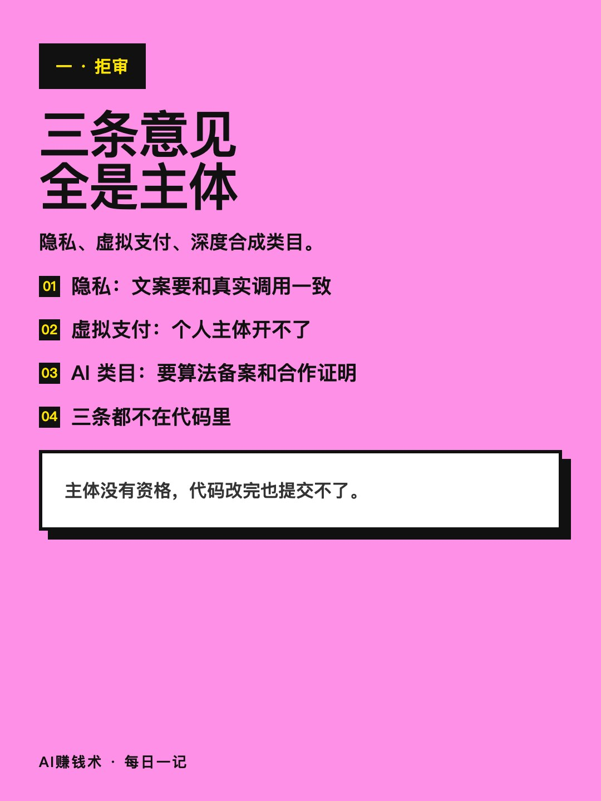
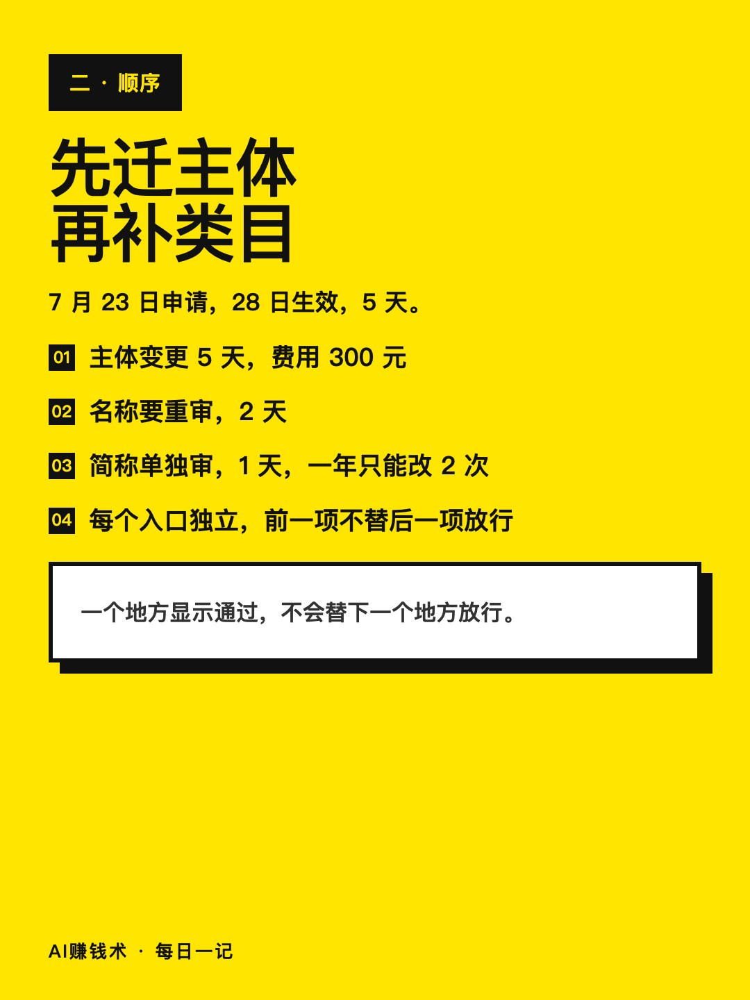
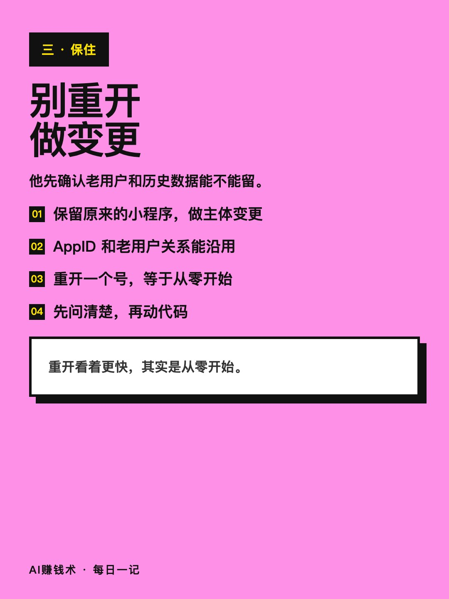
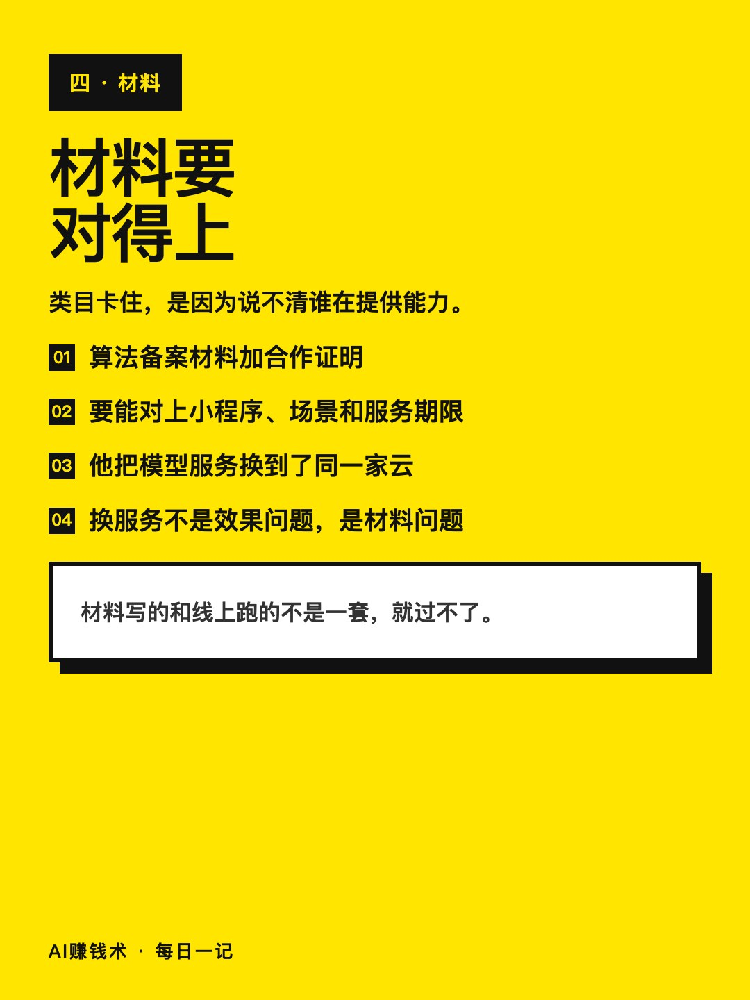
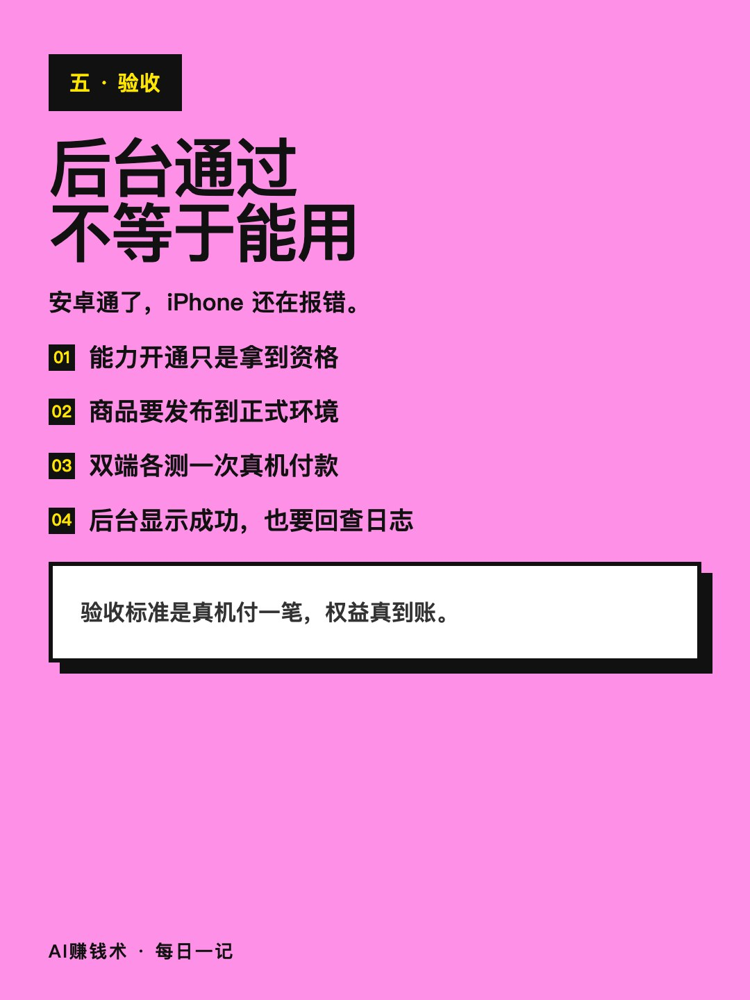

# 拒审3次，问题不在代码

> — · 2026-11-03 13:13 发布 · AI 赚钱内容

## 标题（可直接复制）

```
拒审3次，问题不在代码
```

## 正文（可直接复制发布）

「三条整改意见，我一条都用代码改不了。」

阿甘的小程序 3 月做出来，个人主体，已经开始收费，用的是兑换码。7 月他提交了一个优化版本，后台一次给了三条意见：隐私处理、虚拟支付、深度合成类目。

他一开始也想改代码，把三条截图发给 AI，让它判断哪几处能改。结论很直接：页面能改，授权流程能改，材料也能补，但个人主体没有对应资格，两边都改完也提交不了。

于是他换了个做法：不重开，做主体变更，把原来的小程序保下来。

① 三条意见，一条都不在代码里

隐私那条要求文案和真实的第三方处理一致。他原来写「不会向任何第三方提供信息」，但程序确实在调外部云服务，这句话本身就不成立。

虚拟支付和深度合成类目更直接：个人主体开不了这两项，改页面没用。

判断方法很简单：如果一条意见对应的能力，你的主体根本没资格申请，那就不是改代码的事。

② 先问「老用户和数据保不保得住」

决定迁移之前，他先确认一件事：主体变更能不能沿用原来的小程序，AppID、老用户关系、历史数据还在不在。

确认能沿用，才动。重开一个号看着更快，等于从零开始。

顺序也很关键：主体变更 5 天，费用 300 元；名称重审 2 天；简称 1 天，一年只能改 2 次；隐私指引 2 天；AI 类目 4 天。每个入口独立审核，前一项通过不会替后一项放行。从 7 月 23 日到双端付通，一共 17 天。

③ 后台显示通过，不等于用户能用

容易踩坑的一步在这里：能力审核通过，只代表拿到接入资格。商品还要发布到正式环境，安卓和 iPhone 走的通道不同，得各测一次真机付款。

他安卓先通了，以为结束，换到 iPhone 报错一个接一个：条件不满足、商品未发布、商品正在生效，最后只剩一句「购买失败」。

所以验收标准不是后台那个绿字，是真机付一笔、权益真的到账。

卡住你的往往不是代码，是主体、类目和入口顺序。

你手上那个项目，如果明天被拒审，你会先查哪个入口？

## 话题标签

#AI产品 #小程序 #上线 #AI赚钱术日记 #独立开发 #副业

## 配图（8 张）










## 发布信息

| 项 | 值 |
|---|---|
| 平台 | 小红书 |
| 期数 | — |
| 发布时间 | 2026-11-03 13:13 |
| 正文长度 | 823 字 |
| 图片数量 | 8 张 |
| 状态 | 已发布 |
