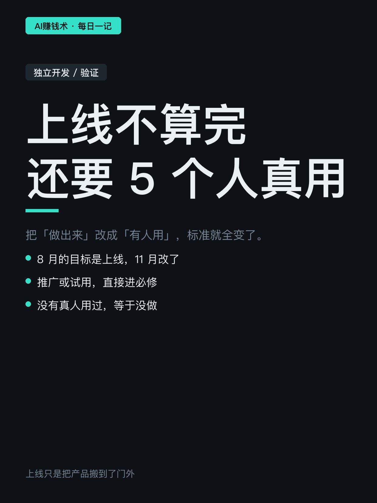
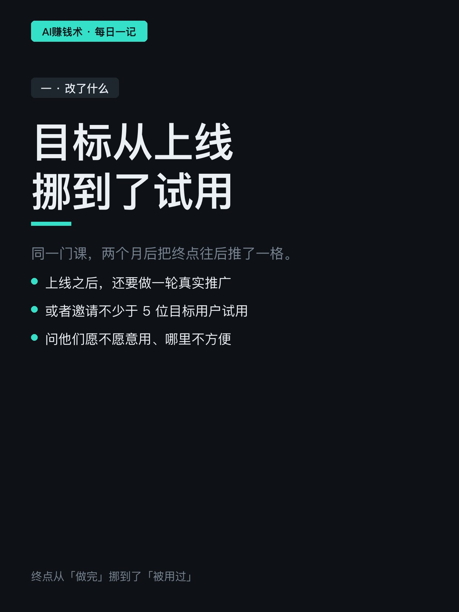
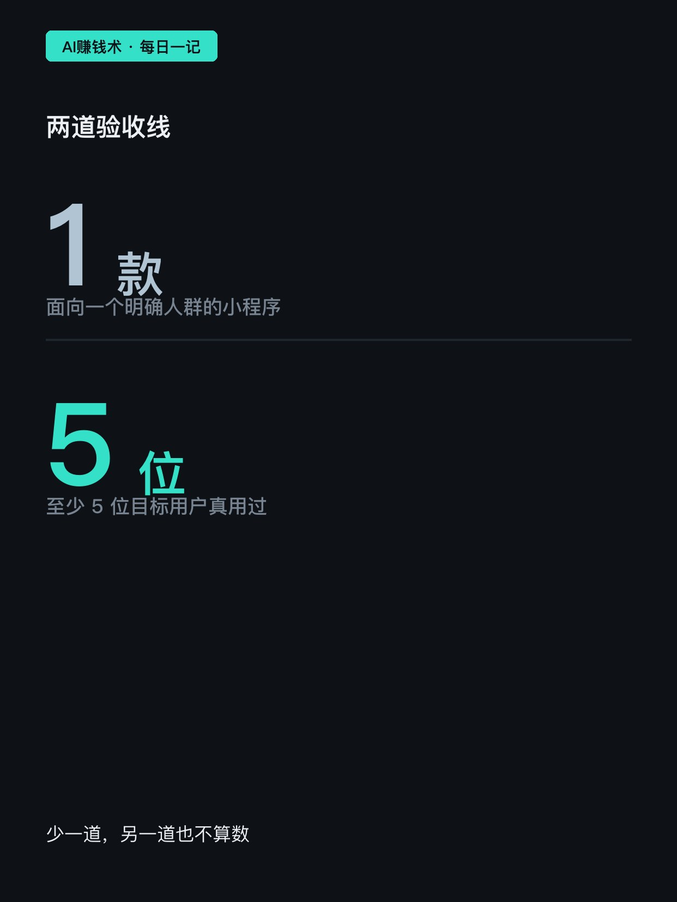
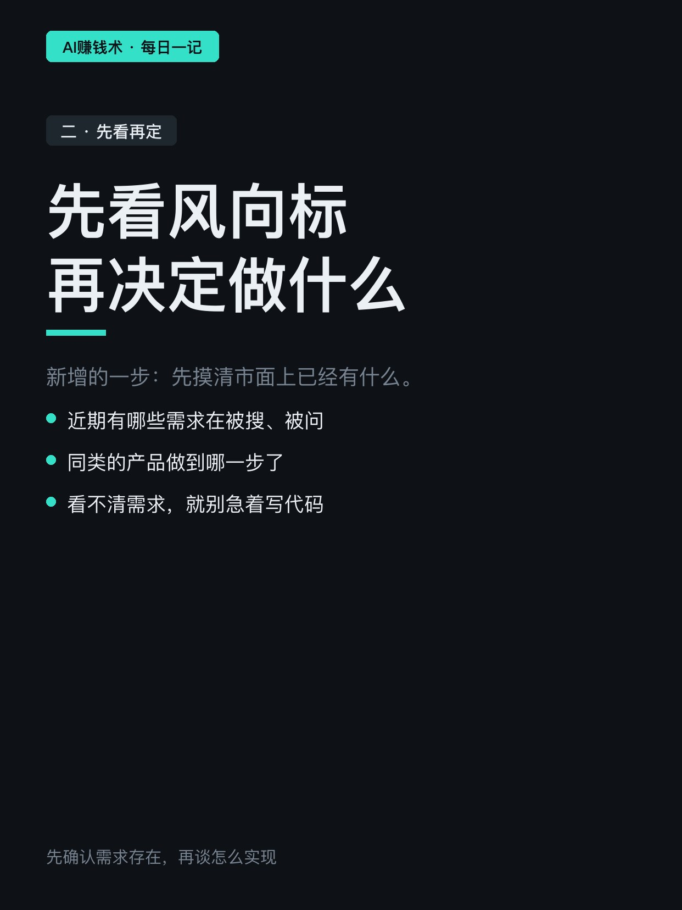
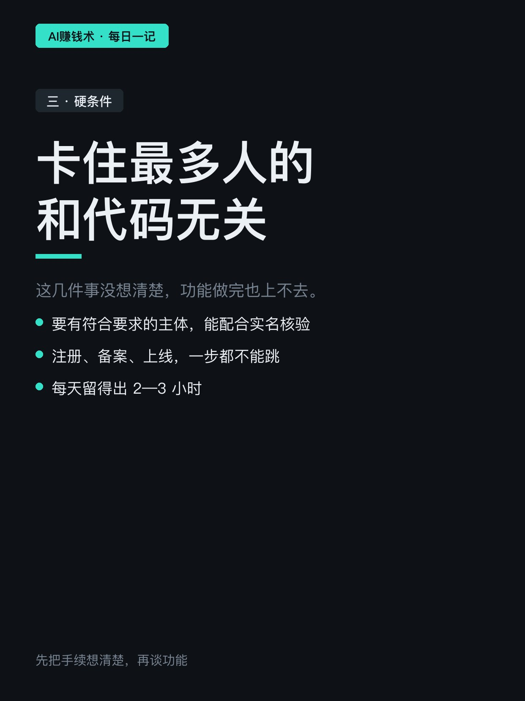
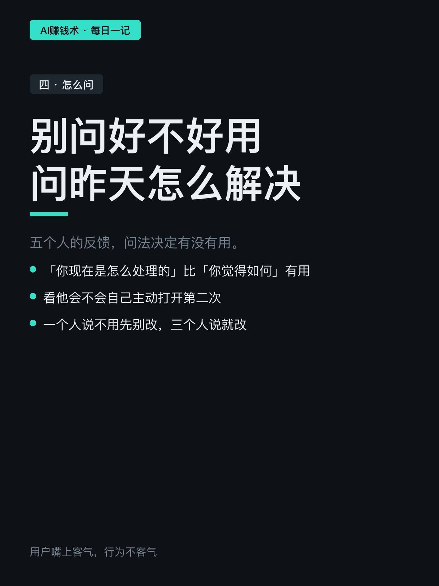
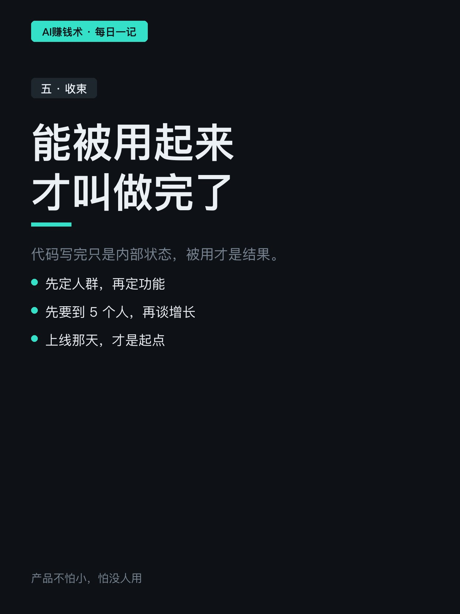

# 上线了不算完，得有5个人真用

> — · 2026-11-04 16:03 发布 · AI 赚钱内容

## 标题（可直接复制）

```
上线了不算完，得有5个人真用
```

## 正文（可直接复制发布）

判断一个产品做没做完，有个很硬的标准：看有没有真人用过。

生财 11 月的航海把小程序这条船改了一次。8 月那期的目标是「把小程序上线」，11 月改成上线之后还要再做一轮真实推广，或者邀请不少于 5 位目标用户试用。

一句话：终点从「做完」挪到了「被用过」。

我觉得这一格挪得很值。

一、先看风向标，再决定做什么

这期新增了一步，叫「小程序风向标」——先研究近期有哪些需求在被问，市面上同类产品已经做到哪一步，再决定自己做什么。

顺序很重要。以前常见的做法是：先有个想法，闷头写两周，上线，然后发现没人要。

先看需求再看产品，听起来慢，其实省时间。因为最贵的成本不是开发，是开发完之后发现方向错了。

二、推广和试用，被写进了必修

这一点最容易被跳过。上线是一个内部状态，你自己知道它跑通了；被用才是结果。

他们给的验收标准很具体：上线之后，做一轮真实推广，或者邀请不少于 5 位目标用户试用。

举个他们提的例子：你做了个老师用的小工具，就找几位老师试试看——他们愿不愿意用、哪个功能不方便、平时又是用什么办法解决这个问题的。

这三个问题里，最有信息量的是最后一个：平时用什么办法解决。它告诉你这个需求现在是怎么被对付过去的，值不值得换成你的产品。

三、有些坎，和代码没关系

这条船开始前列了硬条件：一台能跑开发工具的电脑，每天 2—3 小时。

还有一件更麻烦的：国内小程序要注册、备案、上线，需要符合要求的主体，也需要能配合实名核验的管理员。

不少人卡在这里，功能早就写完了，卡在流程上。

所以顺序上，手续和功能最好并行推进，别等代码写完才开始办。

四、五个人的反馈怎么问

别问「你觉得好不好用」，人会客气。

问「你现在是怎么处理的」。问完看他会不会自己主动打开第二次。

一个人说不用，先别急着改；三个人说同一个地方不行，那就改。

收尾

产品不怕小，怕没人用。

先定一个人群，再定一个功能；先要到 5 个人用，再谈增长。

你手上那个做了一半的东西，现在有几个真人用过？


## 话题标签

#独立开发 #小程序 #产品验证 #AI赚钱术 #AI赚钱术日记

## 配图（8 张）










## 发布信息

| 项 | 值 |
|---|---|
| 平台 | 小红书 |
| 期数 | — |
| 发布时间 | 2026-11-04 16:03 |
| 正文长度 | 861 字 |
| 图片数量 | 8 张 |
| 状态 | 已发布 |
