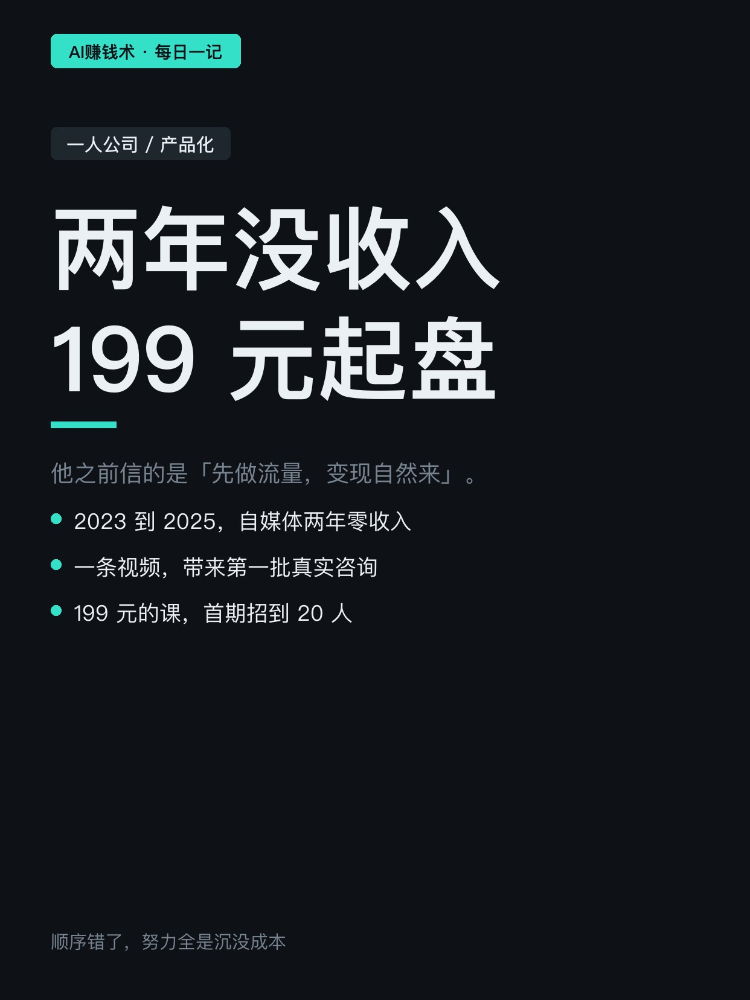
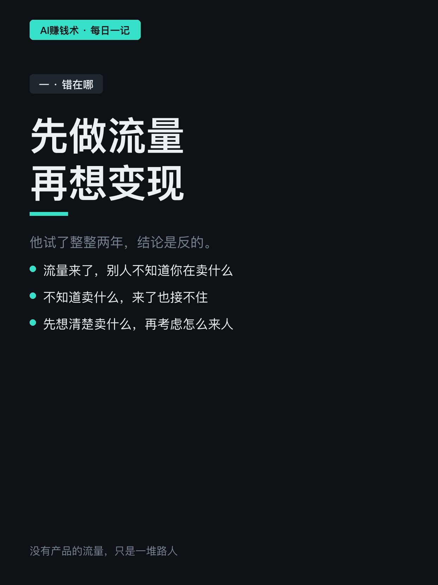
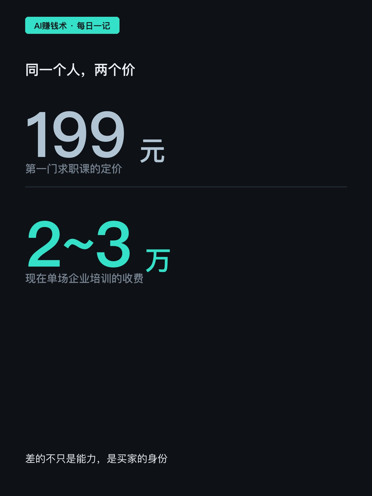
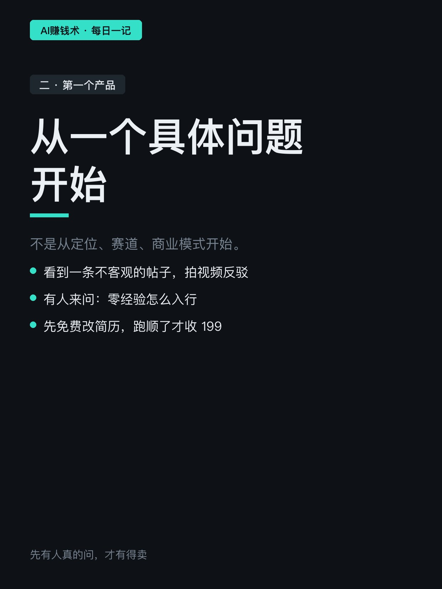
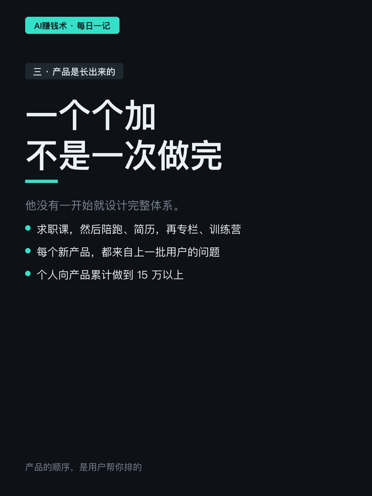
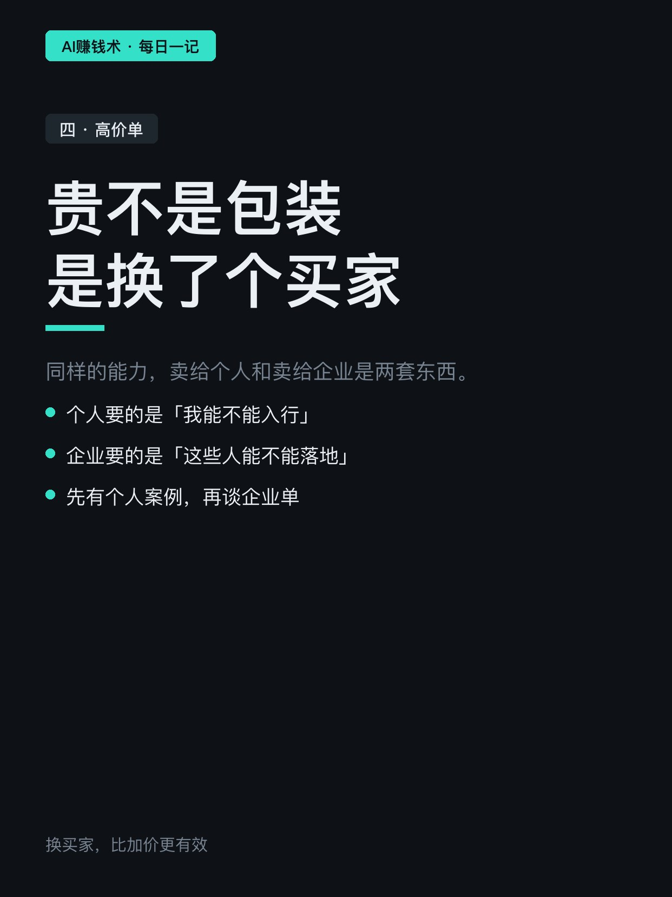
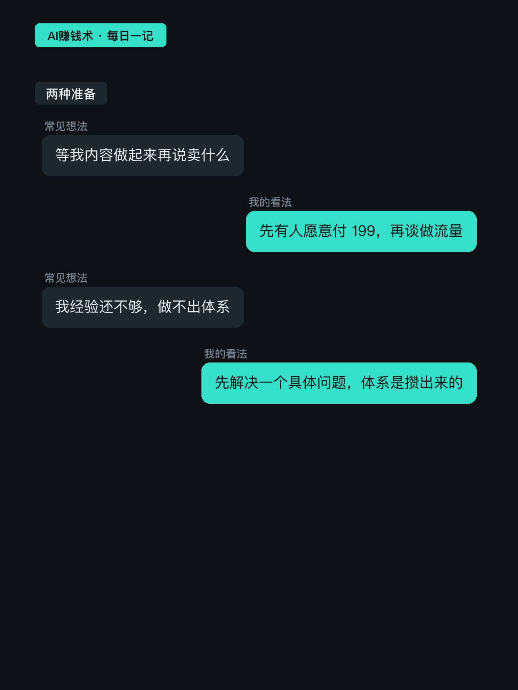
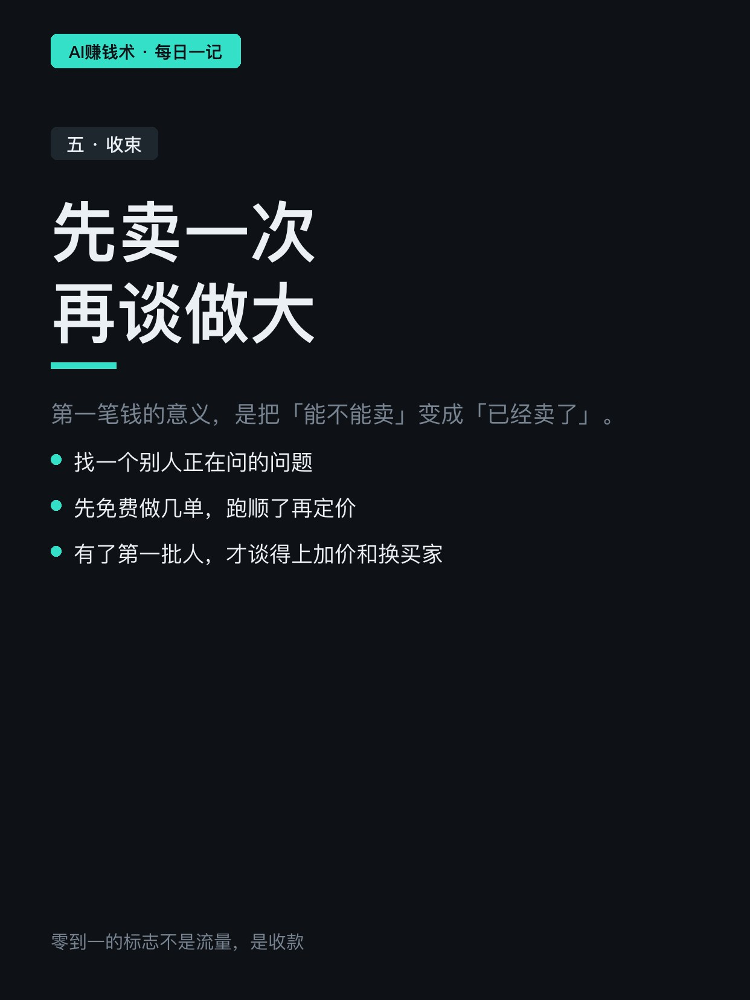

# 两年没收入，199元起盘

> — · 2026-11-04 18:01 发布 · AI 赚钱内容

## 标题（可直接复制）

```
两年没收入，199元起盘
```

## 正文（可直接复制发布）

他做自媒体，整整两年，一分钱没赚到。

第三年，199 元一门课，首期招了 20 人。后来做到单场企业培训 2-3 万。

同一批能力，差的是顺序。

一、他之前的顺序是反的

2023 到 2025，他的想法是：先把流量做出来，后面自然就能变现。

试了很多次，也失败了很多次。

这句话很多人都在信。但流量本身不解决一个问题：别人看到你之后，知道你卖什么吗？

想不清楚卖什么，流量来了也只能路过。

二、第一个产品，从一个具体问题开始

转机很普通。他刷到一条帖子，觉得讲新媒体这行讲得不客观，就拍了一条视频反驳。

结果有人来问：新媒体运营到底是个什么岗位、零经验怎么入行、需要什么能力。

他不是先做定位、赛道、商业模式，而是先免费帮人改简历。改顺了，才收 199 开课。

先有人真的问，才有得卖。

三、产品是长出来的

之后的路径：求职课、求职陪跑、简历服务、专栏、AI 训练营，一个一个加上去。

到 2026 年 9 月，面向个人的产品累计超过 15 万。

关键不在数字，在顺序：每个新产品，都来自上一批用户提出的新问题。

产品体系不是设计出来的，是用户帮你排出来的。

四、2-3 万的单子，换的是买家

同样的能力，卖给个人和卖给企业，是两套产品。

个人问的是「我能不能入行」，企业问的是「这些人上完能不能落地」。

先有个人案例，才谈得上企业单。

他自己也说，这一路有运气的成分。但运气出现有个前提：2025 年 6 月他先做了一件很具体的事——发了一条视频，回了一个问题。

收尾

零到一的标志不是流量，是收款。

先卖一次，哪怕 199。

你手上那些做了很多年的经验，有没有一个具体问题，正有人公开在问？


## 话题标签

#个人IP #知识付费 #产品化 #AI赚钱术 #AI赚钱术日记

## 配图（8 张）










## 发布信息

| 项 | 值 |
|---|---|
| 平台 | 小红书 |
| 期数 | — |
| 发布时间 | 2026-11-04 18:01 |
| 正文长度 | 724 字 |
| 图片数量 | 8 张 |
| 状态 | 已发布 |
