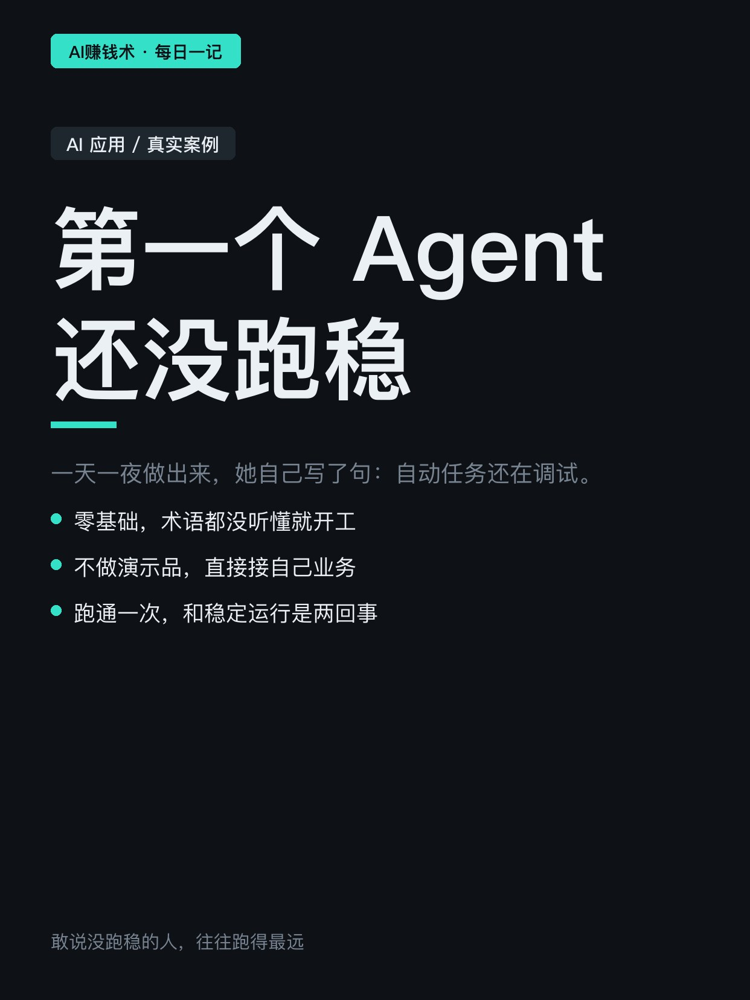
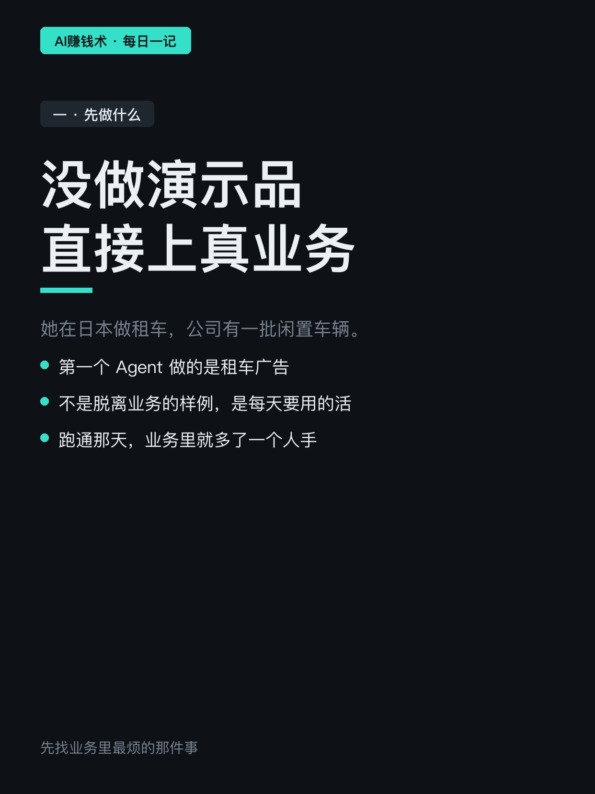
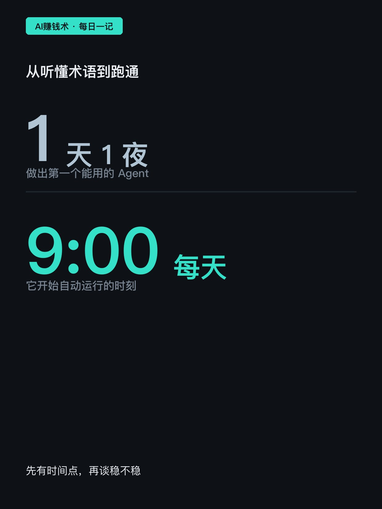
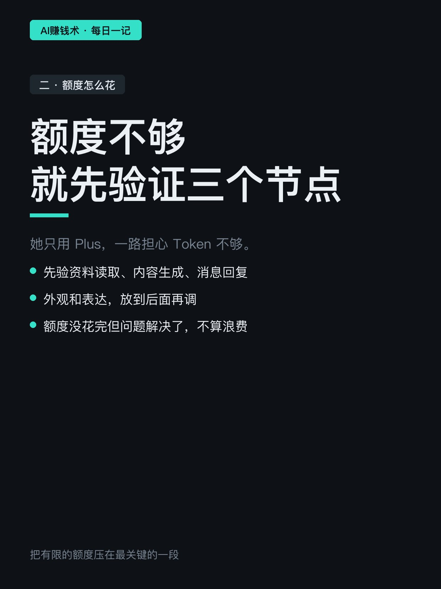
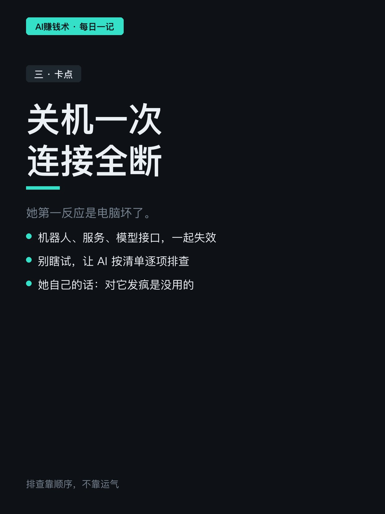
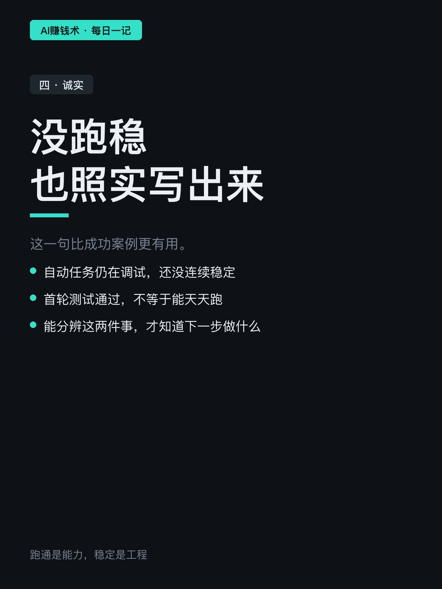
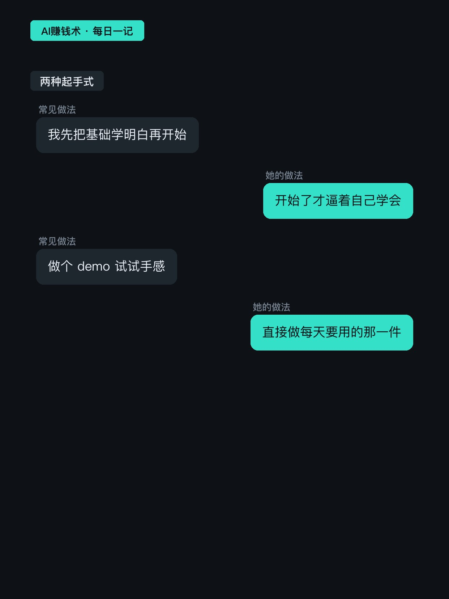
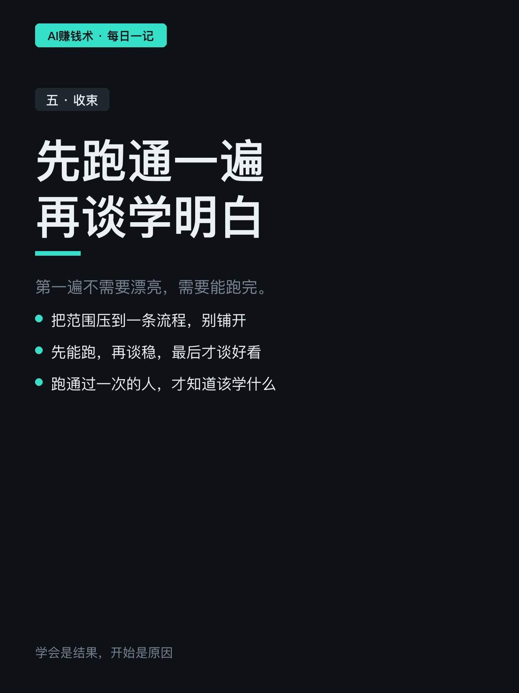

# 她做的第一个 Agent，还没跑稳

> — · 2026-11-04 21:02 发布 · AI 赚钱内容

## 标题（可直接复制）

```
她做的第一个 Agent，还没跑稳
```

## 正文（可直接复制发布）

一个 AI 员工，做到什么程度算做出来了？

任哈哈 Lorena 的答案是两句话：一天一夜做出第一个能用的 Agent；但这个 Agent 的自动任务还在调试，还没连续稳定运行。

两句话她都写在了复盘里。我觉得第二句更值钱。

一、她没做演示品，直接接了真业务

她在日本做高尔夫旅游，公司有一批闲置车辆，正在拓展租车业务。开始学 AI 之后，她的第一个 Agent 不是脱离业务的样例，而是租车广告运营——信息整理、卖点提炼、内容生成、视觉输出、修改迭代，这一段全交给它。

然后设成每天上午 9 点自动跑。

这个选择的价值在于：它一开始就有用户，用户就是她自己。有没有用，第二天就知道。

二、额度有限，先验证三个节点

她只开了 Plus，一路担心额度不够。

她的做法是按优先级分配：先验证三个关键节点——资料能不能读到、内容能不能生成、消息能不能回。这三个通了，流程就成立。外观和措辞的优化，放到后面。

她有句话我很有共鸣：只要解决了本周最重要的问题，即使还有剩余额度，也不算浪费。

反过来也成立：额度全花完了，关键节点还没通，那才是浪费。

三、她的卡点：关机之后，全断了

电脑音频出问题，她以为电脑坏了，问了一下 AI，对方让她关机重启。

关机之后，消息机器人、服务、模型接口，全部失效，她不知道断在哪一层。

她的处理方式是对的：不猜，让 AI 按清单逐项排查——服务有没有起、机器人有没有连、接口通不通、配置和路径对不对、定时任务还在不在、最后看日志找断点。

她自己的总结是：对它发疯是没用的，还是要一步步排查。

四、最值钱的是那句「还没跑稳」

首轮测试通过，和能天天稳定跑，是两件事。

很多人做到第一件就写复盘了，第二件留在心里。她两件都写出来了。

这个区分不是谦虚，是判断力——知道自己卡在哪一层，才知道下一步该做什么。

跑通是能力，稳定是工程，后者没有捷径。

收尾

我们总以为要先把 AI 学明白，才能用它。

她的路径是反的：先挑业务里最烦的那件事，把它跑到能出结果，再回头补知识。

第一遍不需要漂亮，需要能跑完。

你手上那件想交给 AI 的活，有没有一段流程，是你今天就能跑到结尾的？


## 话题标签

#AI应用 #Agent #职场提效 #AI赚钱术 #AI赚钱术日记

## 配图（8 张）










## 发布信息

| 项 | 值 |
|---|---|
| 平台 | 小红书 |
| 期数 | — |
| 发布时间 | 2026-11-04 21:02 |
| 正文长度 | 924 字 |
| 图片数量 | 8 张 |
| 状态 | 已发布 |
