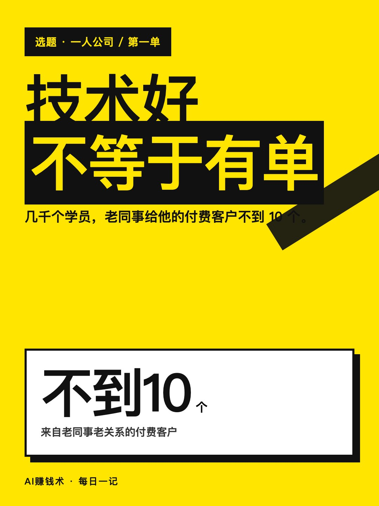
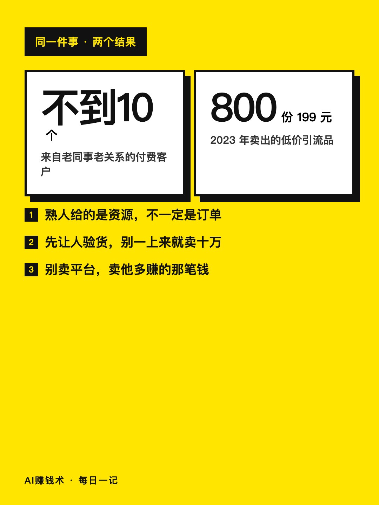
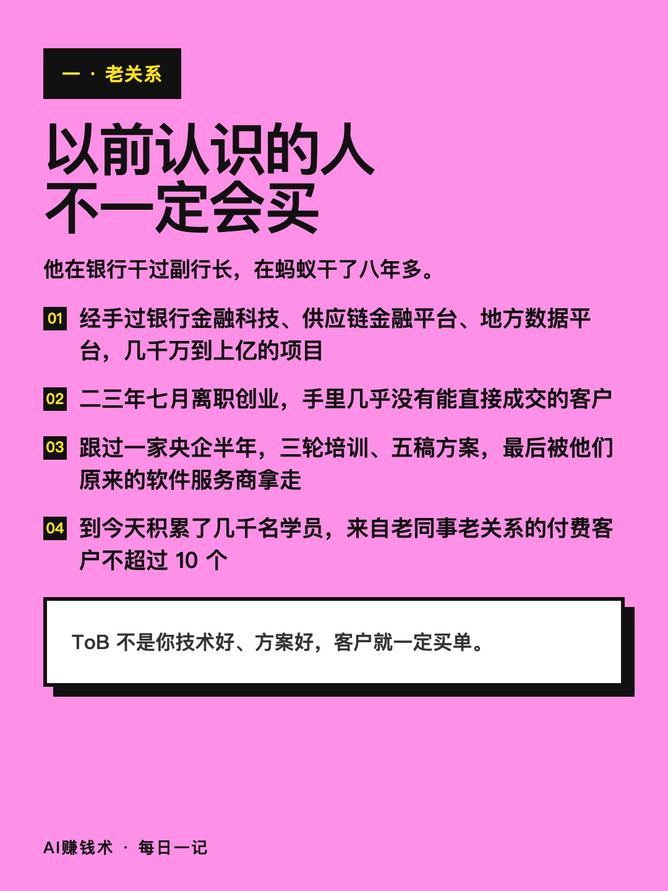
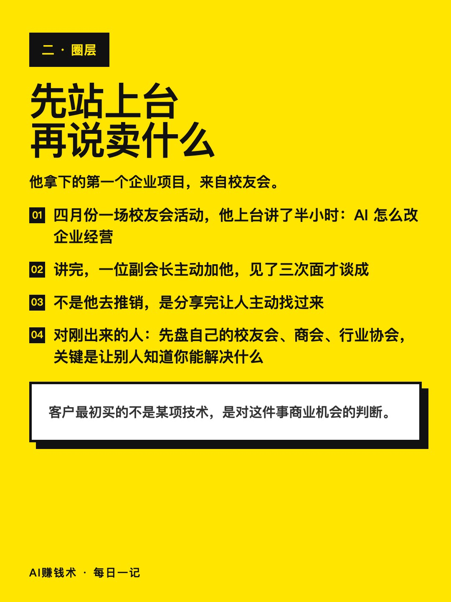
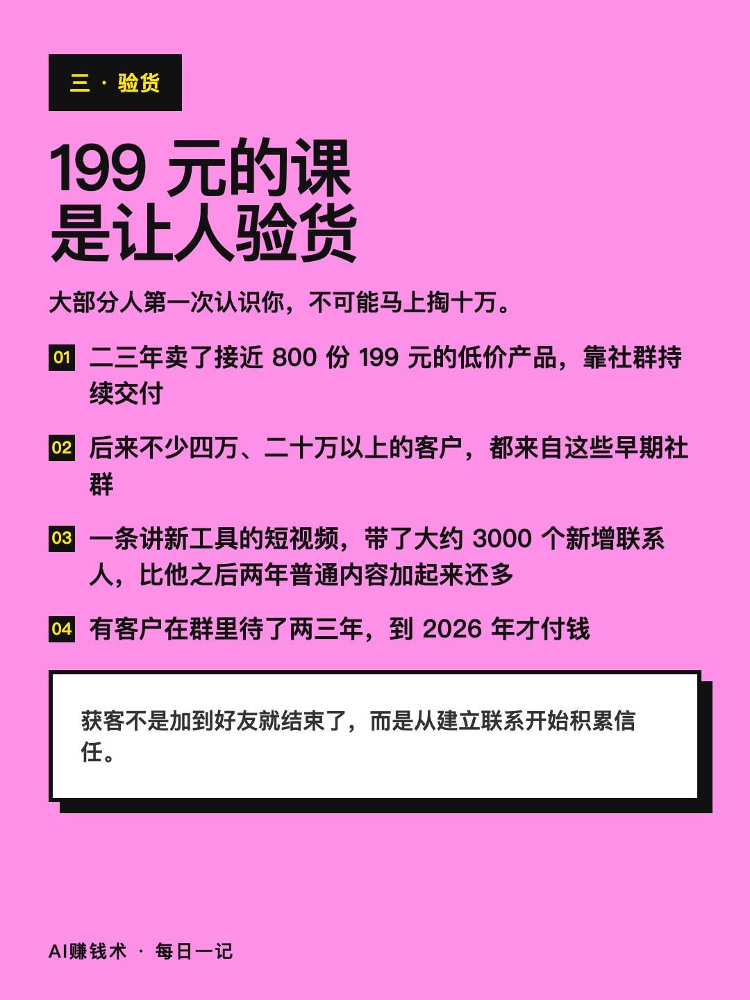
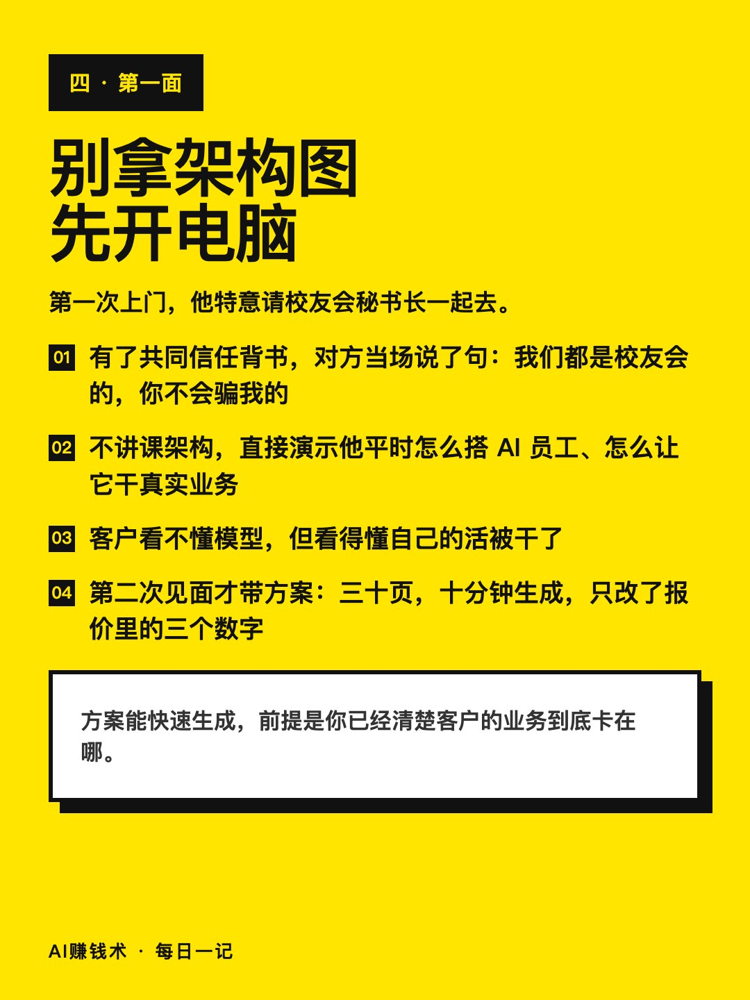
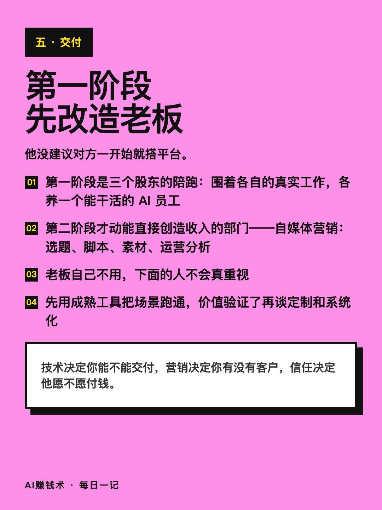
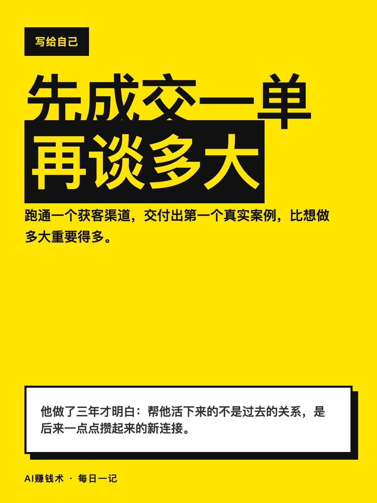

# 技术好，不等于有单

> — · 2026-11-04 14:01 发布 · AI 赚钱内容

## 标题（可直接复制）

```
技术好，不等于有单
```

## 正文（可直接复制发布）

在银行当过副行长，在蚂蚁干了八年多，经手过几千万到上亿的数字化项目。二三年七月他离职创业，手里的客户是零。

跟过一家央企半年，三轮培训、五稿方案，最后被人家原来的软件服务商拿走。到今天他攒了几千名学员，来自老同事老关系的付费客户，不超过 10 个。

① 熟人给的是资源，不是订单

他原本以为大厂履历就是人脉。真出来才发现，客户不会因为你离职就把项目给你，老同事也不太可能成为主要的付费客户。

后来他看明白一件事：跟你特别熟的人反而未必付钱，那些原来不熟、只是列表里加过的人，看过你一段时间的内容，慢慢有了信任，才可能成客户。

② 先站上台，再说卖什么

他拿下的第一个企业项目来自校友会。四月份一场活动，他上台讲了半小时 AI 怎么改企业经营，讲完一位副会长主动来加他，见了三次面才谈成。

不是推销，是让有需要的人自己找过来。刚出来的人可以先盘一盘：校友会、商会、行业协会，你手上总有三个能进去的圈子，关键是在里面讲清你能解决什么问题。

③ 199 元的课，是让人验货

大部分人第一次认识你，不可能马上掏十万。二三年他卖了接近 800 份 199 元的低价产品，靠社群一点点交付，后来不少四万、二十万以上的客户都出自这批人。

一条讲新工具的短视频，给他带了三千来个新增联系人，比他之后两年普通内容加起来还多。也有人在群里待了两三年，到今年才付钱。

④ 第一面别拿架构图，先开电脑

第一次上门，他特意请秘书长一起去，对方当场说了句：我们都是校友会的，你不会骗我的。

见面他没讲架构，直接演示平时怎么搭 AI 员工、怎么让它干真实业务。客户看不懂模型，但看得懂自己的活被干了。第二次才带方案，三十页，十分钟生成，只改了报价里三个数字。

⑤ 第一阶段先改造老板

他没建议对方一上来就搭平台。第一步是三个股东各养一个能干活的 AI 员工，围着各自的真实工作来；第二步才动能直接创造收入的营销部门。

老板自己不用，下面的人不会真重视。先用成熟工具把场景跑通，价值验证了再谈定制。

技术决定你能不能交付，营销决定你有没有客户，信任决定他愿不愿意付钱。

你现在手上那三个圈子里，哪一个能让你下周站上去讲半小时？评论区说一个。

## 话题标签

#AI #创业

## 配图（8 张）










## 发布信息

| 项 | 值 |
|---|---|
| 平台 | 小红书 |
| 期数 | — |
| 发布时间 | 2026-11-04 14:01 |
| 正文长度 | 922 字 |
| 图片数量 | 8 张 |
| 状态 | 已发布 |
