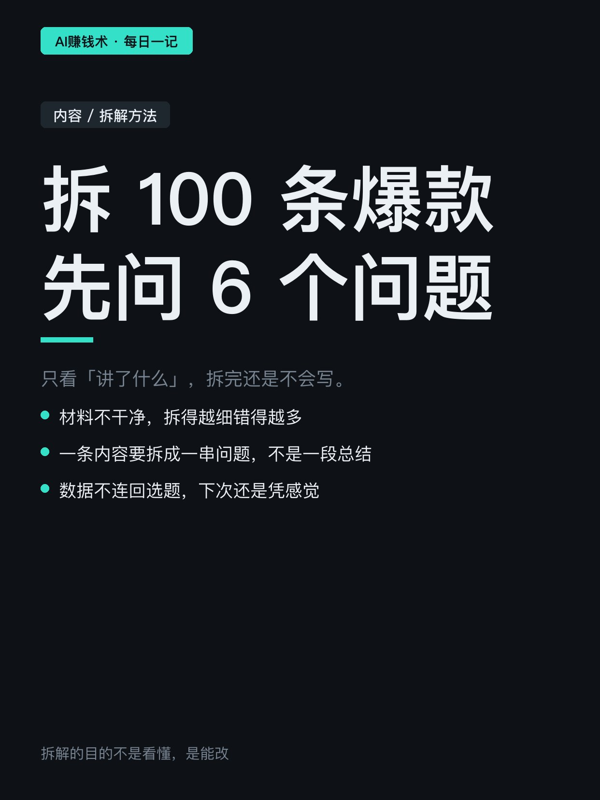
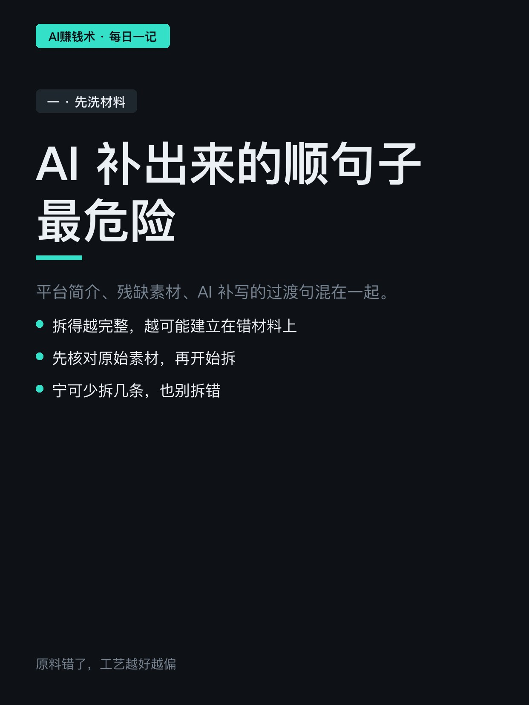
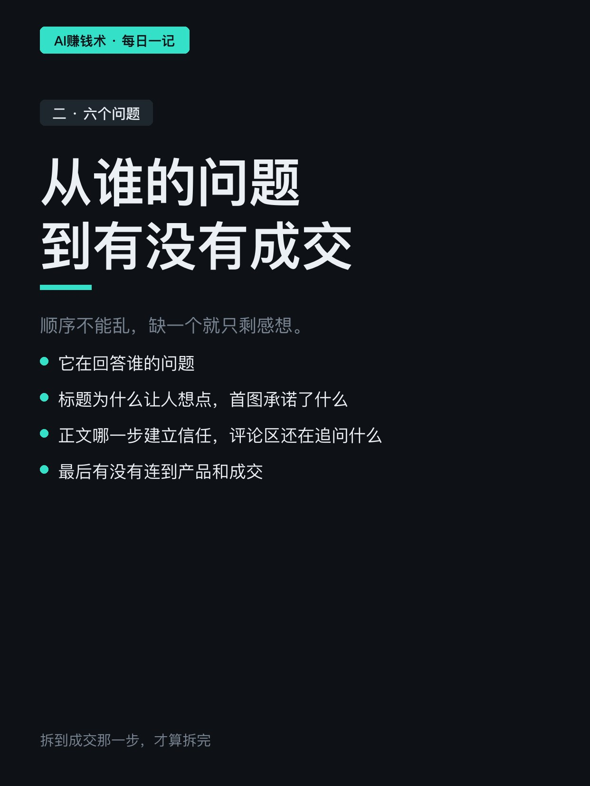
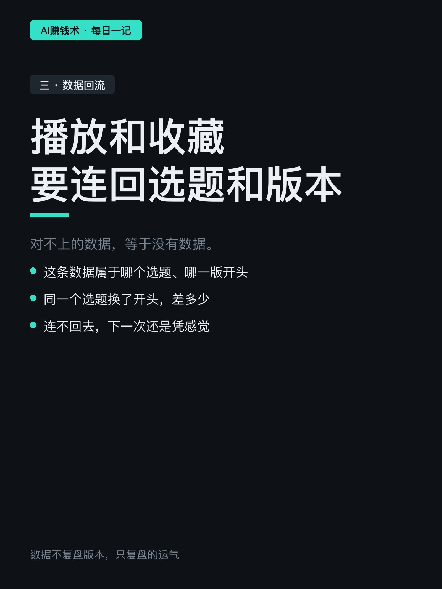
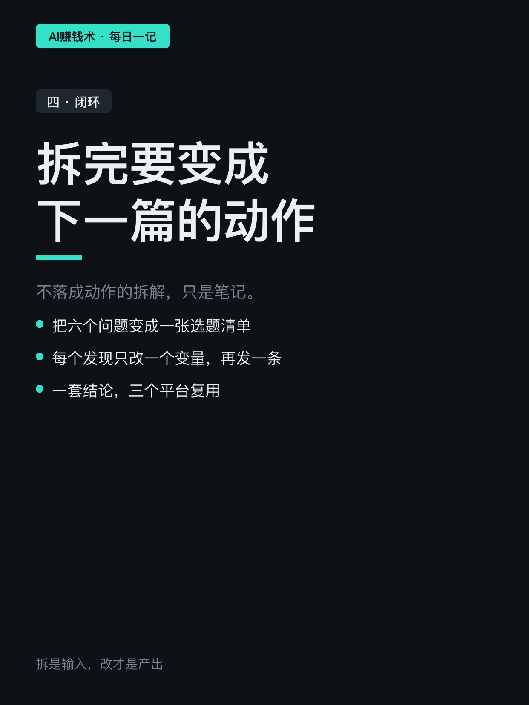
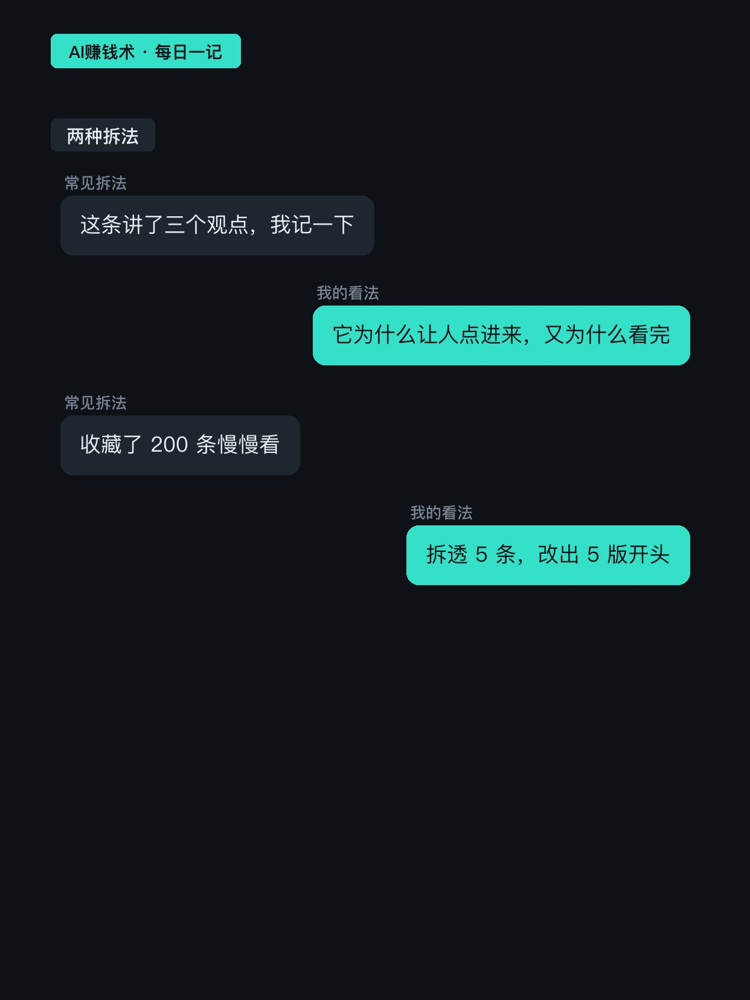
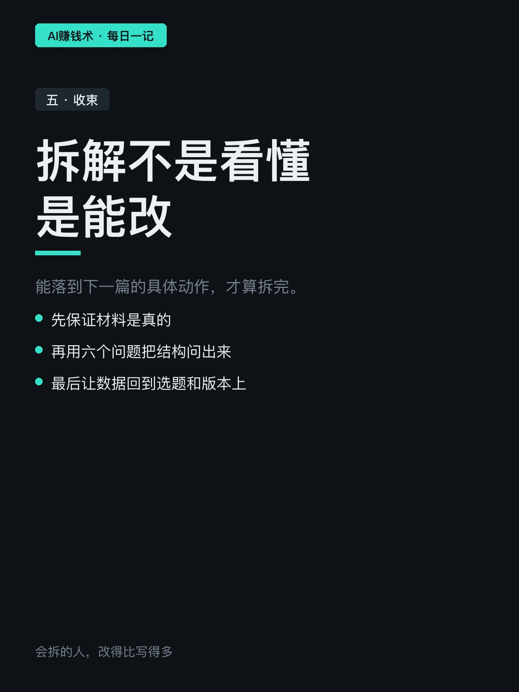

# 拆100条爆款，先问6个问题

> — · 2026-11-04 15:01 发布 · AI 赚钱内容

## 标题（可直接复制）

```
拆100条爆款，先问6个问题
```

## 正文（可直接复制发布）

拆解爆款这件事，大部分人在做无用功。

一位把内容拆解做成 Agent 的作者，给了一条很硬的判断：平台简介、残缺素材、AI 补写出来的顺句子混在一起，后面的拆解越完整，越可能建立在错误材料上。

这句话我先抄下来了。它说的不是工具问题，是原料问题。

一、先把材料洗干净

我们拆一条爆款时，拿到的经常不是原文：有的是平台生成的简介，有的是被截断的片段，还有 AI 顺手补出来的过渡句。

这些材料看起来能读，但结构是假的。你按它总结出的「三段式」「钩子在前两秒」，很可能是 AI 替你编出来的规律。

所以拆之前先做一件笨事：找到原始内容，确认每一句都是作者写的。宁可少拆十条，别拆错一条。

二、一条内容要拆成六个问题

他拆的方式不是总结「讲了什么」，而是连着问：

它在回答谁的问题？
标题为什么让人想点？
首图给了什么承诺？
正文在哪一步建立信任？
评论区的人还在追问什么？
最后有没有连到产品和成交？

这六个问题，把一条内容从「观点」拆成了「结构 + 意图 + 转化」。

顺序也有讲究：前两个决定有没有人点，中间两个决定有没有人看完，最后两个决定有没有人付钱。

大多数人只拆到第三个问题，所以做出来的内容「看着像」，但就是不成交。

三、数据要连回选题和版本

他还有一句批评很扎心：没有把播放、收藏、评论和线索重新连回选题、样本和版本，下一次依然只能凭感觉。

举个具体的：你换了开头，播放涨了，但没记这是第几版、改的是哪一句——那这次涨就白涨了，下次还是靠猜。

四、拆完必须落成动作

拆解的产出不是一份笔记，是下一篇要改的那一处。

他后来的做法是：一套拆解结论，三个平台复用；每次只改一个变量，再发一条。

收尾

会拆的人，改得比写得多。

你最近收藏的那些爆款，有几条是真的拆到了「成交」那一步？


## 话题标签

#内容拆解 #爆款分析 #选题 #AI赚钱术 #AI赚钱术日记

## 配图（8 张）










## 发布信息

| 项 | 值 |
|---|---|
| 平台 | 小红书 |
| 期数 | — |
| 发布时间 | 2026-11-04 15:01 |
| 正文长度 | 766 字 |
| 图片数量 | 8 张 |
| 状态 | 已发布 |
