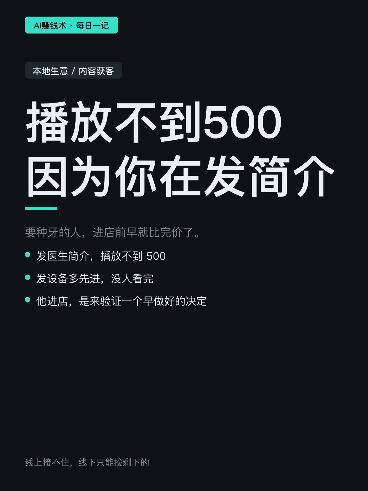
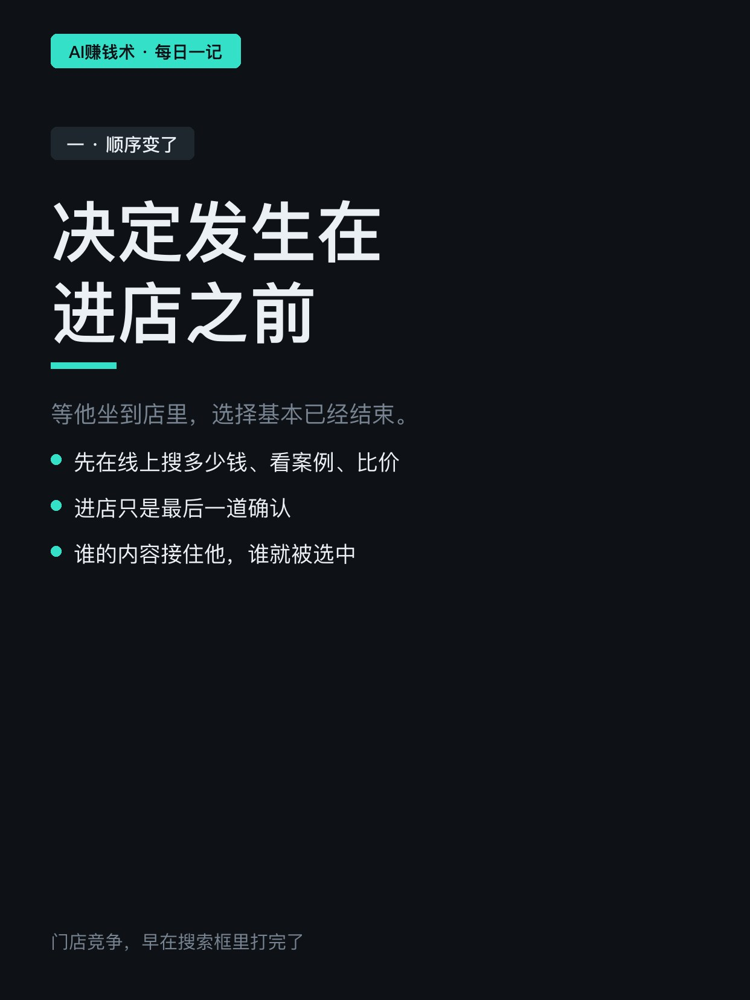
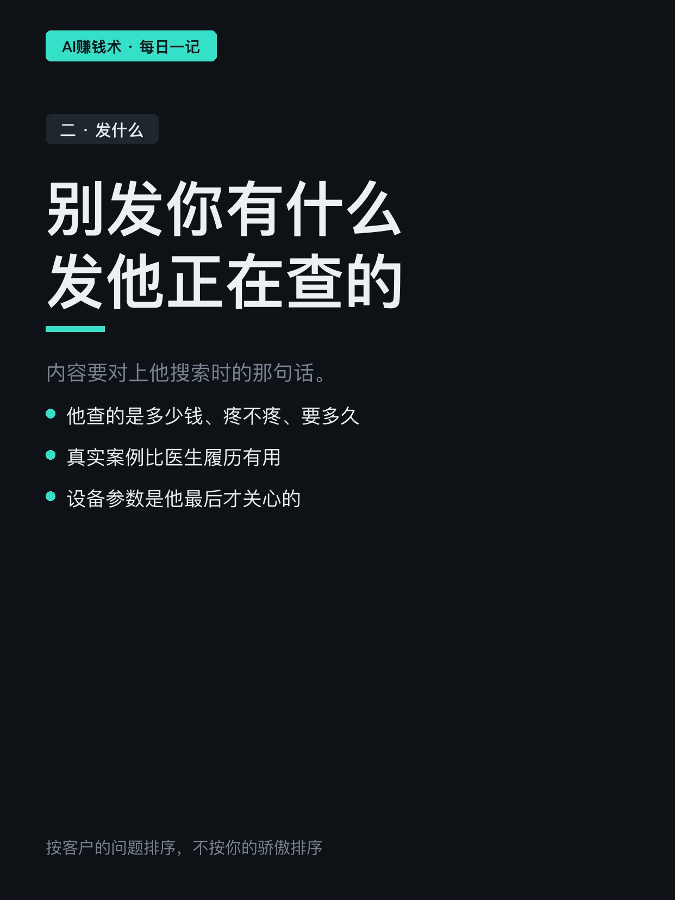
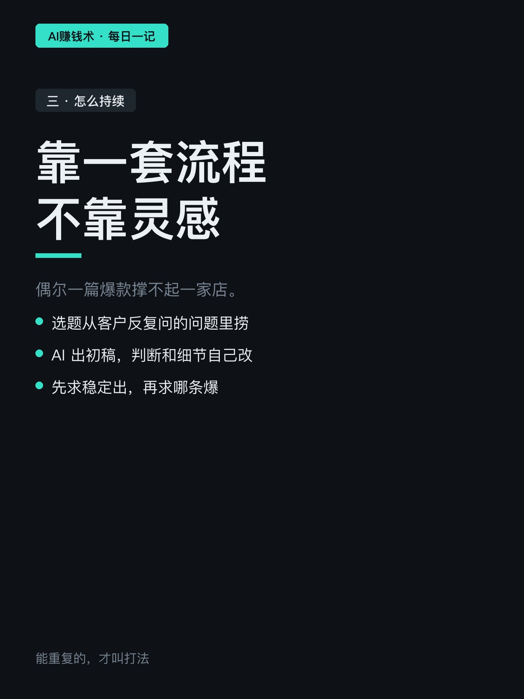
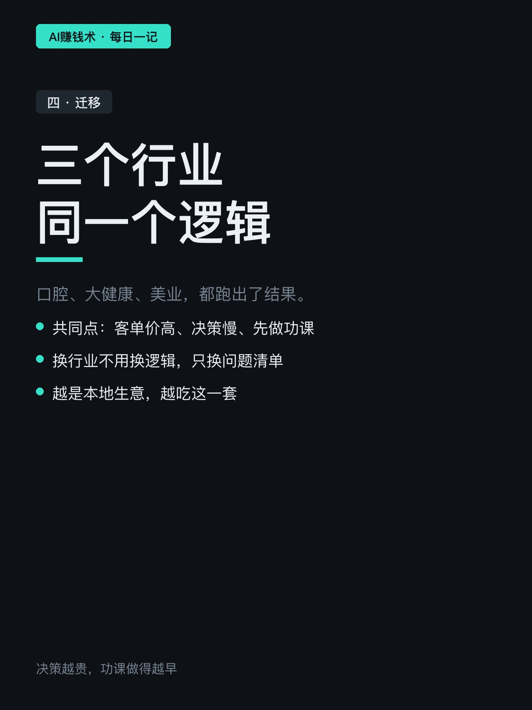
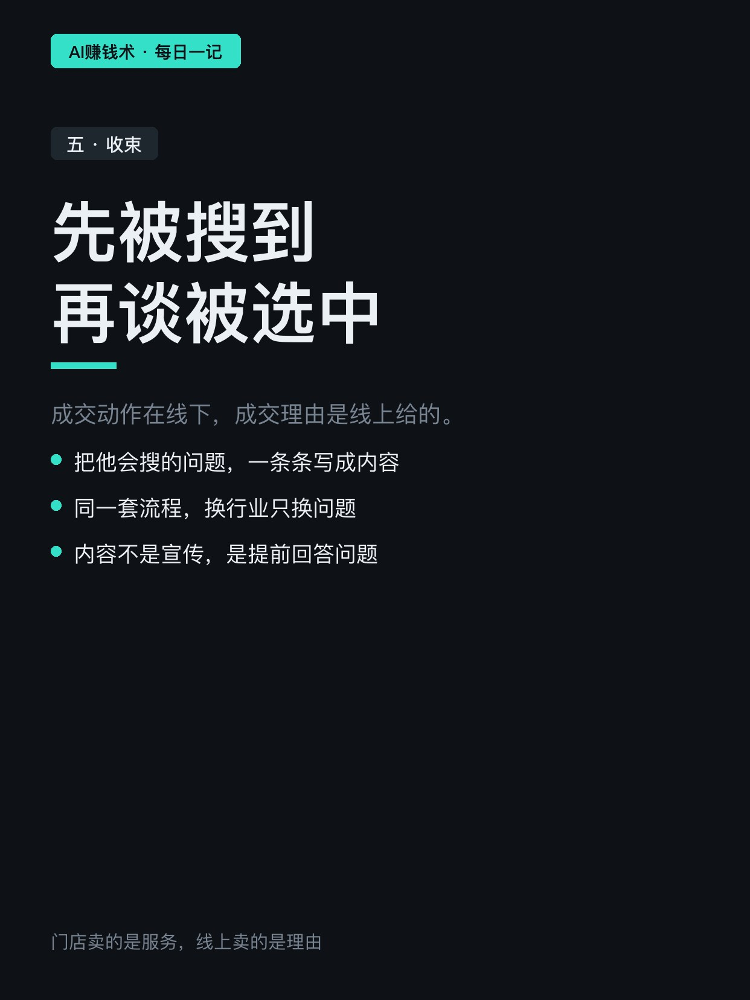

# 播放不到500，因为你在发医生简介

> — · 2026-11-04 13:01 发布 · AI 赚钱内容

## 标题（可直接复制）

```
播放不到500，因为你在发医生简介
```

## 正文（可直接复制发布）

一家口腔门诊发内容，播放量常常不到 500。他们发的是医生简介、设备多先进。

问题不在制作，在顺序。

要种牙的人，进店之前已经搜过「种植牙多少钱」，看过案例，比过价格。等他坐到店里，他不是来找一家店，是来验证一个早就做好的决定。

所以门店之间的竞争，早在搜索框里就打完了。谁的内容接住他，谁被选中。

一、内容要对上他在搜的那句话

他搜的是：多少钱、疼不疼、要做几次、多久能好。

医生履历和设备参数，是他最后才关心的部分。发这些，等于在回答一个他还没问出口的问题。

真实案例在这里比简历有用，因为它回答的是另一件事：别人做了之后怎么样。

二、能持续，靠流程不靠灵感

作者原来一篇文章要磨四五天，用 AI 把流程跑起来之后，20 分钟能出初稿。

我更看重这个变化带来的副作用：不是省时间，是日更变得可能了。

内容这件事，一条爆款撑不起一家店，能每周固定出才有复利。

她的路径也很清楚：靠长文起家，不投流、不拍视频、不露脸，一篇一篇写。今年 7 月，一篇长文成交了 50 万的私塾。

这些数字都是她自述，按自述看就行。

三、为什么能迁到实体老板身上

她把这套打法从知识付费搬到口腔门诊、大健康、美业，都跑出了结果。

共同点很明显：客单价高、决策慢、客户一定会先做功课。

越是这种生意，线上内容越值钱——因为客户在付钱之前，会花很长时间找你、比价、犹豫。

四、落到动作上

把他会搜的问题列出来，一条一条写成内容。
先求稳定出，再求哪一条爆。
内容不是宣传，是提前把他要问的问题答完。

收尾

门店卖的是服务，线上卖的是理由。

理由给不够，人不会走进来。

你那个行业，客户在下单之前，会先搜哪三个问题？


## 话题标签

#本地生意 #内容获客 #实体门店 #AI赚钱术 #AI赚钱术日记

## 配图（8 张）










## 发布信息

| 项 | 值 |
|---|---|
| 平台 | 小红书 |
| 期数 | — |
| 发布时间 | 2026-11-04 13:01 |
| 正文长度 | 719 字 |
| 图片数量 | 8 张 |
| 状态 | 已发布 |
