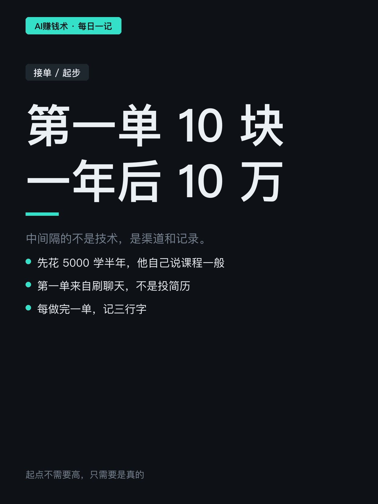
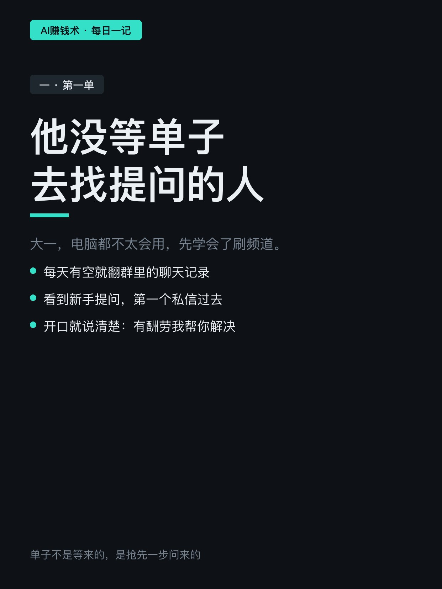
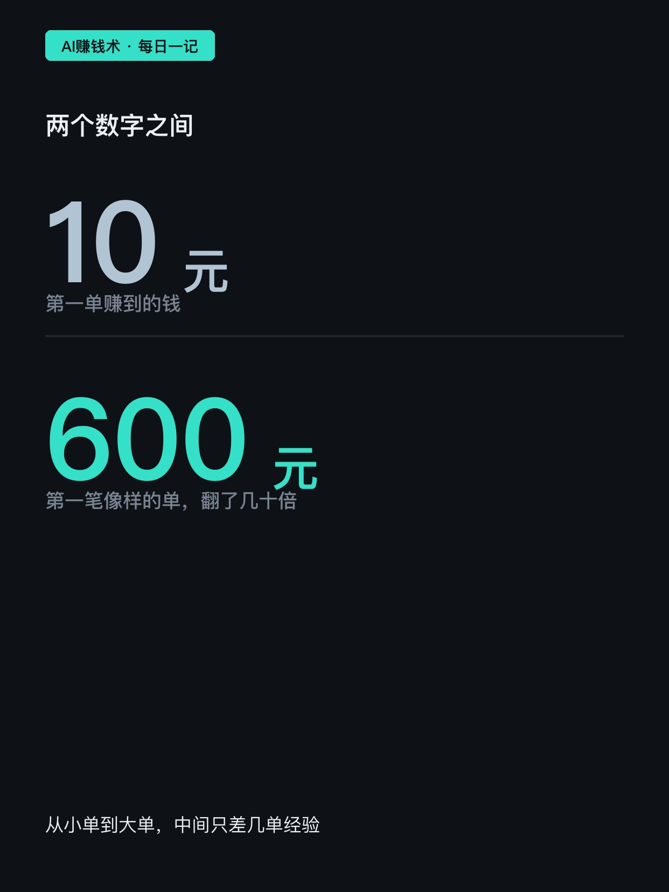
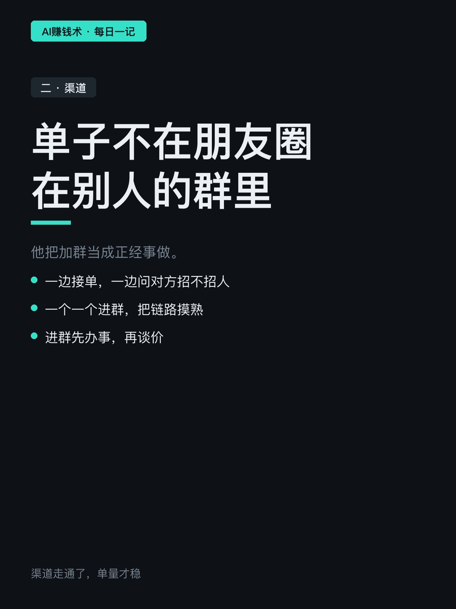
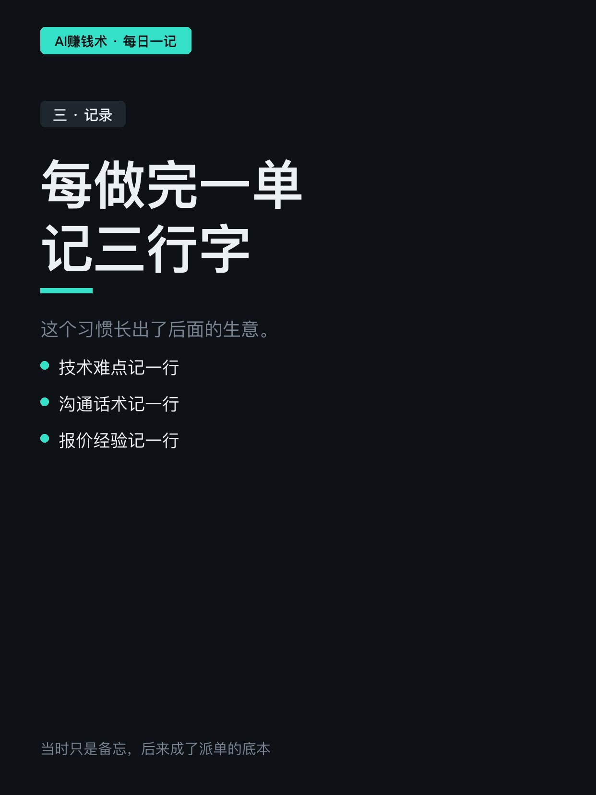
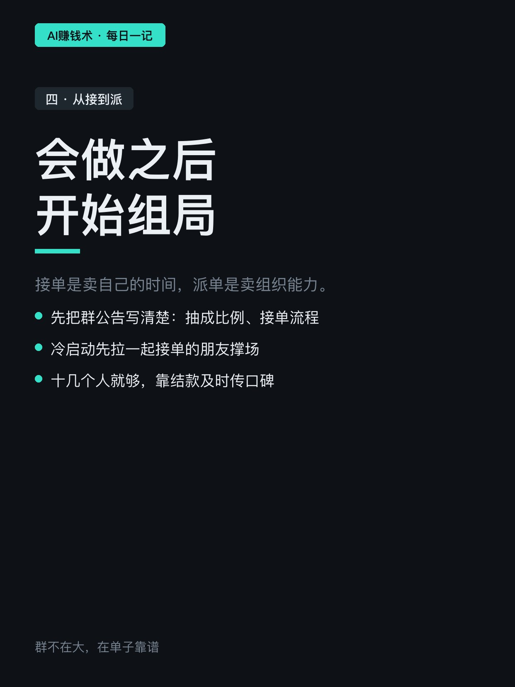
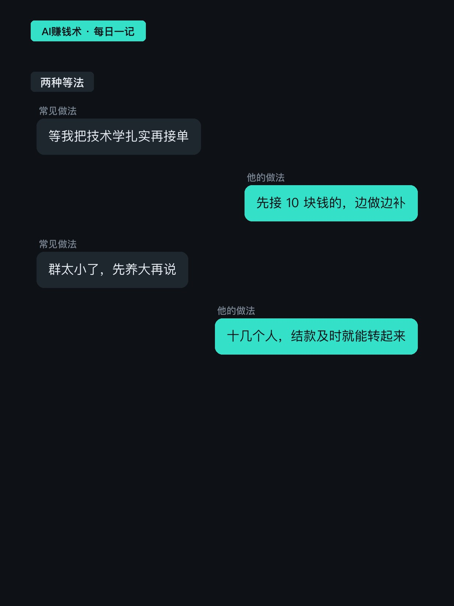
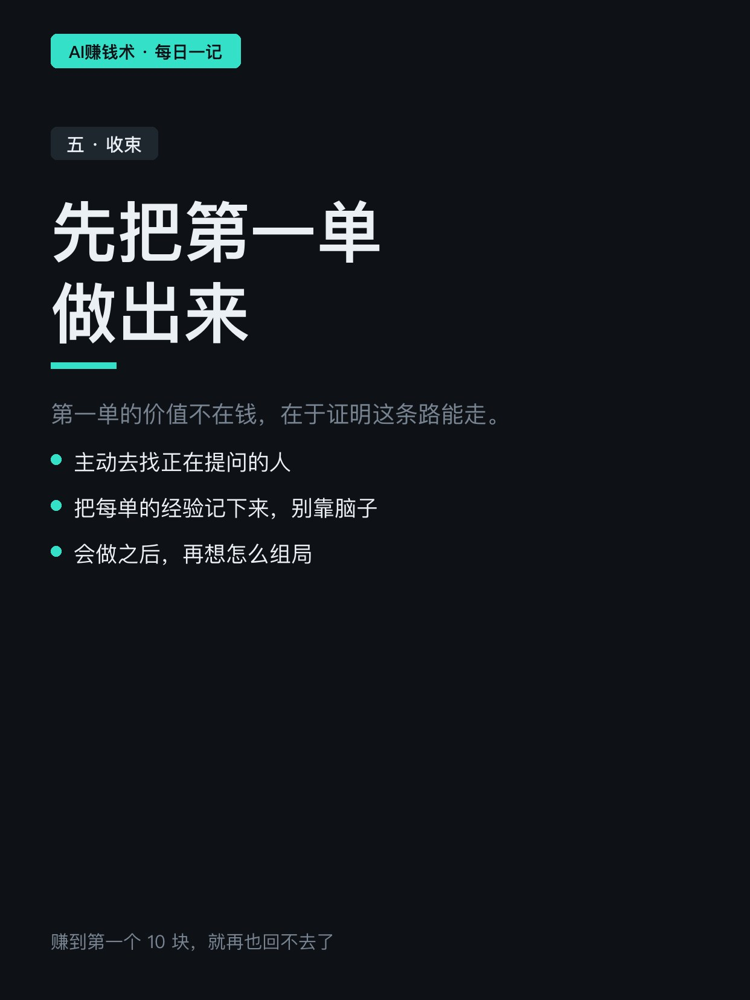

# 第一单10块钱，一年后10万

> — · 2026-11-04 17:01 发布 · AI 赚钱内容

## 标题（可直接复制）

```
第一单10块钱，一年后10万
```

## 正文（可直接复制发布）

他赚到人生第一个 10 万的时候，还在读大二。

再往前一年，他的第一单是 10 块钱。

这两个数字之间，隔着的东西不是技术，是两件事：渠道，和记录。

一、第一单怎么来的

大一时他连电脑都不太会用，先花 5000 报了个课，分期付，每月 500，学了半年。他自己写得很实在：课程质量一般，但服务不错。

学完之后，第一单不是投简历来的，是刷频道刷来的。

他每天有空就翻群里的聊天，看到有新手提问，基本第一个私信过去，说清楚：有酬劳的话我帮你解决。

第一个 10 元、第一个 100 元，都是这么来的。

单子不是等来的，是抢先一步问来的。这句话听着简单，绝大多数人做不到——因为要天天刷，还要在被拒绝很多次之后继续刷。

二、渠道是被他一格格推开的

一边接单，一边问对面：你们还招不招人，能不能把我拉进接单群。

进一个群，做完一单，再加下一个。一个月下来能挣三四千。

后来他写：整个链路我都熟了，那就说干就干。

三、真正的资产是那三行字

第一笔 600 元的单到手之后，他给自己定了个规矩：每做完一单，把技术难点、沟通话术、报价经验记进备忘录。

这个动作看起来最不像在搞钱，但后来派单时用得上的东西，全是从这些记录里长出来的。

四、从接单到派单

2025 年初，他建了自己的接单群。

建群前先把公告写清楚：抽成比例、接单流程。冷启动的做法是先拉一起接单的朋友撑场，再把合作过、聊得来的人一个个请进来。

他有个判断很准：群不在大，在单子靠谱、结款及时。十几个人，口碑自己会传开。

收尾

我们总想先变强，再开始。

他的路径是反的：先用 10 块钱证明自己能交付，再用一个个群把渠道推开，最后才谈组局。

你手上那项技能，有没有一个地方，正有人公开提问？

去回一句就行。


## 话题标签

#接单 #大学生副业 #自由职业 #AI赚钱术 #AI赚钱术日记

## 配图（8 张）










## 发布信息

| 项 | 值 |
|---|---|
| 平台 | 小红书 |
| 期数 | — |
| 发布时间 | 2026-11-04 17:01 |
| 正文长度 | 752 字 |
| 图片数量 | 8 张 |
| 状态 | 已发布 |
