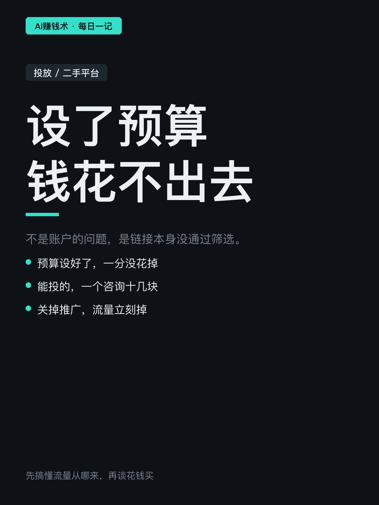

# 预算设好了，钱却花不出去

> — · 2026-11-04 20:02 发布 · AI 赚钱内容

## 标题（可直接复制）

```
预算设好了，钱却花不出去
```

## 正文（可直接复制发布）

投放最容易被误判的一句话是：现在平台越来越难做了。

我把「钱花不出去」当成一个诊断信号，而不是一句抱怨。它至少分两种情况，很多人把这两种混成一件事。

一、先分清两件事

第一种：预算设好了，系统不给量，一分钱花不出去。
第二种：能投，但一个咨询十几块、几十块，投一单亏一单。

这两种病，药完全不一样。

第一种是资格问题——链接本身没达标，系统不愿意把你的钱花出去。第二种是效率问题——漏斗在某个环节漏水。

混在一起，唯一的动作就是加预算。加预算只在第二种情况里有用，在第一种情况里，加得越多越像在赌。

二、先搞懂流量从哪来

一位做了半年二手电商的卖家写了句我认同的话：很多人连流量怎么来的都没搞明白，就开始买流量。

这话听着像废话，但可以自检：同一条链接，不花钱的时候有多少曝光、多少浏览、多少咨询、成交几单？

如果答案是零，推广不是在放大你的生意，是在替你补一个根本不存在的基础。

三、三个常被一起看到的现象

上架好几天，曝光只有几十个。
有人浏览，就是没人问。
同行同样的商品，浏览量几千上万。

这三个连着看，指向的不是预算，是这条商品本身的竞争力：主图、标题、价格带、评价。

这些东西不花钱也能改，改完当天就能看出差别。

改之前先做一次对照：找三条同行里数据最好的，把它们的主图、标题、价格带截图放在一起，和自己的比。差别通常很直观——不是你做得差，是你做得和别人一样。

四、一个顺序

先让这条商品在完全不投放时就有咨询，再拿预算去放大已经被验证的那一条。

顺序反了，钱越多越快。

具体怎么设置投放、看哪些转化指标，原文里有完整拆解，我这篇只借它一个判断：投放是放大器，不是修复器。

收尾

你那条投不出去的链接，如果把推广关掉，还有几个咨询？

这个问题答不出来，先别加预算。


## 话题标签

#投放 #电商运营 #转化率 #AI赚钱术 #AI赚钱术日记

## 配图（8 张）




## 发布信息

| 项 | 值 |
|---|---|
| 平台 | 小红书 |
| 期数 | — |
| 发布时间 | 2026-11-04 20:02 |
| 正文长度 | 762 字 |
| 图片数量 | 8 张 |
| 状态 | 已发布 |
