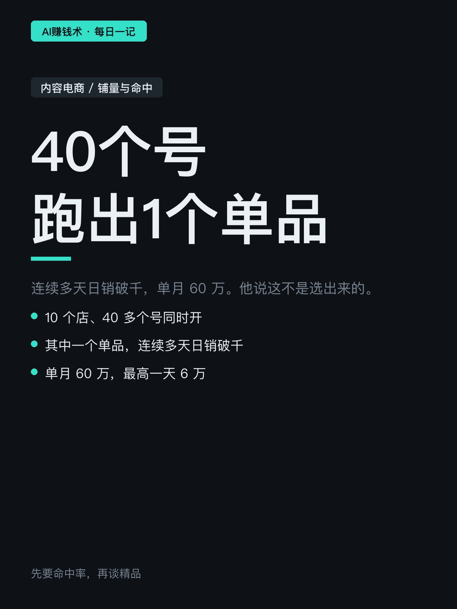
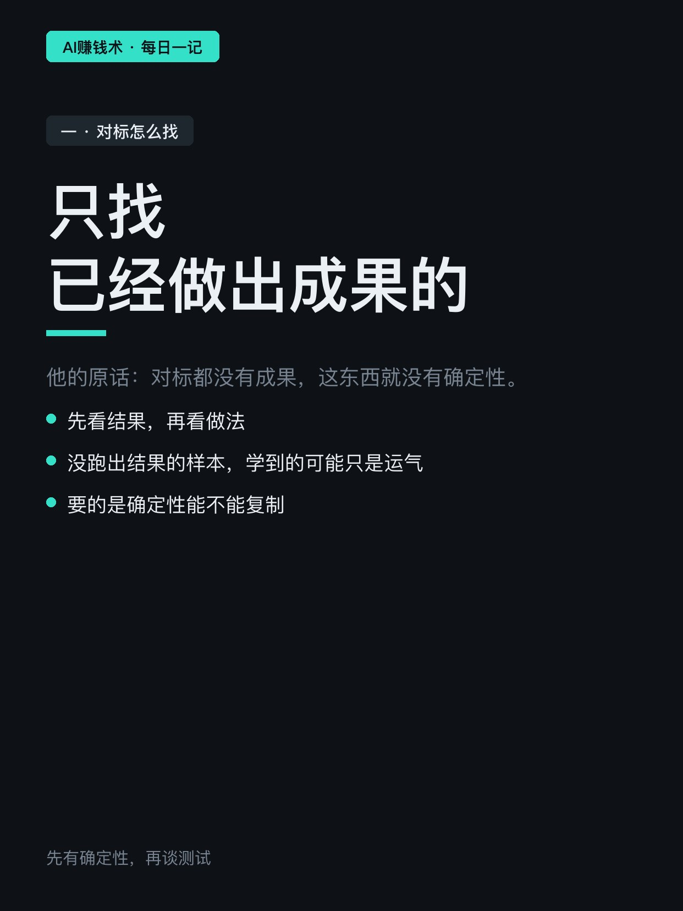
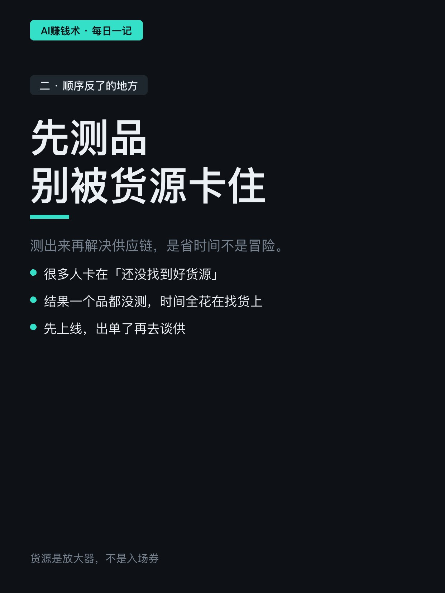
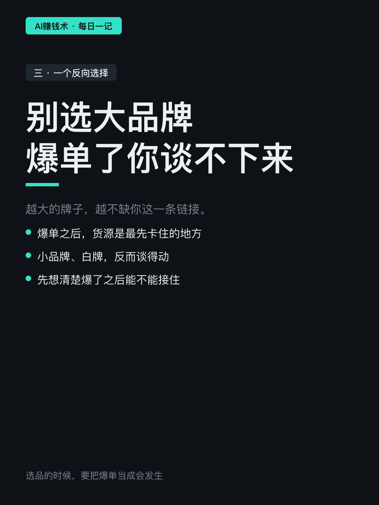
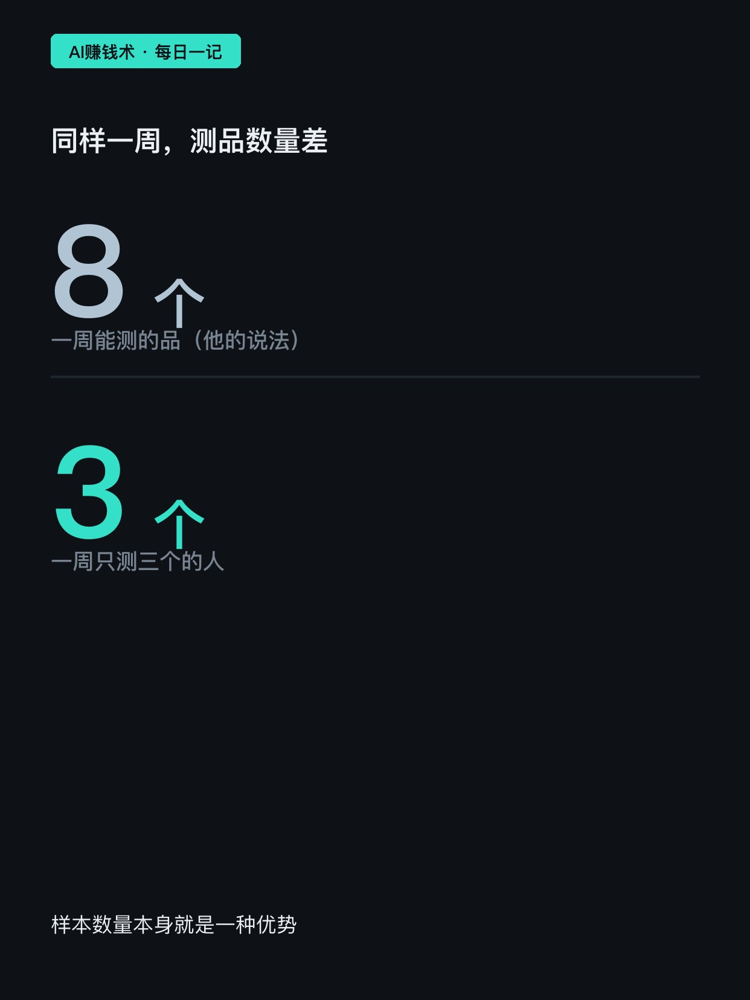
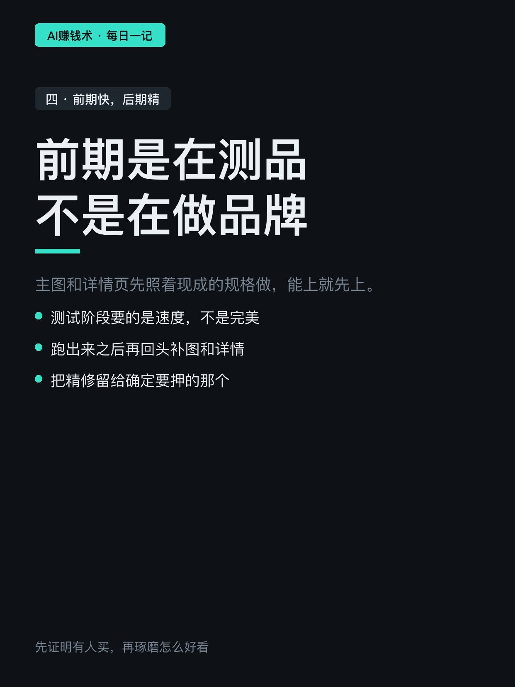
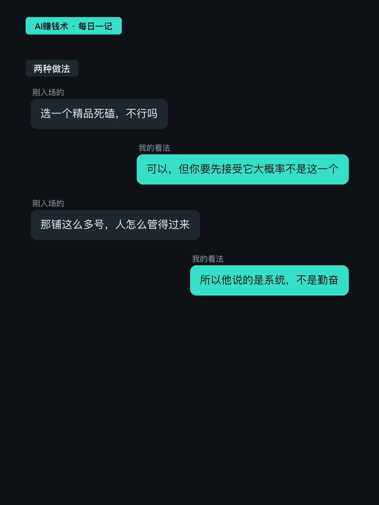
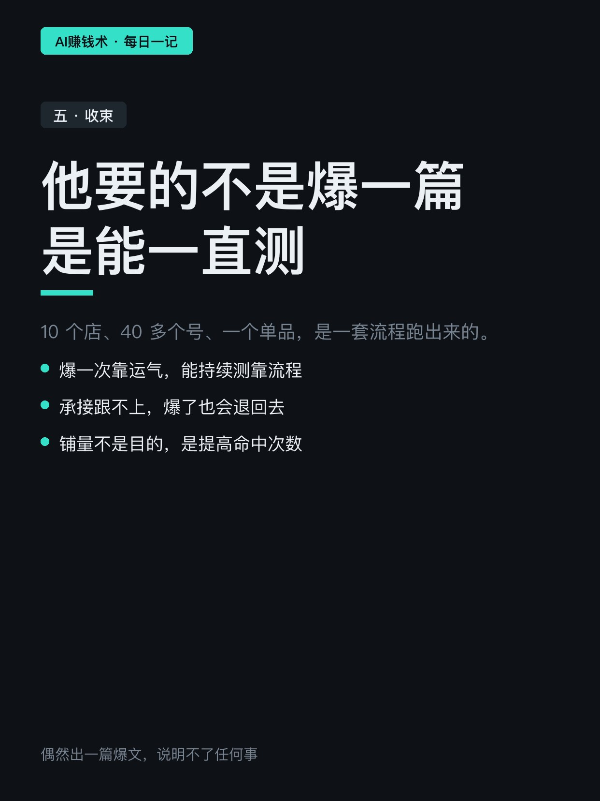

# 40个号，跑出1个日销千单

> — · 2026-11-05 16:01 发布 · AI 赚钱内容

## 标题（可直接复制）

```
40个号，跑出1个日销千单
```

## 正文（可直接复制发布）

10 个店、40 多个号，最后是一个单品连续多天日销破千，单月卖到 60 万，最高一天 6 万。他说这不是选出来的。

这人之前做家电团购，一年做到 600 万以上，后来那套逻辑被平台补贴重构了；去年年中到一家白牌电商公司，从 0 开始搭这个项目。那套家电逻辑是被平台补贴重构的：补贴一出来，原来的加价空间和获客方式同时失效。这段经历大概解释了他为什么先搭系统、再谈单品。

一、对标只找已经做出成果的

他的原话是：如果对标都没有成果，那这个东西就没有确定性。

先看结果，再看做法。没跑出结果的样本，你学到的很可能是运气，而不是方法。

二、先测品，别被货源卡住

很多人卡在「还没找到好货源」，于是一个品都没测，时间全花在找货上。他的顺序是反的：先测出来，再去谈供应链。

但选品有个反向约束——别选大品牌。原因是爆单之后，大牌的货源最不好谈，你反而被卡住。测品阶段的判断标准很粗：有没有人下单。有单再谈图和详情，没单就换下一个，不在一个不动的品上反复改。还有个隐性约束：订单解密的额度是有限的。号铺得越多，越容易在承接这一段先卡住——所以他说的系统，包含怎么分配这些额度。

三、快比精重要

前期的主图和详情页，他按现成的规格先上线。理由很直接：我们前期是在测品，不是在做品牌。

他的说法是，一周能测 8 个品的人，一定比一周只能测 3 个品的人更有优势。这是原话举例，不是他的实测数字。

还有一段容易被忽略：承接跟不上，爆了也会退回去。售后和客服直接影响店铺的品质分。

收尾

他要的不是爆一篇，是能一直测。

10 个店、40 多个号、一个单品，是一套流程跑出来的，不是勤奋堆出来的。

你手上这件事，是在赌一个精品，还是在提高命中次数？

## 话题标签

#电商运营 #选品 #铺量 #AI赚钱术 #AI赚钱术日记

## 配图（8 张）










## 发布信息

| 项 | 值 |
|---|---|
| 平台 | 小红书 |
| 期数 | — |
| 发布时间 | 2026-11-05 16:01 |
| 正文长度 | 729 字 |
| 图片数量 | 8 张 |
| 状态 | 已发布 |
