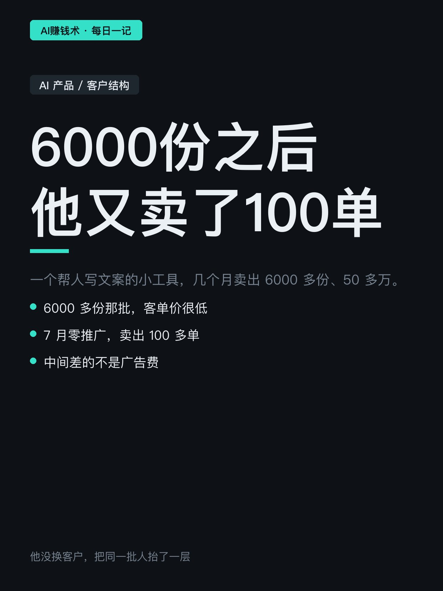
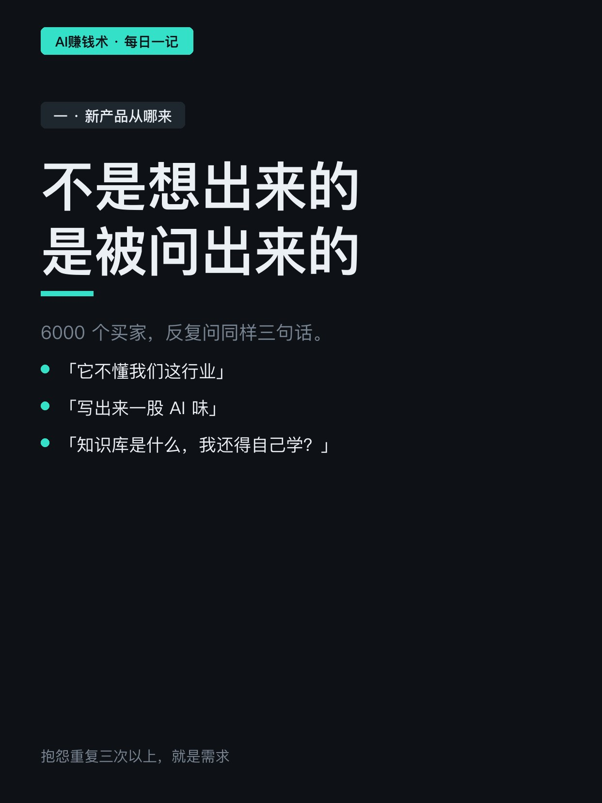
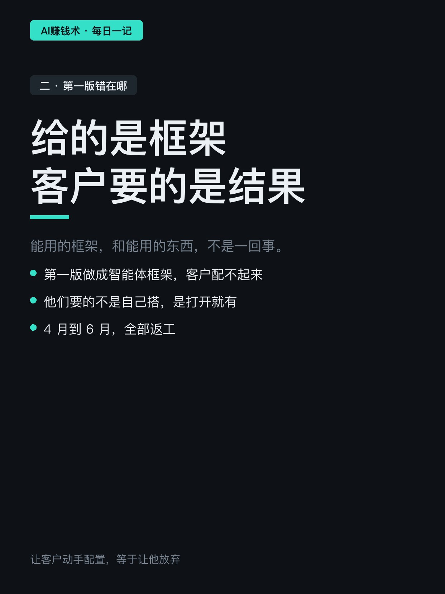
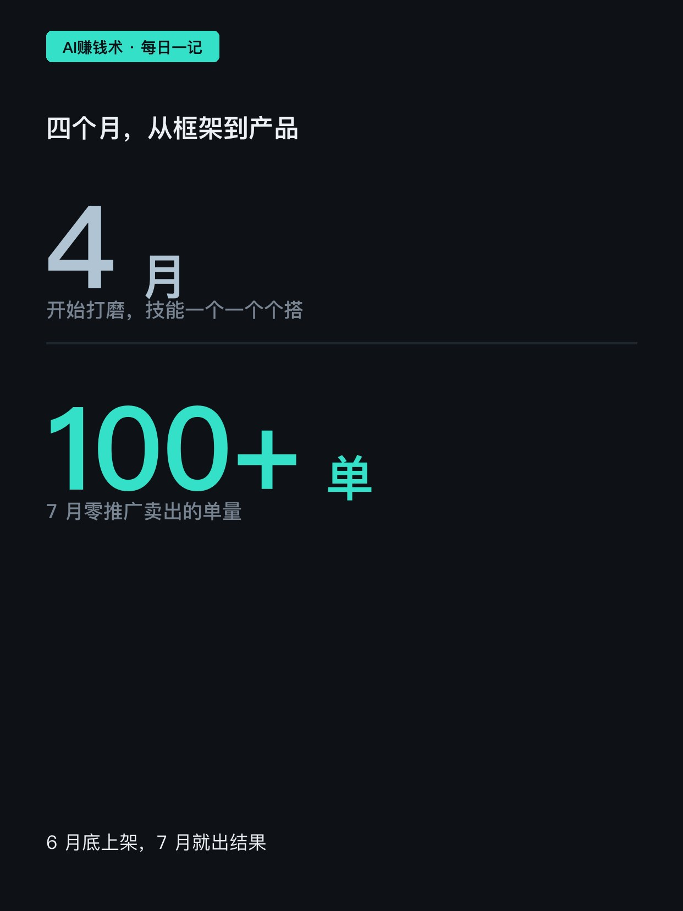
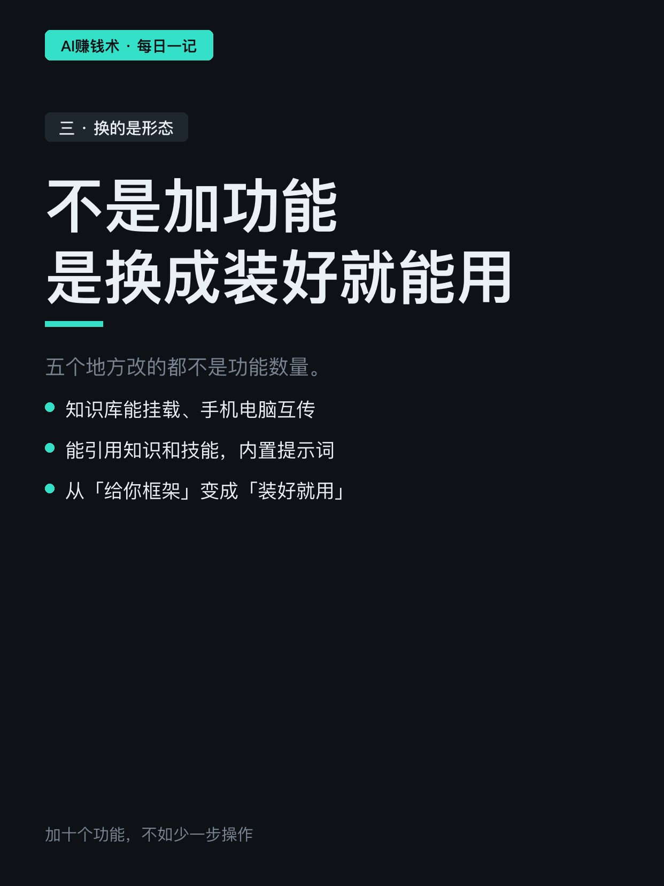
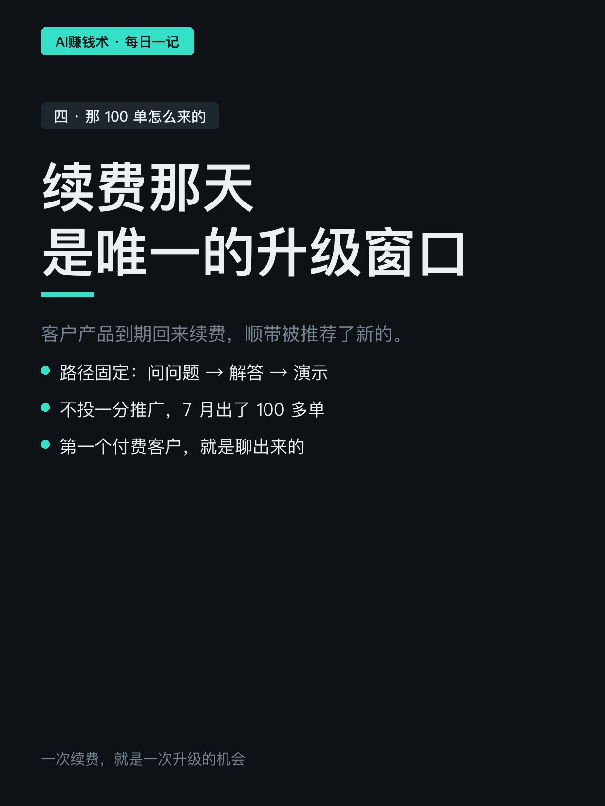
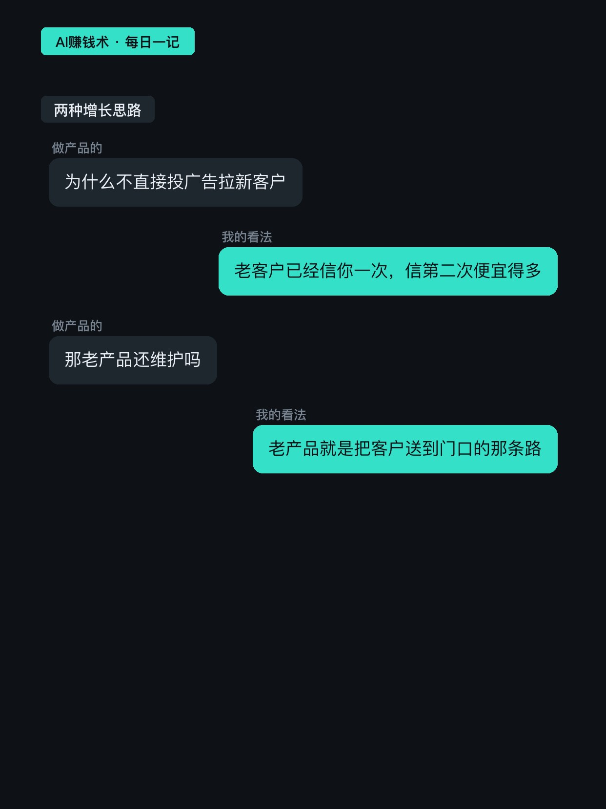
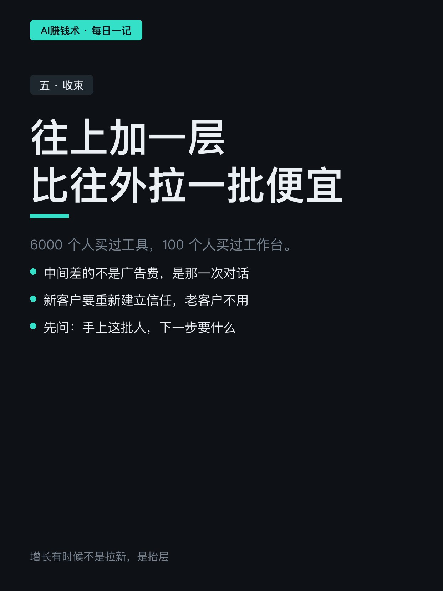

# 6000份卖完，他把客户抬了一层

> — · 2026-11-05 20:02 发布 · AI 赚钱内容

## 标题（可直接复制）

```
6000份卖完，他把客户抬了一层
```

## 正文（可直接复制发布）

一个帮人写文案的小工具，几个月卖了 6000 多份、50 多万。之后他没投一分推广，7 月又卖出 100 多单，营收六位数。

卖的还是同一批人。这是我觉得最有意思的地方。

一、新产品不是想出来的，是被问出来的

老客户反复问同样三句话：「我想让它写我们店的东西，可它不懂我们这个行业」「我想让它写得像我写的，可它写出来一股 AI 味」「知识库是什么，我还要自己去学吗」。

他的原话是：不是拍脑袋，是客户一点一点把我们喂醒的。

同样的抱怨出现三次以上，就不再是抱怨了。

二、第一版错在交付形态，不是功能

第一版做成了智能体框架，客户还是用不起来。他们要的不是一个能用的框架，而是现成的结果。

4 月到 6 月，他们把技能一个一个搭好，直接植入产品。从「给你框架自己配」，变成「装好就能用」。内测那两个多月，他们找了目标客户免费试用，一版一版改。五处交互里，有三处是客户自己提出来的。

改的五个地方也都不是加功能：知识库能挂载、手机电脑能互传、能引用知识和技能、内置提示词。全是少一步操作。

三、100 多单没花推广费

路径固定得有点朴素：客户来问问题 → 耐心解答 → 顺带演示新产品。

真正起作用的是时机：老客户产品到期回来续费那天。他的说法是，一次续费，就是一次升级的机会。

第一个付费客户，也是这么来的。8 月前 19 天比 7 月同期略少，代理端又带来 20 多单。他没把这当成下滑，因为代理那部分本来就不在他的推广计划里。

收尾

他不是换了一批客户，是把同一批客户抬到了下一层。

6000 个人买过他的工具，100 个人买过他的工作台。中间差的不是广告费，是那一次续费时的对话。

你手上已经付过钱的那批人，下一步还想要什么？

## 话题标签

#产品化 #客户经营 #AI产品 #AI赚钱术 #AI赚钱术日记

## 配图（8 张）










## 发布信息

| 项 | 值 |
|---|---|
| 平台 | 小红书 |
| 期数 | — |
| 发布时间 | 2026-11-05 20:02 |
| 正文长度 | 732 字 |
| 图片数量 | 8 张 |
| 状态 | 已发布 |
