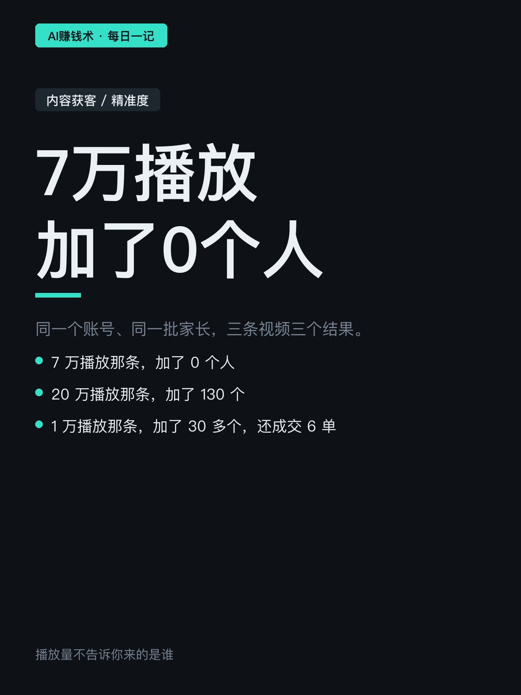
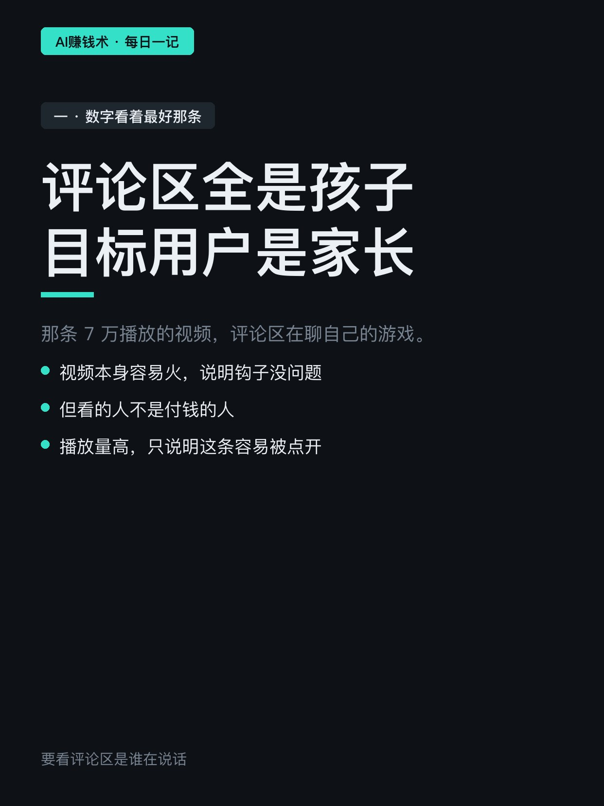
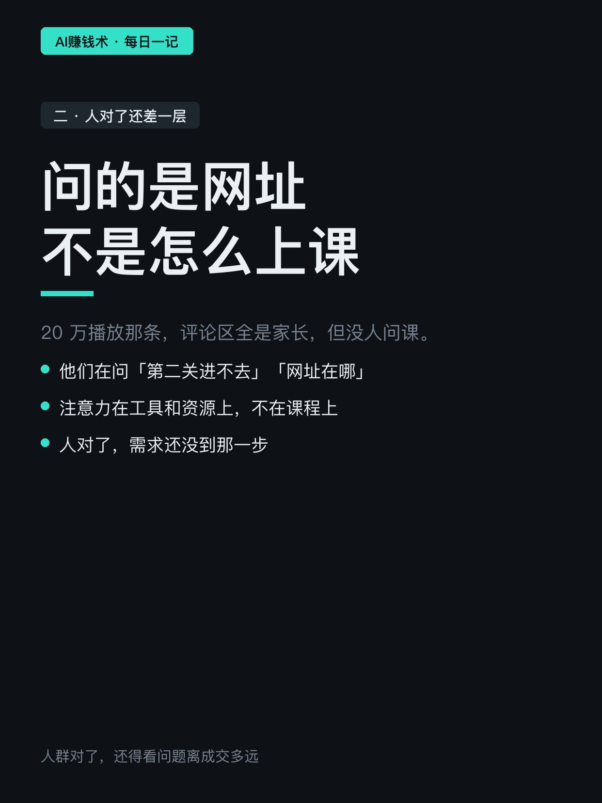
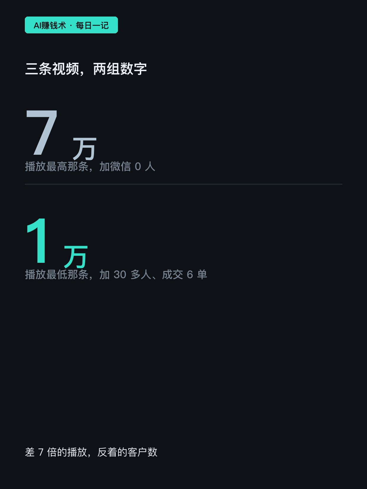
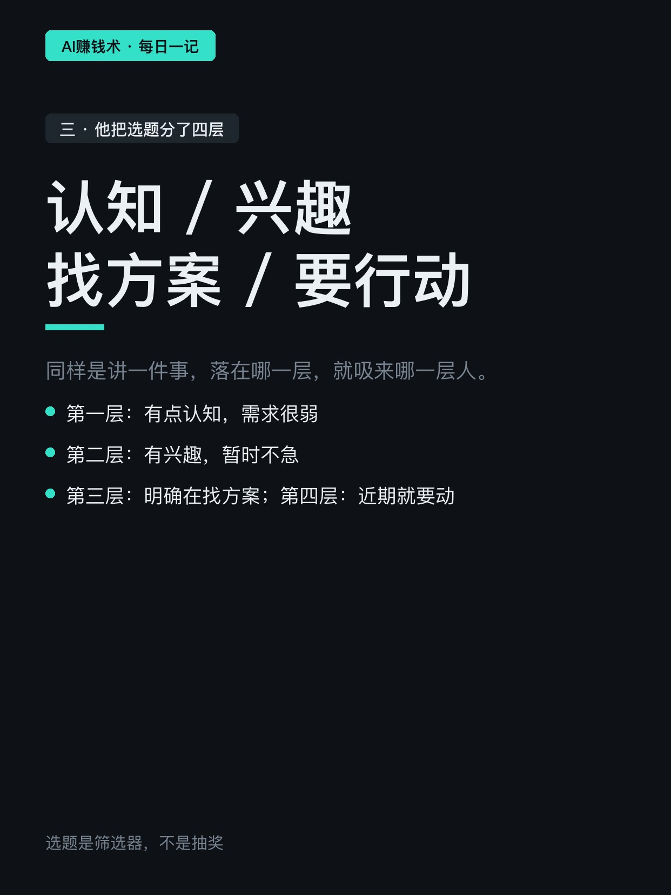
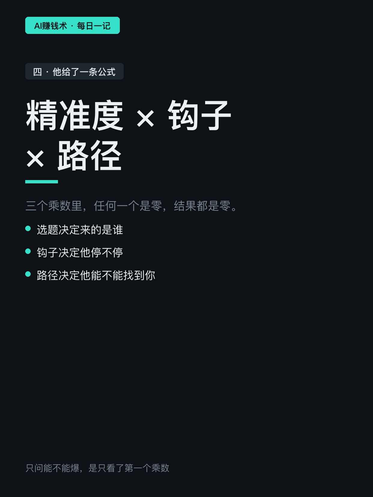
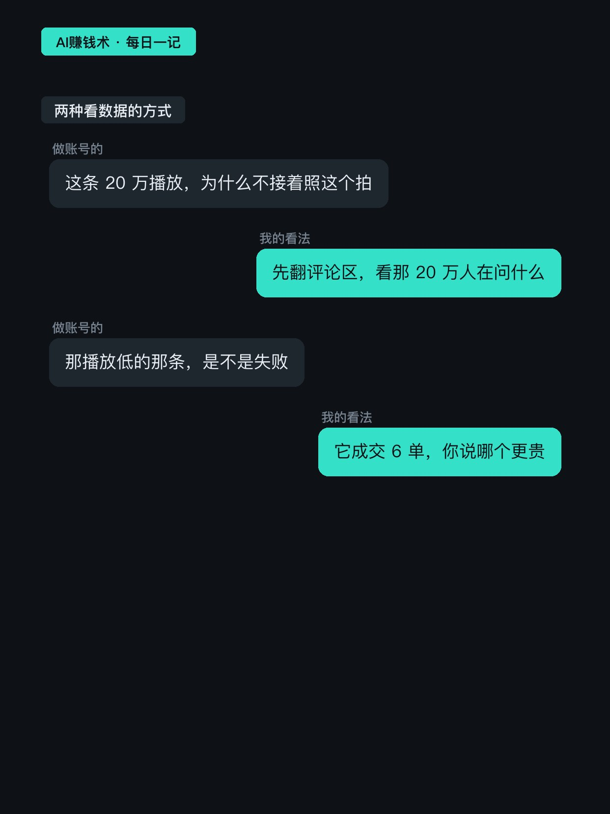
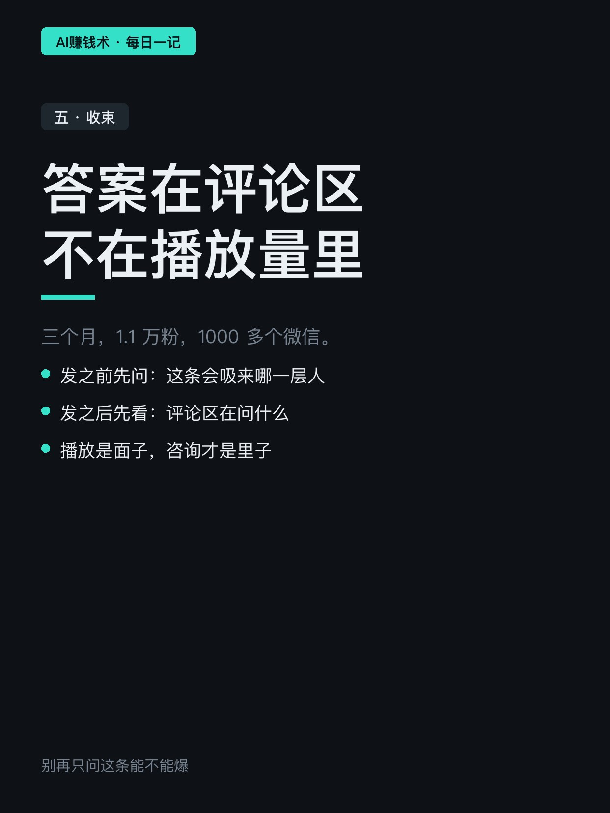

# 7万播放加0人，1万播放成交6单

> — · 2026-11-05 21:02 发布 · AI 赚钱内容

## 标题（可直接复制）

```
7万播放加0人，1万播放成交6单
```

## 正文（可直接复制发布）

同一个账号、同一批家长，三条视频：7 万播放那条，一个人都没加进来；20 万播放那条，加进来 130 个；1 万播放那条，加进来 30 多个，还成交了 6 单试听课。

以上是发布三天左右的数据。作者是做了四年短视频的操盘手，去年底出来，接的第一个号是一个做少儿科学实验课的机构，三个月做到 1.1 万粉。他找对标还有个习惯：优先看最近三到六个月内起来的内容。更早的爆款，环境和现在不是一回事。

一、播放量只说明这条容易火

7 万那条，评论区全是小孩在讲自己的游戏。而付钱的是家长。

视频本身没问题，钩子也没问题，就是看的人不是买的人。播放量不告诉你来的是谁。

二、人对了，还差一层

20 万那条，评论区不再有孩子，全是家长。但他们问的是「网址哪里有」「第二关进不去」。

注意力在工具和资源上，不在课上。人对了，需求还没到那一步。评论区里值得盯的信号只有两类：一类是求资料，一类是问价格和怎么学。前者是注意力，后者才是需求。第三条挂车成交的是试听课，不是正课。他特意把这两层分开算，因为试听课的成交门槛低得多，拿它当正课成绩看会高估自己。

第三条问的是「老师怎么跟着你们上课、开线上课吗」。同样是家长，问的问题离付钱近得多。

三、选题是筛选器，不是抽奖

他把选题分了四层：有点认知但需求弱、有点兴趣暂时不急、有明确问题在找方案、需求明确近期就要行动。

还给了一条公式：选题精准度 × 钩子匹配度 × 路径顺畅度。三个乘数里任何一个是零，结果都是零。

所以发之前该多问一句：这条会吸来哪一层人。

收尾

答案在评论区里，不在播放量里。

播放是面子，来问的人才是里子。

你最近数据最好的那条内容，评论区在问什么？

## 话题标签

#内容获客 #选题 #评论区 #AI赚钱术 #AI赚钱术日记

## 配图（8 张）










## 发布信息

| 项 | 值 |
|---|---|
| 平台 | 小红书 |
| 期数 | — |
| 发布时间 | 2026-11-05 21:02 |
| 正文长度 | 718 字 |
| 图片数量 | 8 张 |
| 状态 | 已发布 |
