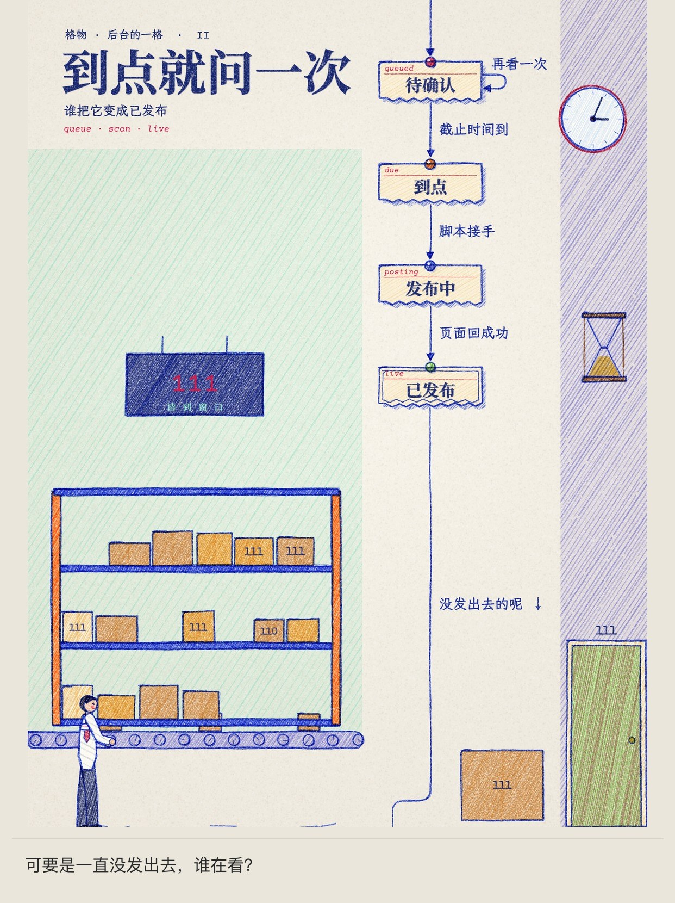
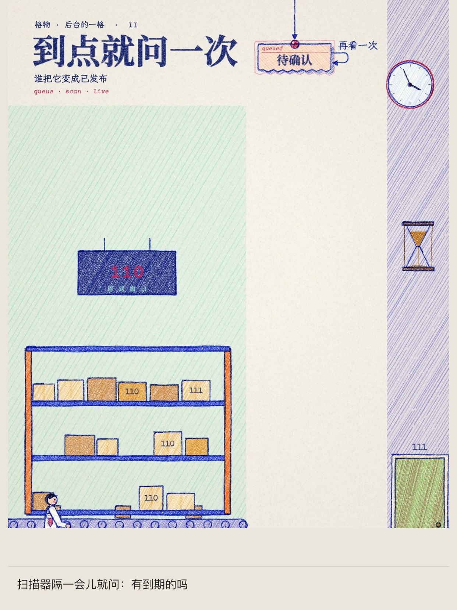
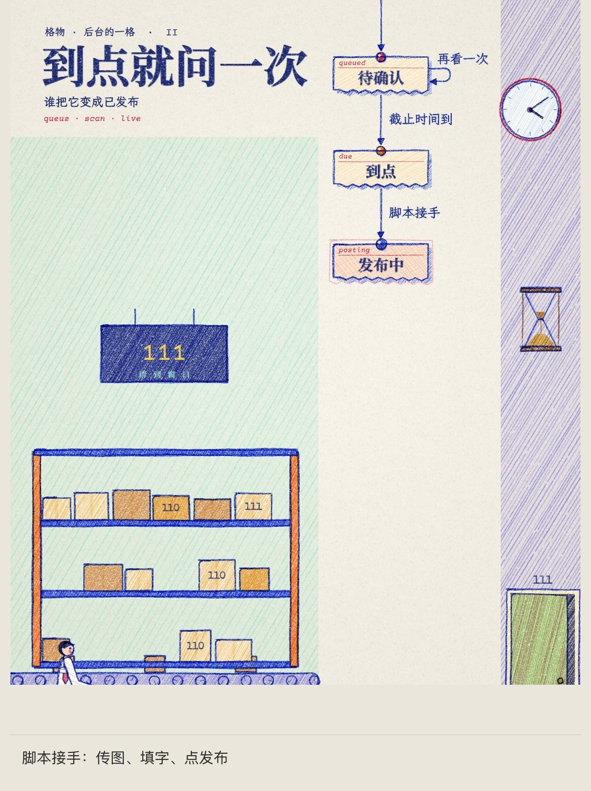
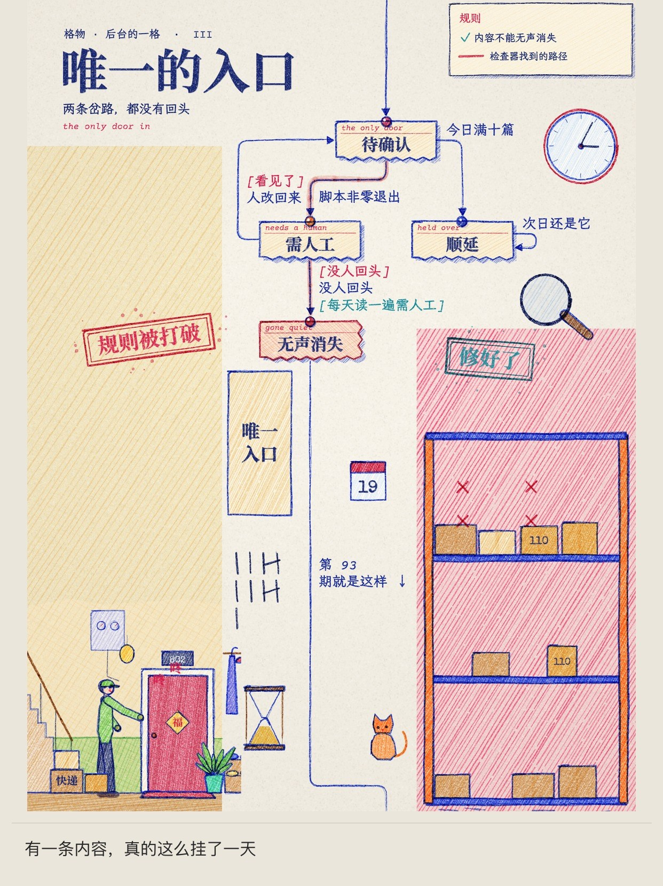
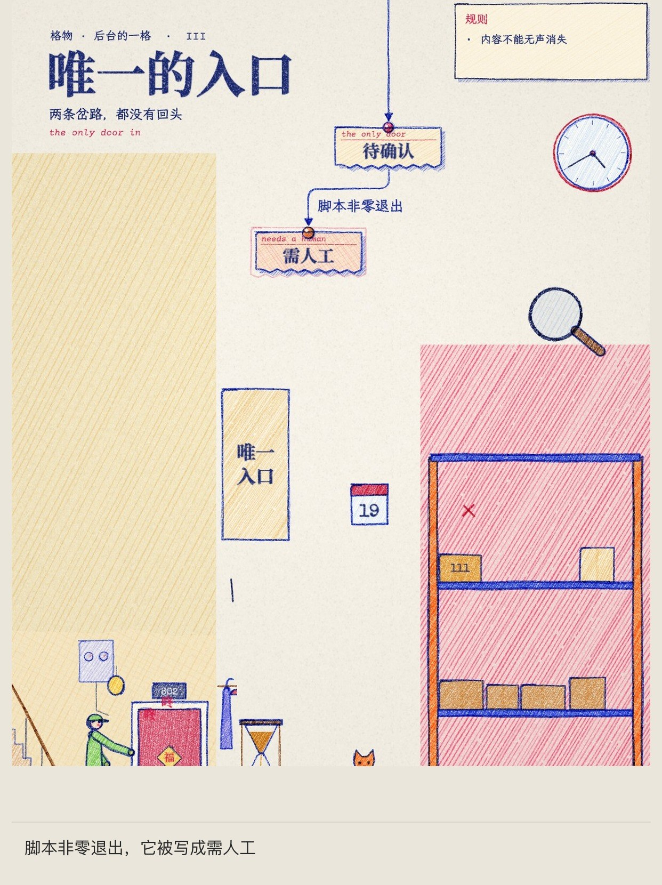
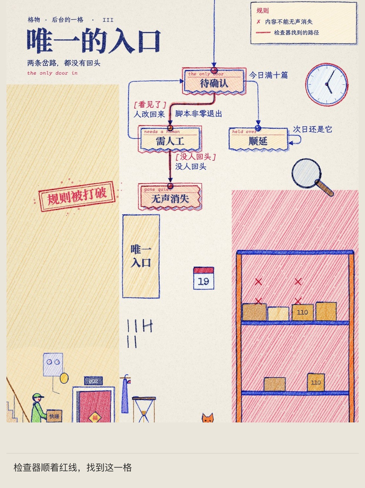
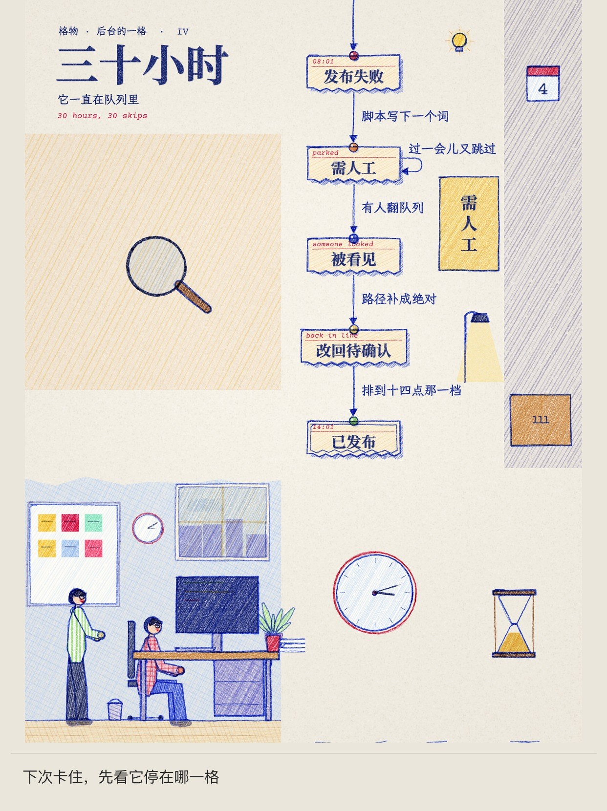
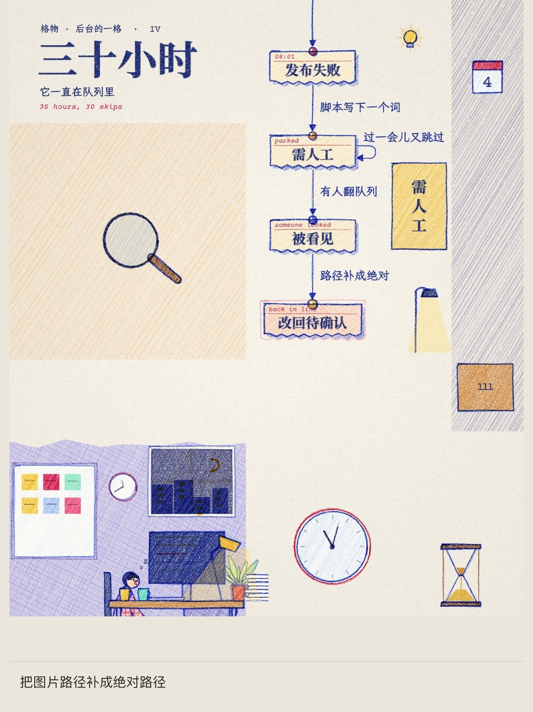

# 一个斜杠，卡了30小时

> — · 2026-11-05 12:33 发布 · AI 赚钱内容

## 标题（可直接复制）

```
一个斜杠，卡了30小时
```

## 正文（可直接复制发布）

内容全做完了：图齐了，字过了检查，标题也定了。它在队列里躺了三十个小时，没发出去。第二天翻后台才发现，问题不是内容，是我写的图片路径少了一截。

我给自己的账号做了个定时发布的小流水线，跑了一个多月。做法很土：一篇内容做完，在待发表里加一行，写上「待确认」和截止时间；一个每两分钟跑一次的脚本去扫这张表，到点就调发布脚本。跑顺的时候很省心——今天九篇，从下午一点到晚上十点，每篇误差一两分钟（自述，后台记录）。

十一月三日早上八点，轮到期数 93 那篇。脚本报错退出：图片文件找不到。原因是我在发布包里写的是相对路径，脚本却在另一个目录下运行，那个路径在它眼里指向了别处。一个斜杠，三十个小时。

一、原理
定时发布不是一个动作，是一串状态的迁移：待确认、到点、发布中、已发布。每一格都得有两条边，进来的和出去的。我的脚本只认「待确认」三个字，所以它一失败，就把状态改写成「需人工」。从那一刻起，这条内容在之后所有扫描里都不存在了——不是发不出去，是不再被看见。看起来像暂停，其实是终点。

二、代价
出错的时候，最贵的不是「发晚了」，是「没人知道它晚了」。那一整天，扫描器每小时问一次「有到期的吗」，三十次都答得很正确：没有。日志干干净净，全是「无到期内容」。三十次正确的判断，合起来是一次事故。而真正错的不是发布环节：发布逻辑一行没错，错的是跟发布毫无关系的路径写法。同类的坑还有第二个：当天已满十篇的会被改成「顺延」，那条边同样没有回程。

三、边界
程序能保证按时，不能保证「发不出去时有人知道」。它还能重试，但我选了不重试——宁可停，也不要同一篇发两遍。这个取舍一落地，最后那一格就必须是人：每天有人把「需人工」和「顺延」读一遍，改回待确认。我后来做的第一件事不是改脚本，是加了一条规矩：任何不是「已发布」的状态，第二天早上必须有人看见。

修完那天我把扫描从每小时改成每两分钟，想着扫得勤总能撞上。其实没有，扫得越勤，只是把「跳过它」做得更利索。真正的修补是把那条断掉的边画回去。

你手上正在自动跑的东西，有几个状态是程序写进去、但只有人才能改回来的？如果答得上来「有三个」，它们现在大概正安静地挂着。

## 话题标签

#AI赚钱术日记 #自动化 #内容生产 #工作流 #踩坑记录

## 配图（12 张）












## 发布信息

| 项 | 值 |
|---|---|
| 平台 | 小红书 |
| 期数 | — |
| 发布时间 | 2026-11-05 12:33 |
| 正文长度 | 909 字 |
| 图片数量 | 12 张 |
| 状态 | 已发布 |
