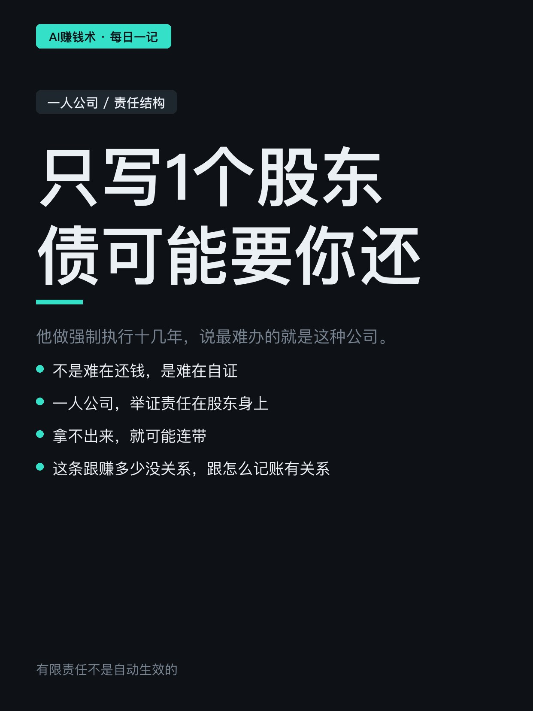
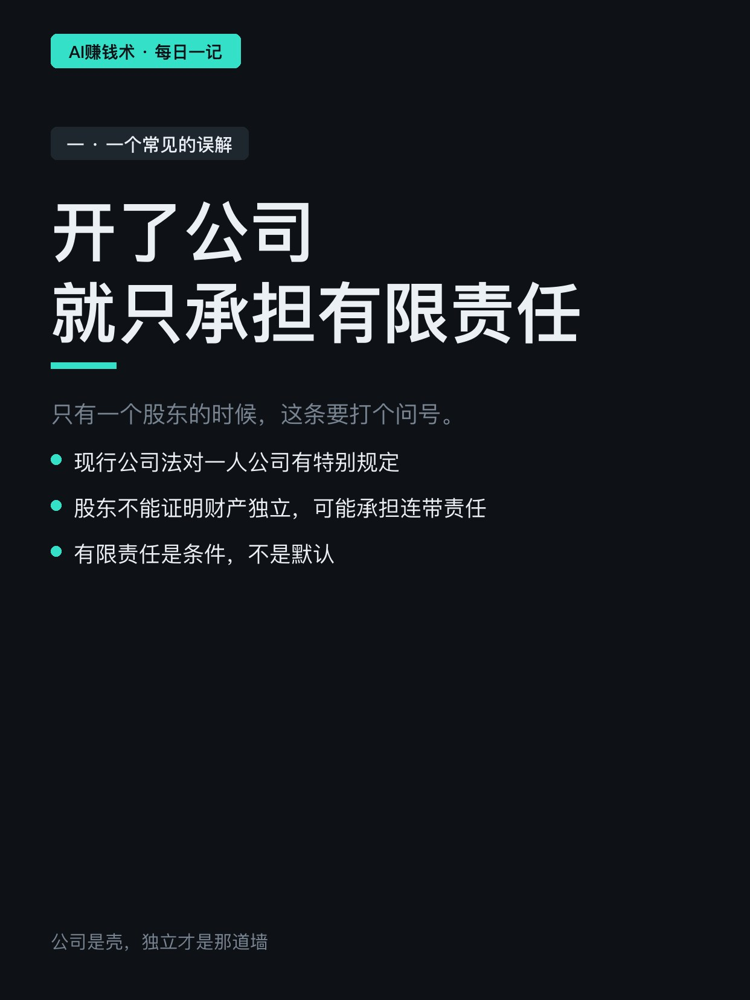
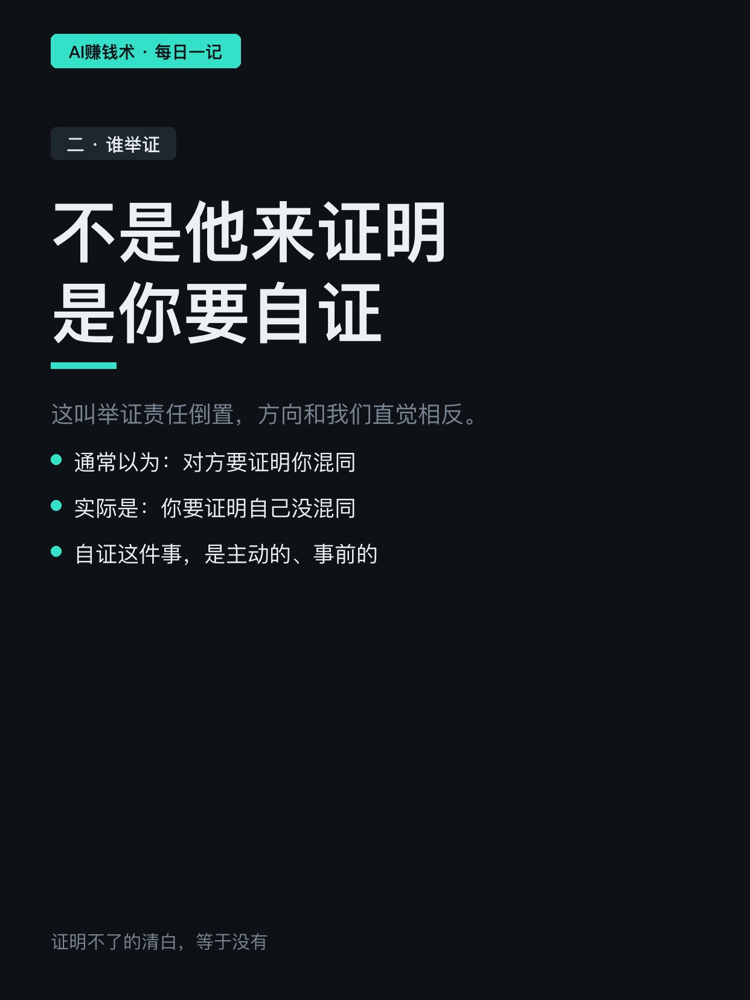
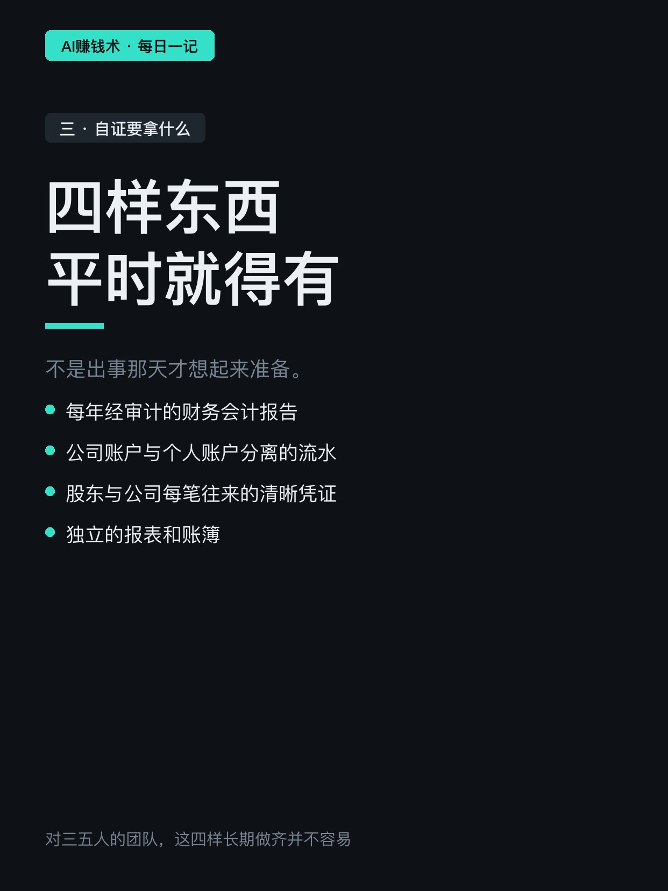
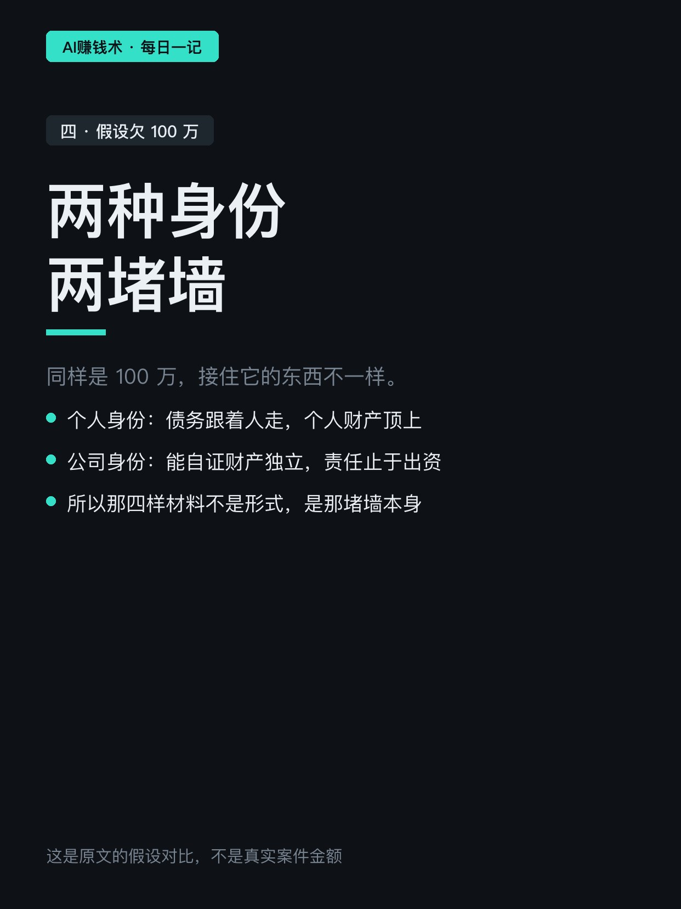
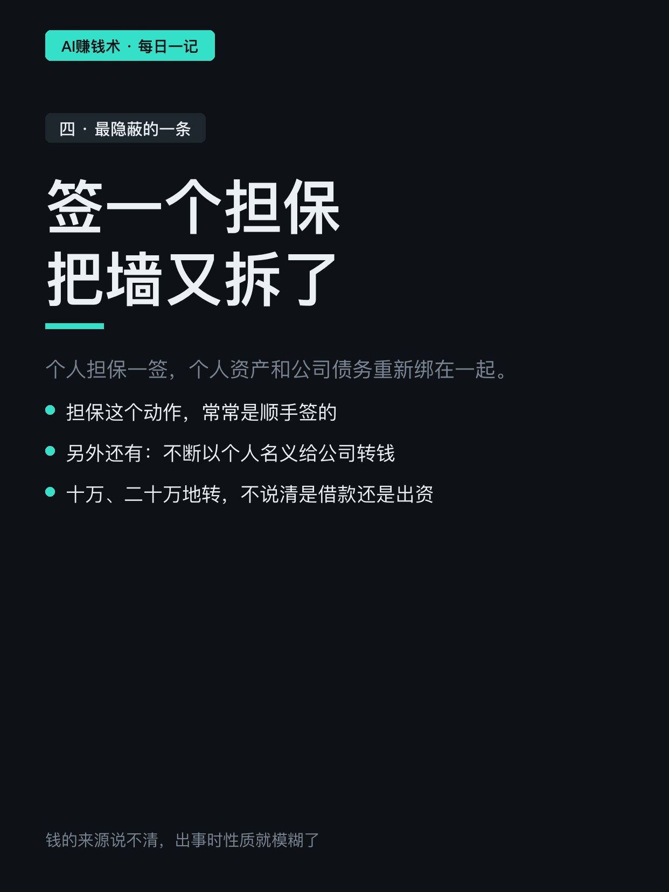
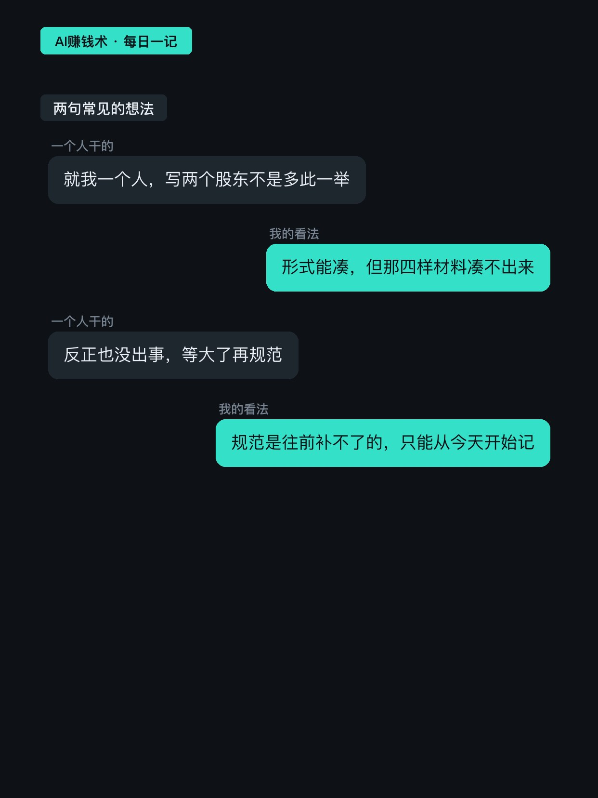
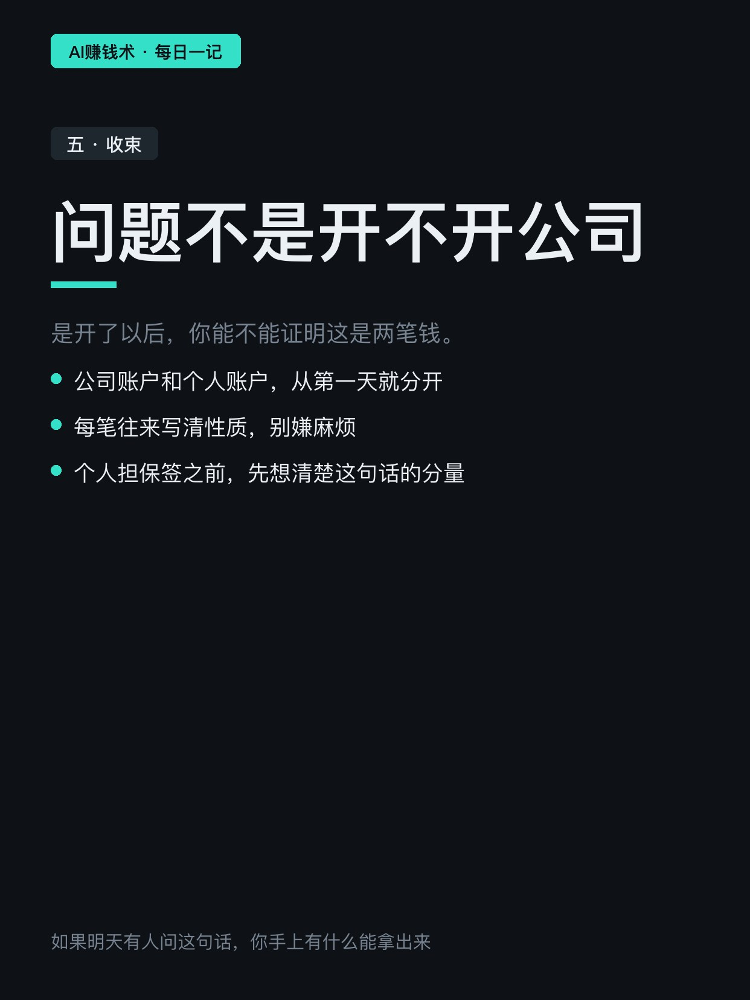

# 公司只写1个股东，债可能要你还

> — · 2026-11-05 22:02 发布 · AI 赚钱内容

## 标题（可直接复制）

```
公司只写1个股东，债可能要你还
```

## 正文（可直接复制发布）

他做合规与强制执行十几年，经手的案子标的最小的上百万、最大的上亿。他说最难办的一种公司，是只有一个股东的那种。

难的不是还钱，是自证。

一、有限责任不是默认生效的

现行公司法对一人公司有特别规定：只有一个股东的公司，股东不能证明公司财产独立于自己的财产，可能要对公司债务承担连带责任。

很多人以为开了公司就只承担有限责任，这是个条件句，不是默认值。

二、举证责任是倒置的

通常的直觉是：对方得证明你把公司钱和自己钱混在一起了。

实际方向是反的——你要自己证明没混同。

要拿出来的东西很具体：每一会计年度经审计的财务会计报告、公司账户与个人账户严格分离的流水、股东与公司之间每一笔资金往来的清晰凭证、独立的报表和账簿。

他的原话是，对小团队来说，长期把这些做得足够清楚，实际上并不容易。

三、更隐蔽的一条是个人担保

一个签字，就把个人资产和公司债务重新绑在一起了。

还有一种更常见的：股东不断以个人名义给公司转钱，今天十万明天二十万，却不说清是借款还是出资。出事时这笔钱的性质就模糊了，对方可以主张出资不实。还有一类主体容易被忽略：个体户。个人经营的债务由个人财产承担；家庭经营，或者财产分不清的，可能连家庭财产一起搭进去。

这篇只是把他见过的死法和法律怎么规定的写出来，不是法律建议。他自己的公司欠过半年薪，靠提前存够一年的生活费撑住。他给的算法很土：每月必要支出乘以 6 到 12 个月；每笔个人收入到账，先留 10%。

收尾

所以问题不是「要不要开公司」，是「开了以后，你能不能证明这家公司的钱和你的钱是两笔钱」。

如果明天有人来问这句话，你手上有什么能拿出来？

## 话题标签

#一人公司 #责任边界 #创业常识 #AI赚钱术 #AI赚钱术日记

## 配图（8 张）










## 发布信息

| 项 | 值 |
|---|---|
| 平台 | 小红书 |
| 期数 | — |
| 发布时间 | 2026-11-05 22:02 |
| 正文长度 | 699 字 |
| 图片数量 | 8 张 |
| 状态 | 已发布 |
