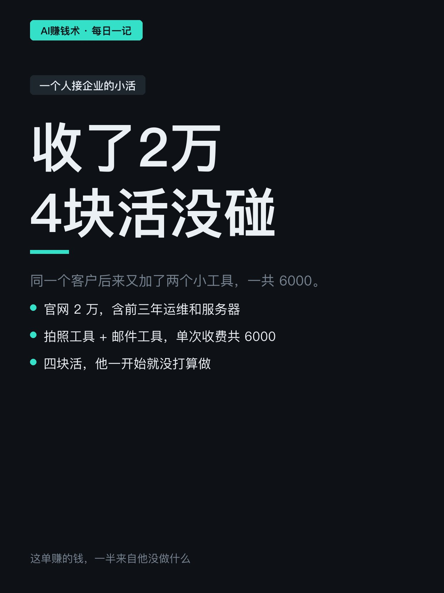
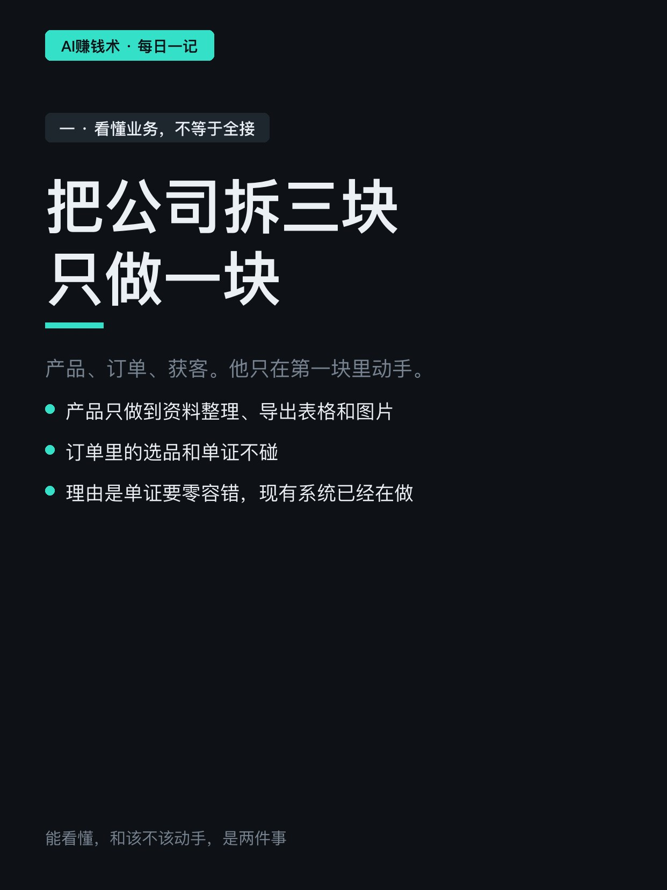
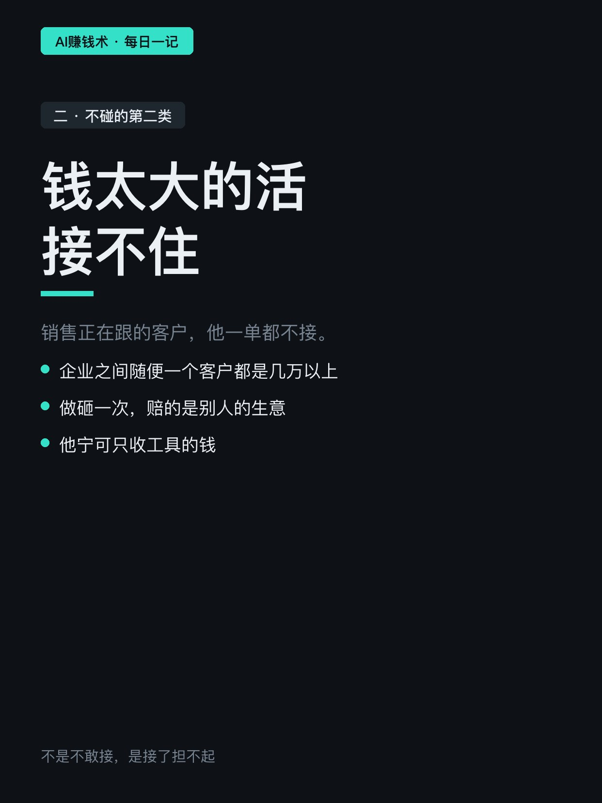
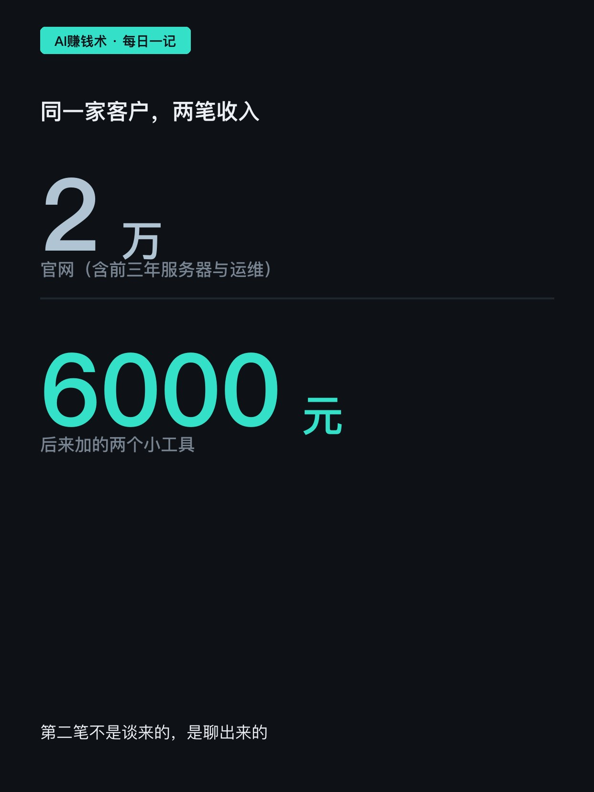
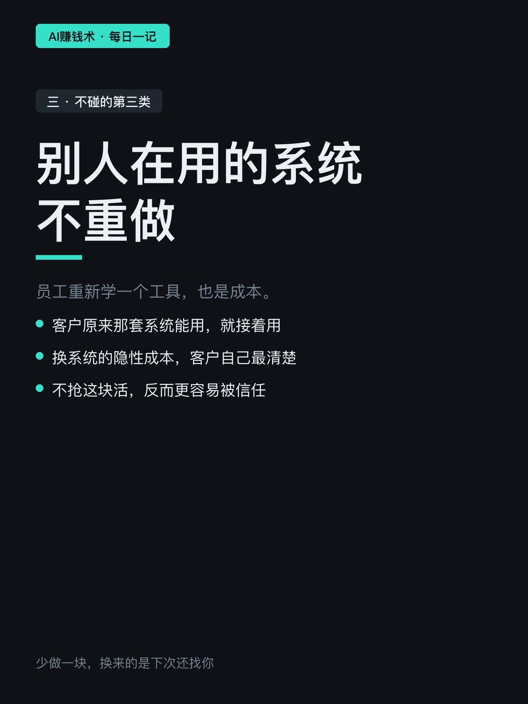
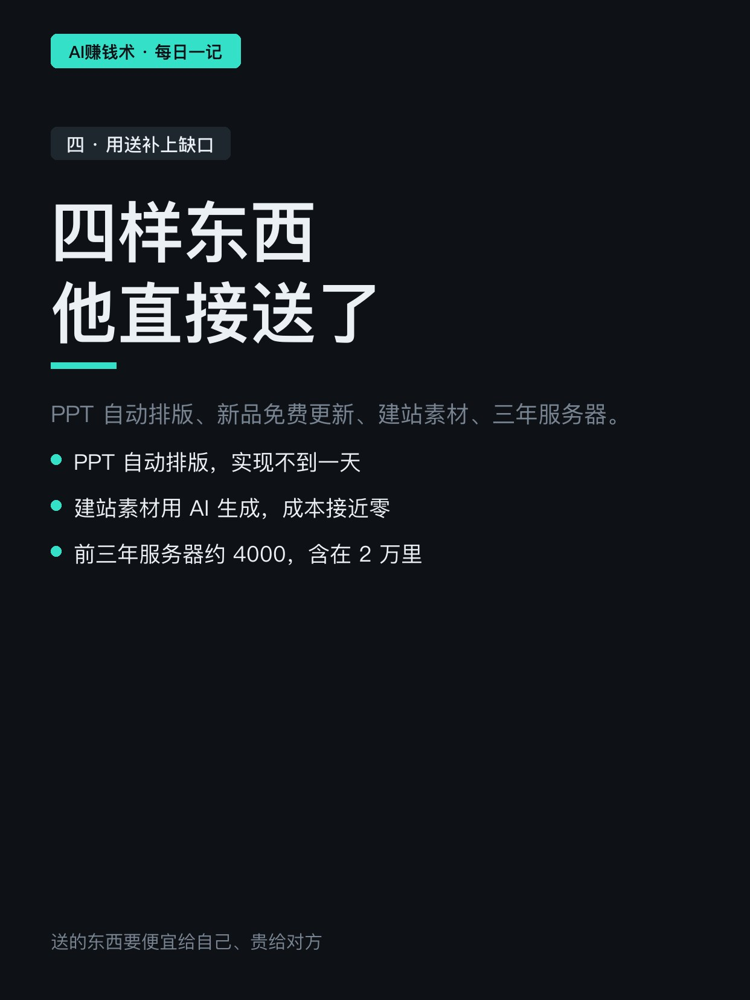
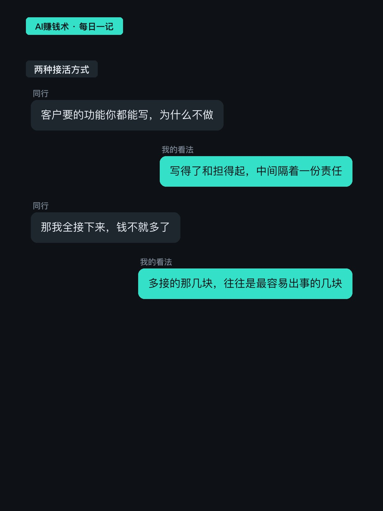
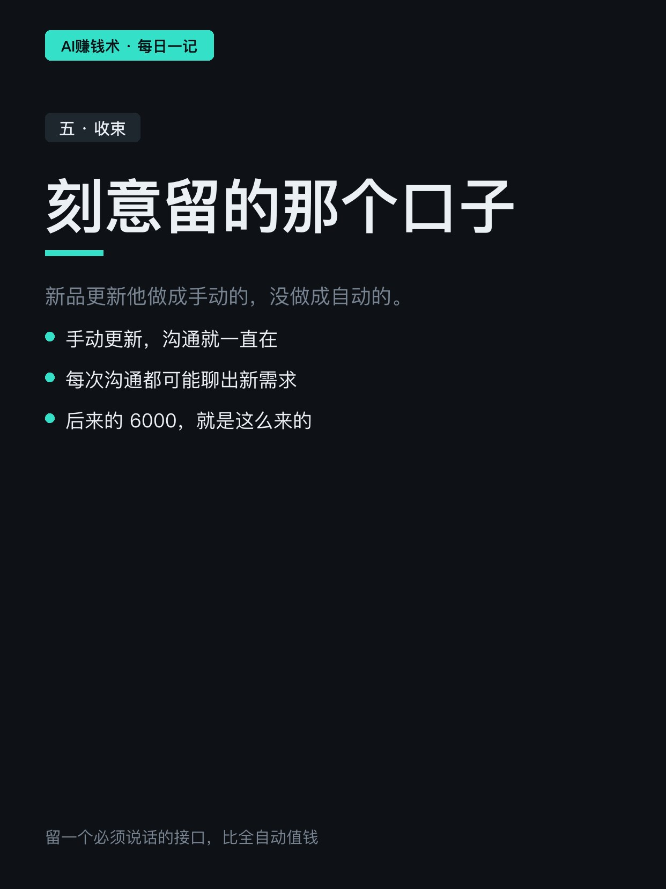

# 收了2万，4块活他没碰

> — · 2026-11-05 15:01 发布 · AI 赚钱内容

## 标题（可直接复制）

```
收了2万，4块活他没碰
```

## 正文（可直接复制发布）

一个外贸官网，他收了 2 万。同一家客户后来又加了两个小工具，一共 6000。但他有四块活，从头到尾没碰。

客户是厦门一个三人的外贸团队，原来主要靠线下展会拿客户。他是下班和周末做的，网站一个多月，两个工具一个多星期，整体约两个月。网站一个多月，两个工具各一个多星期，全是碎片时间。折算下来约等于本职日薪的三倍——他没辞职，也没接第二个客户。

一、看懂业务，不等于全都自己做

他把客户公司拆成三块：产品、订单、获客。产品这块只做到资料整理、导出表格和图片为止。

订单里的选品和单证，他不碰。理由很实在：单证要求零容错，而且现有系统已经在做。

二、不碰的两类活

一类是钱太大的。销售正在跟的客户，他一单都不接，因为企业之间随便一个客户都是几万以上，做砸一次赔的是别人的生意。

另一类是别人已经在用的系统。客户原来那套能用就接着用，员工重新学一个工具，也是成本。还有一类：没有接口的系统，他不做非正规上传。要么对方给正规通道，要么这块不做。技术上他也换过一次：第一版用现成的建站程序，后来放弃，改成用 AI 编程从零做。原因不是那套不好，是客户要的功能全在后台，套模板反而更慢。

三、不做的部分，用送补上

他送了四样：PPT 自动排版，实现不到一天；新品免费更新；建站素材，用 AI 生成；前三年服务器也含在 2 万里。

还有个细节我印象很深：新品更新他故意做成手动的，没做成自动的。手动更新，沟通就一直在，每次沟通都可能聊出新需求——后来的 6000，就是这么来的。

收尾

这单赚的钱，一半来自他做了什么，一半来自他没做什么。

刻意留一个必须说话的接口，比全自动值钱。

你手上那个项目，有没有一块活是你本来可以不接的？

## 话题标签

#接单 #自由职业 #交付边界 #AI赚钱术 #AI赚钱术日记

## 配图（8 张）










## 发布信息

| 项 | 值 |
|---|---|
| 平台 | 小红书 |
| 期数 | — |
| 发布时间 | 2026-11-05 15:01 |
| 正文长度 | 722 字 |
| 图片数量 | 8 张 |
| 状态 | 已发布 |
