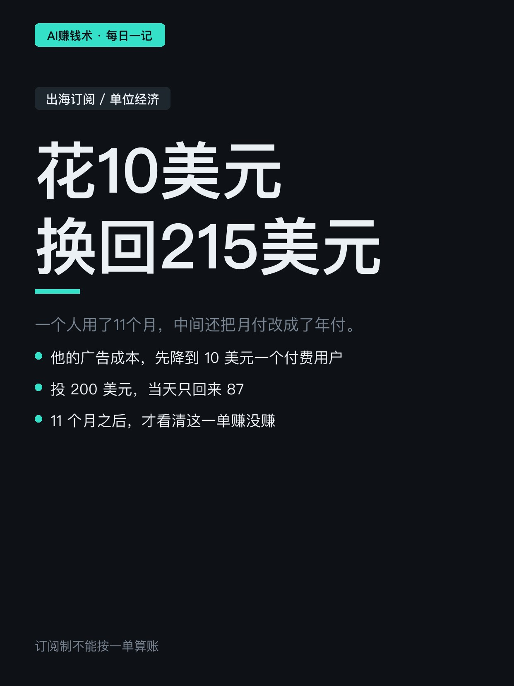
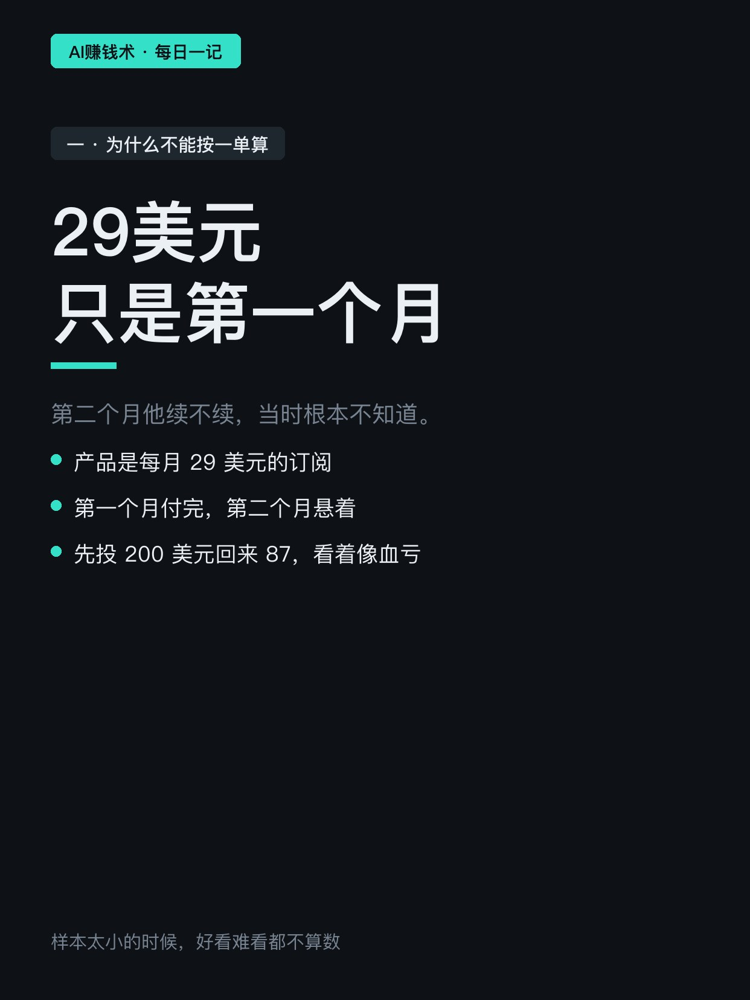
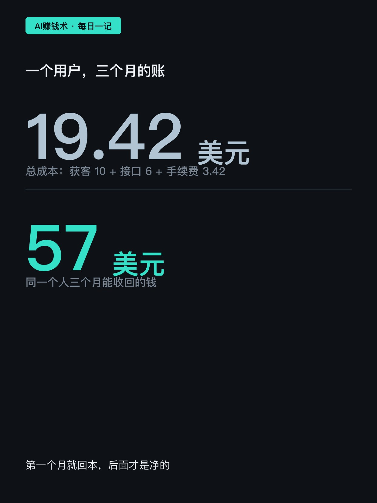
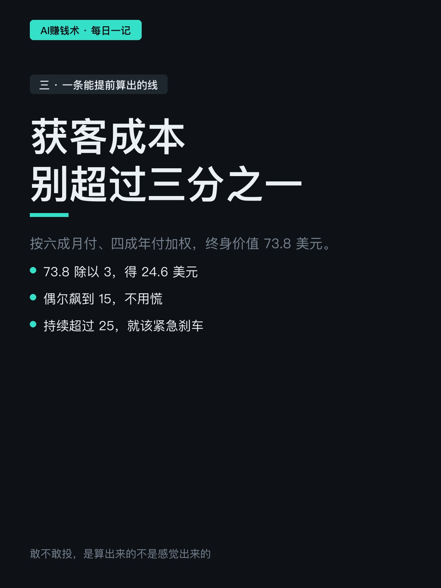
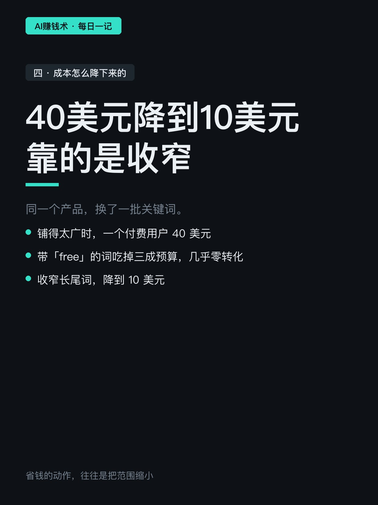
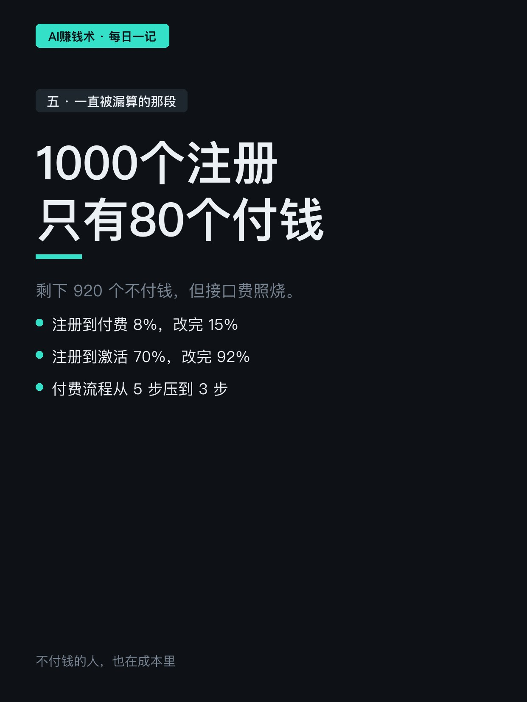
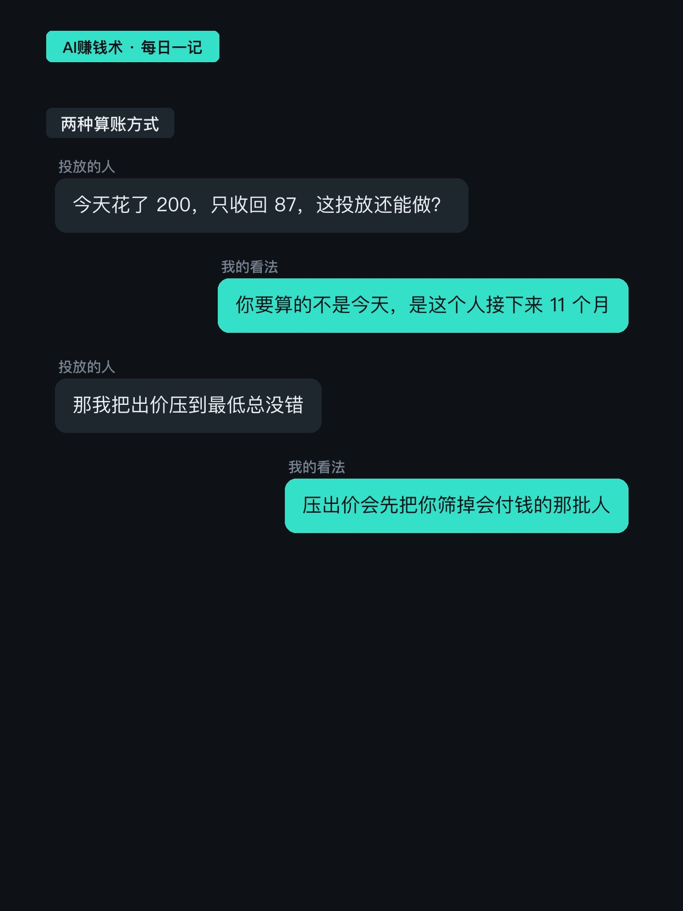
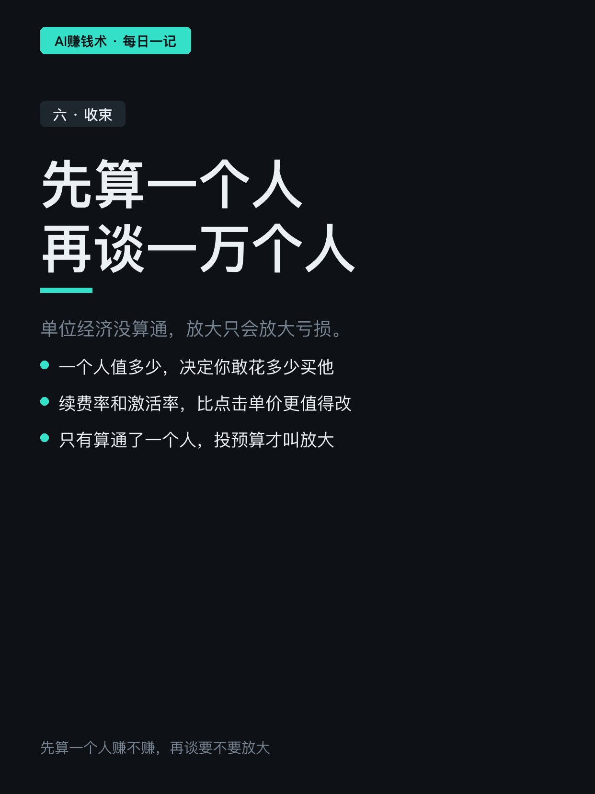

# 花10美元，换回215美元

> — · 2026-11-05 14:01 发布 · AI 赚钱内容

## 标题（可直接复制）

```
花10美元，换回215美元
```

## 正文（可直接复制发布）

他花 10 美元拉来一个付费用户。这个人用了 11 个月，中间还把月付改成了按年付，前后一共付了 215 美元。

客户是做海外图片工具的人，产品每月 29 美元。作者原来做投放和搜索优化，帮他买广告。这个案例最值得看的不是 215 这个数字，是它解释了为什么很多订阅生意一开始的报表都很丑。

一、订阅制不能按一单算

29 美元只是第一个月的收入。第二个月他续不续、能续几个月，当时根本不知道。

所以一开始投 200 美元、当天只回来 87 美元，看着像血亏。但这不是亏损，是样本太小的时候，账面本来就难看。

二、成本也不止广告费

一个用户三个月的总成本是：获客 10 + 接口调用 6 + 支付手续费 3.42，约 19.42 美元。同三个月能收回 57 美元，单用户利润 37.58，第一个月就回本。

还有一段常被漏掉：1000 个注册里只有 80 个付钱，剩下 920 个不付钱，接口费照烧。首月续费率约 65%，100 个付费用户里 35 个第二个月就走了。做完三个关键动作的用户续费率是 82%，一个都没做的只有 38%。

三、有一条线可以提前算出来

规则是获客成本不超过终身价值的三分之一。按六成月付、四成年付加权，终身价值 73.8 美元，除以 3 得 24.6 美元。

所以他的判断是：偶尔飙到 15 美元不用慌，持续超过 25 美元就该紧急刹车。

成本从 40 降到 10，靠的不是压出价，是收窄关键词。带「free」的词吃掉了三成预算，几乎零转化。压出价会先把会付钱的那批人筛掉。还有个更省钱的发现：一位做职业咨询的用户连续订阅 8 个月，中间带来 12 个新付费用户，这 12 个的获客成本是零。老客户的推荐，单价最低。

收尾

单位经济没算通，放大只会放大亏损。

如果你只盯当天收回多少，可以问一句：这个人下个月还会付吗？

## 话题标签

#订阅制 #出海 #单位经济 #AI赚钱术 #AI赚钱术日记

## 配图（8 张）










## 发布信息

| 项 | 值 |
|---|---|
| 平台 | 小红书 |
| 期数 | — |
| 发布时间 | 2026-11-05 14:01 |
| 正文长度 | 785 字 |
| 图片数量 | 8 张 |
| 状态 | 已发布 |
